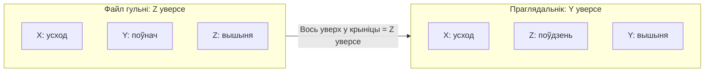

# Восі, адзінкі і час

Гульні і карты не згодныя адносна таго, у які бок «уверх», якая даўжыня адзінкі і як запісваецца час. Гэтая старонка паказвае тры налады, якія робяць так, каб вашы даныя стаялі, мелі правільны маштаб і рухаліся правільна.

Калі ваша карта стаіць, як сцяна, а не ляжыць, як падлога, пераключыце **Вось уверх у крыніцы**.

Пры няправільнай **Вось уверх у крыніцы** карта стаіць, як сцяна; пры правільнай - ляжыць, як падлога.

## Свет, у якім малюе праглядальнік {#the-world-the-viewer-draws-in}

Свет праглядальніка - **Y уверсе**: X і Z - гэта плоскасць зямлі, Y - вышыня. Большасць гульнявых рухавікоў - **Z уверсе**: для іх X і Y - гэта зямля, а Z - вышыня. Некаторыя рухавікі таксама адлюстраваныя (левасторонняя сістэма каардынат). Супастаўленне паказвае, як пераўтварыць восі файла ў восі праглядальніка. (Тэхнічна праглядальнік правасторонні - гэта канвенцыя three.js.)

### Вось уверх {#up-axis}

**Вось уверх у крыніцы** у [Супастаўленні слупкоў](column-mapping.md):

| Налада | Файл (x, y, z) становіцца светам (X, Y, Z) |
|---|---|
| *Z уверсе (большасць гульнявых рухавікоў)* - па змаўчанні | (x, **z**, **y**): Z файла становіцца вышынёй, а Y файла становіцца Z свету |
| *Y уверсе (канвенцыя графікі)* | (x, y, z) без змен |

Для даных з Z уверсе тры масівы перамаркіроўваюцца, а не капіруюцца ([`remapAxesInPlace`](https://github.com/Holdi601/3DHeat/blob/main/src/data/ingest.ts)), што эканоміць сотні мегабайт пры вялікіх загрузках. Здагадка робіцца па ўзоры: уверх ідзе той са слупкоў Y і Z, у якога меншы размах.

### Адлюстраванні {#flips}

**Flip X**, **Flip Y**, **Flip Z** інвертуюць *восю файла* з такой назвай, яшчэ да перамаркіроўкі - таму пры Z уверсе *Flip Y* інвертуе тое, што становіцца Z свету. Адлюстраванне мяняе загружаныя даныя: каардынаты, якія паказвае [лінейка](measure.md), сячэнне і становішча камеры, - гэта адлюстраваныя.

Каб намалюваць адлюстраваны свет правільна, **не** мяняючы даных, выкарыстоўвайце замест гэтага **Camera & scene → Invert world axis** ([Камера](camera.md#invert-world-axis)). Гэта лепшы выбар для гульняў, свет якіх левасторонні, бо кожная каардыната, якую паказваюць інструменты, застаецца ўласнай каардынатай гульні.

### Маштаб адзінак {#unit-scale}

**Маштаб адзінак** памнажае кожную пазіцыю. *1 (m)* ставіць 1, *0.01 (cm→m)* ставіць 0,01 (адзінкі Unreal Engine - сантыметры, таму бярыце 0,01; адзінкі рухавіка Source - цалі, таму бярыце 0,0254; ні тое, ні другое не метры), а поле прымае любое значэнне. Уведзены 0 або значэнне, якое не з'яўляецца лікам, замяняецца на 1.

Праглядальнік падпісвае адлегласці ў метрах (радыус спрайта, адсячэнні па адлегласці, лінейка, хуткасць палёту), і гэта праўда толькі тады, калі маштабаваная адзінка свету - метр. Нічога не ламаецца, калі гэта не так; проста падпісы кажуць «m» для любой адзінкі.

## Час {#time}

### Адзінкі часу {#time-units}

Правіла вялікага пальца: значэнні накшталт 17000000000 (дзесяць або больш лічбаў) - гэта Unix-метка часу; значэнні накшталт 0, 0,25, 0,5 - гэта секунды ад пачатку.

| Адзінка часу (падпіс у меню) | Чытаецца як | Паказваецца гадзіннік |
|---|---|---|
| *Seconds (relative)* | значэнне × 1 с | не |
| *Milliseconds (relative)* | значэнне × 0,001 с | не |
| *Microseconds (relative)* | значэнне × 10^-6 с | не |
| *Nanoseconds (relative)* | значэнне × 10^-9 с | не |
| *Unix timestamp (s)* | секунды ад 1970-01-01 UTC | так |
| *Unix timestamp (ms)* | мілісекунды ад 1970-01-01 UTC | так |
| *ISO-8601 date string* | тэкст накшталт `2026-03-14T18:02:11.250Z`, разбіраецца `Date.parse` браўзера | так |

З абсалютнай адзінкай (апошнія тры) набор даных захоўвае момант насценнага гадзінніка свайго самага раннекага радка, а шкала часу побач з паказальнікам прайгравання паказвае бягучы час UTC (`HH:MM:SSZ`).

**Слупкі Parquet `TIMESTAMP` і `DATE`** дэкадзіруюцца ў сапраўдныя моманты, таму іх налада адзінкі ігнаруецца, і панэль пра гэта кажа. Слупок `DATE` - гэта цэлы дзень: кожны радок дня мае адзін і той жа момант, і прайграванне скача па дні, пра што панэль папярэджвае.

**Радкі ISO-8601 працуюць і ў CSV, і ў Parquet.** Тэкставы слупок часу з адзінкай ISO разбіраецца адзін раз для кожнага розная радка; калі ніводзін не разбіраецца, загрузка падае з паведамленнем *No parseable ISO-8601 timestamps in the mapped time column.* - і супастаўленне ўжо адмаўляецца пачынаць, калі ніводзін з узораў не разбіраецца. Слупок `TIMESTAMP` Parquet чытаецца як метка часу, якая б ні была адзінка, а лікавы слупок Parquet з адзінкай ISO чытаецца як Unix-мілісекунды. Тэкставы слупок часу з лікавай адзінкай адмаўляецца да загрузкі: кожнае значэнне было б NaN.

### Як захоўваецца час {#how-time-is-stored}

Пакуль файлы аб'ядноўваюцца, час - гэта 64-бітавыя секунды, таму абсалютная эпоха захоўвае дробныя долі секунды. Калі ўсе файлы ўжо ўсярэдзіне, самы ранні час усёй выбаркі становіцца 0, і кожны радок захоўвае 32-бітавыя секунды ад яго. 32-бітавае плаваючае мае 24 біты мантысы: прамежкі да прыблізна паўтара дзён дазваляюцца лепш за 1/100 секунды, прамежкі ў паўгода - прыблізна да секунды. Радок, у якога час адсутнічае або не з'яўляецца лікам, ставіцца на 0, на пачатак.

Пасля гэтага радкі сартуюцца па часе, што робіць шкалу часу танной: акно часу знаходзіцца двума бінарнымі пошукамі (гл. [Выбарка і бюджэты](sampling-and-budgets.md)).

### Прайшоўшы час і насценны гадзіннік {#elapsed-time-versus-wall-clock}

Слупок часу, напрыклад `match_time` або `round_time`, лічыць ад уласнага пачатку кожнага матчу. Калі яго абраць, кожны матч апынаецца на адной агульнай восі - добра для параўнання таго, што адбываецца на 3-й хвіліне кожнага матчу, - і панэль на гэта паказвае. Слупок насценнага гадзінніка паказвае матчы ў тым парадку, у якім яны сапраўды адбыліся, перасякаючыся там, дзе перасяклісь.

## Напрамак погляду {#look-direction}

Напрамак погляду выкарыстоўваецца толькі [прайграваннем скрыні](box-replay.md) (промні ад кожнай скрыні). Ён захоўваецца як два вуглы, курс (yaw) і нахіл (pitch), у радыянах.

- **Слупкі курсу / нахілу** чытаюцца як ёсць, пераўтвараюцца з градусаў, калі абрана *Degrees*. Яны не карэктуюцца па восі вверх або па адлюстраваннях.
- **Слупкі вектара напрамку** праходзяць тую ж перамаркіроўку і адлюстраванні, што і пазіцыі, а потым становяцца yaw = atan2(x, -z) і pitch = atan2(y, √(x² + z²)) у восях свету, таму промень паказвае туды, куды глядзіць скрыня, нават у свеце з адлюстраванай крыніцай.

Калі слупкі курсу/нахілу пасля адлюстравання, вектара напрамку або скарэкціраваных вуглоў паказваюць не туды, выпраўленне - гэта вектар напрамку.
