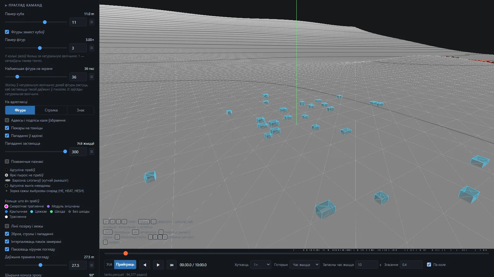

# Накладанне фігур (прайграванне скрыні)

Невялікі фільм: адна фігура на кожную асобу, якая рухаецца, пакуль ідзе час, з следам ззаду.

Рэжым называецца **Накладанне фігур** на панэлі рэжымаў. Раней гэтая старонка называлася «прайграванне скрыні», бо да з'яўлення фігур кожная асоба была скрыняй; «паўтор фігурамі» і «прайграванне скрыні» азначаюць адно і тое ж. **Накладанне фігур** не мае лічбавай клавішы: абярыце яго на панэлі рэжымаў. Ён малюе па адной фігуры (або скрыні) на кожную [асобу](glossary.md), якая рухаецца па [стужцы часу](timeline.md), з неабавязковымі промнямі погляду і следамі. Гэта прайграванне, а не шчыльнасць: *хто дзе быў, калі*. Патрэбны слупок асобы; без слупка часу кожны замер малюецца адразу.

## Як ім карыстацца {#how-to-use-it}

1. Загрузіце даныя са слупком асобы і слупком часу.
2. Абярыце **Накладанне фігур** на панэлі рэжымаў.
3. Пераключыце шкалу часу на **Play** і націсніце прайграванне (`K`).
4. Адкрыйце **Прагляд каманд**, каб змяніць **Даўжыню следу**, памер фігур або промні погляду.

У гэтым рэжыме цяпло не малюецца, а адаптыўны бюджэт спрайтаў не працуе.

Па змаўчанні кожная асоба малюецца як фігура таго, кім яна з'яўляецца, а не скрыняй - гл. [Фігуры](figures.md) пра тое, якую фігуру атрымлівае адзінка, і [Прайграванне матчу](match-replay.md) пра подпісы, камеру пераследу, вымярэнне паміж дзвюма адзінкамі і спіс падзей.

## Панэль Прагляд каманд {#the-team-viewer-panel}

Паказваецца замест панэляў цеплыні ў гэтым рэжыме.

| Рэгулятар | Па змаўчанні | Дыяпазон (маркер) | Значэнне |
|---|---|---|---|
| **Фігуры замест кубоў** | уключана | | Кожная асоба як фігура таго, кім яна з'яўляецца: пяхотнік пешшу, танк або лятальны апарат, названы ў даных. Тое, пра што даныя нічога не кажуць, застаецца скрыняй. |
| **Памер фігур** | 1× | | 1× - сапраўдны памер. |
| **Найменшая фігура на экране** | 36 px | 0 = заўсёды сапраўдны памер | Сапраўдны памер блізка; далей фігуры павялічваюцца, каб заставацца такой даўжыні ў пікселях. |
| **Зброя, стрэлы і пападанні** | уключана | | Зброя ў палёце з дымам, трасіры, удары, пападанні і забойствы. Трасіры, выведзеныя з пападання, пункцірныя. |
| **Памер куба** | памер адзінкі, або размах / 500 пры загрузцы | 0,05-200 м, лагарыфмічна (5000) | Даўжыня рэбра кожнай скрыні. Гл. [памер адзінкі](sessions-persons-groups.md#entity-size). |
| **Інтэрпаляваць паміж замерамі** | уключана | | Паміж двума замерамі той жа асобы ў той жа сесіі размясціць скрыню прапарцыянальна паміж імі. Ніколі праз мяжу сесіі. |
| **Паказваць кірунак погляду** | уключана | | Промень ад кожнай скрыні ў кірунку погляду асобы (патрабуе [слупкоў погляду](axes-units-and-time.md#look-direction)). |
| **Даўжыня праменя погляду** | памер адзінкі × 4, або размах / 200 пры загрузцы | 0,5-500 м, лагарыфмічна (20 000) | Паказваецца, калі ўключаны кірунак погляду. |
| **Даўжыня следу** | 8 с | 0-300 с (86 400); 0 = выключана | Секунды гісторыі, намаляваныя за кожнай асобай. |
| **Маляваць кожны сыры замер** | выключана | | Скрыня на кожны захаваны замер у акне, а не адна інтэрпаляваная скрыня на асобу. Прарэджваецца, каб заставацца інтэрактыўным. |

Падказкі ў панэлі тлумачаць, што інтэрпаляцыя і сляды злучаюць замеры толькі ўнутры адной сесіі, і, калі пры загрузцы ёсць [агульныя імёны](sessions-persons-groups.md#names-worn-by-several-things-at-once), колькі імён намалявана як адзіночныя замеры.

## Сесія, якая прайгравана {#the-session-being-played}

Пры слупку сесіі пікер **Session** уверсе бакавой панэлі ([Сесіі](sessions-persons-groups.md#the-session-picker)) вызначае, які матч прайграецца. Самая актыўная выбіраецца пры загрузцы. Скрынямі і следамі становяцца толькі радкі гэтай сесіі, а шкала часу ідзе па працягласці гэтай сесіі, а не ўсяго набору даных. *All sessions* прайгрывае ўсе сесіі адразу, усё роўна ніколі не злучаючы замеры паміж сесіямі.

## Што малюецца і калі {#what-is-drawn-when}

З [`TrackCursor`](https://github.com/Holdi601/3DHeat/blob/main/src/data/tracks.ts):

**Жывыя скрыні** (рэжым Play, неапрацаваныя замеры выключаны). Для кожнай бачнай асобы - яе апошні замер на паказальніку або раней за яго:

- Калі ў асобы ёсць наступны замер, ён у той жа сесіі, а імя не агульнае, скрыня размяшчаецца паміж двума замерамі прапарцыянальна часу, курс інтэрпалюецца па кароткім шляху, а нахіл - лінейна (пры ўключаным *Інтэрпаляваць*).
- Інакш скрыня застаецца на апошнім замеры на працягу **Запаснога часу жыцця** шкалы часу (па змаўчанні 10 с), а потым знікае, каб выбыўшыя гульцы не заставаліся.

**Рэжым All** ігнаруе паказальнік і малюе кожны замер у дыяпазоне як скрыню.

**Неапрацаваныя замеры** малююць скрыню на захаваны замер у акне: *Span* з гісторыяй *Window*, інакш - усё да паказальніка. Не больш за 65 536 скрынь; калі замераў больш, малюецца кожны *k*-ты.

**Сляды** (калі даўжыня следу больш за 0 і неапрацаваныя замеры не малююцца): лінія паміж кожнымі двума паслядоўнымі замерамі асобы за апошнія *даўжыню следу* секунд да паказальніка, якая згасае ад 80% непразрыстасці да празрыстасці з узростам. След спыняецца на змене сесіі і не малюецца для агульных імёнаў. Не больш за 131 072 вяршыні; калі іх больш, радкі прапускаюцца раўнамерна.

**Хто бачны:** асоба схаваная, калі яе група адзначана як не абраная ў [спісе каманд](teams-list.md) (яе група - група першага радка), калі фільтр групы яе выключае або калі панэль [Сутнасці](entities.md) мае выбар, які яе не ўключае. [Фільтры](filters.md) слупкоў да скрынь не прымяняюцца.

## Колеры {#colours}

Адна гама адценняў на групу і адзін адценне на ўдзельніка, таму адным позіркам відаць, на якім баку хто стаіць ([`teamMemberColor`](https://github.com/Holdi601/3DHeat/blob/main/src/render/colors.ts)). Адценні груп ідуць па пастаяннаму спісу з дзесяці - сіні, чырвоны, зялёны, бурштынавы, фіялетавы, блакітны, пурпурны, лаймавы, аранжавы, індыга - а ўдзельнікі групы размеркаваны па яркасці 42-76% і насычанасці 90-65%.

## Заўвагі {#notes}

- Накладанне фігур перабудоўвае свае фігуры толькі тады, калі нешта змянілася; бяздзейны кадр перамалёўвае апошнія.
- Радок *Cubes* у [накладцы статыстыкі](performance-and-stats.md) лічыць скрыні на экране.
- Накладанне фігур малюецца ў той жа сцэне, што і ўзровень, таму [глыбіня рэзкасці](camera.md#depth-of-field) размывае скрыні, але ніколі не размывае цяпло.
