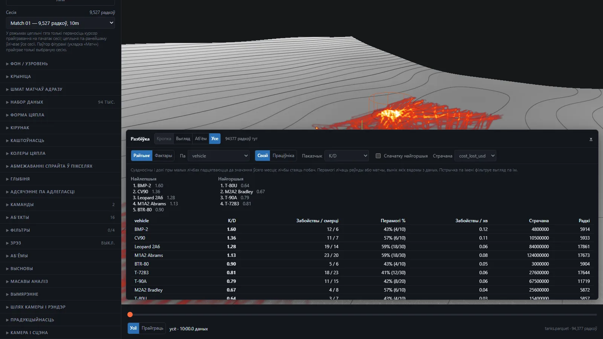
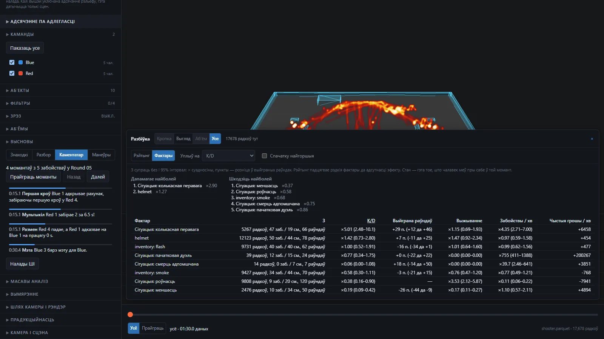

# Разбіўка: хто і што найлепш працуе дзе

**Разбіўка** адказвае на адно пытанне: у гэтым месцы, які транспартны сродак, гулец або зброя працуе лепш за ўсіх? Ёю можна знайсці танк, які перамагае на масту, або праверыць, ці сапраўды шлем дапамагае.

Яна ранжыруе тое, што адбываецца ў адным месцы (абраная кропка, выгляд, аб'ём або ўсё паказанае), па любой катэгорыі, і вымярае кожны фактар стану: з, супраць і без.

## Паспрабаваць {#try-it}

1. Загрузіце матч з забойствамі і смерцямі і адкрыйце **Аб'ёмы**.
2. Намалюйце аб'ём вакол месца, якое вас цікавіць, і абярыце яго.
3. Націсніце **Разбіўка...** у раздзеле Статыстыка.
4. У **Па** абярыце *Vehicle* (транспартны сродак) і меру *K/D* (забойствы на смерць).
5. Чытайце спіс, лепшыя зверху. Націсніце **Спачатку найгоршыя**, каб перавярнуць. Пстрыкніце па назве, каб адфільтраваць выгляд па ёй; пстрыкніце яшчэ раз, каб вярнуць усё.

## Адкрыць {#open-it}

| Адкуль | Вобласць, з якой пачынаецца |
| --- | --- |
| **Разбіўка...** у [Аб'ёмах](volumes.md) (Статыстыка) | абраны аб'ём |
| **Разбіўка тут** на картцы выбару пасля пстрычкі па кропцы | сфера вакол гэтай кропкі (**Радыус**, па змаўчанні 3% памеру даных) |
| раздзельная панэль **Розніца** | выгляд |

Загаловак пераключае вобласць: **Кропка** (Spot), **Выгляд** (View - што бачыла камера пры апошнім пералічэнні; **Пералічыць** пасля перамяшчэння), **Аб'ём** (Volume - абраць адзін) або **Усе** (All). Пералічэнне ідзе ў фоне; радок стану кажа, колькі радкоў у вобласці.

## Ранжыраванне {#ranking}

Абярыце, па чым ранжыраваць, і меру:

| Мера | Што гэта |
| --- | --- |
| A, B | радкі з кожнага боку карты розніцы, падзеленыя так, як іх дзеліць цяпло |
| A / B, A - B, A / (A + B) | два пласты адзін супраць другога |
| K/D | забойствы супраць смерцяў |
| Win % | выйгранае раўнды (або матчы), там, дзе даныя кажуць, хто выйграў |
| Kills / min | колькасць забойстваў у хвіліну прысутнасці (прабелы ў замерах руху) |
| Earned, Lost, Net money | сумы слупкоў `earn_*` і `cost_*`; пікер выбірае валюту |

Забойствы, смерці, прысутнасць, перамогі і грошы ўлічваюць кожны радок, які паказвае выгляд у месцы, з любога боку падзелу або ні з аднаго.

Суадносіны і тэмпы цягнуцца да значэння ўсяго месца там, дзе лічбы малыя, таму 2 забойствы за 1 жыццё не ўзнімаюць запіс уверх спісу. Лічбы паказваюцца побач з імі.

Можна ранжыраваць па групах, гульцах і матчах, па любым слупку катэгорый (транспартны сродак, зброя, бок, тып закупкі, агент або набор), па любым лікавым слупку ў дыяпазонах (броня, вартасць экіпіроўкі), па **класе** слупка зброі (вінтоўка, снайперская, аўтамат, пісталет...) і па тым, колькі прадметаў **утыліты** змяшчае слупок спісу, напрыклад `inventory`.

**Own** ранжыруе па ўласным значэнні радка. **Opponent's** ранжыруе па значэнні другога боку: зброя ахвяры пры забойстве, зброя забойцы пры смерці (патрабуе слупок `other` / `victim`, які іх называе).

## Стан у момант {#state-at-the-time}

Значэнне радка - гэта яго ўласнае, за выключэннем тых выпадкаў, калі радок нічога не запісвае (падзея без экіпіроўкі) або гэта смерць (чый слупок зброі можа назваць зброю забойцы); тады гэта тое, што гэты чалавек меў пры сабе апошнім раней у матчы.

## Фактары: з і без (with, against, without) {#factors-with-against-without}

Пераключыцеся з **Ranking** на **Factors**, абярыце **Уплыў на** і чытайце *Helps most* і *Hurts most*:

Уплыў кожнага фактару на K/D, выйграныя раўнды, выжыванне (хвілін на смерць), забойствы ў хвіліну і чысты грашовы паток у хвіліну, з 95% інтэрвалам: суадносіны як x, выйграныя раўнды як розніца ў ачках. Ранжыраванне цягне кожную ацэнку да адсутнасці ўплыву на велічыню яе ўласнай нявызначанасці, таму рэдкі фактар павінен мець выразны ўплыў, каб трапіць высока; паказаны інтэрвал - гэта неацягнуты.

Даныя з раўндамі дадаюць **сітуацыі** блізкага бою ([Блізкі бой і раўнды](close-quarters.md)), якія разлічваюцца адзін раз для набору даных: *blinded* (`state_flashed` радка або варожая ўспышка на адлегласці 15 м за апошнія 3 с), *death traded* (смерць у абмен), *opening duel* (першы дуэль), і *man up*, *even numbers* або *man down* (гульцы, якія жывыя на баку радка супраць ворага). Смерць лічыцца ў той сітуацыі, у якім была ахвяра непасрэдна перад ёй.

У адным праходзе вымяраецца не больш за 256 фактараў.

## Для распрацоўшчыкаў {#for-developers}

### Выцягванне малых выбарак {#pulling-small-samples}

Значэнне ранжыравання - `(n + m*r0) / (d + m)`: `n` і `d` - лічбы, `r0` - суадносіны ўсяго месца і `m` - вага гэтай апрыёрнай велічыні.

### Для аўтараў канвертараў: называнне слупкоў фактараў {#for-converter-authors-naming-factor-columns}

Канвертар дадае фактар, назваўшы яго слупок:

| Слупок | Фактар |
| --- | --- |
| `state_<name>` лік | уключаны, пакуль не нуль (`state_scoped`, `state_suppressor`) |
| `state_<name>` катэгорыя | адзін фактар на кожнае значэнне (`state_ammo` = AP, HE...) |
| `active_<name>` | тое ж для таго, што было ўключана або выкарыстана нядаўна: здольнасць, ульціматум, гаджэт, узмацненне (`active_ult`, `active_stim`) |
| слупок спісу (`inventory`, `loadout`, `perks`, `abilities`, `attachments`, `modules`, `buffs`, `debuffs`, `upgrades`, або назва `state_`/`active_`, што канчаецца на `s`) | адзін фактар на кожны прадмет у значэнні `a\|b\|c` |
| ужо звычайныя сцяжкі экіпіроўкі (`helmet`, `defuser`, `armor`, `scoped`, `airborne`, `duck`, `flashed`...) | уключаны, пакуль не нуль |
| `ammoType`, `shellType`, `ammoName` | апошні выстралены патрон |

Вынікі: слупок `won` з 0/1 (бок радка выйграў раўнд або матч) і слупок `round` - [слупкі выніку](data-formats.md#outcome-columns); калі файл мае і `won`, і `matchWon`, *Перамогі %* лічыць раўнды. Грошы: `earn_<currency>` і `cost_<kind>_<currency>`; прыбытак толькі па тыпе (`earn_round_cs2`, дакладныя ўзнагароды за раўнд канвертара) замяняе толькі прыбытак гэтага тыпу ў мадэлі кошту (`round` таксама ахоплівае закладкі і разбіранні), а мадэль ацэньвае астатняе.

Супастаўленне само загружае гэтыя слупкі побач са спісам файла: кожны `state_*`, `active_*`, `won`, `round` і слупок спісу, за выключэннем тых, статыстыка файла Parquet якіх паказвае, што яны маюць адно значэнне на ўвесь час (кожны загружаны слупок займае 4 байты на радок).
