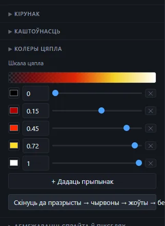

# Колер і экспазіцыя

Гэтыя рэгуляторы вырашаюць, якая колькасць цяпла атрымлівае які колер. **Кропка насычэння** - гэта колькі цяпла лічыцца белым жарам.

## Хуткія выпраўленні {#quick-fixes}

- Усё белае: павялічце **Кропку насычэння** або націсніце **Аўтаэкспазіцыя па полі**.
- Нічога не відаць: паменшыце **Кропку насычэння** або націсніце **Аўтаэкспазіцыя па полі**.
- Відаць толькі некалькі асобных кропак: павялічце **Мінімальнае цяпло**.

Кожны рэгулятар на гэтай старонцы дзейнічае, калі цяплоператвараецца ў колер, таму любы з іх, перацягнуты мышшу, адразу перамалёўвае малюнак і **ніколі не перазапускае накапленне**.

## Кропка насычэння {#saturation-point}

**Кропка насычэння** (раздзел Форма цяпла): накопленае цяпло, якое адпавядае верхняй частцы шкалы колераў (пры рэакцыі *Лінейная*; іншыя - гл. ніжэй). Лагарыфмічны паўзунок 0,1-4000, маркер можна перацягнуць да 10 000 000, бо накопленае цяпло расце з колькасцю радкоў. Значэнне па змаўчанні - 24; пры кожнай загрузцы спачатку ідзе **аналітычная ацэнка**, потым **вымярэнне** з малюнка.

Памылка тут - розніца паміж цеплавой картай і пустым (або белым) экранам, і гэта нельга надзейна вылічыць: тэлеметрыя так моцна скучваецца - спаўн, дзверы, вузкае месца - што суадносіны піка да сярэдняй шчыльнасці мяняюцца на парадак паміж наборамі даных і паміж вугламі камеры.

## Аўтаэкспазіцыя {#auto-exposure}

**Аўтаэкспазіцыя па полі** вымярае поле, якое сапраўды стварыў шэйдар. Яно ігнаруе пустыя пікселі, бярэ 98-ы працэнтыль асветленых і ставіць яго на 85% шляху да кропкі насычэння, таму верхняя частка шкалы захоўваецца для сапраўдных пікаў.

Потым панэль паказвае *вымерана X% кадра; 98-ы працэнтыль R размешчаны блізка да верхняй часткі шкалы*. Пры рэакцыі *З насычэннем* значэнне на 85% ад кропкі насычэння трапляе прыблізна на 57% шкалы, а не на 85%.

Яно таксама запускаецца **аўтаматычна**:

- праз 8 адмалаваных кадраў пасля загрузкі набору даных;
- праз 8 кадраў пасля змены [фільтраў](filters.md) (фільтрацыя кожнай пазіцыі да сотні падзей мяняе шчыльнасць на некалькі парадкаў);
- праз 8 кадраў пасля пераключэння паміж кропкавым цяплом і [цеплам ліній](line-heat.md) або змены маршрутаў, па якіх малюецца цяпло ліній, бо лінія пакідае значна менш цяпла на адзін узор, чым спрайт.

Калі нічога не асветлена, аўтаматычны запуск пакідае насычэнне без змен; кнопка пераходзіць да аналітычнай ацэнкі і паведамляе *нічога не асветлена для вымярэння - выкарыстана аналітычная ацэнка*.

### Сачыць за выглядам {#follow-the-view}

**Сачыць за выглядам** (раздзел Форма цяпла, па змаўчанні ўключана) вымярае зноў кожны раз, калі камера спыняецца, таму вобласць, у якую вы ляціце, выкарыстоўвае ўсю шкалу колераў, а не шкалу, вымераную для ўсёй карты. Малыя змены ігнаруюцца, а шкала плаўна змяняецца, а не скочвае. Гэта працуе ў чатырох рэжымах цяпла, але не ў накладанні фігур.

Зніміце галачку, каб зафіксаваць шкалу і параўноўваць месцы на адной шкале. Перацягванне **Кропкі насычэння** ўручную таксама яе фіксуе.

## Рэакцыя на шчыльнасць {#density-response}

**Рэакцыя на шчыльнасць** - як *k* (цяпло / насычэнне) адлюстроўваецца на шкалу:

| Рэакцыя | Формула | Выкарыстанне |
|---|---|---|
| **З насычэннем** (па змаўчанні) | t = 1 - e^(-k) | Асімптатычна набліжаецца да верхняй часткі шкалы, як складзеныя празрыстыя спрайты. Нічога не абрэзаецца да плоскага белага, таму гэта бяспечны выбар па змаўчанні для незнаёмых даных. |
| **Лінейная** | t = k | Адзінае адлюстраванне, пры якім аднолькавы колер азначае аднолькавую колькасць. Выкарыстоўвайце, каб параўнаць два наборы даных або два часавыя прамежкі. |
| **Лагарыфм** | t = log₂(1 + 7k) / 3 | Сціскае доўгі хвост, таму адзін экстрэмальны гарачы пункт перастае прыціскаць усё астатняе да нізу шкалы. Падымае рэдкія вобласці. |

## Мінімальнае цяпло {#minimum-heat}

**Мінімальнае цяпло** (па змаўчанні выключана, 0-100%): кожны піксель, які мае хоць якое цяпло, падымаецца як мінімум да гэтага пункта шкалы. Павялічце яго і зменшце радыус спрайта, каб убачыць, *дзе хоць раз нешта адбылося* - асобныя пункты даных становяцца выразна бачнымі, а не застаюцца крыху вышэй празрыстага. Пакіньце выключаным, калі ацэньваеце шчыльнасць, бо гэта па задуме выраўноўвае нізы шкалы. Парог (k > 0,0001) утрымлівае сапраўды пустыя пікселі пустымі.

## Рэдактар шкалы {#the-ramp-editor}

У раздзеле **Колеры цяпла**. Яго подпіс кажа, для чаго шкала: *Шкала цяпла* у Цяпле і Лініях, *Дадатная (аддытыўныя каманды)* у Розніцы, *Шкала непразрыстасці (колер бярэцца з групы)* у [Цяпле каманд](team-heat.md), дзе выкарыстоўваецца толькі яе альфа.



Панэль уверсе паказвае шкалу. Пад ёй - адзін радок на кожны прыпынак:

| Частка | Значэнне |
|---|---|
| Колер | Колер прыпынку (выбіральнік колеру браўзэра). |
| Лік | Пазіцыя прыпынку на шкале, ад 0 да 1 (0 = няма цяпла). |
| Паўзунок | Непразрыстасць прыпынку, 0-100%. |
| ✕ | Выдаляе прыпынак; недаступна, калі засталося толькі два. |

**+ Дадаць прыпынак** дадае прыпынак на паўдарозе паміж двума апошнімі, з колерам і непразрыстасцю апошняга прыпынку. **Скінуць да празрысты → чырвоны → жоўты → белы** вяртае значэнне па змаўчанні.

Прыпынкі можна задаваць у любым парадку; іх сартуюць пры пабудове шкалы. **Альфа** - гэта тое, што змешвае цяпло з сцэнай, таму нулявы канец шкалы па змаўчанні цалкам празрысты.

### Шкалы па змаўчанні {#the-default-ramps}

| Пазіцыя | Дадатная (Цяпло, Лініі, Розніца +) | Адмоўная (Розніца −) |
|---|---|---|
| 0,00 | чорны, альфа 0 | чорны, альфа 0 |
| 0,15 | rgb(180, 0, 0), альфа 0,55 | rgb(0, 170, 60), альфа 0,55 |
| 0,45 | rgb(255, 40, 0), альфа 0,85 | rgb(0, 190, 200), альфа 0,85 |
| 0,72 | rgb(255, 220, 40), альфа 0,95 | rgb(40, 80, 255), альфа 0,95 |
| 1,00 | белы, альфа 1 | rgb(170, 60, 255), альфа 1 |

## Пры руху камеры {#while-the-camera-moves}

Калі камера рухаецца, накапленне перазапускаецца кожны кадр. Калі ўключана **Маляваць кожны радок у кожным кадры** (па змаўчанні), кожны рухомы кадр усё роўна дакладны; калі выключана, рухомы кадр паказвае адну ўзоравую ацэнку - яркія, узважаныя плямы - якая збягаецца да больш плаўнай сапраўднай карціны, калі вы спыніцеся. Гэта чакана; гл. [Накапленне](accumulation.md).

## Для распрацоўшчыкаў {#for-developers}

### Праход складання {#the-composite-pass}

Пасля накаплення цяпла значэнне кожнага пікселя ператвараецца ў колер за адзін праход складання ([`COMPOSITE_FS`](https://github.com/Holdi601/3DHeat/blob/main/src/render/webgl2/shaders.ts)). Крокі такія:

```
k = |heat| / saturation point
t = response(k)                         clamped to 0..1
if minimum heat > 0 and k > 0.0001:  t = minimum + (1 - minimum) × t
colour, alpha = ramp(t)                  (the negative ramp when heat < 0, Difference only)
pixel = mix(scene, colour, alpha)
```

### Аналітычная ацэнка {#the-analytic-estimate}

**Аналітычная ацэнка** ([`estimateSaturation`](https://github.com/Holdi601/3DHeat/blob/main/src/data/calibrate.ts)) мяркуе, што радкі раскіданы па плошчы X-Z даных: сярэдняе цяпло = радкі × (π r² / плошча ўчастка) × 1/3 × інтэнсіўнасць у цэнтры (1/3 - сярэдняе па дыску для лінейнага градыенту), памножанае на прыпушчальнае суадносіны піка да сярэдняга 25, абмежаванае 0,1-1 000 000. Ёй трэба толькі быць у межах аднаго парадку.

### Вымярэнне {#metering}

[`exposure.ts`](https://github.com/Holdi601/3DHeat/blob/main/src/render/exposure.ts):

1. цэль цяпла счытваецца назад з GPU, прареджана да не больш за 40 000 значэнняў;
2. пустыя пікселі (цяпло ≤ 0,0001) адкідваюцца - большая частка поля цяпла пустая, і калі ўсереднець іх, усё будзе недаэкспанавана, як камера, накіраваная на чорнае фона;
3. 98-ы працэнтыль асветленых пікселяў - эталон;
4. кропка насычэння становіцца эталон / 0,85, таму эталон знаходзіцца на 85% шляху да кропкі насычэння, а верхняя частка шкалы захоўваецца для сапраўдных пікаў.

### Табліца колераў {#the-colour-table}

Шкала запякаецца ў табліцу RGBA 256 × 2 (дадатная шкала ў першым радку, адмоўная ў другім) ([`buildColorLut`](https://github.com/Holdi601/3DHeat/blob/main/src/render/colors.ts)). Колеры інтэрпалююцца ў лінейным святле і захоўваюцца як sRGB; непразрыстасць інтэрпалюецца лінейна.
