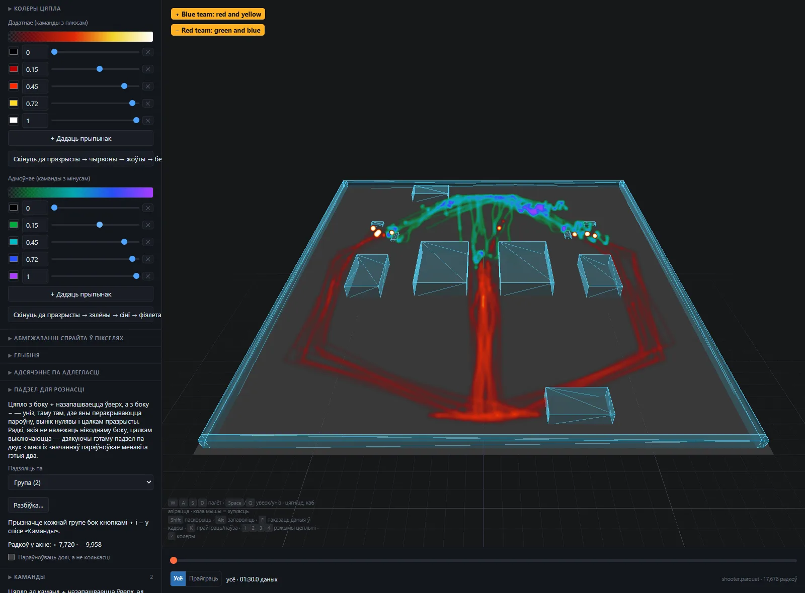

# Розніца

Чырвоным там, дзе каманда A была больш, зелена-сінім там, дзе больш была каманда B, нічога там, дзе яны былі роўныя.

**Розніца** (клавіша 2) - цеплыня са знакам. Радкі адной папуляцыі дадаюць цяпло; радкі другой - адымаюць. Там, дзе дзве папуляцыі перакрываюцца роўна, вынік нулявы і цалкам празрысты; там, дзе адна пераважае, паказваецца колерамі гэтай стараны - па змаўчанні цёплымі (празрысты → чырвоны → жоўты → белы) для стараны **+** і халоднымі (празрысты → зялёны → сіні → пурпурны) для стараны **−**.

## Як карыстацца {#how-to-use-it}

1. Націсніце `2` (або выберыце **Розніца** на панэлі рэжымаў).
2. Адкрыйце **Падзел для рознасці** на бакавой панэлі.
3. Выберыце, што **Падзяліць па**: звычайна *Groups*.
4. Пастаўце адну групу (або значэнне) на **+**, а іншую - на **−**.
5. Чытайце колеры: цёплы азначае старану +, халодны - старану −. Панэль папярэджвае, калі на адной старане няма радкоў (гл. [Паведамленні, якія вы можаце ўбачыць](#messages-you-may-see)).

*Якія* дзве папуляцыі - гэта ўсё пытанне, таму падзел можа быць па любым захаваным слупку, а не толькі па групах. Радкі, якія трапляюць **ні на адну** са старон, **не ўлічваюцца** і не лічацца нулём: менавіта гэта дазваляе падзелу па двух з многіх значэнняў параўноўваць якраз гэтыя два, і ён спалучаецца з [фільтрамі](filters.md) - адфільтруйце да адной карты, потым падзяліце гэта па зборцы.

Рэжыму патрэбныя дзве стараны: слупок групы з не менш чым двума групамі або падзел па слупку, захаваным для фільтрацыі. На данастах з меншай колькасцю груп загрузка пачынаецца з падзелу па слупку - спачатку слупок *Source file* пры загрузцы некалькіх файлаў, потым першы катэгарыяльны слупок з двума значэннямі, потым першы лікавы слупок з дыяпазонам - таму *параўнаць дзве загрузкі* працуе і на даных без груп. Рэжым недаступны, толькі калі няма нічога з гэтага; так жа, калі падзел па слупку пакідае адну старану пустой.

## Панэль Падзел для рознасці {#the-difference-split-panel}

Паказваецца ў рэжыме Розніца, пад панэлямі цяпла.

**Падзяліць па** прапануе:

| Варыянт | Паказваецца як | Правіла падзелу |
|---|---|---|
| Groups | *Group (N)* (калі ёсць слупок групы) | Кожная група на +, − або ні на адной, задаецца ў [Спісе каманд](teams-list.md) |
| Катэгарыяльны слупок | *column (N values)* | Значэнні на +, − або ні на адной |
| Лікавы слупок | *column (numeric)* | Дыяпазон значэнняў для кожнай стараны |
| Файл паходжання | *Source file - compare two loads* (калі загружана некалькі файлаў) | Файлы на +, − або ні на адным |

Прапануюцца толькі слупкі, захаваныя пад *Захаваць для фільтрацыі* пры загрузцы.

### Параўноўваць долі, а не колькасці {#compare-shares-not-counts}

**Параўноўваць долі, а не колькасці** (па змаўчанні выключана) ўзважвае кожную старану на адзінку, падзеленую на ўласную колькасць радкоў, таму старана з удвая большай колькасцю радкоў не перамагае адной лічбай. Колер тады паказвае, дзе кожная старана пропарцыйна часцей, чым другая. Карыстайцеся, калі ў дзвюх старон вельмі розная колькасць даных, напрыклад два сеансы рознай працягласці.

### Папярэджанні, якія вы можаце ўбачыць {#messages-you-may-see}

Панэль папярэджвае, калі малюнак не з'яўляецца сапраўднай рознасцю:

| Паведамленне | Значэнне |
|---|---|
| *N + / M −* (або *N + / M − / K unused*) | Колькі значэнняў на кожнай старане (і на ніводнай). |
| Ні адзін радок у акне не на старане **+** | Малюецца толькі старана **−**. Перамясціце акно стужкі часу або зменіце падзел. |
| Ні адзін радок у акне не на старане **−** | Малюецца толькі старана **+**. |
| Ні адно значэнне не на адной са старон | Розніца нічога не малюе. Пастаўце хоць адно значэнне на **+** або **−**. |
| *column* нельга падзяліць так | Выбраны слупок не падыходзіць да падзелу. Выберыце слупок нанова. |
| Слупок падзелу не ўлез у памяць GPU для N з M частак | Гэтыя радкі не малююцца. Павялічце бюджэт GPU у Прадукцыйнасць → Бюджэты рэсурсаў або загрузіце менш радкоў. |

### Па групах {#by-group}

Панэль проста паказвае на [Спіс каманд](teams-list.md), дзе ў кожнай групы ёсць кнопкі **+** і **−**. Пры кожнай загрузцы першая палова груп (з акругленнем уверх) ідзе на +, астатнія - на −; **Падзяліць пароўну** у Спісе каманд робіць тое ж нанова. Група, якая ні на адной са старон, або схаваная сваім сцяжком, не дае ўкладу.

### Па значэннях катэгорый {#by-category-values}

| Частка | Значэнне |
|---|---|
| `a + / b − / c unused` | Колькі значэнняў на кожнай старане і на ніводнай. |
| **Ачысціць** | Ставіць кожнае значэнне ні на адну старану. |
| Спіс значэнняў | Кожнае значэнне з кнопкамі **+** і **−** (націсніце актыўную кнопку яшчэ раз, каб зняць з гэтай стараны). Пустое значэнне пазначаецца як *(missing)*. |
| Заўвага пра ліміт | Паказваюцца толькі першыя 200 значэнняў: *Showing the first 200 of N values. A column this wide is better narrowed with a filter first, or split by range if its values are ordered.* |

Пры выбары слупка яго першае значэнне ідзе на +, другое - на −. Калі ні на адной старане няма значэнняў, падзел вяртаецца да груп, а не паказвае пусты кадр. *Source file* працуе гэтак жа, па значэнні на файл - так параўноўваюць два экспарты, два выпрабавальныя запускі або дзве зборкі.

### Па дыяпазоне {#by-range}

| Частка | Значэнне |
|---|---|
| Падказка | Мінімум і максімум слупка. |
| **Дадатны дыяпазон (+)**, **ад** / **да** | Радкі са значэннем у гэтым дыяпазоне, уключна з абодвух бакоў, дадаюцца. |
| **Адмоўны дыяпазон (−)**, **ад** / **да** | Радкі ў гэтым дыяпазоне адымаюцца. |
| **Падзяліць па сярэдзіне** | Ставіць + на [мінімум, сярэдзіна], а − на [сярэдзіна, максімум] - тое ж, што робіць выбар слупка. |

Значэнне ў абодвух дыяпазонах лічыцца +. Дыяпазоны не абавязаны пакрываць слупок; значэнні ні ў адным не ўлічваюцца. *Першыя дзве хвіліны супраць апошніх дзвюх* - гэта падзел па дыяпазоне на слупку, падобным да часу.

## Колеры {#colours}

Раздзел **Колеры цяпла** у гэтым рэжыме паказвае два рэдактары шкалы: **Дадатнае (каманды з плюсам)** і **Адмоўнае (каманды з мінусам)**, кожны са сваёй кнопкай скіду (*Скінуць да празрысты → чырвоны → жоўты → белы*, *Reset to transparent → green → blue → purple*). Кампазіцыя бярэ абсалютнае значэнне чыстай цеплыні праз [кропку насычэння і водгук](colour-and-exposure.md), і выбірае адмоўную шкалу там, дзе чыстае значэнне меншае за нуль. Гл. [Колер і экспазіцыя](colour-and-exposure.md#the-ramp-editor).

Выкарыстоўвайце водгук *Linear*, калі важны памер розніцы: гэта адзіны водгук, пры якім аднолькавы колер азначае аднолькавую колькасць.

## Як гэта працуе {#how-it-works}

Кожны радок атрымлівае знак +1, -1 або 0 у вершынным шэйдэры ([`POINT_HEAT_VS`](https://github.com/Holdi601/3DHeat/blob/main/src/render/webgl2/shaders.ts)); 0 адкідае радок да малявання любога фрагмента.

- Па групах знак бярэцца з табліцы груп на 4,096 запісаў, індэксаванай па ідэнтыфікатары групы радка (ідэнтыфікатар групы ідзе ў чацвёрты канал тэксела пазіцыі радка).
- Па катэгорыі знак бярэцца з другой табліцы на 4,096 запісаў, запоўненай для кожнага значэння катэгорыі, а значэнне радка чытаецца з тэкстуры фільтра слупка; значэнне за межамі табліцы адкідаецца на абодвух бэкэндах.
- Па дыяпазоне значэнне радка параўноўваецца з двума дыяпазонамі.

Змена падзелу перазапускае накапленне.

**Схаваныя групы застаюцца схаванымі пры любым падзеле.** Пры падзеле па слупку табліца груп больш не нясе знакаў; яна мае 1 для паказанай групы і 0 для схаванай ([`frameSignTables`](https://github.com/Holdi601/3DHeat/blob/main/src/render/filterTables.ts)), і абедзве табліцы трапляюць у шэйдэр разам - два радкі адной тэкстуры знакаў на WebGL2, дзве паловы аднаго буфера захоўвання на WebGPU. Радок малюецца толькі тады, калі яго група паказана *і* яго значэнне слупка на нейкай старане. Таму група, знятая ў [Спісе каманд](teams-list.md), або выключаная сторонай фокусу ўкладкі Матч, не дае ўкладу, як бы ні падзяляць розніцу.
