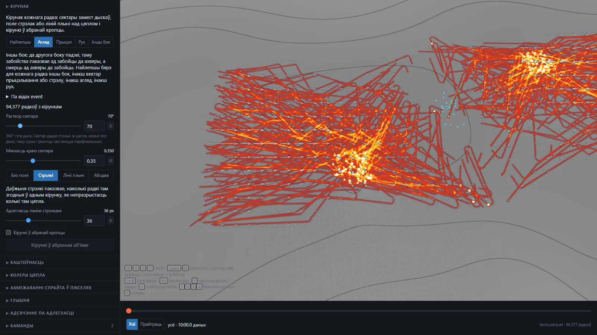

# Направленая цеплыня

Звычайная цеплыня паказвае **дзе** адбываюцца рэчы. Направленая цеплыня таксама паказвае **у які бок**: у які бок людзі глядзелі, цэлілі, рухаліся або дзе была другая бок бойкі.

Звычайны спрайт - гэта поўны дыск (360 градусаў). Пры **Раствор сектара** 70 градусаў той жа спрайт становіцца вузкім клінам, які паказвае, у які бок быў павернуты радок, і дадае тую ж агульную цеплыню.

## Як ёй карыстацца {#how-to-use-it}

1. Загрузіце даныя, у якіх ёсць напрамак (гл. [Што дае радку напрамак](#what-gives-a-row-a-direction)).
2. Абярыце **Цеплыня**, **Розніца** або **Каманды** на панэлі рэжымаў.
3. Адкрыйце раздзел **Кірунак** у бакавой панэлі.
4. Абярыце **крыніцу** (які напрамак браць), потым уключыце малюнак:
   - панізьце **Раствор сектара** ніжэй за 360°, каб малаваць кожны радок як клін, які паказвае ў свой бок, а не як дыск;
   - абярыце **Поле**, каб намаляваць стрэлкі або лініі плыні паверх цяпла;
   - пастаўце галачку **Кірункі ў абранай кропцы** і пстрыкніце па цяпле, каб атрымаць палярную дыяграму гэтай кропкі.

Радок стану кажа, колькі радкоў маюць напрамак з абранай крыніцы.

## Налады {#settings}

| Налада | Па змаўчанні | Што робіць |
|---|---|---|
| Крыніца: **Найлепшыя**, **Выгляд**, **Прыцэл**, **Рух**, **Іншы бок** | Найлепшыя | Які напрамак атрымлівае кожны радок. *Найлепшыя* для кожнага радка бярэ іншы бок, інакш прыцэл, інакш выгляд, інакш рух. |
| **Па віду падзеі** | як вышэй | Іншая крыніца для кожнага віду падзеі, напрыклад *Іншы бок* для забойстваў і *Выгляд* для пазіцый. Паказваецца, калі ў даных ёсць слупок падзей з не больш чым 40 значэннямі. |
| **Раствор сектара** | 360° | 360° - звычайны дыск (выключана). Меншае - вузейшы клін. Клін дадае столькі цяпла, колькі яго дыск, таму агульныя суммы і розніцы застаюцца параўнальнымі. |
| **Мяккасць краю сектара** | 0,35 | 0 - клін з вострым краем, 1 - мяккі веер. |
| **Поле**: No field, Arrows, Streamlines, Both | No field | Arrows: даўжыня стрэлкі - гэта, наколькі радкі ў гэтым месцы згодныя ў адным напрамку; яе непразрыстасць - колькі там цяпла. Стрэлкі паказваюцца толькі там, дзе ёсць цяпло. |
| **Адлегласць паміж стрэлкамі** | 28 px | Адлегласць паміж стрэлкамі на экране. |
| **Анімаваць лініі плыні** | уключана | Лініі плыні цякуць, пакуль уключана. |
| **Кірункі ў абранай кропцы** | выключана | Пстрыкніце па цяпле, каб убачыць напрамкі там (гл. ніжэй). |
| **Кірункі ў абраным аб'ёме** | | Тая ж дыяграма для ўсяго ўнутры абранага [аб'ёму](volumes.md). |

## Палярная дыяграма ў кропцы {#the-polar-chart-at-a-spot}

Пры ўключаным **Кірункі ў абранай кропцы** пстрыкніце па цяпле. Радкі побач з гэтай кропкай (у межах 1,5 радыуса спрайта) збіраюцца ў ружу з 24 секцый па 15°:

- **аранжавыя** пялёсткі: выходныя напрамкі (куды паказваюць радкі);
- **сінія** пялёсткі: уваходныя напрамкі (адкуль яны прыйшлі);
- **плошча** пялёстка расце з яго лікам; стрэлка паказвае асноўны напрамак;
- лініі пад дыяграмай даюць асноўны пеленг, наколькі моцна радкі згодны (R, ад 0 да 1), размах у градусах і колькасць радкоў.

0° уверсе дыяграмы - гэта свет −Z (поўнач для запісаў Tacview). Кропка таксама адзначана ў трохмерным выглядзе стрэлкай і кольцам.

## Што дае радку напрамак {#what-gives-a-row-a-direction}

| Крыніца | Патрэбна ў даных |
|---|---|
| Выгляд | слупок курсу (адлюстроўваецца як напрамак погляду): `yaw`, `heading`, `azimuth`, `view_yaw`, `rot_z` |
| Прыцэл | пары лікаў, напрыклад `aim_x`/`aim_y`, `shot_x`/`shot_y`, `fire_x`/`fire_y`, `hit_dir_x`/`hit_dir_y` (неабавязковы `…_z`) |
| Рух | нічога дадатковага: крок ад папярэдняга замеру той самай асобы (не больш чым за 10 с раней, у той жа сесіі) |
| Іншы бок | слупок, які называе другі бок падзеі (`other`, `victim`, `target`, `killer`, `attacker`, `shooter`, `other_player` ...), значэнні якога - імёны асоб; забойства паказвае ад забойцы да ахвяры, смерць - ад ахвяры да забойцы |

## Парады {#tips}

- Клінам патрэбны пэўны памер на экране; ніжэй за некалькі пікселяў іх зноў малююць як дыскі.
- Выкарыстоўвайце *Іншы бок* на радках забойстваў, каб бачыць, **адкуль** выйгравалі бойкі, і *Выгляд* на радках пазіцый, каб бачыць, **куды глядзяць людзі**.
- З **Розніцай** клінам дзвюх бакоў паказваюць у свае ўласныя напрамкі, таму спрэчныя лініі агню выдзяляюцца.
