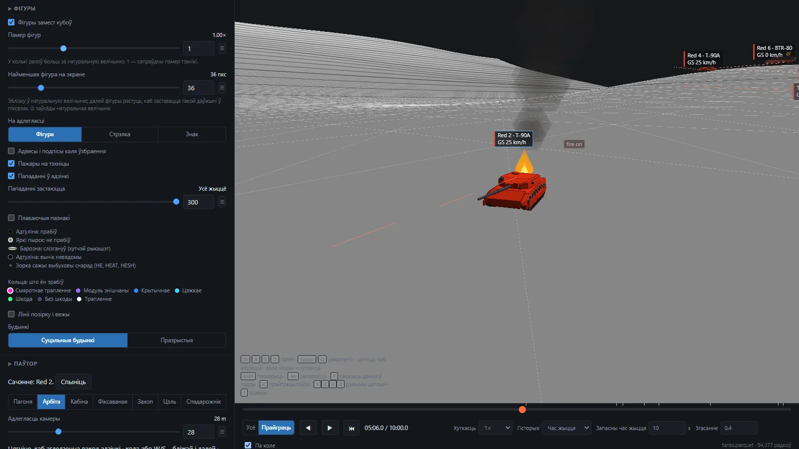

# Фігуры

**Фігура** — гэта маленькая 3D-мадэль таго, чым адзінка насамрэч з'яўляецца: танк, рэактыўны самалёт, карабель, салдат. [Прайграванне](match-replay.md) малює кожную адзінку як яе фігуру ў сапраўдным памеры, а не простым кубам.

Ёсць каля 2 000 названых транспартных сродкаў, самалётаў, караблёў, узбраення і салдат, зробленых самім праглядальнікам.

## Што ёсць у каталогу {#what-is-in-the-catalogue}

| Галіна | Прыклады |
|---|---|
| Людзі | салдат стаіць, прысеў, ляжыць; снайпер, процітанкавы, санітар, экіпаж |
| Зямля | танкі, баявыя машыны пяхоты, зенітная артылерыя, артылерыя, грузавікі і легкавыя машыны, цягнікі і трамваі |
| Паветра | знішчальнікі, штурмавікі, бамбардзіроўшчыкі, транспартныя самалёты, верталёты: ад біпланаў да сучасных рэактыўных |
| Мора | ваенныя караблі па класах, авіяносцы, падводныя лодкі, катэры, гандлёвыя судны |
| Узбраенне | ракеты, снарады-ракеты, бомбы, тарпеды, пасткі і дыпольныя адбіткі |
| Маркеры | дым, успышка і запальныя гранаты, закладзеныя бомбы, сцягі, спаўны, пункты маршруту |

## Як робяцца фігуры {#how-the-figures-are-made}

- **Пабудаваны па апублікаваных памерах.** Большасць фігур робіць уласны будавальнік фігур праглядальніка па публічных лікавых: даўжыня, шырыня, вышыня, колы, башня і гармата, крылы і хвост. Іх форму потым тонка налажаджваюць па публічных фотаздымках, рысунках і апублікаваных памерах. Мадэлі гульняў не выкарыстоўваюцца.
- **Бясплатныя мадэлі.** Некаторыя фігуры выкарыстоўваюць бясплатныя 3D-мадэлі (CC0 або CC BY), там, дзе яны праўдзівейшыя, часам разам з пабудаваным корпусам. Аўтары твораў CC BY пералічаны на [Аўтары фігур](figure-credits.md); творы CC0 не патрабуюць згадвання і там не пералічаны.
- Кожная фігура мае поўную, грубую і далёкую версію (узроўні дэталізацыі, LOD), таму іх могуць малявацца тысячы адначасова.

## Якую фігуру атрымлівае адзінка {#which-figure-a-unit-gets}

Праглядальнік глядзіць на ўласныя слупкі даных:

1. **Назвы** — слупкі *Name*, *Vehicle*, *Unit*, *Unit type*, *Model*, *Aircraft*, *Plane*, *Tank*, *Ship*, *Craft*, *Loadout*, *Kit* або *Figure* — супастаўляюцца з каталогам: дакладна, праз каля 4 000 псеўданімаў (ідэнтыфікатары адзінак некалькіх гульняў), па самым доўгім вядомым пачатку (`F-16C_50` — гэта F-16C) або па самай кароткай назве фігуры, якая пачынаецца з яе.
2. Назва, фігура якой не падыходзіць да **тыпу** адзінкі, не выкарыстоўваецца (грузавік з назвай *Typhoon* — гэта не знішчальнік).
3. **Тыпы** — слупкі *Type*, *Class*, *Kind*, *Category*, *Icon*, *Role* або *Domain* — даюць фігуру класа: тэгі Tacview (`Air+FixedWing`, `Ground+Heavy+Armor+Vehicle+Tank`, `Sea+Watercraft+Warship`, `Weapon+Missile`), значкі карты або простыя словы (tank, helicopter, infantry — танк, верталёт, пяхота).
4. Даныя без аднаго з гэтых слупкоў — гэта даныя людзей: кожны — салдат.

Значыць, найпрасцейшы спосаб атрымаць правільныя фігуры — слупок `vehicle` з сапраўднымі назвамі або слупок `type` з тэгамі Tacview.

**Мая адзінка паказваецца як куб або салдат.** Дадайце слупок `vehicle` з сапраўднай назвай або слупок `type` з тэгам Tacview. Навядзіце курсор на адзінку, каб убачыць, якая назва супала. Даныя, у якіх ёсць такія слупкі, але нічога не кажуць пра адзінку, пакідаюць яе кубам; даныя без такіх слупкоў малююцца як салдаты.

## Налады {#settings}

Раздзел **Фігуры** на бакавой панэлі прайгравання задае памер, найменшы памер на экране, тое, кім становяцца далёкія адзінкі (фігура, стрэлка, сімвал), і эфекты, якія малююцца на іх. Гл. [Прайграванне матчу](match-replay.md#figures). Дым, агонь і іншыя эфекты з часам: [Фігуры ў накладанні фігур](figure-replay.md).

## Неабавязковы лакальны пакет фігур {#an-optional-local-figure-pack}

Вы можаце трымаць неабавязковы пакет уласных фігур на сваім камп'ютары. Яго фігуры займаюць месца фігур каталога з тымі ж назвамі. Ён ніколі не з'яўляецца часткай рэпазіторыя або апублікаванай зборкі; без яго нічога не мяняецца.
