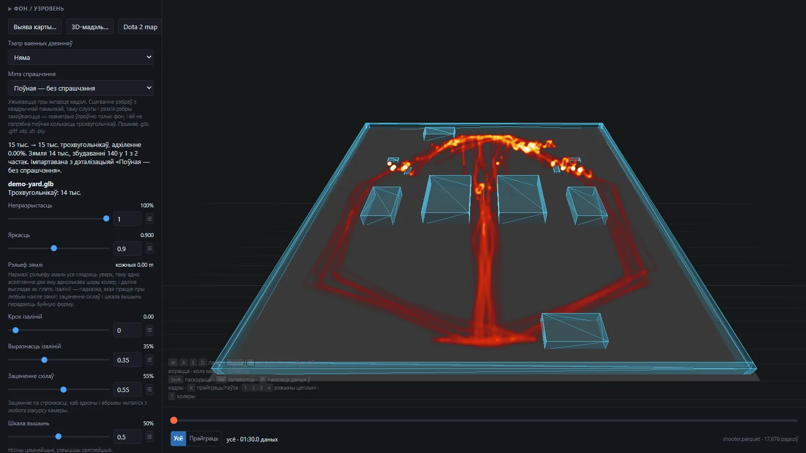
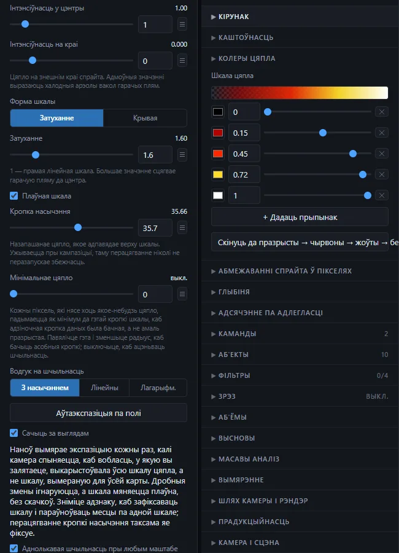

# Цяпло

Цеплавая карта фарбуе месцы, дзе адбылося шмат рэчаў: чырвоным там, дзе адбылося трохі, і бела-гарачым там, дзе адбылося шмат. Яна адказвае на пытанне «дзе гэта адбываецца і колькі разоў».

**Цеплыня** (клавіша 1) - рэжым па змаўчанні. Кожны бачны [радок](glossary.md) дае круглы [спрайт](glossary.md), які глядзіць на камеру; накладзеныя спрайты дадаюцца ў плаваючы буфер; сума праходзіць праз шкалу колераў - па змаўчанні празрысты → чырвоны → жоўты → белы - і малюецца паверх сцэны.

Малюнак паказвае цяпло раунда шутэра на ўзроўні з будынкамі: гарачыя пляцоўкі - у пакоях і на лесвіцах, а не толькі на зямлі.

## Як карыстацца {#how-to-use-it}

1. Загрузіце даныя і націсніце `1` (або выберыце **Цеплыня** на панэлі рэжымаў).
2. Калі ўсё белае або пустое, націсніце **Аўтаэкспазіцыя па полі** у раздзеле **Форма цяпла**.
3. Мяняйце **Радыус спрайта**, пакуль суседнія кропкі не зліюцца ў пасы: меншы паказвае асобныя плямы, большы - вобласці.
4. Адкрыйце **Колеры цяпла**, каб змяніць колеры, або **Глыбіня**, каб пагоркі і сцены хавалі цяпло за сабой.

Тыя ж панэлі фармуюць [Розніцу](difference.md), [Каманды](team-heat.md) і [Лінейную цеплыню](line-heat.md); яны адрозніваюцца тым, што дадаецца (са знакам, афарбаванае або ўздоўж ліній), а не тым, як гэта рабіцца.

## Панэлі і іх значэнні па змаўчанні {#the-panels-and-their-defaults}

Кожнае кіраванне ніжэй адпавядае параметру шэйдэра, таму змяненне каштуе толькі перамалёўкі. Паўзункі маюць тэкставае поле побач і ручку перацягвання (маленькі захоп справа: цягніце ўверх або ўніз, далей - хутчэй, Shift для дакладнай настройкі); там, дзе трэк паўзунка заканчваецца раней за сапраўдную мяжу, ручка можа выйсці за яго да *мяжы прыпынку*, пададзенай тут. Значэнні з пазнакай *on load* пералічваюцца для кожнага новага набору даных.

### Форма цяпла (адкрыта) {#heat-shape-open}

| Кіраванне | Па змаўчанні | Дыяпазон (мяжа прыпынку) | Падрабязнасці |
|---|---|---|---|
| **Радыус спрайта** | 6 м; on load: памер / 120 | 0.05-2000 м, лагарыфмічна (50,000) | [Форма спрайта](sprite-shape.md#sprite-radius) |
| **Інтэнсіўнасць у цэнтры** | 1 | 0-10 (1000) | [Форма спрайта](sprite-shape.md#centre-and-edge-intensity) |
| **Інтэнсіўнасць на краі** | 0 | -2-10 (1000) | [Форма спрайта](sprite-shape.md#centre-and-edge-intensity) |
| **Форма шкалы** | *Затуханне* | *Затуханне* / *Curve* | [Форма спрайта](sprite-shape.md#ramp-shape-falloff-or-curve) |
| **Затуханне** (толькі пры Затуханні) | 1.6 | 0.1-8 (64) | [Форма спрайта](sprite-shape.md#falloff) |
| **Плаўная шкала** (толькі пры Затуханні) | уключана | | [Форма спрайта](sprite-shape.md#falloff) |
| Рэдактар крывой (толькі Curve) | пераход *Smooth* | | [Форма спрайта](sprite-shape.md#the-curve-editor) |
| **Кропка насычэння** | 24; on load - ацэнка, потым вымярэнне | 0.1-4000, лагарыфмічна (10,000,000) | [Колер і экспазіцыя](colour-and-exposure.md#saturation-point) |
| **Мінімальнае цяпло** | выключана (0) | 0-100% | [Колер і экспазіцыя](colour-and-exposure.md#minimum-heat) |
| **Водгук на шчыльнасць** | *Saturating* | *Saturating* / *Linear* / *Log* | [Колер і экспазіцыя](colour-and-exposure.md#density-response) |
| **Аўтаэкспазіцыя па полі** | | кнопка | [Колер і экспазіцыя](colour-and-exposure.md#auto-exposure) |
| **Сачыць за выглядам** | уключана | | Заново вымервае экспазіцыю кожны раз, калі камера спыняецца, таму вобласць, у якую вы ляціце, выкарыстоўвае ўсю шкалу колераў. Дробныя змены ігнаруюцца, а маштаб плаўна змяняецца. Адключыце або перацягніце **Кропка насычэння**, каб зафіксаваць маштаб і параўноўваць месцы на адной шкале. [Колер і экспазіцыя](colour-and-exposure.md#follow-the-view) |
| **Аднолькавая шчыльнасць пры любым маштабе** | уключана | | Колер азначае адну і тую ж колькасць радкоў на плошчу зямлі, як бы блізка вы ні былі. Спрайт, якога мяжы пікселяў павялічваюць (здалёк) або памяншаюць (зблізку), захоўвае цяпло, якое дало б яго сапраўдны памер, таму карцінка, экспанаваная здалёк, не блякне, калі ў яе ляціш. Калі выключана, спрайт з мяжой дае поўную вагу ў сваім абмежаваным памеры. [Форма спрайта](sprite-shape.md#pixel-clamps) |
| **Спраецыраваць на плоскасць зямлі** | выключана | | [Форма спрайта](sprite-shape.md#flatten-onto-ground-plane) |

### Колеры цяпла (закрыта) {#heat-colours-closed}

| Кіраванне | Па змаўчанні | Падрабязнасці |
|---|---|---|
| Колеравыя квадраты груп і **Падзел колераў** (толькі Каманды) | 1.4 | [Каманды](team-heat.md) |
| Рэдактар **Шкала цяпла** (*Дадатнае (каманды з плюсам)* у рэжыме Розніца, *Шкала непразрыстасці* у рэжыме Каманды) | празрысты → чырвоны → жоўты → белы | [Колер і экспазіцыя](colour-and-exposure.md#the-ramp-editor) |
| **Скінуць да празрысты → чырвоны → жоўты → белы** | | |
| Шкала **Адмоўнае (каманды з мінусам)** (толькі Розніца) | празрысты → зялёны → сіні → пурпурны | [Розніца](difference.md#colours) |

### Мяжы пікселяў спрайта (закрыта) {#sprite-pixel-clamps-closed}

| Кіраванне | Па змаўчанні | Дыяпазон (мяжа прыпынку) | Падрабязнасці |
|---|---|---|---|
| **Мін. радыус у пікселях** | 1 px | 0-16 (512) | [Форма спрайта](sprite-shape.md#pixel-clamps) |
| **Макс. радыус у пікселях** | 96 px | 2-1024, лагарыфмічна (8192) | [Форма спрайта](sprite-shape.md#pixel-clamps) |

### Глыбіня (адкрыта) {#depth-open}

| Кіраванне | Па змаўчанні | Падрабязнасці |
|---|---|---|
| **Хаваць за рэльефам** | уключана | [Глыбіня і адсячэнне](depth-and-culling.md#hide-behind-terrain) |
| **Схаванае за геаметрыяй** | 0.8 (*на 80% цямней*) | [Глыбіня і адсячэнне](depth-and-culling.md#hidden-behind-geometry) |

### Адсячэнне па адлегласці (закрыта) {#distance-culling-closed}

| Кіраванне | Па змаўчанні | Дыяпазон (мяжа прыпынку) | Падрабязнасці |
|---|---|---|---|
| **Блізка** | выключана (0) | 0.5-5000 м, лагарыфмічна, унізе трэка = выключана (200,000) | [Глыбіня і адсячэнне](depth-and-culling.md#distance-culling) |
| **Далёка** | выключана (0) | 1-200,000 м, лагарыфмічна, унізе = выключана (10,000,000) | [Глыбіня і адсячэнне](depth-and-culling.md#distance-culling) |
| **Рэзаць плоскасцю** | уключана | | [Глыбіня і адсячэнне](depth-and-culling.md#distance-culling) |
| **Рэзаць і ўзровень** | уключана | | [Глыбіня і адсячэнне](depth-and-culling.md#distance-culling) |

Клавішы: `[` і `]` адсоўваюць і адсоўваюць far-мяжу, `\` перамыкае яе ([Глыбіня і адсячэнне](depth-and-culling.md#keyboard)).

### Direction і Value {#direction-and-value}

Яшчэ два раздзелы ідуць пад Форма цяпла. **Кірунак** малюе кожны радок як клін і дадае стрэлкі: гл. [Направленая цеплыня](directional-heat.md). **Значэнне** ўзважвае цяпло па тым, што кожны радок каштаваў або прынёс: гл. [Узважванне значэнняў](value-weighting.md).

## Што захоўваецца {#what-is-saved}

Налады цяпла вышэй не захоўваюцца паміж сеансамі: перазагрузка старонкі вяртае значэнні па змаўчанні. Два элементы захоўваюцца ў браўзеры: апошняя хуткасць прайгравання (`heat3d.speed`, гл. [Стужка часу](timeline.md)) і налады далёкіх фігур [накладання фігур](box-replay.md) (стыль сімвалаў, памер, адзнакі пападанняў і гэтак далей). Таксама захоўваюцца мова, [інвертаваныя восі свету](camera.md#invert-world-axis), запамятаныя назвы аўтамабіляў укладкі гонак і [бібліятэка ўзроўняў](level-library.md). Поўны спіс - на [Захаваныя налады](ref-settings-storage.md).
