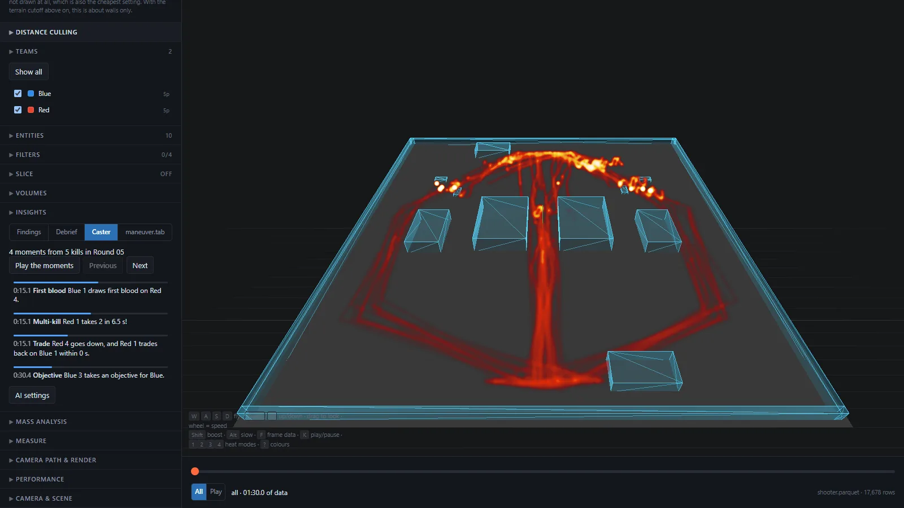

# Высновы

**Insights** шукае ў загружаных даных тое, што выдзяляецца, - моцныя пазіцыі, смяротную мясцовасць, пасткі пры нараджэнні, вузкія месцы, гульцоў, значна вышэйшых за аднагодкаў - і кажа вам, ад самага моцнага, з доказамі. Выкарыстоўвайце, каб за хвіліну даведацца, дзе матч выйгралі або прайгралі. Потым ён можа напісаць разбор, а ў адным паўторы - дзейнічаць як каментатар, які пераходзіць да вялікіх момантаў.

Усё падлічваецца ў вашым браўзеры. Нічога не пакідае ваш кампутар, калі не ўключаць знешні ШІ (гл. [Знешні ШІ](#external-ai)).

Раздзел **Insights** знаходзіцца на бакавой панэлі ўкладак Цеплавая карта і Матч. Ён мае тры ўкладкі: **Знаходкі**, **Разбор** і **Каментатар**.

## Знаходкі {#findings}

1. Загрузіце даныя і адкрыйце **Insights**. Націсніце **Знайсці высновы** (»Падлік… n%» паказвае прагрэс).
2. Прачытайце спіс. Кожная знаходка мае паласу моцы, сказ, якасць доказаў (*Strong evidence*, *Good evidence* або *Some evidence*), дэтэктар, які яе знайшоў, і клас тэхнікі, калі гэта важна.
3. **Націсніце на знаходку**: праглядальнік ставіць яе фільтры, ляціць камерай да месца і скача да часу, а таксама адкрывае падрабязнасці: эфект з 95% інтэрвалам, значэнні p і q, падлічаныя доказы і **Volume here**, які малюе [аб'ём](volumes.md) вакол месца.
4. **Вярнуць фільтры** вяртае вашыя фільтры. **Copy JSON** капіюе ўвесь справаздачу.

Падлік выкарыстоўвае бягучыя фільтры, схаваныя групы і абраны матч за ўвесь прамежак часу. Калі вы потым змяняеце фільтры, з'яўляецца нататка пра гэта; націсніце **Пералічыць**.

Радкі ўверсе спіса (напрыклад, сумы грошай) падсумоўваюць усе даныя перад знаходкамі.

### Дэтэктары {#the-detectors}

| Дэтэктар | Што знаходзіць | Што патрэбна ў даных |
|---|---|---|
| **Power positions** | Месцы з значна лепшымі каэфіцыентамі забойстваў на смерць, чым у астатняй карце, і *бяспечную зямлю*, дзе гінуць мала на час, праведзены там | падзеі забойстваў і смерцяў |
| **Hot and cold zones** | Месцы, дзе падзея (стрэлы, пападанні, захопы ...) адбываецца значна часцей або радзей, чым прадказвае час, праведзены там | слупок падзей |
| **Open ground and cover** | Смерці на адкрытым месцы супраць блізкай геаметрыі ўзроўню, і павольна супраць хуткага руху | смерці; 3D-ўзровень для часткі геаметрыі |
| **Spawns** | Моцныя пункты нараджэння, пасткі, бяспечныя пункты, час да першага кантакту | час і асобы |
| **Class by place** | Клас тэхнікі, або гульцы супраць ШІ, які значна лепш або горш дзейнічае ў вобласці | забойствы плюс слупок класа тэхнікі або гульцы/ШІ |
| **Players** | Гульцы, якія забіваюць або гінуць значна больш або менш за іншых у тым самым класе | асобы і забойствы |
| **Chokes and flanks** | Вузкія месцы (значна больш пераходаў, чым вакол) і флангавыя шляхі (рэдка выкарыстоўваюцца, але вядуць да забойстваў) | асобы |
| **Value** | *Costly ground* і *Earning ground* | [слупкі значэнняў](value-weighting.md) |

Дэтэктары, якія не могуць працаваць на даных, пералічаны ўнізе з прычынай.

### Як ранжыруюцца знаходкі {#how-findings-are-ranked}

Кожнае месца або група правяраецца супраць астатняй карты (дакладны біномны тэст або тэст стаўкі). Частка ілжывых адкрыццяў трымаецца на 5% (Benjamini-Hochberg). Выпадковасць можа выглядаць як заканамернасць; гэта трымае ілжывыя трывогі на нізкім узроўні: сярод паказаных знаходак чакаецца не больш за адну з дваццаці выпадковай. Эфекты з невялікай колькасцю падзей сціскаюцца да «няма эфекту» перад ранжыраваннем. Паказваецца не больш за 60 знаходак, і кожны дэтэктар атрымлівае некалькі месцаў у верхняй частцы.

## Разбор {#debrief}

Укладка **Разбор** запісвае знаходкі ў кароткі тэкст: уступ, самую яснаю знаходку, адну для тактыкі, адну для балансу, астатнія, згрупаваныя па дэтэктары, і колькі з іх грунтуюцца на слабейшых доказах. Кожны абзац мае пранумараваныя кнопкі, якія паказваюць яго знаходкі. **Copy text** капіюе яго.

Убудаваны апавядальнік працуе афлайн, на вашай мове. Выбарнік **Lens** над ім (гл. [Лінза ведаў](knowledge.md)) вызначае, на якую літаратуру спасылаюцца абзацы.

### Знешні ШІ {#external-ai}

**Налады ШІ** дазваляюць напісаць разбор мадэллю ШІ на ваш выбар:

| Налада | Значэнне |
|---|---|
| **Провайдэр** | Anthropic (Claude), OpenAI (ChatGPT), OpenRouter, Ollama (лакальны), LM Studio (лакальны), llama.cpp server (лакальны) або любы кропка з сумяшчальным з OpenAI API |
| **Базавы URL**, **Мадэль** | Запаўняе провайдэр; **Паказаць мадэлі** пытаецца ў сервера |
| **API-ключ** | Адпраўляецца толькі на базавы URL. Ніколі не запісваецца ў журнал, ніколі не захоўваецца ў выглядах, экспартах або файлах `.3dheat`. Большасць лакальных сервераў ключ не патрабуюць. |
| **Запомніць ключ у гэтым браўзеры** | Па змаўчанні выключана: ключ забываецца, калі старонка закрываецца |
| **Выкарыстоўваць знешні ШІ** | Па змаўчанні выключана |
| **Адпраўляць імёны гульцоў** | Па змаўчанні выключана: гульцы адпраўляюцца як P1, P2 ... |

Затым напішыце, калі хочацца, пытанне і націсніце **Напісаць з дапамогай ШІ**. Адпраўляюцца толькі знаходкі і іх лічбы - ніколі радкі вашых даных. Адказ паступае па частках; названыя знаходкі становяцца кнопкамі.

## Каментатар {#caster}

Для **аднаго матчу** (абярыце адзін, калі загружана некалькі) **Каментатар** знаходзіць моманты, якія варта паглядзець: першая кроў, мультызабойствы, абмены, клатчы, зрухі па мэтах, вяртанні, вылучаныя гульцы, далёкія стрэлы.

- Націсніце момант: выгляд пераключаецца на паўтор, скача трохі да яго, ляціць туды і сочыць за гульцом.
- **Прайграць моманты** прайгрывае кожны да канца і рухаецца далей; **Назад** / **Далей** гартаюць іх.
- Калі ўключаны знешні ШІ, **Каментарыі ад ШІ** пішуць каментарый са спісу момантаў (віды, часы, імёны або псеўданімы, каманды, класы, адлегласці).

Патрэбны асобы і падзеі забойстваў/смерцяў (або захопаў); слупок `other`/`victim` робіць магчымымі абмены і далёкія стрэлы.

## Лінза ведаў {#knowledge-lens}

Знаходку можна прачытаць праз **лінзу** ўсталяваных ведаў: ваенная дактрына, паветраны і марскі бой, гарадскія аперацыі, дызайн гульняў і кіберспорт (або *Auto*, выбрана адзінкамі ў даных). Адкрытая знаходка тады паказвае найбліжэйшы запіс **дактрыны і літаратуры** і **гістарычную паралель** з спасылкамі, а **Метрыкі лінзы** падлічваюць на даных меры з той літаратуры (падагнанні Lanchester, суадносіны абмену, суадносіны сіл, сектары агню, ключавую мясцовасць, абмены, ініцыятыву). Разбор і запыт ШІ іх таксама ўключаюць. Усё пра гэта: [Лінза ведаў](knowledge.md).

Метрыкі лінзы таксама мераць, як гульцы паводзяцца як натоўп і як група - выраўноўванне і блуканне, вядзенне па маршрутах, шляхі і сляды, цеснату, лідараў і паслядоўнікаў, адстаючых, кропку зламу пры стратах, рызыку пасля страты жыцця, серыі, згоду па закупках і рэакцыю на ўваходны агонь - кожная супраць свайго нулявога ўзору: [Калектыўныя паводзіны](collective-behaviour.md).

## Даныя, з якімі высновы працуюць {#data-that-makes-insights-work}

- пазіцыі з **часам**, **асобай** і **камандай**;
- слупок **падзей** з забойствамі і смерцямі (`kill`, `death`), і іншыя (`hit`, `fire`, `capture` ...);
- слупок **іншай стараны** (`other`, `victim`) для абменаў і накірункаў;
- слупок **тэхнікі** або **тыпу** для класаў; слупок `ai` для гульцоў супраць ШІ;
- слупок **сеансу** / **матчу** / **раунда**, калі матчаў некалькі.

У [дэма-даных](demo-data.md) ёсць усё гэта.
