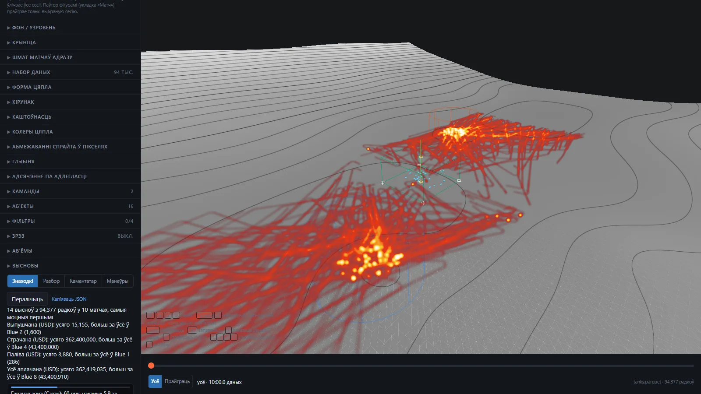
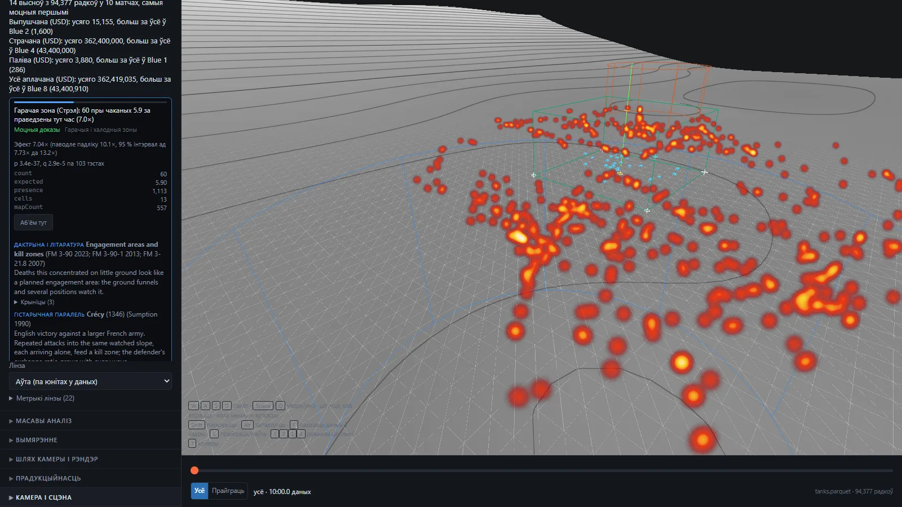
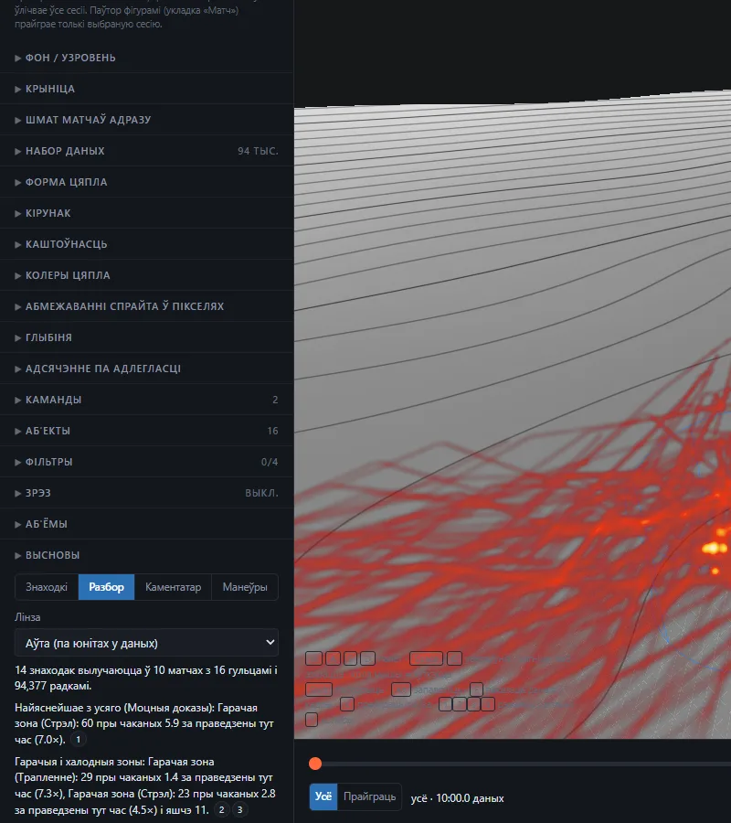
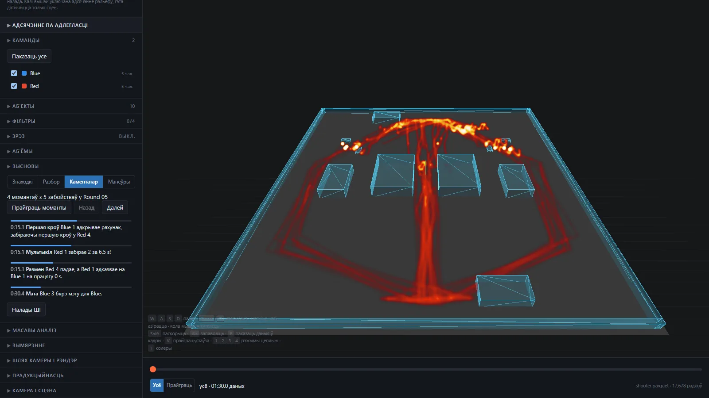

# Высновы

**Высновы** шукае ў загружаных даных тое, што выдзяляецца, - моцныя пазіцыі, смяротную мясцовасць, пасткі пры нараджэнні, вузкія месцы, гульцоў, значна вышэйшых за аднагодкаў - і кажа вам, ад самага моцнага, з доказамі. Выкарыстоўвайце, каб за хвіліну даведацца, дзе матч выйгралі або прайгралі. Потым ён можа напісаць разбор, а ў адным паўторы - дзейнічаць як каментатар, які пераходзіць да вялікіх момантаў.

Усё падлічваецца ў вашым браўзеры. Нічога не пакідае ваш кампутар, калі не ўключаць знешні ШІ (гл. [Знешні ШІ](#external-ai)).

Раздзел **Высновы** знаходзіцца на бакавой панэлі ўкладак Цеплавая карта і Матч. Ён мае тры ўкладкі: **Знаходкі**, **Разбор** і **Каментатар**.

## Знаходкі {#findings}

1. Загрузіце даныя і адкрыйце **Высновы**. Націсніце **Знайсці высновы** (»Падлік… n%» паказвае прагрэс).
2. Прачытайце спіс. Кожная знаходка мае паласу моцы, сказ, якасць доказаў (*Strong evidence*, *Good evidence* або *Some evidence*), дэтэктар, які яе знайшоў, і клас тэхнікі, калі гэта важна.
3. **Націсніце на знаходку**: праглядальнік ставіць яе фільтры, ляціць камерай да месца і скача да часу, а таксама адкрывае падрабязнасці: эфект з 95% інтэрвалам, значэнні p і q, падлічаныя доказы і **Аб'ём тут**, які малюе [аб'ём](volumes.md) вакол месца.
4. **Вярнуць фільтры** вяртае вашыя фільтры. **Капіяваць JSON** капіюе ўвесь справаздачу.

Падлік выкарыстоўвае бягучыя фільтры, схаваныя групы і абраны матч за ўвесь прамежак часу. Калі вы потым змяняеце фільтры, з'яўляецца нататка пра гэта; націсніце **Пералічыць**.

Радкі ўверсе спіса (напрыклад, сумы грошай) падсумоўваюць усе даныя перад знаходкамі.

### Дэтэктары {#the-detectors}

| Дэтэктар | Што знаходзіць | Што патрэбна ў даных |
|---|---|---|
| **Моцныя пазіцыі** | Месцы з значна лепшымі каэфіцыентамі забойстваў на смерць, чым у астатняй карце, і *бяспечную зямлю*, дзе гінуць мала на час, праведзены там | падзеі забойстваў і смерцяў |
| **Гарачыя і халодныя зоны** | Месцы, дзе падзея (стрэлы, пападанні, захопы ...) адбываецца значна часцей або радзей, чым прадказвае час, праведзены там | слупок падзей |
| **Адкрытая мясцовасць і ўкрыцці** | Смерці на адкрытым месцы супраць блізкай геаметрыі ўзроўню, і павольна супраць хуткага руху | смерці; 3D-ўзровень для часткі геаметрыі |
| **Спаўны** | Моцныя пункты нараджэння, пасткі, бяспечныя пункты, час да першага кантакту | час і асобы |
| **Клас па месцы** | Клас тэхнікі, або гульцы супраць ШІ, які значна лепш або горш дзейнічае ў вобласці | забойствы плюс слупок класа тэхнікі або гульцы/ШІ |
| **Гульцы** | Гульцы, якія забіваюць або гінуць значна больш або менш за іншых у тым самым класе | асобы і забойствы |
| **Вузкія месцы і флангі** | Вузкія месцы (значна больш пераходаў, чым вакол) і флангавыя шляхі (рэдка выкарыстоўваюцца, але вядуць да забойстваў) | асобы |
| **Значэнне** | *Costly ground* і *Earning ground* | [слупкі значэнняў](value-weighting.md) |
| **Што вырашала раўнды** | Што адрознівала выйграныя раўнды ад прайграных, і гульцы, якія дадалі або каштавалі найбольш імавернасці перамогі (гл. [Хто выйграў](#who-won-what-decided-the-rounds)) | раўнды, забойствы і смерці, а таксама [слупкі выніку](data-formats.md#outcome-columns) (`won`) |

Дэтэктары, якія не могуць працаваць на даных, пералічаны ўнізе з прычынай.

### Як ранжыруюцца знаходкі {#how-findings-are-ranked}

Кожнае месца або група правяраецца супраць астатняй карты (дакладны біномны тэст або тэст стаўкі). Частка ілжывых адкрыццяў трымаецца на 5% (Benjamini-Hochberg). Выпадковасць можа выглядаць як заканамернасць; гэта трымае ілжывыя трывогі на нізкім узроўні: сярод паказаных знаходак чакаецца не больш за адну з дваццаці выпадковай. Эфекты з невялікай колькасцю падзей сціскаюцца да «няма эфекту» перад ранжыраваннем. Паказваецца не больш за 60 знаходак, і кожны дэтэктар атрымлівае некалькі месцаў у верхняй частцы.

### Хто выйграў: што вырашала раўнды {#who-won-what-decided-the-rounds}

Калі даныя кажуць, хто выйграў кожны раўнд ([слупок выніку](data-formats.md#outcome-columns) `won`: CS2, Rainbow Six Siege, War Thunder ...), менавіта пра вынік ідзе гаворка ў Высновах. Для кожнага боку раўнды дзеляцца па тым, што ў іх адбылося, і параўноўваюцца долі перамог:

| Фактар | Раўнды боку з ім | ... і без яго |
|---|---|---|
| Першая дуэль | ён зрабіў першае забойства | ён загінуў першым |
| Закупка | яго закупка была лепшай, чым у другога боку | горшай |
| Разменяная першая смерць | яго першую смерць разменялі на працягу 5 с | не разменялі |
| Устаноўка | ён усталяваў бомбу | без устаноўкі |
| Рыштунак | больш гранат, чым у яго звычайным раўндзе | менш |
| Ранні кантакт | першая дуэль адбылася раней за медыянны час матчу | пазней |
| Утрыманае месца | гулец стаяў на месцы 5 с або больш | ніхто не стаяў |
| Месца, дасягнутае рана | гулец дабраўся туды за першыя 25 с (маршрут) | ніхто не дабраўся |

Кожнае параўнанне - гэта розніца дзвюх доляў перамог з яе 95% інтэрвалам (Newcombe), дакладнае p Фішэра і q па ўсіх правераных фактарах (Benjamini-Hochberg). Галіна з менш чым 8 раўндамі пазначана *мала раўндаў*. Тыя, што праходзяць пад 5% часткі ілжывых адкрыццяў, становяцца знаходкамі; наймацнейшыя стаяць вышэй за знаходкі іншых дэтэктараў (знаходка пра вынік важыць у 1,35 раза больш, чым знаходка з тым самым эфектам і доказамі).

Прыдуманы прыклад на 40 раўндах:

> **T** выйграў 79% з 19 раўндаў, калі ўтрымліваў **Mid**, супраць 24% з 21 без гэтага (55 пунктаў, 95% ад 26 да 74) - q 0,004.

Высновы таксама сочаць за **імавернасцю перамогі** ў раўндзе - шанцам кожнага боку ў кожны момант, з жывых байцоў, устаноўкі і гадзінніка: падагнанай пад раўнды, калі іх 30 або больш, інакш з фіксаванай апрыёрнай мадэлі (і тэкст кажа, з якой). З яе вынікаюць **пераломныя моманты** (забойствы і ўстаноўкі, якія найбольш змянілі шанец) і **дададзеная імавернасць перамогі** кожнага гульца: яго забойствы і ўстаноўкі ідуць яму ў плюс, яго смерці - у мінус, у раўндах за матч, у сярэднім за раўнд з інтэрвалам, з праверкай супраць нуля. Месцы атрымліваюць такі самы баланс: які бок выйграў найбольш у дуэлях, што там адбыліся.

Даным патрэбныя раўнды, забойствы і смерці з абодвума бакамі, а таксама слупок `won`; названыя месцы (`place`) для ўтрыманых месцаў, слупок `buy` для закупкі.

## Разбор {#debrief}

Укладка **Разбор** запісвае знаходкі ў кароткі тэкст: уступ, самую яснаю знаходку, адну для тактыкі, адну для балансу, потым - калі даныя кажуць, хто выйграў, - што вырашала раўнды, астатнія, згрупаваныя па дэтэктары, і колькі з іх грунтуюцца на слабейшых доказах.

Што вырашала раўнды, апісана ў чатырох абзацах: лік і адкуль бяруцца імавернасці перамогі; наймацнейшыя фактары з іх лічбамі, інтэрвалам і q (калі ніводзін не праходзіць частку ілжывых адкрыццяў, тэкст кажа *пакуль нічога не пэўна* і ўсё роўна называе наймацнейшы); тры найбуйнейшыя пераломныя моманты; і гульцы, якія дадалі і каштавалі найбольш імавернасці перамогі, з месцамі, што атрымалі найбольш. Прыдуманы прыклад:

> T выйграў 23, а CT выйграў 17 з 40 раўндаў з вядомым вынікам (T: 58%, 95% ад 42% да 72%). Імавернасці перамогі бяруцца з мадэлі, падагнанай пад гэтыя раўнды.
>
> Што адрознівала выйграныя раўнды ад прайграных: T выйграў 79% з 19 раўндаў, калі ўтрымліваў Mid, супраць 24% з 21 без гэтага (55 пунктаў, 95% ад 26 да 74) (q 0,004), ...
>
> Пераломныя моманты: раўнд 17 на 48 с, забойства ад CT на B site змяніла яго шанец з 31% да 58%, і ён узяў раўнд, ... Кожны абзац мае пранумараваныя кнопкі, якія паказваюць яго знаходкі. **Скапіяваць тэкст** капіюе яго.

Убудаваны апавядальнік працуе афлайн, на вашай мове. Выбарнік **Лінза** над ім (гл. [Лінза ведаў](knowledge.md)) вызначае, на якую літаратуру спасылаюцца абзацы.

### Знешні ШІ {#external-ai}

**Налады ШІ** дазваляюць напісаць разбор мадэллю ШІ на ваш выбар:

| Налада | Значэнне |
|---|---|
| **Провайдэр** | Anthropic (Claude), OpenAI (ChatGPT), OpenRouter, Ollama (лакальны), LM Studio (лакальны), llama.cpp server (лакальны) або любы кропка з сумяшчальным з OpenAI API |
| **Базавы URL**, **Мадэль** | Запаўняе провайдэр; **Паказаць мадэлі** пытаецца ў сервера |
| **API-ключ** | Адпраўляецца толькі на базавы URL. Ніколі не запісваецца ў журнал, ніколі не захоўваецца ў выглядах, экспартах або файлах `.3dheat`. Большасць лакальных сервераў ключ не патрабуюць. |
| **Запомніць ключ у гэтым браўзеры** | Па змаўчанні выключана: ключ забываецца, калі старонка закрываецца |
| **Выкарыстоўваць знешні ШІ** | Па змаўчанні выключана |
| **Адпраўляць імёны гульцоў** | Па змаўчанні выключана: гульцы адпраўляюцца як P1, P2 ... |

Затым напішыце, калі хочацца, пытанне і націсніце **Напісаць з дапамогай ШІ**. Адпраўляюцца толькі знаходкі і іх лічбы - ніколі радкі вашых даных. Адказ паступае па частках; названыя знаходкі становяцца кнопкамі. Калі даныя кажуць, хто выйграў, мадэлі загадваюць пачаць з таго, што вырашала раўнды, з інтэрвалам і q кожнай лічбы, і сказаць, калі фактар грунтуецца на малой колькасці раўндаў або імавернасці перамогі бяруцца з апрыёрнай мадэлі.

## Каментатар {#caster}

Для **аднаго матчу** (абярыце адзін, калі загружана некалькі) **Каментатар** знаходзіць моманты, якія варта паглядзець: першая кроў, мультызабойствы, абмены, клатчы, зрухі па мэтах, вяртанні, вылучаныя гульцы, далёкія стрэлы і **пераломныя моманты** - забойствы, якія найбольш змянілі шанец боку выйграць раўнд (па колькасці жывых гульцоў кожнага боку, у раўндах без адраджэння).

Калі даныя кажуць, хто выйграў кожны раўнд, кожны момант гэта паведамляе: *«Anna забівае Ben: шанец T выйграць раўнд расце з 38% да 62% - і яны бяруць раўнд.»* Момант боку, які потым выйграў, важыць больш, калі каментатар выбірае, якія моманты пакінуць, а вяртанне лічыцца ў выйграных раўндах.

- Націсніце момант: выгляд пераключаецца на паўтор, скача трохі да яго, ляціць туды і сочыць за гульцом.
- **Прайграць моманты** прайгрывае кожны да канца і рухаецца далей; **Назад** / **Далей** гартаюць іх.
- Калі ўключаны знешні ШІ, **Каментарыі ад ШІ** пішуць каментарый са спісу момантаў (віды, часы, імёны або псеўданімы, каманды, класы, адлегласці).

Патрэбны асобы і падзеі забойстваў/смерцяў (або захопаў); слупок `other`/`victim` робіць магчымымі абмены і далёкія стрэлы.

## Лінза ведаў {#knowledge-lens}

Знаходку можна прачытаць праз **лінзу** ўсталяваных ведаў: ваенная дактрына, паветраны і марскі бой, гарадскія аперацыі, дызайн гульняў і кіберспорт (або *Auto*, выбрана адзінкамі ў даных). Адкрытая знаходка тады паказвае найбліжэйшы запіс **дактрыны і літаратуры** і **гістарычную паралель** з спасылкамі, а **Метрыкі лінзы** падлічваюць на даных меры з той літаратуры (падагнанні Lanchester, суадносіны абмену, суадносіны сіл, сектары агню, ключавую мясцовасць, абмены, ініцыятыву). Разбор і запыт ШІ іх таксама ўключаюць. Усё пра гэта: [Лінза ведаў](knowledge.md).

Метрыкі лінзы таксама мераць, як гульцы паводзяцца як натоўп і як група - выраўноўванне і блуканне, вядзенне па маршрутах, шляхі і сляды, цеснату, лідараў і паслядоўнікаў, адстаючых, кропку зламу пры стратах, рызыку пасля страты жыцця, серыі, згоду па закупках і рэакцыю на ўваходны агонь - кожная супраць свайго нулявога ўзору: [Калектыўныя паводзіны](collective-behaviour.md).

## Даныя, з якімі высновы працуюць {#data-that-makes-insights-work}

- пазіцыі з **часам**, **асобай** і **камандай**;
- слупок **падзей** з забойствамі і смерцямі (`kill`, `death`), і іншыя (`hit`, `fire`, `capture` ...);
- слупок **іншай стараны** (`other`, `victim`) для абменаў і накірункаў;
- слупок **тэхнікі** або **тыпу** для класаў; слупок `ai` для гульцоў супраць ШІ;
- слупок **сеансу** / **матчу** / **раунда**, калі матчаў некалькі.

У [дэма-даных](demo-data.md) ёсць усё гэта.
