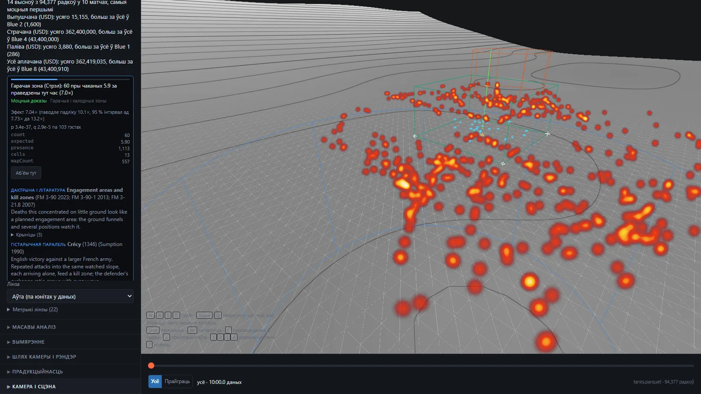

# Лінза ведаў

Калі [Высновы](insights.md) знаходзяць нешта, гэтая частка тлумачыць гэта з дапамогай ідэй з ваеннай гісторыі, распрацоўкі гульняў і аналізу спорту, і называе кнігу або артыкул, з якіх яна ўзятая. Выкарыстоўвайце яе, каб даведацца *чаму* шаблон важны, а не толькі тое, што ён ёсць.

## Паспрабуйце {#try-it}

1. Загрузіце даныя і адкрыйце **Высновы**, потым націсніце **Знайсці высновы**.
2. Націсніце на вынік, каб адкрыць яго.
3. Прачытайце **Дактрына і літаратура** і **Гістарычная паралель**; поўныя спасылкі схаваны пад імі.
4. Змяніце **Лінза** (напрыклад, на *Ваенная дактрына*), каб прачытаць той самы вынік праз іншы корпус літаратуры.

## Як гэта працуе {#how-it-works}

Панэль Высноў ацэньвае свае вынікі так, як гэта зрабіў бы прафесійны аналітык: праз ваенную дактрыну і аперацыйныя даследаванні, гістарычныя бітвы, а таксама літаратуру па распрацоўцы гульняў, дызайну ўзроўняў і аналітыцы. Гэта робіцца афлайн, па адабранай базе ведаў у глядзельніку, і той самы матэрыял перадаецца знешняй мадэлі, калі тая пішэ разбор.

## Што паказвае панэль {#what-the-panel-shows}

- **Лінза** выбірае корпус літаратуры, праз які чытаюцца вынікі: *Аўто* (выбіраецца па відах адзінак у даных: авіяцыя, караблі, наземная тэхніка, пяхота), *Ваенная дактрына*, *Паветраны бой*, *Ваенна-марскія*, *Гарадскія*, *Распрацоўка гульняў і баланс*, *Кіберспорт*. Запісы па-за абранай лінзай не паказваюцца.
- Кожны адкрыты вынік паказвае свой найбліжэйшы запіс **дактрыны і літаратуры** і сваю найбліжэйшую **гістарычную паралель**, з поўнымі спасылкамі пад імі.
- **Метрыкі лінзы** пералічвае меры аперацыйнага аналізу, падлічаныя па тых самых радках (ніжэй), кожная з тым, што яна значыць, і сваёй літаратурай.
- **Разбор** дадае радкі для галоўных вынікаў і метрык лінзы: «Дактрына і літаратура: ...» і «Гістарычная паралель: ...», кожны з цытаваннямі аўтар-год і спасылкамі, схаванымі пад ім.
- **Напісаць з дапамогай ШІ** адпраўляе з справаздачай найбольш адпаведныя запісы (рэзюмэ, урок, вынікі, з якімі яны звязаны, поўныя спасылкі) і просіць мадэль цытаваць іх па ідэнтыфікатары - `{concept.lanchester-square}` - і не выкарыстоўваць іншых крыніц.

Пазнакі перакладзеныя; сами веды - на англійскай мове.

## Метрыкі лінзы {#lens-metrics}

Вылічваюцца ў працоўным працэсе высноў, у тым самым праходзе па радках, што і дэтэктары (`src/insights/lensMetrics.ts`). Кожная пропускаецца, калі даныя не могуць яе несці.

| Метрыка | Што вымярае | Патрабуе |
|---|---|---|
| Падгонка Ланчэстэра | Страты кожнага боку на 20 с, рэгрэсаваныя па сілах абодвух бакоў, якія яшчэ жывыя (Пуасон, памылкі квазіправаўдападобнасці); паказчыкі па сіле ворага і сваёй, праверраныя супраць квадратнага закону (прыцэльны агонь) і лінейнага закону (агонь па плошчы) | час, каманды, забойствы і смерці |
| Каэфіцыент абмену | Забойствы на адну смерць па баку і па месцы; доля смерцяў на самым смяротным наземным участку, які трымае 5% часу, супраць долі, якую дае адна выпадковасць пры такой колькасці смерцяў; Джыні смерцяў па часе; I Морана для інтэнсіўнасці смерцяў | забойствы і смерці |
| Лакальны каэфіцыент сілы | Саюзныя і ворожыя адзінкі, якія жывыя ў межах дыяпазону бою кожнага забойства (дыяпазон задаецца з даных: удвая медыяна адлегласці да найбліжэйшага ворага); доля забойстваў лакальна вышэйшага боку і яго перавага над тым, што прадказваюць адны лічбы | час, каманды, асобы |
| Палі агню | Вокны відаць з самых загружаных месцаў забойстваў на паверхні перашкод 2,5D (геаметрыя ўзроўню да вышыні сцяны або пройдзеная зямля) супраць сярэдняга месца, і ранговая карэляцыя бачнасці і долі забойстваў | пазіцыі; загружаны ўзровень робіць гэта дакладней; не для авіяцыі |
| Энергетычны стан | Удзельная энергія (вышыня плюс тая, што можна набыць хуткасцю) у паветраных забойцаў і паветраных ахвяр, параўнаная па статыстыцы Манна-Уітні | класы самалётаў, час, вышыня |
| Ключавая мясцовасць | Як часта кожнае месца сярод трох самых загружаных месцаў забойстваў матча | некалькі матчаў |
| Узаемная падтрымка (абмены) | Смерці, на якія адказаў забойствам таварыш у межах дыяпазону бою і 5 с | час, каманды |
| Першы ўдар | Сутыкненні - забойствы, згрупаваныя па матчы, па 20 с цішыні і па трох дыяпазонах бою па адлегласці, - якія выйграў бок, што забіў першым | час, каманды |
| Мадэль залпу | Ураўненне залпу Х'юза, падагнанае пад перыяды па 20 с кантакту караблёў: караблі, выведзеныя са строю на адзін атакуючы, і выратаваныя на адзін абаронны; падгонка Ланчэстэра толькі па караблях | класы караблёў, час, каманды |
| Баявая эфектыўнасць | Забойствы на адну адзінка-гадзіну ў дзеянні кожнага боку і суадносіны двух самых вялікіх (значэнне баявой эфектыўнасці ў сэнсе Дзюпюі) з 95% інтэрвалам, і доля забойстваў кожнага боку пры роўнай лакальнай колькасці | час, каманды |
| Дыяпазоны бою | Адлегласць да найбліжэйшага ворага пры забойствах, пры запусках і пры першым стрэле кожнага жыцця (выяўленне да сутыкнення), па відзе адзінкі | час, каманды; запускі там, дзе ёсць у даных |
| Ланцуг забойстваў | Секунды ад апошняга запуску забойцы да забойства і ад яго першага стрэлу ў бойцы да забойства | час; запускі або падзеі агню |
| Канцэнтрацыя або рассеянне | У кожным перыядзе па 20 с - разрэджанасць двух самых вялікіх бакоў і доля забойстваў, узятая больш шчыльным з іх | час, каманды |
| Вылеты | Па баку: вылеты (узлёты або з'яўленні авіяцыі), пасадкі, страчаныя самалёты і забойствы самалётамі; частата страт і забойствы на вылет | класы самалётаў; узлёты або з'яўленні |

Даныя з раўндамі дадаюць меры для блізкага бою і кіберспорту - імавернасць выйгрышу раўнда, коштам дзеянняў, адкрыўныя дуэлі, абмены, піклер супраць ўтрымальніка, прыцэл, перакрыжаваны агонь, утыліты, перавага людзей, кластчы, устаноўкі, пасля закладкі, фатальныя воранкі і ўплыў гульца: гл. [Блізкі бой і раўнды](close-quarters.md).

Треки і каманды дадаюць меры калектыўных паводзін з навукі пра натоўп, калектыўнага руху, паводзінавай эканомікі і ваеннай псіхалогіі - выраўноўванне і мітусня, загон па маршруце, паласы і сляды, скучанасць, лідэры і вядомыя, адсталыя, пункт зрыву, рызыка пасля страт, серыі, узгадненне купляў і прыгнечанне, кожная з уласнай нулявой мадэллю: гл. [Калектыўнае паводзіны](collective-behaviour.md).

Зброя, прыманкі і будынкі не лічаюцца адзінкамі. Там, дзе радкі зброі называюць сваю адзінку запуску (слупок `Shooter` або `Launcher`, як у даных з Tacview), запуск залічваецца гэтай адзінцы, супастаўленай па назве або ідэнтыфікатары аб'екта.

## Як вынікі сустракаюцца з літаратурай {#how-findings-meet-the-literature}

Запісы і вынікі сустракаюцца праз **таксанамію шаблонаў** (`src/insights/knowledge/patterns.ts`): канцэнтрацыя, лакальная перавага, прыцэльны і плошчны агонь, вузкія месцы, зоны забойстваў, палі агню, зваротны схіл, фланкаванне, узаемная падтрымка, энергетычная перавага, ціск пры з'яўленні, баланс і гэтак далей. Кожны від дэтэктара і кожная метрыка лінзы кажа, якія шаблоны паказвае яго лічбы (`src/insights/lens.ts`); кожны запіс ведаў кажа, якія шаблоны ён закранае, з вагой. Адпаведнасць запісу вынікам - гэта ўзважанае перасячэнне, масштабаванае па тым, наколькі добра дамен запісу (зямля, паветра, мора, горад) падыходзіць да даных, і па ўласнай сіле вынікі. Абгрунтаванне, якое паказваецца, - лічбы вынікаў у адным сказе, за якім ідзе ўрок запісу.

## Каталог {#catalogue}

Кожны шаблон, паняцце, метад, гістарычны выпадак, прынцып дызайну і даследаванне, з бібліяграфіяй: гл. [Каталог ведаў](knowledge-catalogue.md).

## Для распрацоўшчыкаў {#for-developers}

### Даданне запісаў {#adding-entries}

1. Выберыце файл па тыпе: `concepts.ts` і `concepts-more.ts`, `methods.ts`, `cases.ts`, `cases-land.ts`, `cases-air-sea.ts`, `cases-esports.ts`, `design.ts` (прынцыпы дызайну) або `studies.ts` у `src/insights/knowledge/`.
2. Дайце яму новы ідэнтыфікатар `<type>.<slug>` (ніколі не паўтарайце), яго лінзы, дамены і шаблоны, якія ён закранае, з вагамі 0..1. Дадайце шаблон у `patterns.ts` толькі тады, калі вынік можа яго паказаць, і звяжыце яго з вынікам або метрыкай у `lens.ts`.
3. Напішыце рэзюмэ і ўрок **сваімі словамі**. Цытаты - толькі з твораў з агульнага доступу (`pd: true` у даведніку), і кароткія.
4. Цытуйце: дадайце любы новы твор у `refs.ts` з аўтарамі, годам, назвай і выдаўцом (часопіс з томам і старонкамі); URL або DOI, калі ёсць публічны запіс.
5. Запусціце `npx vitest run src/insights/lens.test.ts` (унікальныя ідэнтыфікатары, вядомыя шаблоны, праўдзівыя спасылкі, цытаты з агульнага доступу, выпадкі з датай і вынікам) і `node tools/knowledge-doc.mjs`, каб абнавіць [каталог](knowledge-catalogue.md).
