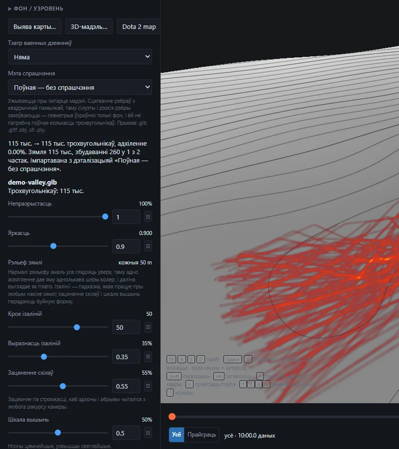

# Узроўні і фонавая геаметрыя

Узровень - гэта 3D-месца, дзе адбывалася гульня: карта, горад, трасса. Пастаўце яго за вашымі данымі, і вы ўбачыце, *дзе* цяпло. Панэль **Фон / узровень** (гл. [Слоўнік](glossary.md) для «узроўню») дае тры віды кантэксту:

- **выява карты**, прывязаная да дзвюх кропак - гл. [Выявы карт](map-images.md);
- **3D-ўзровень** - `.glb`, `.gltf`, `.obj`, `.stl` або `.ply` - падзелены на зямлю, пабудовы і ваду і спрашчаны пры імпарце - гл. [3D-узроўні](model-levels.md) і [Выгляд узроўню](level-appearance.md).
- **фон свету** - для запісу, які кажа, дзе на зямлі ён адбыўся (файл Tacview ACMI): сапраўдны рэльеф, дарогі, вада, аэрадромы і будынкі, спампаваныя з адкрытых даных - гл. [Фон свету](world-backdrop.md).

Калі нічога не загружана, сцэна цёмная, з сеткай і каляровымі восямі (**Сетка** і **Восі** у [Камера і сцэна](camera.md)), і панэль кажа *Nothing loaded - the scene shows a grid and axes. Add a map image or a level mesh to give the heat context.*

Узровень агульны для ўсіх трох укладак: трасса, загружаная ва ўкладцы Аналіз заездаў, - гэта той жа ўзровень, які паказвае цеплавая карта.

## Пастаўце ўзровень за вашымі данымі {#put-a-level-behind-your-data}

1. Спачатку загрузіце даныя ([Загрузка даных](getting-data-in.md)), каб узровень быў падагнаны пад іх.
2. Адкрыйце **Фон / узровень** на бакавой панэлі.
3. Націсніце **Выява карты…** для малюнка або **3D-мадэль…** для 3D-ўзроўню і выберыце файл. Для запісу з рэальнага свету выкарыстоўвайце **Рэальны свет як фон** або **Тэатр ваенных дзеянняў**.
4. Пачакайце, пакуль радок прагрэсу завершыцца. Вялікая мадэль спачатку спрашчаецца (гл. **Мэта спрашчэння** ніжэй).
5. Націсніце **F** у выглядзе, каб кадраваць усё. Карыстайцеся **Непразрыстасць** і **Яркасць**, пакуль цяпло не выдзеліцца на фоне ўзроўню.
6. Націсніце **Захаваць у бібліятэку**, калі будзеце карыстацца ўзроўнем яшчэ раз ([Бібліятэка ўзроўняў](level-library.md)).

## Што ўзровень робіць для цяпла {#what-a-level-does-for-the-heat}

- Ён **перакрывае**: радкі за ім цямнеюць па паверхні, а радкі за рэльефам хаваюцца ([Глыбіня і адсячэнне](depth-and-culling.md)). Без узроўню перакрыцця няма.
- Ён **разразаецца** [Зрэзам](slice.md) і, пры *Рэзаць і ўзровень*, [адсячэннем па адлегласці](depth-and-culling.md#distance-culling), разам з цяплом.
- Гэта адзінае, што размывае [глыбіня поля](camera.md#depth-of-field), акрамя сеткі і кубоў.
- 3D-ўзровень **пашырае далёкую плоскасць камеры**, калі ён большы за даныя: блізкая і далёкая плоскасці калібруюцца па наборы даных, а экспартаваная карта шырынёй у некалькі кіламетраў інакш цалкам апынулася б за далёкай плоскасцю і пакінула пусты выгляд. Далёкая плоскасць становіцца 3 × гарызантальнага памеру ўзроўню, калі той большы, блізкая плоскасць рухаецца з ёй (не менш за far / 100,000), каб захаваць дакладнасць глыбіні, ад якой залежыць перакрыццё, а хуткасць палёту падымаецца да не менш за памер / 12. Яна толькі пашыраецца, ніколі не звужаецца.

## Панэль, зверху ўніз {#the-panel-top-to-bottom}

| Частка | Падрабязнасці |
|---|---|
| **Выява карты…**, **3D-мадэль…** | Загрузіць адно; яно замяняе бягучы ўзровень. |
| **Рэальны свет як фон**, **Забыць пліткі мапы** | Толькі для набору даных з геаграфічнай прывязкай: пабудаваць пад ім сапраўднае месца як узровень або выдаліць спампаваныя пліткі. [Фон свету](world-backdrop.md) |
| **Мэта спрашчэння** | Бюджэт трохвугольнікаў для наступнага імпарту мадэлі: *Full - no simplification* (па змаўчанні), *High - 8M*, *Medium - 3M*, *Low - 800k*, *Silhouette - 100k*. [3D-узроўні](model-levels.md#simplification) |
| Прагрэс і **Скасаваць** | Пры дэкадаванні або імпарце. |
| Нататка імпарту | Трохвугольнікі да і пасля, падзел на зямлю / пабудовы / ваду, узровень дэталізацыі. |
| Назва і памер | `width×height px · x × z m/px` для малюнка, `N triangles (from M)` для мадэлі. |
| **Непразрыстасць**, **Яркасць** | Для абодвух відаў. |
| Кіраванне малюнкам | **Абескаляровіць**, **Адлюстраваць поўнач/поўдзень**, **Размяшчэнне** (Размяшчэнне, дзве кропкі), **Падагнаць пад межы даных**, **Вышыня**. [Выявы карт](map-images.md) |
| Кіраванне мадэллю | Рэльеф зямлі, вада, трохвугольнікі зямлі, сетка, тэкстура, захопленыя колеры, пабудовы, класіфікацыя частак. [Выгляд узроўню](level-appearance.md) |
| **Захаваць у бібліятэку**, **Выдаліць** | [Бібліятэка ўзроўняў](level-library.md); Выдаліць выгружае ўзровень. |
| **Бібліятэка** | Узроўні, захаваныя ў гэтым браўзеры. [Бібліятэка ўзроўняў](level-library.md) |

## Старонкі гэтага раздзела {#pages-in-this-section}

- [Выявы карт](map-images.md)
- [3D-узроўні](model-levels.md) - фарматы, часткі, класіфікацыя, спрашчэнне, тэкстуры
- [Выгляд узроўню](level-appearance.md) - кожнае кіраванне для 3D-ўзроўню
- [Бібліятэка ўзроўняў](level-library.md)
- [Фон свету](world-backdrop.md) - сапраўдны свет пад запісам, з адкрытых даных

Як здабыць узроўні з гульняў і рухавікоў - справа асобных інструментаў-экспарцёраў (гл. [README](https://github.com/Holdi601/3DHeat/blob/main/README.md) рэпазіторыя); кантракт, у які яны пішуць, падсумаваны ў [3D-узроўні](model-levels.md#the-exporter-contract).
