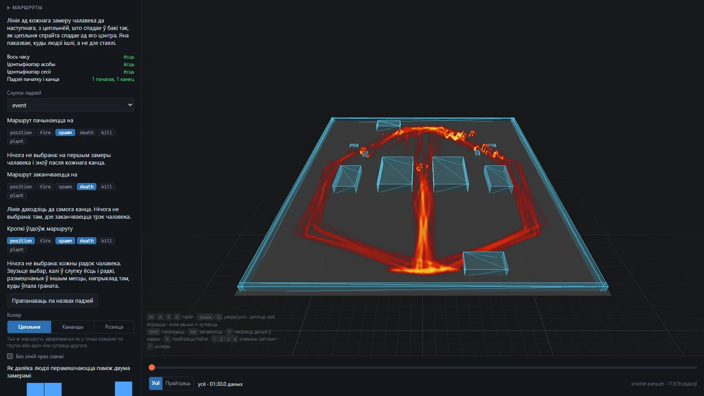

# Лінейная цеплыня

Рэжым «Цеплыня» паказвае, дзе людзі стаялі. Рэжым «Лініі» паказвае шляхі, па якіх яны ішлі.

**Лініі** (клавіша 4) - гэта лінейная цеплыня: ад кожнага ўзора [асобы](glossary.md) да наступнага ўзора праводзіцца лінія, якая размазваецца з тым самым спадам, што і [спрайт](glossary.md), - не вакол кропкі, а ўпоперак лініі. Яна паказвае, куды людзі *ішлі*, а не дзе яны стаялі: калідор, які прайшлі адзін раз, бачны гэтак жа добра, як пакой, у якім сядзелі, а рэдкія ўзоры хуткага гульца злучаюцца ў суцэльны маршрут, а не ў пункцірны след. Патрэбны слупок асобы і слупок часу.

## Як карыстацца {#how-to-use-it}

1. Націсніце `4` (або выберыце **Лініі** на панэлі рэжымаў).
2. Адкрыйце **Маршруты** і праверце зялёны спіс: павінны быць вось часу і ідэнтыфікатар асобы.
3. Націсніце **Прапанаваць па назвах падзей**, каб запоўніць, дзе маршруты пачынаюцца і заканчваюцца.
4. Прачытайце радок статыстыкі: «N маршрутаў, з іх M дайшлі да канца».
5. Калі лініі скачуць праз карту, наладзьце **Найдаўжэйшы крок** (гл. [Ліміт скачкоў](#the-jump-limit)).

Лінія мае сэнс толькі паміж пачаткам і канцом, таму панэль **Маршруты** кажа, чым абмежаваны маршрут. Усё, што ідзе пасля [Правілаў маршруту](#the-rules-of-a-route), - падрабязнасці, якія можна прапусціць.

## Панэль «Маршруты» {#the-routes-panel}

Паказваецца над панэлямі цеплыні ў рэжыме «Лініі».

### Што ёсць у даных {#what-the-data-has}

Спіс адзнак: зялёная, калі ёсць, бурштынавая, калі няма:

| Радок | Стан |
|---|---|
| **Вось часу** | *ёсць* / *няма - патрэбна* |
| **Ідэнтыфікатар асобы** | *ёсць* / *няма - патрэбна* |
| **Ідэнтыфікатар сесіі** | *ёсць* / *няма - усе радкі - адзін сеанс* |
| **Падзеі пачатку і канца** | *N пачаткаў, M канцоў* / *нічога не выбрана - цэлыя трэкі* (зялёная толькі пры слупку падзей і хаця б адным пачатку і адным канцы) |

### Элементы кіравання {#controls}

| Элемент | Значэнне |
|---|---|
| **Слупок падзей** | Слупок катэгорыі, значэнні якога - падзеі (з'яўленне, смерць, пазіцыя, ...). *Няма - цэлыя трэкі*: трэк кожнай асобы ў кожнаму сеансе - адзін маршрут, які разрываецца там, дзе ў трэку ёсць прабел. Прапануюцца толькі слупкі, захаваныя для фільтраў пры загрузцы. |
| **Маршрут пачынаецца на** | Значэнні падзей, якія пачынаюць маршрут (з'яўленне, адраджэнне, высадка). Нічога не выбрана: маршрут пачынаецца з першага ўзора асобы і зноў пасля кожнага канца. |
| **Маршрут заканчваецца на** | Значэнні падзей, якія завяршаюць маршрут (смерць, эвакуацыя, тэлепартацыя). Лінія ідзе да самога радка канца. Нічога не выбрана: маршрут заканчваецца там, дзе заканчваецца трэк асобы. |
| **Кропкі ўздоўж маршруту** | Значэнні падзей, радкі якіх ляжаць уздоўж маршруту. Нічога не выбрана: кожны радок асобы. Звужайце, калі ў слупку ёсць і радкі, якія стаяць у іншым месцы, напрыклад дзе ўпала граната. |
| **Прапанаваць па назвах падзей** | Запаўняе тры спісы паводле назваў значэнняў (ніжэй). |
| **Колер** | *Цеплыня*, *Цеплыня каманд* або *Розніца*. Тыя самыя маршруты ў колеры гэтага рэжыму: кожная група ў сваім адценні або адна старана супраць другой, са спісам груп, падзелам і шкаламі, якія працуюць так, як у гэтых рэжымах. Стандартна - *Цеплыня*. Цеплыня каманд і розніца патрабуюць слупка групы. |
| **Без ліній праз скачкі** / **Найдаўжэйшы крок** | Наступны ўзор асобы, які далей за гэта, - адраджэнне, тэлепартацыя або падзенне, а не месца, куды яна ішла, таму ніякая лінія не злучае два. Запаўняецца пры загрузцы, калі даныя паказваюць выразны прабел (ніжэй), і выключаецца, калі не паказваюць. Працуе з слупком падзей і без яго. |
| Радок статыстыкі | `N маршрутаў, з іх M дайшлі да канца, K сегментаў`, абнаўляецца некалькі разоў у секунду. |

Кожны спіс - радок пераключальных чыпаў, адзін на значэнне, спачатку найчасцейшыя; навядзенне на чып паказвае колькасць яго радкоў. Прапануецца не больш за 120 значэнняў (*ён яшчэ N значэнняў не паказаны*).

Пры выбары іншага слупка падзей прымяняецца прапанова, калі яна выбірае той самы слупок, а ў іншым выпадку пачынаецца з пустых спісаў.

### Прапанова {#the-suggestion}

Пры кожнай загрузцы і пры **Прапанаваць па назвах падзей** ([`suggestLineSettings`](https://github.com/Holdi601/3DHeat/blob/main/src/data/lines.ts)):

- **Слупок падзей:** першы захаваны слупок катэгорыі з назвай `event`, `eventname` або `eventtype`; інакш `kind`, `type` або `action`; інакш любы, які змяшчае *event*, *kind*, *action* або *type*.
- **Пачаткі:** значэнні, якія змяшчаюць *spawn, deploy, join, enter, start, begin, respawn, revive, land/landed/landing, drop* - калі яны не супадаюць таксама са словам канца.
- **Канцы:** значэнні, якія змяшчаюць *death, died, dead, kill/killed, eliminat…, extract, evac, teleport, leave, left, disconnect, quit, exit, end, finish, downed* - за выключэннем значэнняў `kill` і `kills` (забойства - гэта тое, што робіць забойца, а не канец яго маршруту).
- **Кропкі:** значэнні, якія дакладна роўныя *position, location, player location, move, movement, tick, sample* або *pos*; калі знойдзена хоць адно, пачаткі і канцы дадаюцца і да кропак. Калі не знойдзена ніводнага, кропкі застаюцца пустымі (кожны радок).

### Ліміт скачкоў {#the-jump-limit}

Там, дзе людзі скачуць, даўжыні крокаў падзяляюцца на дзве групы з амаль нічым паміж імі: тое, што асоба пераадольвае паміж двума ўзорамі, і шырыня карты. Пры загрузцы ([`suggestMaxJump`](https://github.com/Holdi601/3DHeat/blob/main/src/data/lines.ts)) крокі лічацца па падваенні квадрата даўжыні, да 16 мільёнаў, і ліміт ставіцца ў сярэдзіну першага дыяпазону вышэй за медыяну, які шырокі не менш за адно падваенне даўжыні, мае менш за 0,02% крокаў на кожную частку і мае крокі за сабой. Калі такога дыяпазону няма, нічога не адразаецца, бо нельга будзе адрозніць скачок ад хуткай машыны; уключаючы ліміт уручную, пачатак тады - на адной дзясятай дыяганалі даных.

Графік над лімітам паказвае, якія крокі сапраўды ёсць, з лініяй на ліміце: слупкі справа ад яе не малююцца. Абедзве восі лагарыфмічныя, бо скачкоў можа быць адна сотая крокаў, але ў тысячу разоў даўжэйшыя. Навядзіце на слупок, каб убачыць яго дыяпазон і долю; націсніце на графік, каб паставіць ліміт там. Пад ім - доля крокаў за межамі ліміту.

## Правілы маршруту {#the-rules-of-a-route}

Радкі праходзяцца ў парадку часу, для кожнай асобы ([`buildLines`](https://github.com/Holdi601/3DHeat/blob/main/src/data/lines.ts)):

1. Радкі [агульнай назвы](sessions-persons-groups.md#names-worn-by-several-things-at-once) цалкам прапускаюцца.
2. Калі абраны кропкі, радок, які не з'яўляецца ні пачаткам, ні канцом, ні кропкай, прапускаецца.
3. Радкі ідуць для кожнай асобы ў кожным сеансе, таму асоба, сеансы якой перамешваюцца ў часе, мае адзін маршрут у кожным. Маршрут закрываецца, калі ў папярэдняга радка не было наступніка (яго [тэрмін жыцця](sessions-persons-groups.md#person) - «няма»): маршрут ніколі не перасякае мяжу сеансу або прабел, які загрузка вызначыла як не маючы наступнага ўзора. Да якога маршруту належыць радок, вылічваецца адзін раз і захоўваецца, 4 байты на радок, таму змена найдаўжэйшага кроку не паўтарае гэтую частку.
4. Радок **пачатку** закрывае любы адкрыты маршрут і адкрывае там новы.
5. Калі абраны пачаткі, радок па-за маршрутам ігнаруецца. Без пачаткаў любы радок не-канца па-за маршрутам адкрывае маршрут.
6. Любы іншы радок унутры маршруту дадае **сегмент** ад папярэдняга радка маршруту да гэтага.
7. Радок **канца**, які падаўжае маршрут, закрывае яго пасля свайго сегмента; такі маршрут лічыцца *дайшоўшым да канца*.
8. Крок даўжэйшы за **Найдаўжэйшы крок** закрывае маршрут там, дзе ён быў, і новы маршрут пачынаецца на далёкім канцы, калі толькі гэты радок не канец. Праз яго лінія не праводзіцца, а радок статыстыкі яго лічыць.

Кожны сегмент захоўваецца ў сваім *канцы* радку, таму сегменты застаюцца ў парадку часу, і [шкала часу](timeline.md), вокны, семплер, [фільтры](filters.md), бачнасць груп і знак рознасці працуюць з імі, як з кропкамі. Таму фільтр прымяняецца да радка, у якім заканчваецца сегмент.

## Прайграванне {#playback}

У рэжыме **Усе** кожны маршрут малюецца цалкам. У рэжыме **Прайграць** кожная асоба - кропка, якая рухаецца між сваімі ўзорамі, і малюе свой маршрут за сабой:

- сегмент, які пачынаецца пасля маркера прайгравання, не малюецца;
- сегмент, у сярэдзіне якога знаходзіцца асоба, малюецца да яе інтэрпаляванай пазіцыі, з канцом на галаве;
- цеплыня згасае на **хвасце**: пры гісторыі *Назапашана* хвост неабмежаваны і ўвесь маршрут да гэтага моманту застаецца; пры *Акне* ён згасае да нуля на працягу *Прамежку* (стандартна 30 с). Пры *Тэрміне жыцця* хвост таксама роўны *Прамежку*, а ў рэжыме «Лініі» шкала часу паказвае поле *Прамежку* і для гэтай гісторыі (замест *Запасной жыццё* і *Згасанне*, якія лінейная цеплыня не выкарыстоўвае).

Пакуль ідзе прайграванне, кожны кадр малюецца цалкам, а не назапашваецца, бо галовы рухаюцца кожны кадр, і рухомае сярэдняе размазала б кожную ў паласу.

## Для распрацоўшчыкаў {#for-developers}

### Памяць {#memory}

Маршруты будуюцца ў галоўным патоку, калі ўваходзіш у рэжым «Лініі» (або мяняюцца налады маршрутаў), і вызваляюцца, калі з яго выходзяць: 5 байтаў на радок у памяці і 8 байтаў на радок у GPU (пачатковая пазіцыя кожнага сегмента, квантаваная па 16 біт на вось у межах абмежавальнай рамкі даных, і яго сцяжкі).

### Як малюецца лінія {#how-a-line-is-drawn}

Абодва бэкэнды малююць кожны сегмент ад яго радка канца як **18 вяршынь** ([`lineHeatVs`](https://github.com/Holdi601/3DHeat/blob/main/src/render/webgl2/shaders.ts) і яго WGSL-двайнік):

- Паўшырыня на кожным канцы - гэта [радыус спрайта](sprite-shape.md#sprite-radius) на адлегласці гэтага канца, з прыменаным пікселейным абмежаваннем. Лінія вужэйшая за 2,5 пікс малюецца шырынёй 2,5 пікс з цеплынёй, зніжанай у адпаведнасці, таму тонкія лініі ні знікаюць, ні ярчэюць.
- Цеплыня спадае **упоперак** лініі з тым самым пераходам, што і спрайт - спад або крывая, інтэнсіўнасць у цэнтры і на краі.
- Круглыя канцы малююцца **толькі** там, дзе маршрут пачынаецца або заканчваецца, таму стыкі паміж паслядоўнымі сегментамі не ператвараюцца ў ланцужок бусінак.
- Геаметрыя будуецца ў экраннай прасторы і інтэрпалюецца там лінейна, таму спад застаецца адцэнтраваным на лініі, як бы яна ні ішла ў глыбіню. Сегмент, які перасякае блізкую плоскасць, там абразаецца, а не выкідваецца.

Цеплыня па кропках і лінейная цеплыня даюць вельмі розную колькасць цеплыні на радок, таму насычанасць перамяраецца зноў, калі пераключаешся паміж імі ([Колер і экспазіцыя](colour-and-exposure.md#auto-exposure)).
