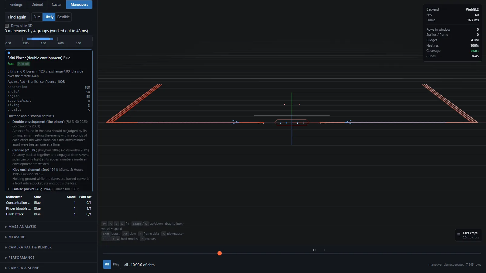

# Манеўры: як рухаюцца групы

**Высновы → Манеўры** сочыць за тым, як адзінкі кожнага боку рухаюцца *як групы*, і называе манеўры, якія яны робяць: флангавы ўдар, клешчы, прарыў, засаду, адыход, абарону ад ракет, перасячэнне T. Для кожнага манеўру паказваецца, наколькі ён верагодны, лічбы, на якіх ён грунтуецца, ці акупіўся ён, а таксама паралелі ў доктрыне і гісторыі. **Масавы аналіз → Манеўры** падлічвае іх у тысячах матчаў: як часта кожны манеўр робіцца на кожнай карце, у кожным рэжыме і для кожнага боку, і як часта ён акупаецца.

Усё вылічваецца ў вашым браўзеры, у сваім асобным працэсе (`src/insights/maneuver`). Матч з некалькімі сотнямі адзінак займае 10-500 мс, а двухгадзінная паветраная вайна з тысячамі аб'ектаў - каля секунды.

## Як карыстацца {#using-it}

- Адкрыйце **Высновы**, укладку **Манеўры**. Пры першым адкрыцці падлік ідзе сам. Пасля змены фільтраў націсніце **Знайсці зноў**.
- **Дакладна / Імаверна / Магчыма** задае, якой упэўненасці манеўры паказваюцца (па змаўчанні - Імаверна).
- **Шкала часу** мае дарожку для кожнага боку і слупок для кожнага манеўру. **Спіс** пад ёй паказвае тое самае па часе. Пры націсканні прайграванне пераходзіць да паўтору на пачатку манеўру, камера ляціць туды і малюе яго ў 3D: шлях кожнай групы - стрэлкай (дзве рукі клешчаў - гэта іх дугі), контуры груп у ключавы момант (контур праціўніка - у колеры яго боку), фронт праціўніка - белай лініяй. **Паказаць усе ў 3D** дадае іншыя манеўры матча, слабымі лініямі. Лініі перадаюцца відэакарце адзін раз, калі змяняецца выбар, а не кожны кадр. Пры 480 манеўрах, намаляваных падчас прайгравання, часы кадраў на сапраўднай відэакарце (WebGL2 і WebGPU, p99 18,0-18,5 мс, максімум 19,5-20,8 мс) такія самыя, як без іх.
- Адкрыты манеўр паказвае свой вынік (страты і забойствы адзінак, якія яго зрабілі, падчас яго і адразу пасля, у параўнанні з абменам свайго боку за ўвесь матч), свае доказы і запісы базы ведаў пра яго: доктрыну і гістарычныя паралелі (Канны для клешчаў, Седан 1940 для прарыву, Цусіма для перасячэння T, Аперацыя Bolo для ілжэ-ўдару...).
- Невялікая табліца ў канцы: для кожнага віду і боку - колькі зроблена і колькі акупілася.

## Як знаходзяцца групы {#how-groups-are-found}

Кожная адзінка змяшчаецца на агульнай шкале часу (крок 1 с пешшу, 2 с у іншых выпадках, даўжэй для вельмі вялікіх файлаў). Адзінка, якая загінула, стаіць нерухома, каб пасля адраджэння не была праведзена лінія праз усю карту. На кожным кроку адзінкі аднаго боку і аднаго віду (авіяцыя, машыны, караблі, пяхота) звязваюцца, калі яны блізка - 18 м пешшу, 170 м для машын, 3 км для караблёў, 5 км для авіяцыі - і рухаюцца аднолькава (хуткасці ў межах паловы хуткасці хутчэйшага або абодва стаяць). Скапленне захоўвае ідэнтыфікатар групы, у якой была большасць яго членаў. Адзінка без класа лічыцца пешай, машынай або паветранай па сваёй хуткасці.

**Форма** групы чытаецца адносна кірунку руху: калона або лінія - па тым, як яны расцягнуты ўздоўж і ўпоперак, клін - калі ў сярэдзіне ідзе лідар, эшалон - калі члены адступаюць да аднаго боку, квадрат - калі яны трымаюць вуглы.

Усё ацэньваецца ў маштабе самога матча. **Дыяпазон бою** `R` - гэта 75-ы працэнтыль адлегласці паміж забойцам і ахвярай (абмежаваны адчуваннем дамена). Часы манеўру залежаць ад віду адзінак (пяхота - трэцяя частка часу для зямлі).

## Што ён знаходзіць {#what-it-finds}

| Манеўр | Знаходзіцца, калі |
|---|---|
| Формаванне | група трымае адну форму на 60% сваіх рухавых крокаў на працягу 30 с |
| Лабавы ўдар | група збліжаецца з-за межаў дыяпазону да кантакту, на ¾ R або больш, з вугла не больш за 35° ад таго, куды глядзіць праціўнік |
| Флангавы ўдар | тое самае з 50-130° (зад - далей); упэўнены толькі з сілай *замацавання*, якая б'ецца з праціўнікам там (забойствы ў любы бок) |
| Клешчы | два флангавыя ўдары аднаго боку па адным целе праціўніка з супрацьлеглых бакоў (на 100° і больш адзін ад аднаго), у межах 90 с; упэўнены, калі рукі б'юцца |
| Акружэнне | кампактная група праціўніка, побач з якой ёсць не менш такой жа колькасці супрацьлеглага боку ў радыусе 1,5 R, ад дзвюх і больш груп, без прамежку шырэй за 100°, на працягу хвіліны, адрэзаная ад свайго боку; упэўнены, калі кальцо зачынілася на ½ R і біла кішэню |
| Прарыў | група праходзіць праз утрыманую лінію (праціўнікі стаяць 30 с і злева, і справа ад яе, а цэнтр свайго боку - за імі); упэўнены, калі яна выходзіць на ½ R далей, трымаецца 20 с і б'ецца там; прарыў - яшчэ на R далей |
| Пераадоленне вагнем | у малой групе частка рухаецца, а астатнія стаяць; ролі мяняюцца чатыры разы і больш, з прыкрыццём агнём ад тых, хто стаіць |
| Канцэнтрацыя / разгортванне | доля боку каля яго самага шчыльнага месца расце з 35% да 60% (адзінкі збіраюцца на 1,5 R і больш, потым кантакт) - або падае, калі сторана разыходзіцца |
| Ілжэ-ўдар | невялікі элемент у кантакце прываблівае два і больш праціўнікаў з іншага месца; большая група потым б'е на чатыры дыяпазоны ад таго месца, дзе праціўнікаў менш |
| Адыход / пераследаванне | група ў кантакце разварочваецца і адыходзіць на R ад таго месца, дзе біла; упэўнены, калі праціўнік там толькі што забіў аднаго з яе і група адышла на 2 R ад гэтага забойцы (ніколі пешшу: гл. ніжэй); праціўнікі, якія ідуць у тым самым кірунку і не адстаюць, пераследуюць |
| Глыбокая абарона | адзінкі, што стаяць, у двух і больш пасах праз восі праціўніка, на R у глыбіню, праціўнік наступае, агонь з пасаў |
| Адваротны схіл | тры і больш забойстваў на кароткай адлегласці ад адзінак, што стаяць, у ахвяр, якія прыйшлі праз грэбень |
| Засада | рухомая група сустракае праціўнікаў, якія стаялі 45 с; яны страляюць першымі, і тыя, хто рухаўся, губляюць два або палову групы |
| Экран | адна-дзве адзінкі рухаюцца наперадзе групы з трох і больш і першымі сустракаюць праціўніка |
| Унутраныя лініі | групы аднаго боку блізка адна да адной паміж групамі другога, адзінкі пераходзяць паміж імі |
| Тэмп | бок адказвае на кантакт (паварот, змена хуткасці, першы стрэл) у 1,5 раза хутчэй, p па Mann-Whitney менш за 0,05 |
| Кранк, ножка, цяга, помпа | мэта пуску ракеты разварочвае стралка на 35-70°, 75-105°, больш за 140°, або цягне і разварочваецца назад |
| Паветраныя клешчы, сцяна, вядучы-вядомы, касілка | пара, якая разбіваецца на аднаго праціўніка; тры ў шарэнзе супраць праціўніка; элемент на 5-20 км за іншым; два круцяцца вакол аднае кропкі на адлегласці ў адну кропку |
| Паветраны патруль | круціцца вакол станцыі тры хвіліны |
| Бой на энергіі / на вуглах | у блізкім бою - курсы на 30° адзін ад аднаго, кожны па чарзе трымае другога на сваім носе, або паміж імі ёсць забойства - выкарыстоўваецца вышыня і набор, або палёт роўна і круты паварот з запаволеннем; упэўнены, калі адзін забіў другога |
| Ударны пакет, SEAD | паветраная група з рознымі роляў, некаторыя з якіх б'юць па зямлі; забойствы зенітнай абароны - раней за большасць іншых забойстваў па зямлі |
| Лінія бою, перасячэнне T | тры караблі ў калоне; калона квадратам праз галаву калоны праціўніка |

Кожны манеўр паказвае, якія **шаблоны** базы ведаў ён адлюстроўвае (`patterns-maneuver.ts`: формаванне, лабавы ўдар, двайны ахоп, акружэнне, прарыў, агонь і манеўр, ілжэ-ўдар, адыход, пераследаванне, глыбокая абарона, экранаванне, разгортванне, абарона ад ракет, бой на вуглах, паветраны патруль, ударны пакет, лінія бою, перасячэнне T), і запісы, якія варта прачытаць спачатку. Старыя запісы пераносяць новыя шаблоны праз `knowledge/maneuver-tags.ts`. Гл. [Лінза ведаў](knowledge.md).

**Акупіўся** параўноўвае абмен адзінак падчас манеўру (і хвіліну пасля) з абменам іх боку за ўвесь матч. Адыход акупаецца, калі пасля павароту страчана менш адзінак, чым да яго. Абарона ад ракет - калі самалёт жыве хвіліну. Акружэнне - калі кішэня губляе палову.

## Па многіх матчах {#over-many-matches}

Падсумаванне кожнага матча (`src/mass/summarize.ts`, гл. [Масавы аналіз](mass-analysis.md)) мае невялікі раздзел `maneuvers`: для кожнага віду і боку - колькі зроблена (на ўзроўні Імаверна або вышэй), колькі акупілася, колькі не акупілася, забойствы і страты. **Масавы аналіз → Манеўры** складае іх па матчах, якія пакідае фільтр, - па карце і рэжыме або па ўсіх разам, з інтэрвалам Уілсана для долі акупленых. Радок загружае матчы, у якіх ён быў зроблены. Падсумаванні, запісаныя да з'яўлення гэтага раздзелу, яго не маюць: запусціце `node tools/3dheat-summarize.mjs <folder> --force`, каб дадаць яго.

## Наколькі ён упэўнены {#how-sure-it-is}

Сінтэтычныя матчы з закладзенымі манеўрамі (`synth.ts`, запускаецца `maneuver.test.ts`): усе 28 закладзеных відаў знаходзяцца на ўзроўні Імаверна або вышэй. З 50 паведамленых манеўраў 31 - закладзенага віду, а іншыя 19 таксама сапраўды ёсць (формаванне рухомай групы, лабавы падыход калоны, якая прарываецца). Ні адзін не памылковы. На 30 нулявых матчах - выпадковыя блуканні асобна і змешаныя, адзінкі стаяць выпадкова, самалёты ляцяць па прамых, натоўп мітусіцца - нічога не паведамляецца на ўзроўні Імаверна або вышэй.

На сапраўдных данных (дзясяткі наземных бітваў, некалькі доўгіх місій паветранай вайны, некалькі матчаў стралкоў): лабавыя ўдары, флангі, прарывы і акружэнні ў танкавых бітвах; фармаванні і блізкія боі ў паветры; абароны ад ракет, паветраныя патрулі і пары «вядучы-вядомы» ў місіях паветранай вайны; лабавыя дабіванні, калоны, а таксама некалькі засад і пар, якія чаргуюцца, у стралках. Парогі - гэта формы з доктрыны, пераведзеныя на памер гульні. Адзін знаходак чытайце з яго доказамі, а долі ў табліцы масава - з іх інтэрваламі.

### Супраць нулявых мадэляў тых самых матчаў {#against-null-models-of-the-same-matches}

Дэтэктар можа быць ашуканы мясцовасцю і натоўпам: у свалцы кожная група мае ворагаў са ўсіх бакоў. Таму кожны від таксама запускаецца на **нулявых мадэлях**, пабудаваных з тых самых матчаў (`nulls.ts`), дзе бакі ўжо не сустракаюцца, як раней: часовая шкала аднаго боку паварочваецца на адну траць - дзве траціны матча (*зрух*), або яго траекторыі паварочваюцца вакол цэнтра карты (*паварот*); а метку каманды перамешваюць (*каманды*, што па пабудове захоўвае каля паловы сапраўдных бітваў). Бітвы лічацца толькі як забойствы, звязаныя з сваімі смерцямі: забойца - у межах 2 R, ахвяра - на месцы. Нулявая мадэль гэта парушае. Знаходкі на ўзроўні Імаверна або вышэй, сапраўдныя супраць нулявых мадэляў (30 танкавых бітваў; 12 матчаў стралкоў):

| Від | Танкавыя бітвы: сапраўдныя / зрух / паварот | Стралкі: сапраўдныя / зрух / паварот |
|---|---|---|
| Акружэнне | 0 / 0 / 0 (было 1,3 / 1,2 / 0,8) | 0 / 0 / 0 |
| Прарыў | 0,03 / 0,02 / 0,05 (было 1,6 / 1,8 / 1,4) | 0 / 0 / 0 |
| Фланг | 0,33 / 0,07 / 0,10 | 1,0 / 0,08 / 0,21 |
| Лабавы ўдар | 0,87 / 0,47 / 0,12 | 14,4 / 6,5 / 4,3 |
| Адыход | 0,03 / 0 / 0,02 | 0,08 / 0,08 / 0,5 (таму пешшу ніколі не ўпэўнены) |
| Засада | - | 0,17 / 0,04 / 0,04 |
| Бой на энергіі | 1,2 / 0,1 / 0,85 | - |
| Бой на вуглах | 0,6 / 0,07 / 0,3 | - |

Блізкія паветраныя баі над цэнтрам бітвы перажываюць паварот вакол гэтага цэнтра, таму калонка «паварот» менш ілжыва ацэньвае іх, чым наземныя віды. Віды ўнутры аднаго боку - фармаванне, паветраны патруль, касілка, ударны пакет, SEAD, пераадоленне вагнем, экран - не залежаць ад другога боку і такім чынам не правяраюцца. `maneuver.test.ts` правярае, ці прыбіраюць нулявыя мадэлі закладзеныя флангавы ўдар, клешчы, акружэнне, прарыў, засаду і адыход з сінтэтычных матчаў.

## Абмежаванні {#limits}

- Групам патрэбны становішчы ў часе; файл з адных падзей іх не мае.
- Напрамак твару не чытаецца з даных: фронт праціўніка - там, дзе яго трымае сіла замацавання, інакш - там, куды ён рухаецца, інакш - адкуль прыйшоў нападнік.
- Мясцовасць чытаецца па вышынях самых адзінак (адваротны схіл); праверкі прамой бачнасці няма.
- Вельмі вялікія файлы бяруцца з больш доўгімі крокамі; кароткія паветраныя манеўры ў іх усё роўна чытаюцца з крокаў па 2-4 с.
