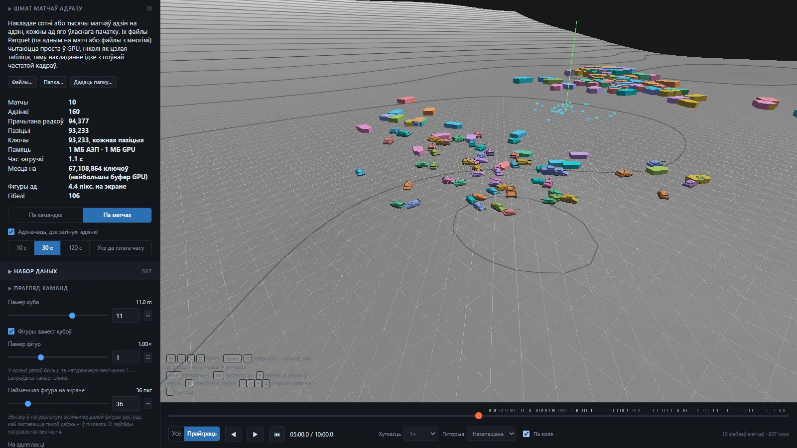

# Шмат матчаў адразу

**Шмат матчаў адразу** прайграе многія матчы адзін на адным, таму вы бачыце, куды звычайна ходзяць гульцы кожнага матча. Выкарыстоўвайце, каб параўнаць сотні або тысячы матчаў на адной карцінцы.

Кожны матч пачынаецца з свайго пачатку, і яго адзінкі рухаюцца як фігуры. Файлы ідуць проста ў відэакарту, і поўная табліца не будуецца, таму прайграванне плаўнае там, дзе звычайная загрузка вычарпала б памяць.

## Як выкарыстоўваць {#how-to-use-it}

1. Адкрыйце **Шмат матчаў адразу** на бакавой панэлі Heatmap.
2. Націсніце **Файлы…** (абярыце многа файлаў), **Папка…** (папка і яе падпапкі) або **Дадаць папку…** (дадаць да загружанага).
3. Праглядальнік пераключаецца на накладанне фігур і пачынае з пачатку. Націсніце **Прайграць**.

Кожны файл — гэта адзін матч (або некалькі). Працуюць файлы Parquet і кантэйнеры [`.3dheat`](container.md). Файлу патрэбны слупкі пазіцыі, часу і адзінкі; слупкі назвы, тыпу і боку захоўваюцца. Іншыя файлы і бакавыя файлы канвертараў (палёт, паведамленні, падзеі, чат, задачы) прапускаюцца. Для звычайнай табліцы гл. [Загрузка даных](getting-data-in.md).

## Налады {#settings}

| Налада | Што робіць |
|---|---|
| **Па камандах** / **Па матчах** | Колер па боку або колер на матч. |
| **Адзначаць, дзе загінулі адзінкі** | Адзнака ў месцы, дзе загінула кожная адзінка, на 10 с, 30 с, 120 с або ўсе дасюль. |

Панэль паказвае, колькі матчаў, адзінак, радкоў і пазіцый прачытана, колькі памяці выкарыстана і час загрузкі. *Room for* — колькі яшчэ пазіцый відэакарта магла б узяць. *Figures from* — памер на экране, ніжэй за які адзінка малюецца як маленькі дротык замест фігуры.

Выгляд фігур выкарыстоўвае тыя ж элементы кіравання, што і [прайграванне матчу](match-replay.md#figures): **Памер фігур**, **Найменшая фігура на экране** і **На адлегласці**.

## Парады {#tips}

- Калі ўсё не змясцілася б у памяці, пазіцыі праразраджваюцца (захоўваецца толькі пазіцыя праз кожныя некалькі метраў), і панэль пра гэта кажа.
- Рэжымы цеплыні таксама працуюць з данымі накладання.
- Для статыстыкі па тысячах матчаў без малявання гл. [Масавы аналіз](mass-analysis.md).
