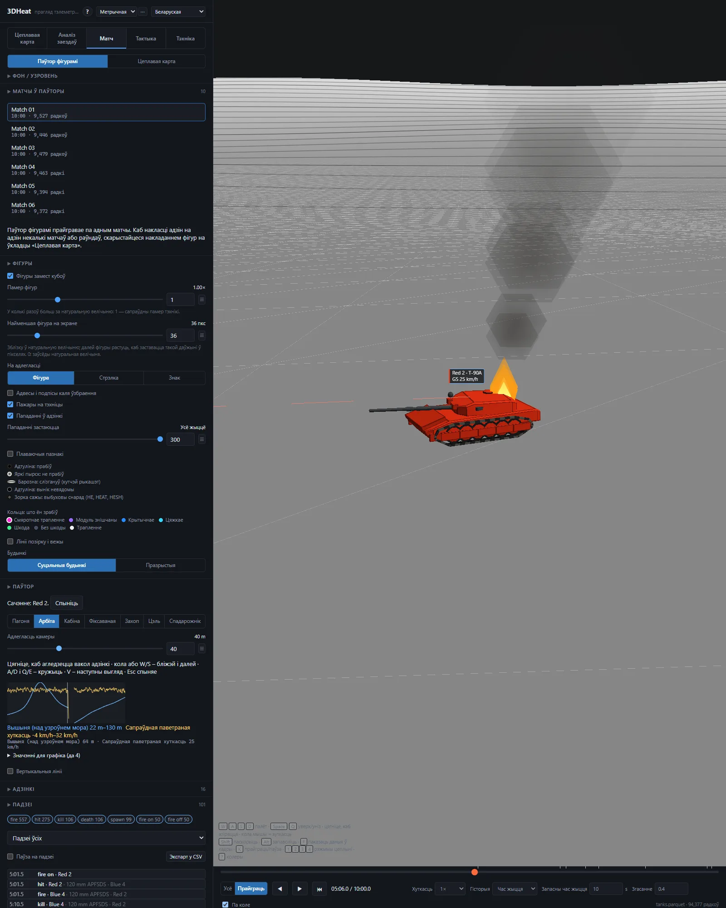
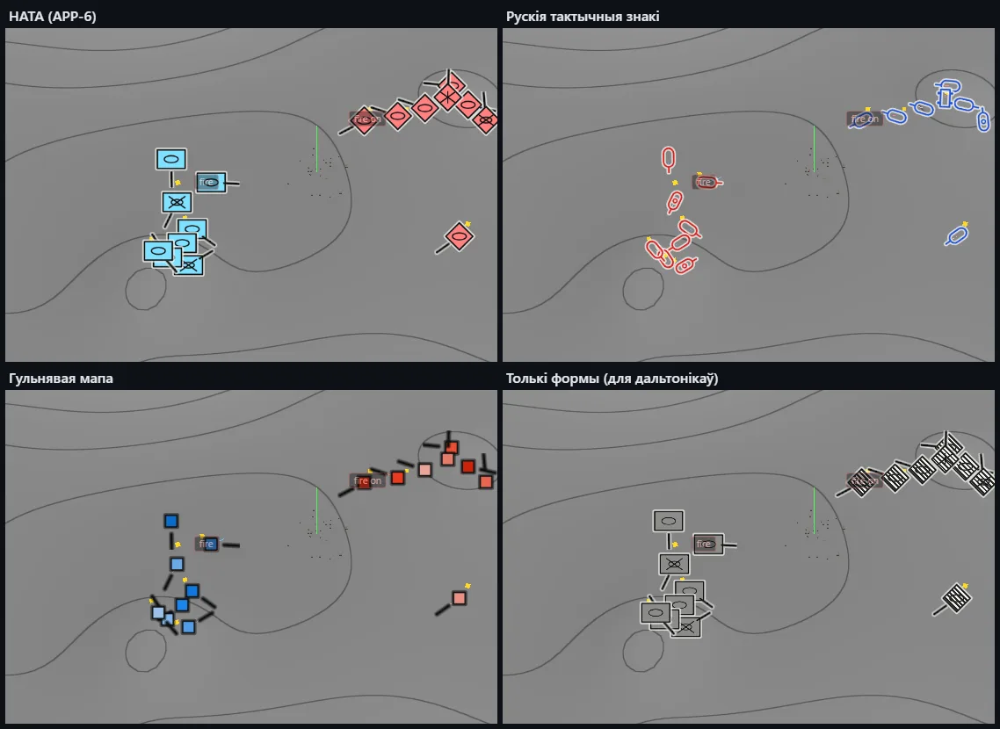
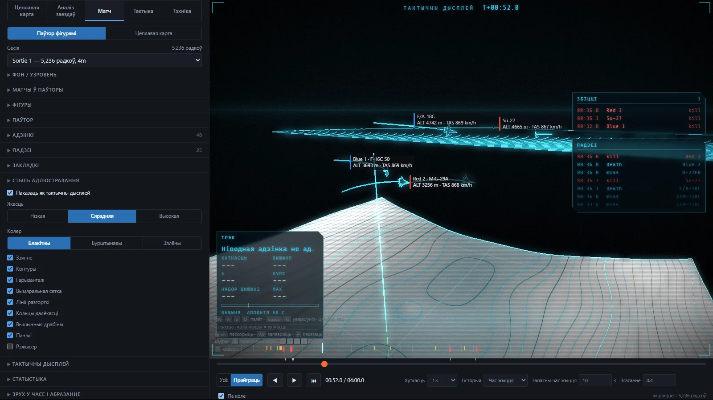

# Прайграванне матчу

Паўтор - гэта фільм матчу, дзе кожны гулец намаляваны тым, чым ён кіраваў. Выкарыстоўвайце, каб яшчэ раз паглядзець бой, сачыць за адной адзінкай і бачыць, хто каго пападзе.

Стрэлы, пападанні, пажары і знішчаныя адзінкі малююцца на адзінках і аб'ектах на ўзроўні. Камеры, подпісы і тактычны дысплей дапамагаюць чытаць бой. Вы ведаеце Tacview? [Паралельнасць з Tacview](tacview-parity.md) паказвае, дзе знаходзіцца кожны яго інструмент.

## Пачаць паўтор {#start-a-replay}

1. Загрузіце запіс праз **Source → Files…** або перацягнуўшы яго на панэль Source (любая табліца з калонкай **person** і калонкай **time**, файл Tacview, канвертаваны паўтор, матч у фармаце [`.3dheat`](container.md)). Гл. [Загрузка даных](getting-data-in.md).
2. Адкрыйце ўкладку **Match** і абярыце **Figure replay** або абярыце **Figure overlay** у панэлі рэжымаў укладкі Heatmap.
3. У раздзеле **Matches in the replay** абярыце адзін матч, усе адразу або некалькі.
4. Націсніце **Play** на шкале часу (або `K`). Перацягніце шкалу часу, каб перайсці.

Фігуры замяняюць кубы для кожнай адзінкі, чыё імя або від вядомыя (гл. [Фігуры](figures.md)). Даныя без калонкі імя або віду малююцца як салдаты.

## Фігуры {#figures}

| Налада (раздзел **Figures**) | Па змаўчанні | Што робіць |
|---|---|---|
| **Figures instead of boxes** | уключана | Выключана малюе простыя кубы. |
| **Figure size** (разоў ад сапраўднага памеру) | 1 | 1 - сапраўдны памер; ад 0,25 да 20 разоў (лагарыфмічная шкала). Большы памер дапамагае здалёку. |
| **Smallest figure on screen** | 36 px | Далёкія фігуры павялічваюцца, каб заставацца такога памеру, ад 0 да 200 px; 0 захоўвае сапраўдны памер. |
| **At a distance**: Figure, Arrow, Symbol | Figure | Чым становіцца далёкая адзінка. |
| **Symbols** | NATO (APP-6) | NATO (APP-6), расійскія тактычныя знакі, значкі **Game map** або **Shape only (colour-blind safe)**. |
| **Symbol size**, **My side**, **Hostile / Neutral**, **Heading ticks** | 28 px (ад 12 да 64), аўтаматычна, варожы, уключана | Як выглядаюць знакі і які бок з'яўляецца сяброўскім. |
| **Drop lines** | уключана | Лінія ад кожнай адзінкі прама ўніз да зямлі, каб вышыні чыталіся ў 3D. |
| **Drop lines and labels on weapons** | выключана | Лініі да зямлі і подпісы на ракетах і бомбах. |
| **Fires on units** | уключана | Полымя ад моманту, калі адзінка загарэлася, да таго, як яго патушылі. |
| **Hits on units** | уключана | Адзнакі там, дзе ўдарылі стрэлы (ніжэй). **Hits stay**: ад 1 да 300 секунд, або **Whole life**. **Floating markers**: адзнакі, намаляваныя над паверхняй. |
| **Aim and turret lines** | выключана | Пунктырам: куды глядзіць гулец; суцэльна: куды накіравана гармата. |
| **Buildings** | solid | Суцэльныя або празрыстыя будынкі, калі ўзровень іх малюе. |

### Знакі на адлегласці {#symbols-at-a-distance}

Калі адзінка была б меншай за **Smallest figure on screen**, яна можа стаць знакам, які застаецца чытэльным. Форма паказвае від (напрыклад, закруглены кубік з адзнакай гусенічнага ходу для браніраванай тэхнікі); колер паказвае бок. Адкрыйце меню **Symbols**, каб змяніць стыль.

### Адзнакі траплянняў, зруйнаваная тэхніка і пажары {#hit-marks-wrecks-and-fires}

- **Адзнакі траплянняў** сядзяць на паверхні, у якую трапіў стрэл, у маштабе фігуры. Іх выгляд кажа, што адбылося: дзірка (праб'е), яркі плеск (не праб'е), драпіна (рыкашэт), зорка з сажы (фугасны снарад). Каляровае кола кажа, што гэта зрабіла: смяротны стрэл, модуль знішчаны, крытычна, моцна, пашкоджанне, без пашкоджання, пападанне. Навядзіце на адзнаку, каб убачыць назву снарада.
- Знішчаная адзінка малюецца **абвугленай** як руіна ад моманту смерці, пакуль не адрадзіцца або не будзе выдалена; яе знак перакрэслены.
- **Пажары** гараць на адзінцы ад моманту, калі яна загарэлася, да таго, як яе патушылі.
- **Вежы** паварочваюцца туды, куды паказваюць даныя, куды накіравана гармата (або, без іх, куды глядзіць гулец).

### Зброя, падманкі і трасіры {#weapons-decoys-and-tracers}

Калі ўключана **Weapons, shots and hits** (раздзел Team viewer): ракеты, снарады, бомбы і торпеды ляцяць як уласныя фігуры з дымавым следам; кулі і снарады - гэта трасіры; удары і выбухі ўспыхваюць. Трасір, намаляваны **пунктырам**, быў вылічаны з пападання, бо ў даных не было стрэлу. Ракетныя пасткі і дыпольныя адбівальнікі малююцца як падманкі; яны схаваны са спісу адзінак, калі не адзначана *Decoys and shells*.

## Камеры {#cameras}

Націсніце на адзінку або яе подпіс, каб **сачыць** за ёй; раздзел **Replay** прапануе **Chase**, **Orbit**, **Cockpit** (з цэласным дысплеем, `H`), **Fixed**, **Padlock**, **Target** і **Satellite**. `V` перамыкае іх, **Camera distance** задае адлегласць. Esc спыняе.

- **Выгляд з дзвюх адзінак**: абярыце **Target** (або націсніце Ctrl/Alt і пстрычніце адзінку), каб глядзець на яе з адзінкі, за якой сочыце; **Swap** мяняе іх месцамі.
- **Measure**: націсніце Shift і пстрычніце дзве адзінкі, каб убачыць пеленг, дальнасць і розніцу вышыні паміж імі.
- **2D-карта** (`M`): кутні або поўны выгляд, са следамі і імёнамі.
- **Закладкі** (`B`): захоўваюць момант і камеру; забойствы, смерці і адзнакі самога запісу таксама ў спісе.
- **Events**: кожная падзея ў часавым парадку; пстрычка пераносіць туды. `Page Up` / `Page Down` пераходзяць паміж падзеямі; **Pause on event** спыняецца на кожнай.

## Тактычны дысплей {#tactical-display}

Раздзел **Tactical display** малюе для адзінкі, абраных, усіх або аднаго віду (лятальныя апараты, наземныя, караблі, узбраенне): вектары хуткасці і шлях наперад, лініі носа і падымальнай сілы, конусы радара, захопы, каналы перадачы даных, зоны і лініі сутыкнення, лініі візіравання, куды глядзяць гульцы (конусы агляду), прыцэл вежы і запісаную камеру.

### Стыль дысплея {#display-style}

`T` (або пераключальнік **Show as tactical display**) пераводзіць выгляд у стыль экрана радара: свячэнне, контуры, контурныя лініі, сетка вымярэнняў, лініі сканавання, кругі дальнасці, шкалы вышыні, панэлі з забойствамі і падзеямі, і **Director**, які сам перамяшчае камеру да падзей.

## Мэты {#objectives}

Калі матч мае свае мэты, раздзел **Objectives** малюе іх на ўзроўні: зоны захопу (з уладальнікам і прагрэсам захопу), спаўны, аэрадромы, плошчы і цэлі для бамбавання, кожны пласт можна перамыкаць, з подпісамі. Яны бачныя праз зямлю. Калі загружаны некалькі гульнявых рэжымаў, **Mode** фільтруе матчы па рэжыме. Мэты паступаюць з файла матчу канвэртара побач з запісам або ўнутры кантэйнера [`.3dheat`](container.md).

## Подпісы і статыстыка {#labels-and-statistics}

- **Labels**: правілы для кожнага віду (**Selected**, **Aircraft**, **Ground**, **Ships**, **Weapons**, **AI**): паказваць ці не, якія значэнні, і **Priority** - хто атрымлівае месца, калі подпісы накладваюцца. **Keep labels apart** перамяшчае подпіс побач з адзінкай, калі ён закрыў бы іншую, і прыбірае яго там, дзе няма месца. **Label size** - ад 60 да 250 %. **Back to name, vehicle, altitude and speed** скідвае правілы.
  - Наземныя адзінкі пачынаюць з імя, тэхнікі і хуткасці.
  - Лятальныя апараты пачынаюць з імя, тэхнікі, вышыні і хуткасці.
  - Караблі пачынаюць з імя, тэхнікі, хуткасці і курсу.
  - Навядзіце на адзінку, каб убачыць усе яе значэнні.
- **Statistics**: для кожнай каманды і адзінкі: забойствы, смерці, стрэлы, пападанні, суадносіны пападанняў, узлёты, пасадкі, час у паветры, максімальная хуткасць, вышыня і G, адлегласць. Экспарт у CSV.
- **Charts**: значэнні адзінкі з цягам часу, дзве адзінкі ў параўнанні або адно значэнне супраць другога.

## Многа матчаў адразу {#many-matches-at-once}

Каб пакласці сотні або тысячы матчаў адзін на аднаго, гл. [Многа матчаў адразу](many-matches.md). Падрабязнасці фігур (дым, полымя, іншыя эфекты з часам): [Фігуры ў накладанні фігур](figure-replay.md). Спіс магчымасцей Tacview: [Паралельнасць з Tacview](tacview-parity.md), старонка, звязаная з гэтай.
