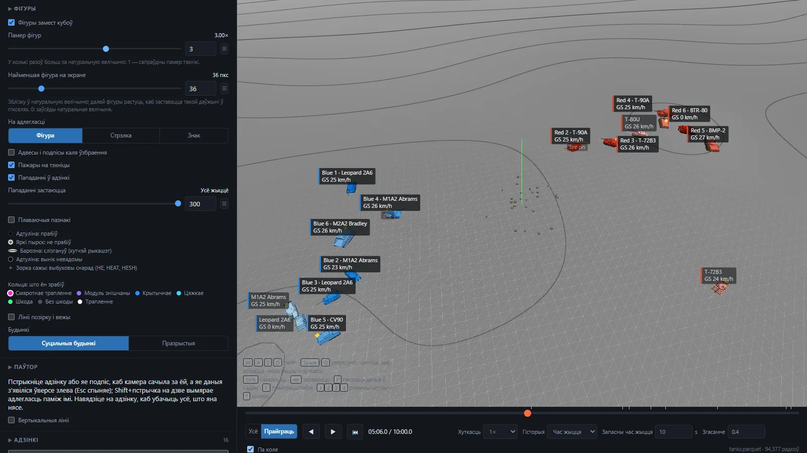
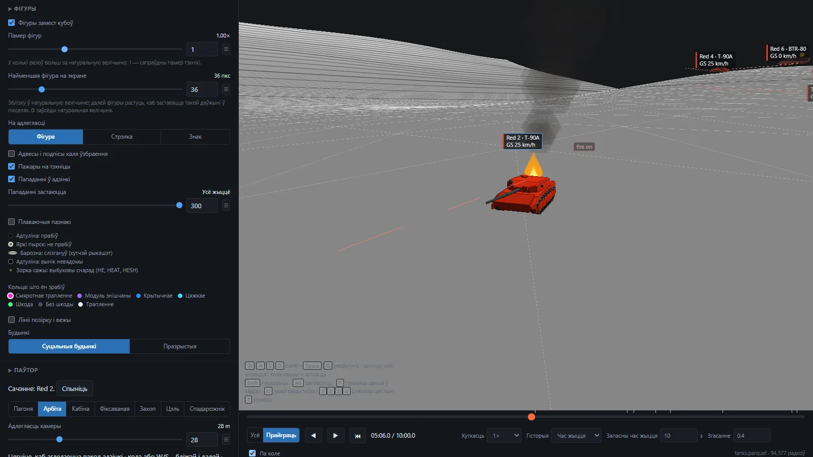
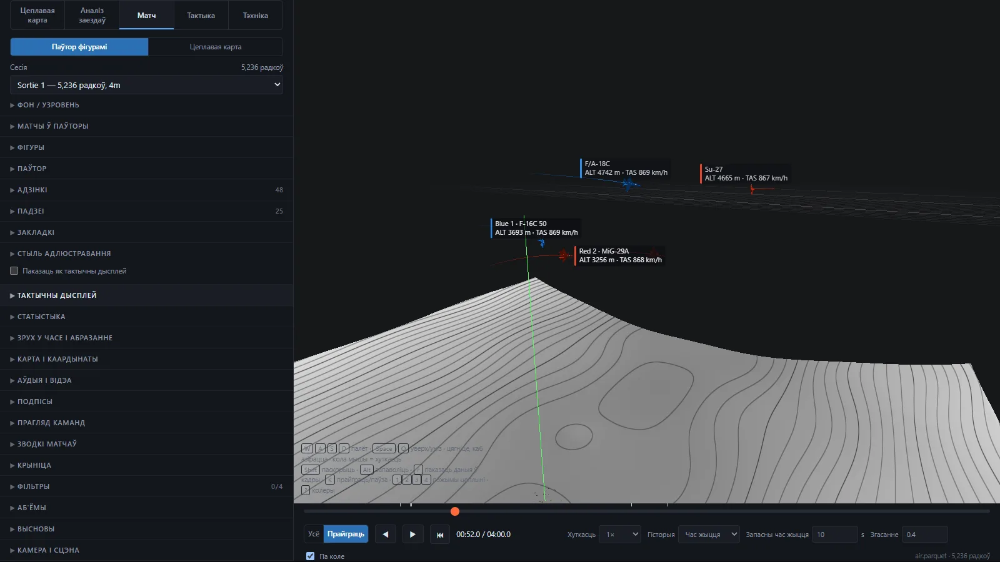

# Прайграванне матчу

Паўтор - гэта фільм матчу, дзе кожны гулец намаляваны тым, чым ён кіраваў. Выкарыстоўвайце, каб яшчэ раз паглядзець бойку, сачыць за адной адзінкай і бачыць, хто каго трапіў.

Стрэлы, пападанні, пажары і разбураныя адзінкі малююцца на адзінках і мэтах на ўзроўні. Камеры, подпісы і тактычны дысплей дапамагаюць чытаць бойку. Вы ведаеце Tacview? [Паралельнасць з Tacview](tacview-parity.md) паказвае, дзе знаходзіцца кожны яго інструмент.

## Запусціць паўтор {#start-a-replay}

1. Загрузіце запіс праз **Крыніца → Файлы…** або перацягнуўшы яго на панэль Крыніца (любая табліца з слупкамі **асоба** і **час**, файл Tacview, канвертаваны паўтор, матч [`.3dheat`](container.md)). Гл. [Загрузка даных](getting-data-in.md).
2. Адкрыйце ўкладку **Матч** і выберыце **Паўтор фігурамі**, або выберыце **Накладанне фігур** на панэлі рэжымаў укладкі Цеплавая карта.
3. У **Матчы ў паўторы** выберыце адзін матч, усе адразу або некалькі.
4. Націсніце **Прайграць** на стужцы часу (або `K`). Перацягніце стужку, каб перайсці.

Фігуры замяняюць кубы для кожнай адзінкі, чыя назва або тып вядомы (гл. [Фігуры](figures.md)). Даныя без слупка назвы або тыпу малююцца як салдаты.

## Фігуры {#figures}

| Налада (раздзел **Фігуры**) | Па змаўчанні | Што робіць |
|---|---|---|
| **Фігуры замест кубоў** | уключана | Выключана малюе звычайныя куба. |
| **Памер фігур** (у разы ад натуральнага) | 1 | 1 - натуральны памер; ад 0.25 да 20 разоў (лагарыфмічная шкала). Большы дапамагае здалёк. |
| **Найменшая фігура на экране** | 36 px | Далёкія фігуры павялічваюцца, каб заставацца такімі вялікімі, ад 0 да 200 px; 0 трымае натуральны памер. |
| **На адлегласці**: Figure, Arrow, Symbol | Figure | У што ператвараецца далёкая адзінка. |
| **Знакі** | NATO (APP-6) | NATO (APP-6), рускія тактычныя знакі, значкі **Гульнявая мапа** або **Толькі формы (для дальтонікаў)**. |
| **Памер знака**, **Мой бок**, **Hostile / Neutral**, **Адзнакі курсу** | 28 px (ад 12 да 64), аўтаматычна, варожы, уключана | Як выглядаюць знакі і якая старана свая. |
| **Вертыкальныя лініі** | уключана | Лінія ад кожнай адзінкі проста ўніз да зямлі, каб вышыні чыталіся ў 3D. |
| **Адвесы і подпісы каля ўзбраення** | выключана | Лініі да зямлі і подпісы на ракетах і бомбах. |
| **Пажары на тэхніцы** | уключана | Полымя з моманту, калі адзінка загарэлася, да гасення. |
| **Пападанні ў адзінкі** | уключана | Адзнакі, дзе ўдарылі стрэлы (ніжэй). **Пападанні застаюцца**: ад 1 да 300 секунд, або **Усё жыццё**. **Плаваючыя пазнакі**: адзнакі над паверхняй. |
| **Лініі позірку і вежы** | выключана | Пункцірам: куды глядзіць гулец; суцэльна: куды накіравана гармата. |
| **Будынкі** | суцэльна | Суцэльныя або празрыстыя будынкі, калі ўзровень іх малюе. |

### Знакі на адлегласці {#symbols-at-a-distance}

Калі адзінка была б меншай за **Найменшая фігура на экране**, яна можа стаць знакам, які застаецца чытэльным. Форма кажа пра від (напрыклад, закруглёная скрынка з адзнакай гусенічнага ходу для браневой тэхнікі); колер кажа пра старану. Адкрыйце меню **Знакі**, каб змяніць стыль.

### Адзнакі пападанняў, разбураная тэхніка і пажары {#hit-marks-wrecks-and-fires}

- **Пазнакі траплянняў** сядзяць на паверхні, у якую трапіў стрэл, у маштабе фігуры. Іх выгляд кажа, што здарылася: дзірка (прабіў), яркі сплеск (не прабіў), барозна (рыкашэт), зорка сажы (фугасны снарад). Каляровае кольца кажа, што ён зрабіў: смяротны стрэл, модуль разбіты, крытычна, моцна, пашкоджанне, без пашкоджання, пападанне. Навядзіцеся на адзнаку, каб убачыць назву снарада.
- Знішчаная адзінка малюецца **абвуглена** як разбурэнне ад моманту смерці, пакуль не ўваскросне або не будзе выдалена; яе знак перакрэслены.
- **Пажары** гараць на адзінцы з моманту, калі яна загарэлася, да гасення.
- **Вежы** паварочваюцца туды, куды паказваюць даныя, што гарматы накіраваны (або, без іх, куды глядзіць гулец).

### Зброя, прыманкі і трасіры {#weapons-decoys-and-tracers}

Калі **Зброя, стрэлы і пападанні** уключана (раздзел Прагляд каманд): ракеты, снарады, бомбы і торпеды лятаюць як уласныя фігуры з дымавым шлейфам; кулі і снарады - трасіры; ўдары і выбухі ўспыхваюць. Трасір, намаляваны **пункцірам**, быў вылічаны з пападання, бо ў даных не было стрэлу. Флары і дыпольныя адбіцыі малююцца як прыманкі; яны схаваны са спісу адзінак, калі не адзначана *Decoys and shells*.

## Камеры {#cameras}

Націсніце на адзінку або яе подпіс, каб **сачыць** за ёй; раздзел **Паўтор** прапануе **Пагоня**, **Арбіта**, **Кабіна** (Кабіна, з head-up дысплэем, `H`), **Фіксаваная**, **Захоп**, **Цэль** і **Спадарожнік**. `V` перамыкае іх, **Адлегласць камеры** задае адлегласць. Esc спыняе.

- **Выгляд двух адзінак**: абярыце **Цэль** (або Ctrl/Alt-клік на адзінку), каб глядзець на яе з той, за якой сочыце; **Памяняць** мяняе іх месцамі.
- **Паказчык**: Shift-клік на дзве адзінкі дае пеленг, дальнасць і розніцу вышынь паміж імі.
- **2D-карта** (`M`): кутні або поўны выгляд, са слядамі і імёнамі.
- **Закладкі** (`B`): захаваць момант і камеру; уласныя забойствы, смерці і адзнакі запісу таксама пералічваюцца.
- **Падзеі**: кожная падзея ў часавым парадку; клік пераходзіць туды. `Page Up` / `Page Down` скачуць паміж падзеямі; **Паўза на падзеі** спыняецца на кожнай.

## Тактычны дысплей {#tactical-display}

Раздзел **Тактычны дысплей** малюе, для адзінак, абраных, усіх або аднаго віду (лятальныя апараты, наземныя, караблі, узбраенне): вектары хуткасці і шлях наперад, лініі носа і падымальнай сілы, радарныя конусы, захопы, каналы перадачы даных, зоны і лініі ўзаемадзеяння, лініі погляду, куды глядзяць гульцы (конусы агляду), прыцэл вежы і запісаную камеру.

### Стыль дысплэя {#display-style}

`T` (або пераключальнік **Паказаць як тактычны дысплей**) пераключае выгляд у радарны стыль: свячэнне, контуры, гарызанталі, сетка вымярэнняў, лініі сканавання, кольцы дальнасці, лесвіцы вышыні, панэлі з забойствамі і падзеямі і **Рэжысёр**, які сам перамяшчае камеру да падзей.

## Мэты {#objectives}

Калі матч прыходзіць з мэтамі, раздзел **Мэты** малюе іх на ўзроўні: зоны захопу (з уладальнікам і прагрэсам захопу), пункты нараджэння, аэрадромы, вобласці і мэты для бамбавання, кожны пласт можна ўключыць або выключыць, з подпісамі. Яны бачны скрозь зямлю. Калі загружана некалькі рэжымаў гульні, **Рэжым** фільтруе матчы па рэжыму. Мэты бяруцца з файла матчу канвертара побач з запісам або ўнутры [`.3dheat`](container.md) кантэйнера.

## Подпісы і статыстыка {#labels-and-statistics}

- **Подпісы**: правілы для кожнага віду (**Абраныя**, **Лятальныя апараты**, **Наземныя**, **Караблі**, **Узбраенне**, **ШІ**): паказваць або не, якія значэнні, і **Прыярытэт** - каму даецца месца, калі подпісы накладаюцца. **Не накладваць подпісы** перамяшчае подпіс побач з адзінкай, калі ён закрыў бы іншую, і прыбірае, калі месца няма. **Памер подпісаў** - ад 60 да 250 %. **Вярнуць імя, тэхніку, вышыню і хуткасць** скідае правілы.
  - Наземныя адзінкі пачынаюцца з імя, тэхнікі і хуткасці.
  - Лятальныя апараты пачынаюцца з імя, тэхнікі, вышыні і хуткасці.
  - Караблі пачынаюцца з імя, тэхнікі, хуткасці і курсу.
  - Навядзіцеся на адзінку, каб убачыць кожнае значэнне, якое яна мае.
- **Статыстыка**: для кожнай каманды і адзінкі: забойствы, смерці, стрэлы, пападанні, доля пападанняў, узлёты, пасадкі, час у паветры, максімальная хуткасць, вышыня і G, адлегласць. Экспарт у CSV.
- **Графікі**: значэнні адзінкі з часам, дзве адзінкі параўнаныя або адно значэнне супраць другога.

## Многа матчаў адначасова {#many-matches-at-once}

Каб наклаць адзін на другі сотні або тысячы матчаў, гл. [Многа матчаў адначасова](many-matches.md). Падрабязнасці фігур (дым, агонь, іншыя эфекты з часам): [Фігуры ў накладанні фігур](figure-replay.md). Спіс магчымасцей Tacview: [Паралельнасць з Tacview](tacview-parity.md), падстаронка гэтай старонкі.
