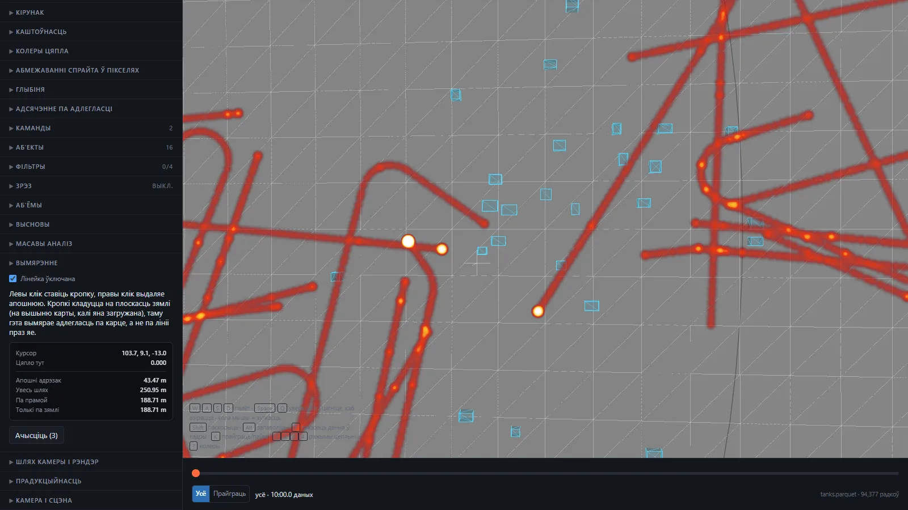

# Паказчык

**Паказчык** ператварае мыш у лінейку і кажа вам, наколькі загружана месца пад курсорам. Выкарыстоўвайце яго, каб даведацца, наколькі далёка адно ад аднаго месцы, або колькі руху праходзіць праз адно месца.

## Паспрабуйце {#try-it}

1. Адкрыйце **Паказчык** на бакавой панэлі і адзначце **Лінейка ўключана**.
2. Націскайце левай кнопкай мышы ў трох месцах на карце. Кожны націск ставіць кропку.
3. Чытайце **Увесь шлях** (даўжыня ўсяго шляху) і **Апошні адрэзак** (апошні перагон).
4. Націсніце правай кнопкай, каб выдаліць апошнюю кропку, або націсніце **Ачысціць (3)**, каб выдаліць усе.

| Дзеянне | Эфект |
|---|---|
| Левы націск | Ставіць кропку там, дзе курсор сустракаецца з плоскасцю зямлі. Націск, пры якім мыш пасля націску і адпускання перасунулася больш чым на 4 пікселі, — гэта перацягванне камеры, а не кропка. |
| Правы націск | Выдаляе апошнюю кропку. |
| Рух | Становішча курсора і цеплыня пад ім абнаўляюцца ў рэальным часе. |

Камера працуе, пакуль лінейка ўключана: перацягванне па-ранейшаму аглядае, клавішы па-ранейшаму лётаюць. Пакуль лінейка ўключана, яна забірае кожны націск, таму [выбар націскам](camera.md#click-to-pick) чакае, пакуль яна выключана.

**Плоскасць зямлі** — гэта вышыня [выявы карты](map-images.md), калі выява карты загружана, інакш самы нізкі Y набору даных (0, калі выявы няма). Кропкі трапляюць на яе, таму лінейка вымярае праз карту, а не па прамой лініі праз яе. З 3D-узроўнем плоскасць усё роўна самы нізкі Y набору даных, а не паверхня ўзроўню. Для кропкі на сапраўднай паверхні выключыце лінейку і націсніце яе ([выбар націскам](camera.md#click-to-pick)): ён счытвае каардынаты з уласных трохвугольнікаў узроўню.

## Паказанні {#readouts}

| Радок | Значэнне |
|---|---|
| **Курсор** | Сусветныя X, Y, Z пункта пад курсорам, на плоскасці. |
| **Цяпло тут** | Колькі цяпла ў пікселі курсора. Большая лічба — больш руху ў гэтым месцы. Гэта значэнне, якое падаецца ў колеравую шкалу да таго, як кропка насычэння яго дзеліць, таму яго можна параўноўваць з [кропкай насычэння](colour-and-exposure.md#saturation-point). |
| **Апошні адрэзак** | Адлегласць ад апошняй кропкі да курсора (або паміж двума апошнімі кропкамі). |
| **Увесь шлях** | Даўжыня ламанай праз кожную кропку і курсор. |
| **Па прамой** | 3D-адлегласць ад першай кропкі да курсора (або апошняй кропкі). |
| **Толькі па зямлі** | Тое ж самае, толькі па X і Z. |
| **Ачысціць (N)** | Выдаляе ўсе кропкі. |

Адлегласці паказваюцца ў сантыметрах, калі менш за 1 адзінку, у метрах, калі менш за 1 000, і ў кіламетрах, калі больш, — маючы на ўвазе, што адна сусветная адзінка — метр ([Восі, адзінкі і час](axes-units-and-time.md#unit-scale)). Каардынаты — сусветныя, у тым ліку калі вось [інвертавана для паказу](camera.md#invert-world-axis).

Кропкі і лінія паміж імі малююцца накладкай у відзе, памер бярэцца з крока сеткі. Кропкі лінейкі не захоўваюцца ў відах; яны застаюцца, калі вы загружаеце іншыя даныя.

## Для распрацоўшчыкаў {#for-developers}

**Цяпло тут** счытваецца з GPU не часцей за раз у 120 мс, бо счытванне аднаго пікселя спыняе канвеер. Ён выкарыстоўвае той жа шлях, што і `engine.readHeatProbe()`: дзеліцца на ўзмацненне, з якім быў запісаны кадр. Таму на шляху half-float (`?heat=f16`) ён мае тыя ж адзінкі, што і на 32-бітнай мэце ([Накапленне ў half-float](half-float-accumulation.md)).
