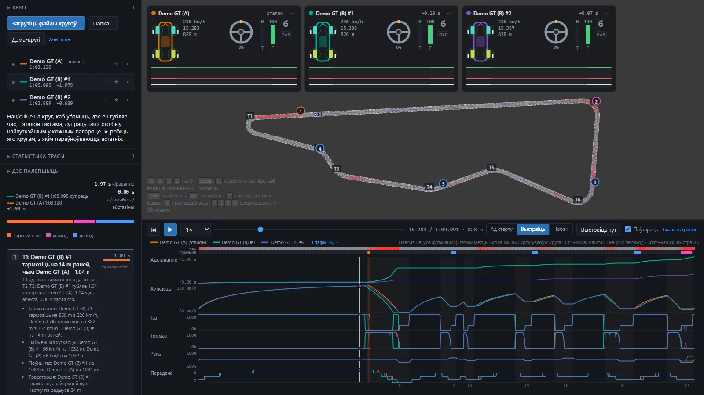

# Аналіз заездаў

Вы праехалі адну і тую самую трасу двойчы. Укладка **Аналіз заездаў** прайгрывае абодва заезды разам у 3D, паказвае, дзе адзін круг быў павольнейшы, і кажа, чаму. Кругоў яшчэ няма? Націсніце **Дэма-кругі**.

Укладка параўноўвае два або больш кругоў адной трасы. Яна дзеліць палатно, камеру і загружаную мадэль трасы (**Фон / узровень**) з цеплавой картай; усё астатняе ў яе сваё: свая бакавая панэль і свая паласа пад выглядам. Словы *круг*, *эталон* і *апекс* растлумачаны ў [слоўніку](glossary.md).

Гэтая старонка - карта ўкладкі. У кожнай часткі ёсць свая старонка:

| Старонка | Што ахоплівае |
|---|---|
| [Загрузка кругоў](race-loading-laps.md) | кожны фармат файлаў, тэчкі і трасы, назвы машын, дэма-кругі, спіс кругоў, эталон і фокус |
| [Паўтор і 3D-сцэна](race-replay-and-scene.md) | панэль кіравання, тры рэжымы паўтору, выраўноўванне машын, камера пераследу, лініі, карты, машыны, подпісы, люстраныя светы |
| [Графікі і HUD](race-charts-and-hud.md) | графікі па адлегласці, выбар графікаў, навядзенне і павелічэнне, карткі машын, табліца каналаў |
| [Падзеі кантролю машыны](race-control-events.md) | блакіроўкі, буксаванне, недастатковая і залішняя паварочвальнасць, завіхурэнні, удары, аварыі, ABS/TC, ручны тормаз, паветра - як кожная выяўляецца, з усімі парогамі |
| [Аналіз паварот за паваротам](race-corner-analysis.md) | выраўноўванне па адлегласці, павароты і сегменты, часавы ўлік павароту, кожная прычына і парадак, у якім яны правяраюцца, форма лініі і парады |
| [Профілі машын і параўнанне](race-car-profiles.md) | што можа кожная машына, вымерана па яе кругах; *Параўнанне аўтамабіляў*; што машына вырашае ў кожным павароце |
| [Статыстыка трасы](race-course-statistics.md) | многа кругоў адной трасы: памылкі па павароце і па віду, карта памылак, экспарт цеплавой карты, межы прадукцыйнасці |
| [Аналітыка заездаў: метад](race-analytics.md) | даследаванне, на якім заснаваны правілы, з крыніцамі |
| [Іншыя гоначныя гульні](other-games.md) | што глядзельнік робіць з кругамі кожнай гульні: слізганне і дрыф, вылічаныя там, дзе гульня іх не дасылае, люстраныя светы, дадатковыя каналы |

## Экран {#the-screen}

**Бакавая панэль**, зверху ўніз (раздзелы можна згортваць):

1. **Кругі** - загрузка, спіс, паказ/схаванне, эталон, фокус, пераслед.
   Гл. [Загрузка кругоў](race-loading-laps.md).
2. **Статыстыка трасы** - толькі з трох загружаных кругоў.
   Гл. [Статыстыка трасы](race-course-statistics.md).
3. **Дзе палепшыць** - вынікі для круга ў фокусе, паварот за паваротам.
   Гл. [Аналіз паварот за паваротам](race-corner-analysis.md).
4. **Паварот за паваротам** (або *Паварот за паваротам - клас X* пры некалькіх класах) - найхутчэйшы круг праз кожны паварот і яго лінія. Паказваецца з двух і больш кругоў.
5. **Кантроль над аўтамабілем** - блакіроўкі, слізганні, выштурхванні і ўдары круга ў фокусе.
   Гл. [Падзеі кантролю машыны](race-control-events.md).
6. **Параўнанне аўтамабіляў** (або **Аўтамабіль**, калі машына адна) - гл. [Профілі машын і параўнанне](race-car-profiles.md).
7. **Выгляд** - якая карта малюецца на трасе і што малюецца.
   Гл. [Паўтор і 3D-сцэна](race-replay-and-scene.md).
8. Агульныя панэлі **Узровень** і **Камера і сцэна** (мадэль трасы, інвертаванне восі, камера) - апісаны з цеплавой картай і ў [Камеры](camera.md).

**Выгляд** паказвае трасу, праедзеныя лініі, карту, машыны, подпісы, замацаваныя да трасы, і да шасці картак машын уверсе злева (гл. [Графікі і HUD](race-charts-and-hud.md)). Калі кругі не загружаны, пішацца: «Кругі не загружаны - перацягніце сюды два або больш файлаў кругоў або загрузіце дэма-кругі з бакавой панэлі».

**Паласа пад выглядам** утрымлівае панэль кіравання паўторам і, калі не схавана, графікі па адлегласці.

## Хуткі старт {#quick-start}

1. Адкрыйце ўкладку **Аналіз заездаў** (побач з **Цеплавая карта** уверсе бакавой панэлі).
2. Загрузіце кругі. Націсніце **Дэма-кругі**, каб убачыць, што ўкладка робіць з трыма выдуманымі кругамі. Для сваіх кругоў спачатку запішыце іх ([фарматы файлаў і запісвальнікі](race-loading-laps.md#file-formats)), потым націсніце **Загрузіць файлы кругоў…** або **Папка…**, або перацягніце файлы або тэчкі на выгляд.
3. Найхутчэйшы поўны круг становіцца эталонам; самы павольны іншы круг ставіцца ў фокус. Націсніце любы круг у спісе, каб паставіць яго ў фокус; ★ робіць круг эталонам.
4. Прачытайце **Дзе палепшыць**. Націсніце на вынік: машыны выстройваюцца за 40 м да яго, камера кадруе яго, паўтор праходзіць праз яго, і адкрываюцца вымярэнні.
5. Навядзіце на графікі, каб перамясціць кожную машыну на гэты метр; Shift+націсканне, каб выстраіць іх там.

## Клавіятура {#keyboard}

Пакуль адкрыта ўкладка «Аналіз заездаў»:

| Клавіша | Што робіць |
|---|---|
| **K** | прайграванне / паўза паўтору |
| **Home** | назад на пачатак паўтору |
| клавішы з лічбамі | нічога (у цеплавой карце яны пераключаюць рэжымы) |

Клавішы, набраныя ў тэкставым полі або выпадаючым спісе, ігнаруюцца. Клавішы камеры працуюць як у цеплавой карце (**W A S D**, **Space** уверх, **Q** уніз, **Shift** хутчэй, **Alt** павольней, мыш - агляд; усё ў [Камеры](camera.md)); **F** кадруе загружаныя кругі (як і загрузка кругоў).

## Многа кругоў {#many-laps}

- Усе загружаныя кругі аналізуюцца і падлічваюцца; дзясяткі - за секунду-дзве.
- Пасля **8** кругоў (`SHOW_ALL_UP_TO`) новыя кругі малююцца толькі тады, калі яны эталон, круг у фокусе або лепшы круг класа круга ў фокусе. Перамыкачы *Паказаць усе* / *Толькі тыя, што разглядаюцца*.
- Пасля **10** бачных машын (`PLAIN_PAST`) кругі, на якія не глядзяць (не фокус, не машына, за якой ідуць, і не эталон), малююцца з лініямі, прарэджанымі да кропкі кожныя 6 м замест 1,5 м, і простымі машынамі.
- Графікі малююць не больш за **8** кругоў; HUD паказвае не больш за **6** картак.
- Статыстыка трасы з'яўляецца з **3** кругоў.

Падрабязней: [Статыстыка трасы](race-course-statistics.md#performance-with-many-laps).

## Стандартныя налады выгляду {#default-view-settings}

| Налада | Стандартна |
|---|---|
| Карта | Карта часу |
| Праедзеныя лініі, Машыны, Шыны і падвеска, Подпісы, Трасса з кругоў | уключана |
| Усе значэнні на картках | выключана |
| Памер машыны | 1× |
| Графікі | паказваюцца |
| Рэжым паўтору | Ад лініі |
| Хуткасць паўтору | 1× |
| Цыкл | уключаны |

Ніводная з гэтых налад не захоўваецца; перазагрузка пачынае са стандартных. Што памятаецца ў браўзеры: мова і назвы машын, вывучаныя з файлаў кругоў (гл. [Загрузка кругоў](race-loading-laps.md#car-names)).

## Для распрацоўшчыкаў {#for-developers}

### Што адбываецца, калі кругі загружаны {#what-happens-when-laps-are-loaded}

Кожны раз, калі мяняецца набор кругоў, эталон або мова, уся аналітыка перарабляецца (`analyse` у [`src/race/analysis.ts`](https://github.com/Holdi601/3DHeat/blob/main/src/race/analysis.ts)):

1. Вылічаныя каналы дадаюцца да кожнага круга там, дзе гульня іх не дасылае: вугал дрыфу, слізганне кол па хуткасцях кол, у паветры, рыхлы грунт, хуткасць рысканя ([`derive.ts`](https://github.com/Holdi601/3DHeat/blob/main/src/race/derive.ts)).
2. Выбіраецца эталон, і кожны круг праецыруецца на яго шлях і перасэмплуецца кожныя 2 м ([`align.ts`](https://github.com/Holdi601/3DHeat/blob/main/src/race/align.ts)).
3. З кругоў вызначаецца, ці люстраны свет гульні ([`handedness.ts`](https://github.com/Holdi601/3DHeat/blob/main/src/race/handedness.ts)).
4. Павароты знаходзяцца на эталоне і групуюцца ў сегменты ад адной зоны тармажэння да наступнай ([`segments.ts`](https://github.com/Holdi601/3DHeat/blob/main/src/race/segments.ts)).
5. Для кожнай машыны: яе агаліна (зчапленне, тармажэнне, цяга па хуткасці), яе профіль, яе крывыя шын ([`envelope.ts`](https://github.com/Holdi601/3DHeat/blob/main/src/race/envelope.ts), [`profile.ts`](https://github.com/Holdi601/3DHeat/blob/main/src/race/profile.ts), [`control.ts`](https://github.com/Holdi601/3DHeat/blob/main/src/race/control.ts)).
6. Для круга і сегмента: што ён зрабіў (кропка тармажэння, самая павольная кропка, поўны газ, ...) і лінія, якую ён праехаў ([`line.ts`](https://github.com/Holdi601/3DHeat/blob/main/src/race/line.ts)).
7. Для круга: яго падзеі кантролю машыны, кожная пастаўленая супраць круга, з якім тут параўноўваецца.
8. Для круга і сегмента: часавы ўлік супраць круга для параўнання і выснова словамі.
9. Карта часу і карта прычын для кожнага круга.

Тэксты складаюцца на бягучай мове; змена мовы запускае аналіз нанова (і перайменоўвае дэма-кругі). Збой аналізу паказваецца пад кнопкамі **Кругі** як памылка, а кругі застаюцца загружанымі.

### Файлы крыніц {#source-files}

| Файл | Роля |
|---|---|
| `src/race/adapters.ts`, `ibt.ts` | чытанне файлаў кругоў |
| `src/race/lap.ts`, `carNames.ts`, `synthetic.ts` | тып круга, назвы, дэма-кругі |
| `src/race/derive.ts`, `handedness.ts` | вылічаныя каналы, люстраныя светы |
| `src/race/align.ts`, `segments.ts`, `line.ts` | вось адлегласці, павароты, лініі |
| `src/race/analysis.ts` | супастаўленыя павароты, прычыны, высновы |
| `src/race/envelope.ts`, `profile.ts` | што можа машына |
| `src/race/control.ts`, `impacts.ts` | кантроль машыны, удары і аварыі |
| `src/race/stats.ts` | многа кругоў |
| `src/race/replay.ts`, `scene.ts`, `glyph.ts`, `geometry.ts` | паўтор і малюнак |
| `src/race/schema.ts`, `graphs.ts` | табліца каналаў, радкі графікаў |
| `src/ui/race/*` | бакавая панэль, графікі, HUD, подпісы |
| `src/state/raceStore.ts` | стан укладкі і гадзіннік паўтору |
