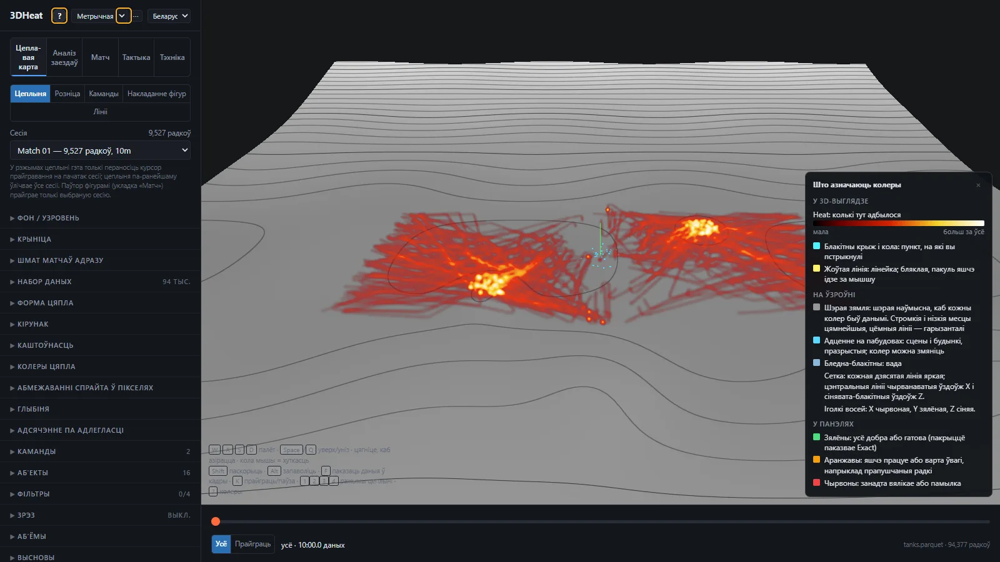
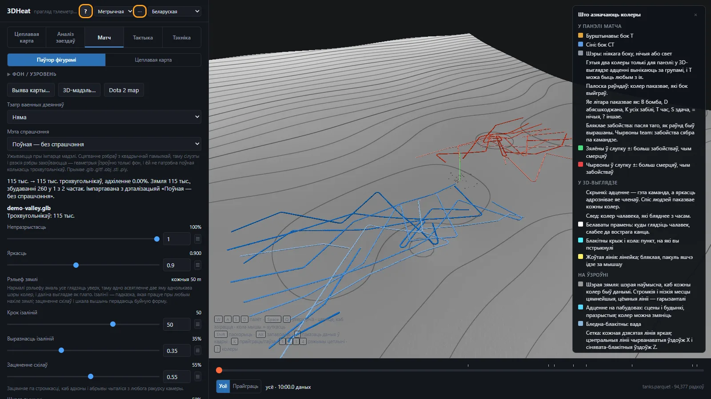

# Налады, адзінкі і клавішы

Невялікія кіраванні ўверсе бакавой панэлі мяняюць тое, як праглядальнік з вамі размаўляе: мову, адзінкі (метры або футы, км/г або вузлы) і рэжым даведкі, які тлумачыць колеры. Вашы выбары запамінаюцца ў браўзеры.

## Загаловак {#the-header}

Уверсе бакавой панэлі:

| Кіраванне | Што робіць |
|---|---|
| **?** | Рэжым даведкі: што азначае кожны колер (таксама `?` або `F1`) |
| Меню **Адзінкі** | Metric, Imperial, Aviation або Nautical |
| Кнопка **...** побач з **Адзінкі** | Адкрывае «Choose a unit for each quantity»: адзін спіс на кожную велічыню |
| Меню **Мова** | Мова праглядальніка: [40 моў](languages.md), або мова браўзера |

Лічбы, якія вы ўводзіце ў полі, могуць мець кропку або коску (`0.35` або `0,35`). Праглядальнік чытае абодва і паказвае лічбы так, як іх піша мова праглядальніка.

## Адзінкі {#units}

1. Выберыце прэсет у меню **Адзінкі**. Усе велічыні пераключаюцца разам.
2. Каб змяніць толькі адну велічыню, націсніце кнопку **...** побач з ёй і выберыце адзінку для гэтай велічыні. Тады ў меню пасля прэсета з'явіцца `*`.
3. Велічыня, якую вы не задавалі, ідзе за прэсетам. Выберыце «As preset», каб вярнуцца.

| Велічыня | Metric (па змаўчанні) | Imperial | Aviation | Nautical |
|---|---|---|---|---|
| Адлегласць | km | mi | NM | NM |
| Вышыня, даўжыня | m | ft | ft | m |
| Хуткасць | km/h | mph | kt | kt |
| Вертыкальная хуткасць | m/s | ft/min | ft/min | m/s |
| Тэмпература | °C | °F | °C | °C |
| Ціск | hPa | inHg | hPa | hPa |
| Маса, паліва | kg, l | lb, gal | lb, gal | t, m³ |
| Вугал | градусы | градусы | градусы | градусы |

Іншыя адзінкі, якія можна выбраць для адной велічыні: адлегласць km, mi, NM; хуткасць km/h, m/s, kt, mph; вертыкальная хуткасць m/s, ft/min, m/min; тэмпература °C, °F, K; ціск hPa, inHg, mmHg, psi; маса kg, lb, t; вугал — градусы або мілы NATO (6400 на круг). Адзінкі аднолькавыя ўсюды ў праглядальніку: подпісы, карткі, графікі, статыстыка.

## Рэжым даведкі {#help-mode}

Націсніце `?` або `F1`, або кнопку **?**. З'явіцца *What the colours mean*: легенды для 3D-выгляду, шкалы цяпла, колераў каманд, колераў узроўню, колераў статусу панэляў, панэлі матчу і выгляду гонкі. Ён застаецца, пакуль вы яго не выключыце. На ўкладцы Match ён таксама тлумачыць колеры панэлі матчу.

## Што запамінае браўзер {#what-the-browser-remembers}

Гэтыя налады захоўваюцца ў браўзеры паміж візітамі (нічога нікуды не адпраўляецца):

- мова, адзінкі і рэжым даведкі;
- налады фігур, сімвалаў, подпісаў, камеры і тактычнага дысплэя прайгравання;
- хуткасць прайгравання і люстэраванне;
- закладкі для кожнага запісу, аб'ёмы для кожнага набору даных, слаі задач;
- налады знешняга ШІ (ключ — толькі калі вы адзначыце *Remember*).

Налады цеплыні, фільтры і рэжым пачынаюцца нанова пры кожнай загрузцы. Поўны, згенераваны спіс: [Захаваныя налады](ref-settings-storage.md).

## Клавішы, якія праглядальнік утрымлівае ў браўзеры {#keys-the-viewer-keeps-from-the-browser}

Сесія з вялікімі данымі загружаецца доўга, таму праглядальнік не дае браўзеру выпадкова выкінуць яе:

- `Ctrl`/`Cmd` + літары, якія друкуюць, захаваюць, адкрываюць, перазагружаюць, зачыняюць або адкрываюць новыя вокны, нічога не робяць па-за тэкставымі палямі; `F1`, `F3`, `F5`, `F6` і `F7` нічога не робяць.
- Зачыненне або перазагрузка ўкладкі з загружанымі данымі або ўзроўнем спачатку пытаецца.
- У поўнаэкранным рэжыме праглядальнік блакуе клавішы, якія ён выкарыстоўвае (W, T, N, S, R, P, Q, Esc), каб браўзер іх не забраў.

Поўны спіс: [Клавішы браўзера](ref-browser-keys.md). Усе ўласныя клавішы праглядальніка: [Даведнік па клавіятуры і мышы](keyboard-reference.md).
