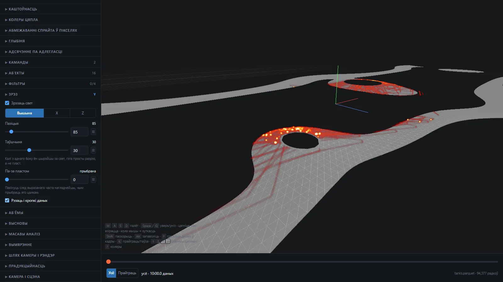

# Зрэз

**Зрэз** разразае свет, як кавалак торта, каб можна было зазірнуць унутр будынкаў. Выкарыстоўвайце яго, калі сцены хаваюць цікавае цяпло, напрыклад, каб паглядзець адзін паверх будынка.

## Паспрабуйце {#try-it}

1. Загрузіце ўзровень і некаторыя даныя і адкрыйце **Зрэз**.
2. Адзначце **Зрэзаць свет**. Вось — **Вышыня**.
3. Перацягвайце **Пазіцыю** ўверх і ўніз: пласт рухаецца па ўзроўні.
4. Зрабіце **Таўшчыню** тонкай для плана паверха або шырокай для «усё ніжэй за гэтую мяжу».
5. Трымайце **Па-за пластом** на 0, каб выдаліць астатняе, або падніміце, каб захаваць слабы след.



Пласт разразае **геаметрыю ўзроўню і кропкі даных разам**: калі разразаць толькі ўзровень, цяпло засталося б вісець там, дзе раней быў будынак. Гэта супрацьлегласць [адсячэнню глыбіні](depth-and-culling.md): калі ўзровень правільна хавае тое, што за ім, нутро будынка таксама схавана. Панэль паказваецца, калі ёсць што зрэзаць (набор даных або 3D-узровень); яе загаловак паказвае вось, пакуль зрэз уключаны, і *выключана* ў адваротным выпадку.

```
side view         Position = where the slab is
 ----------       Thickness = how tall the slab is
 | floor 3 |
 |=========|  <--- slab (kept)
 | floor 2 |  <--- outside: removed (or faint)
 | floor 1 |
 ----------
```

## Элементы кіравання {#controls}

| Кіраванне | Па змаўчанні | Значэнне |
|---|---|---|
| **Зрэзаць свет** | выключана | Уключае пласт. Пакуль пазіцыя яшчэ на пачатковым 0, а таўшчыня на пачатковым 500, пры ўключэнні яны пераносяцца на сярэдзіну восі і на 15% яе даўжыні. |
| Вось | **Вышыня** | *Вышыня* (Y), *X* або *Z*. Пры змене восі пласт пераносіцца на сярэдзіну новай восі. |
| **Пазіцыя** | сярэдзіна | Цэнтр пласта ў сусветных адзінках праз даўжыню восі (500 крокаў). |
| **Таўшчыня** | 15% даўжыні | Ад 1/500 даўжыні да двух даўжынь, у лагарыфмічных крокавых. Чытаецца *за межамі свету*, калі яна роўная даўжыні восі: тады адна сторана выходзіць за свет, і гэта проста разрэз, а не пласт. |
| **Па-за пластом** | 0, *выдалена* | Колькі таго, што ляжыць па-за пластом, застаецца бачным, 0–100%. Слабы след таго, што было адрэзана, часта лягчэй чытаць, чым выдаляць зусім. |
| **Рэзаць і кропкі даных** | уключана | Выключана — цяпло застаецца цэлым і паказваецца праз разрэз. Карысна, каб бачыць, што над пластом і пад ім. |

Даўжыня восі — гэта даўжыня 3D-узроўню, калі ён загружаны, інакш даўжыня набору даных.

Зрэз не залежыць ад [адсячэння па адлегласці](depth-and-culling.md#distance-culling), якое рэжа ўздоўж напрамку погляду, а не па восі свету; яны спалучаюцца. Любая змена налады зрэзу перазапускае накапленне цеплыні.

## Для распрацоўшчыкаў {#for-developers}

Пласт правяраецца для сусветнай пазіцыі кожнага радка ў вершынным шэйдары: радок па-за ім мае свой унёсак, памножаны на значэнне *Па-за*, таму пры 0 ён адхіляецца, перш чым намалюецца які-небудзь фрагмент. Шэйдары ўзроўню прымяняюць той жа тэст да кожнага фрагмента зямлі, пабудоў і вады.
