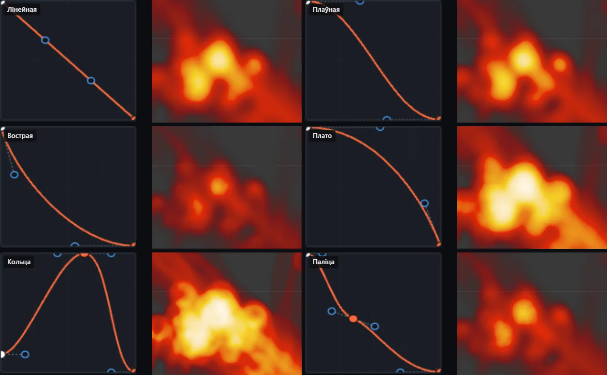

# Форма спрайта

Кожны радок малюецца як круглы спрайт, які заўсёды глядзіць на камеру. Яго памер і профіль ад цэнтра да краю - **шкала** - вызначаюць, ці чытаецца гарачы пункт як вострая кропка, мяккая хмара, дыск або кольца. Гэтыя рэгулятары знаходзяцца ў раздзелах **Форма цяпла** і **Абмежаванні спрайта ў пікселях** бакавой панэлі і прымяняюцца да [Цяпла](heat.md), [Розніцы](difference.md), [Цяпла каманд](team-heat.md) і, як паўшырыня лініі, да [Цеплыні ліній](line-heat.md).

Змена любога з іх перазапускае накапленне (поле трэба перамаляваць з новай формай).

Уяўляйце кожную кропку як мяккую пляму святла. Маленькая пляма паказвае асобныя кропкі; вялікая пляма зліваецца з суседнімі ў хмару. Форма вызначае, наколькі мяккі край.



## Радыус спрайта {#sprite-radius}

Радыус спрайта ў **адзінках свету** (падпісаны як метры). Па змаўчанні 6; пры кожнай загрузцы - гарызантальны памер даных / 120, каб суседнія ўзоры ўздоўж шляху зліваліся ў паласу, а не выглядалі як валаскі. Лагарыфмічны паўзунок 0,05-2000, маркер можна перацягнуць да 50 000.


Далёкія рэчы выглядаюць меншымі, таму спрайт на экране памяншаецца з адлегласцю. У паралельнай праекцыі ён аднолькавы ўсюды, і гэта частка прычыны, чаму паралельны выгляд правільны для параўнання гарачых пунктаў ([Камера](camera.md#projection)).

## Абмежаванні ў пікселях {#pixel-clamps}

**Абмежаванні спрайта ў пікселях** (па змаўчанні зачынены) абмяжоўваюць радыус на экране пасля пераўтварэння вышэй.

| Рэгулятар | Па змаўчанні | Дыяпазон (паўзунок) | Чаму |
|---|---|---|---|
| **Мін. радыус у пікселях** | 1 px | 0-16 (512) | Не дае далёкім даных знікнуць меншымі за адзін піксель. |
| **Макс. радыус у пікселях** | 96 px | 2-1024, лагарыфмічна (8192) | Ахоўнік перамалёўвання. Спрайт, які пакрывае N пікселяў, каштуе N аперацый змешвання, таму неабмежаваны радыус каля камеры і ператварае хуткі кадр у павольны. Пасля вышыні вобласці прагляду ён больш нічога не абмяжоўвае. |

**Аднолькавая шчыльнасць пры любым маштабе** (у раздзеле Форма цяпла, па змаўчанні ўключана) працуе разам з абмежаваннямі. Спрайт, які абмежаванне робіць большым (далёка) або меншым (блізка), захоўвае цяпло, якое дало б яго сапраўдны памер, таму колер азначае адну і тую ж колькасць радкоў на плошчу зямлі пры любым маштабе. Калі яно выключана, абмежаваны спрайт дадае сваю поўную вагу пры абмежаваным памеры, і карціна мяняецца, калі вы ляціце ўсярэдзіну.

## Інтэнсіўнасць у цэнтры і на краі {#centre-and-edge-intensity}

Колькасць цяпла, якое спрайт дадае ў сваім дакладным цэнтры (**Інтэнсіўнасць у цэнтры**, па змаўчанні 1, 0-10, маркер 1000) і на краі (**Інтэнсіўнасць на краі**, па змаўчанні 0, -2-10, маркер 1000). Значэнне шкалы *t* (1 у цэнтры, 0 на краі, фарміруецца спадам або крывой ніжэй) змешвае паміж імі (формула - у [Для распрацоўшчыкаў](#for-developers)).

**Адмоўная інтэнсіўнасць на краі** прымушае край адымаць, што вырэзае халодны арэол вакол кожнага гарачага пункта і разразае кластары адзін ад аднаго. Бачнасць улічвае [закрыццё](depth-and-culling.md) і [зрэз](slice.md); затуханне - гэта [затуханне па тэрміне дзеяння](timeline.md#history); знак - ±1 у [Розніцы](difference.md).

## Форма шкалы: Спад або Крывая {#ramp-shape-falloff-or-curve}

**Форма шкалы** пераключае паміж двума спосабамі фарміравання *t* па спрайце. Дзе *d* - адлегласць ад цэнтра (0) да краю (1):

### Спад {#falloff}

Паказваецца, калі абрана *Спад* (па змаўчанні).

- **Спад** (па змаўчанні 1,6, 0,1-8, маркер 64): `t = (1 - d) ^ falloff`. 1 - гэта прамая лінейная шкала; большае значэнне цягне цяпло да цэнтра і звужае гарачы пункт; меншае за 1 выраўноўвае яго ў дыск.
- **Плаўная шкала** (па змаўчанні ўключана): прымяняе да *t* S-вобразную крывую smoothstep, таму спрайт плаўна згасае на краі, а не заканчваецца бачным краем.

### Рэдактар крывой {#the-curve-editor}

Паказваецца, калі абрана *Крывая*. Буквальны папярочны пераразак спрайта: адлегласць ад цэнтра папярок (*цэнтр* злева, *край* справа), цяпло ўверх. Крывая - гэта кавалкава-кубічная крывая Бізье праз кантрольныя кропкі, у кожнай два маркеры.

| Дзеянне | Эфект |
|---|---|
| Двайны клік па графіку | Дадае кропку на гэтай адлегласці (трымаецца паміж 0,02 і 0,98), на крывой і з яе нахілам у гэтым месцы, таму даданне нічога не мяняе, пакуль вы не перацягнеце. |
| Перацягнуць кропку | Перамяшчае яе. Вышыні трымаюцца паміж 0 і 1. |
| Перацягнуць малы круг | Згінае адрэзак побач з ім (перамяшчае гэты маркер). |
| Alt-пстрычка або правы клік па кропцы | Выдаляе яе. Дзве крайнія кропкі выдаліць нельга. |
| Кнопка прэсета | Замяняе крывую прэсетам. |

Крайнія кропкі замацаваны ў цэнтры і на краі; іх вышыня ўсё роўна ваша.

**Прэсеты** ([`curve.ts`](https://github.com/Holdi601/3DHeat/blob/main/src/state/curve.ts)):

| Прэсет | Форма | Выкарыстанне |
|---|---|---|
| **Linear** | Прамая ад 1 да 0 | Тое самае, што *Спад* 1 з выключанай *Плаўнай шкалай*. |
| **Smooth** | S-крывая | Крывая па змаўчанні; тое, што дае *Плаўная шкала* пры спадзе 1. |
| **Tight** | Крутое ядро, доўгі слабы край | Рэдкія даныя. |
| **Plateau** | Роўна, потым хуткі спад | Выглядае як дыск, а не пляма. |
| **Ring** | 0,15 у цэнтры, 1 на 62% радыуса, 0 на краі | Пусты спрайт: паказвае, дзе шляхі праходзяць, а не дзе спыняюцца. |
| **Shelf** | Спад у два этапы, 0,45 на 35% | Аддзяляе шчыльнае ядро ад навакольнага. |

## Спраецыраваць на плоскасць зямлі {#flatten-onto-ground-plane}

**Спраецыраваць на плоскасць зямлі** (па змаўчанні выключана) ігнаруе вышыню кожнага радка і малюе ўсё цяпло на адной вышыні - самай нізкай Y даных - класічная двухмерная цеплавая карта. Калі гэта ўключана, закрыццё па глыбіні і *Хаваць за рэльефам* выключаюцца (кожная кропка сядзела б дакладна на паверхні, па якой яе правяраюць), і раздзел Глыбіня пра гэта кажа.

## Для распрацоўшчыкаў {#for-developers}

### Формулы {#formulas}

Радыус на экране ў пікселях: `radius × P[1][1] / w × вышыня вобласці / 2`, дзе `P` - матрыца праекцыі, а `w` - глыбіня кропкі ў выглядзе.

Цяпло, якое дадае спрайт:

```
heat added = mix(edge, centre, t) × sample weight × sign × fade × visibility
```

### Крывая {#the-curve}

Маркеры абмежаваны па гарызанталі сваім адрэзкам, таму крывая заўсёды з'яўляецца функцыяй адлегласці: калі перацягнуць маркер далёка за наступную кропку, ён выраўнуецца да яе, а не згорне крывую назад, што зрабіла б вынік залежным ад таго, які корань знайшоў рашальнік.

### Як малюецца крывая {#how-the-curve-is-drawn}

Крывая запекаецца ў табліцу з 256 запісаў пры кожнай змене, загружаецца як тэкстура з 16-бітавымі плаваючымі пунктамі і чытаецца для кожнага фрагмента з лінейнай фільтрацыяй і ўсталяваннем на паўпіксель, каб абодва канцы заставаліся дакладнымі. Рашэнне Бізье адносна x патрабуе ітэрацыі, якой няма месца ў самым гарачым шэйдары праграмы, а выбарка з табліцы таксама танчэйшая за `pow()`, якім карыстаецца спад. 16 біт, а не 8, таму што 8 біт дае паласатасць, калі сумуюцца тысячы спрайтаў; 16-бітавае палова-плаваючае можна фільтраваць у асноўным WebGL2, а 32-бітаваму патрэбна пашырэнне.
