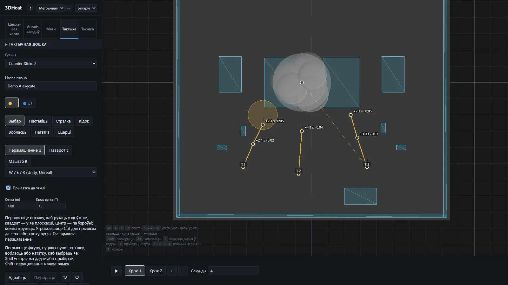

# Дошка тактык

Укладка **Тактыка** - гэта дошка для малявання плана каманды: вы кладзяце на карту невялікія фігуры, малюеце стрэлкі, куды яны ідуць, і націскаеце прайграванне, каб убачыць, як гэта адбудзецца. Выкарыстоўвайце яе, каб распланаваць раунд або атаку, перш чым іграць. Яна дзеліць палатно, камеру і [узровень](levels.md) з іншымі ўкладкамі і больш нічога; план - гэта не даныя і цеплыню не малюе.

## Ваш першы план {#your-first-plan}

1. Адкрыйце ўкладку **Тактыка**. Выберыце **Гульня** (напрыклад, Counter-Strike 2) і, для Valorant, націсніце **Загрузіць карты Valorant** і выберыце **Карта**. Або спачатку загрузіце [узровень](levels.md).
2. Выберыце **Бок** (ён задае колер) і націсніце **Выгляд зверху**.
3. Выберыце **Месца**, абярыце фігуру ў **Фігуры** (каб знайсці, выкарыстоўвайце **Пошук фігур**) і націсніце на карту. Пастаўце дзве-тры фігуры.
4. Выберыце **Стрэлка**, націсніце на фігуру, потым націскайце ўздоўж шляху, якім яна павінна ісці, і націсніце **Enter**, каб завяршыць стрэлку.
5. Націсніце **+** пад выглядам, каб дадаць крок 2. Кожная фігура пачынаецца там, дзе скончылася яе стрэлка. Там малюйце новыя стрэлкі.
6. Націсніце **▶** (або `K`), каб прайграць план ад паказанага кроку да канца.
7. Назавіце план у **Назва плана** і націсніце **Захаваць**.

## Пачатак плана {#starting-a-plan}

| Элемент | Што робіць |
|---|---|
| **Гульня** | Выбірае бакі і фігуры, якія прапануе палітра: Counter-Strike 2 (T, CT; гульцы і ўтыліты), Valorant (Attack, Defense; гульцы і агульныя здольнасці), Battlefield, Squad, Arma (пяхота, наземная тэхніка, самалёты, лодкі), DCS / War Thunder / IL-2 (рэактыўныя, паршнявыя самалёты, верталёты, паветраная абарона, наземныя, караблі, зброя) і Іншае. План, у якім ужо ёсць фігуры, захоўвае свае бакі, калі гульня мяняецца. |
| **Назва плана** | Назва, пад якой план захоўваецца. |
| **Карта**, **Загрузіць карты Valorant** | Калі выбраны Valorant: **Загрузіць карты Valorant** бярэ спіс карт з [valorant-api.com](https://valorant-api.com); **Карта** потым ставіць міні-карту выбранай карты як узровень, кадраваную зверху. Малюнак загружаецца пры выбары і ніколі не пастаўляецца з праграмай. Паведамленне Riot паказваецца, пакуль яно на экране (гл. ніжэй). |
| **Бок** | Бок, якому належыць наступная фігура, стрэлка або вобласць; яна бярэ колер гэтага боку. |

Без узроўню дошка - гэта плоская зямная плоскасць. Загрузіце ўзровень у **Узровень**, каб планаваць на сапраўднай карце: карту CS2, экспартаваную інструментам CS2, узровень з бібліятэкі або малюнак карты.

## Інструменты {#tools}

| Інструмент | Націсканне | Заўвагі |
|---|---|---|
| **Выбар** | Фігура, кропка маршруту, стрэлка, вобласць або нататка выбіраюцца. | Shift+націсканне дадае або прыбірае; Shift+перацягванне малюе рамку вакол таго, што трэба дадаць. Для абранага ёсць гізмо трансфармацыі (гл. ніжэй); `Delete` або `Backspace` выдаляе. `M` перамяшчае абраную фігуру да наступнага націскання. |
| **Месца** | Ставіць абраную фігуру. | Фігура выбіраецца ў палітры **Фігуры** (з **Пошук фігур**). Калі нічога не абрана, `R` паварочвае наступную фігуру на 15° перад тым, як яе паставіць (`Shift+R` - у іншы бок). |
| **Стрэлка** | Кожнае націсканне дадае кропку; Enter, двайное націсканне або правая кнопка завяршаюць, Esc адмяняе. | **Зрушыць**, **Атака** (шырокая галоўка) або **Назіранне** (тонкая лінія на вышыні вачэй). Стрэлка, пачатая на фігуры, - гэта маршрут гэтай фігуры ў гэтым кроку: пры прайграванні фігура яго праходзіць, і наступны крок пачынаецца там, дзе ён скончыўся. |
| **Кідок** | Той, хто кідае, потым там, дзе прызямляецца. | Пунктырная дуга ад аднаго да другога, а абраная ўтыліта (дым, успышка, кактэйль Молатава, ...) з'яўляецца там, дзе прызямляецца, і застаецца з гэтага кроку. |
| **Вобласць** | Цэнтр, потым край. | Дыск у колеры боку. |
| **Нататка** | Дзе будзе нататка; просіць яе тэкст. | Паказваецца як булавка, а яе тэкст - над ёй. |
| **Сцерці** | Фігуру, стрэлку, вобласць або нататку. | Выдаляе з гэтага кроку; на першым кроку - выдаляе зусім. |

**Адрабіць** і **Паўтарыць** (`Ctrl+Z`; `Ctrl+Y` або `Ctrl+Shift+Z`) ідуць па кожнай змене. Лінія пад планам паказвае, колькі ў ім фігур, стрэлак і крокаў. **Выгляд зверху** глядзіць строга ўніз (ортаграфічна), **3D-выгляд** вяртае перспектыву, **Кадр** падганяе план або, калі плана няма, узровень.

**Памер фігур** маштабуе кожную фігуру на дошцы; 1× - гэта сапраўдны памер, які зверху выглядае як некалькі пікселяў для чалавека.

## Перамяшчэнне, паварот і маштаб {#moving-turning-and-scaling}

Усё на дошцы можна перамяшчаць, як у 3D-рэдактары: фігуры, утыліты, маркеры, асобныя кропкі маршруту і цэлыя стрэлкі, вобласці і нататкі. Абранае атрымлівае гізмо ў сваім цэнтры:

| Рэжым | Клавішы | Маніпулятары |
|---|---|---|
| **Зрушыць** | W (або G) | Стрэлка на кожную вось (X чырвоная, Y зялёная і ўверх, Z сіняя) перасоўвае ўздоўж яе; квадрат перасоўвае ў сваёй плоскасці; цэнтр перасоўваецца па ўзроўні пад покажчыкам. |
| **Паварот** | E (або R) | Кольца на кожную вось паварочвае вакол яе. Кольцы адной фігуры - яе ўласныя рыск, тангаж і крэн; група паварочваецца вакол восей свету вакол свайго цэнтра. |
| **Маштаб** | R (або S) | Разводзіць або зводзіць абранае з цэнтра ўздоўж восі або ва ўсе бакі; радыус вобласці расце разам з ім. |

**Ключы** пераключаюць W / E / R (Unity, Unreal) і G / R / S (Blender); клавішы выбіраюць рэжым толькі тады, калі нешта абрана, а інакш лятаюць камерай. Таму `R` азначае **Маштаб** з клавішамі W / E / R і **Паварот** з клавішамі G / R / S, калі нешта абрана, і паварочвае наступную фігуру, якую трэба паставіць, калі нічога не абрана. Усе клавішы дошкі пералічаны ў [даведніку клавіятуры](keyboard-reference.md#tactics-board). Трымайце **Ctrl** пры перацягванні, каб прывязаць перасоўванне да **Сеткі** (метры) або паварот да **Кроку кута**. **Прывязка да зямлі** (уключана па змаўчанні) ставіць перасунутых людзей, машыны, маркеры, кропкі маршруту і вобласці на паверхню ўзроўню; самалёты і верталёты захоўваюць вышыню, а перацягванне ўздоўж стрэлкі Y ніколі не прывязваецца. Перацягванне маніпулятара ніколі не перасоўвае камеру. **Esc** адмяняе перацягванне, і кожная змена - адзін крок Адрабіць.

Кропкі маршруту паказваюцца кропкамі на стрэлках паказанага кроку: націсніце на адну, каб абраць, перацягніце, каб перасунуць, Delete - каб выдаліць. Раздзел **Абраныя** паказвае месца абранага ў метрах, рыск, тангаж і крэн фігуры ў градусах і радыус вобласці, кожнае - з магчымасцю ўвесці значэнне.

## Час {#timing}

Маршрут фігуры мае час: кожны сегмент займае сваю даўжыню па ўзроўні - узятую па паверхні кожныя пару метраў, таму пагорак або лесвіца паміж двума кропкамі лічыцца, - на хуткасці **рэжыму** руху гэтай фігуры ў гэтай гульні, плюс любое **чаканне** на кропцы маршруту. Пяхота поўзае, прысядае, ідзе (ціха), бяжыць або імчыць; наземная тэхніка і лодкі ідуць павольна, асцярожна, звычайна або імкліва; самалёты і верталёты лётаюць павольна, на крэйсерскай, на баявой або на максімальнай хуткасці. Рэжым, якога ў гульні няма (у CS2 няма спрынту), бярэ найбліжэйшы, які там ёсць. Тое, як схіл запавольвае рух, залежыць ад гульні: у CS2 і Valorant лічыцца толькі гарызантальная адлегласць, як і ў самых гульнях; ваенныя сімулятары запавольваюць пяхоту ўверх (функцыя ходзьбы Тобляра) і наземную тэхніку па градыенце.

Хуткасці бяруцца з табліц для кожнай гульні з іх крыніцамі (гл. [Хуткасці руху](tactics-speeds.md)): CS2 - па зброі ў руках, з вызначэнняў зброі гульні; Valorant - па зброі; Battlefield, Squad, Arma і авіяцыйныя гульні - па тыпе і класе тэхнікі. **Рухаецца як** выбірае профіль фігуры (зброю, тып тэхнікі); **Свая (m/s)** перакрывае любы рэжым для гэтай фігуры. Рэжымы названы так, як іх паказвае дошка: *Поўзанне*, *Прысяданне*, *Хода (ціха)*, *Бег*, *Спрынт*; *Асцярожна*, *Звычайна*, *Імкліва*; *Павольна*, *Крэйсерская*, *Баявая*, *Максімум*.

Кожная кропка маршруту паказвае час ад папярэдняй і час ад пачатку плана («+3,9 с · 0:12»). Маршрут абранай фігуры пералічвае кожны сегмент з рэжымам, даўжынёй і часам, чаканнем і прыбыццём. **Прыбыцці** пад **Час** ставіць кожную фігуру з маршрутам на адну шкалу часу, першае прыбыццё ўверсе. З **Прайграваць у рэальным часе** (уключана па змаўчанні) крок доўжыцца, пакуль не прыбудзе самы павольны маршрут, і кожная фігура рухаецца з уласнай хуткасцю; **Секунды** тады - найменшая даўжыня кроку. **Адзінак узроўню на метр** кажа, у чым узровень: 39,37 для карт CS2 (адзінкі гульні), 1 для метрычных карт.

## Параўнанне з данымі матчаў {#compare-with-match-data}

**Загрузіць файлы матчаў…** чытае табліцы матчаў CS2 карты (файлы Parquet інструмента CS2, колькі заўгодна; толькі патрэбныя слупкі, у фоне); **Выкарыстаць загружаныя даныя** бярэ даныя, загружаныя ў глядзельнік. Потым:

- **Найранейшае прыбыццё на карце** фарбуе карту часам ад пачатку раунда, калі гулец упершыню дасягнуў кожнага месца - кнопка **Самы хуткі** паказвае самы хуткі за ўсе раўнды, **Тыпова (медыяна)** - сярэдні раўнд, - ад зялёнага раней да чырвонага пазней, для аднаго боку або для абодвух. Гэта паказвае, што магчыма і калі.
- Абраны маршрут параўноўваецца з тым, чаго гульцы дасягалі ад яго пачатку (або ад пачатку раунда) да канца, кожны канец - дыск зададзенага радыуса: «Самы хуткі назіраны 14,2 с, p10 15,0 с, медыяна 18,3 с па 41 праездзе; ваш план 15,1 с».
- Хуткасці, з якімі гульцы сапраўды рухаліся - бег, хада, прысяданне, з слупкоў хады і прысядання табліц, - у м/с.

## Крокі {#steps}

Паласа пад выглядам утрымлівае крокі. План пачынаецца з аднаго; **+** дадае яшчэ, і кожная фігура пачынаецца там, дзе скончыўся яе маршрут у апошнім кроку; **−** выдаляе паказаны. **Секунды** - колькі часу займае паказаны крок пры прайграванні. **▶** (K) прайгрывае ад паказанага кроку да канца: фігуры з маршрутам ідуць па ім, фігуры, перасунутыя ў новае месца ў наступным кроку, туды з'язджаюць, астатнія стаяць. Пакуль крок паказаны, месца кожнай фігуры ў наступным кроку малюецца слабым прывідам, а стрэлкі мінулага кроку - слаба пад стрэлкамі гэтага.

## Захаванне {#saving}

Раздзел **Файл** утрымлівае **Захаваць**, **Open** і **Ачысціць**. **Захаваць** запісвае план як `<name>.h3dplan.json` (просты JSON: бакі, крокі, фігуры з месцам на кожны крок, стрэлкі, вобласці, нататкі); **Open** чытае яго назад. Файл іншай версіі або той, што не з'яўляецца планам, адхіляецца з прычынай. **Ачысціць** ачышчае план; Адрабіць вяртае яго.

## Фігуры {#figures}

Кожная фігура пабудавана самім глядзельнікам: простыя формы з апублікаваным памерам тыпу, з дэталямі, якія адрозніваюць яе ад суседак, - дарожныя колы і вежа танка, гарматы, ракеты і радары зенітнай машыны, плян крыла самалёта, хвост і рухавікі, лопасці верталёта і кароткія крылы. Нічога не ўзята з гульні. Дызайн, які прыдумала гульня, паказваецца як агульная фігура свайго класа. Гл. [Фігуры](figures.md#which-figure-a-unit-gets) пра тое, як даныя знаходзяць сваю фігуру.

## Паведамленне Riot {#riots-notice}

Карты Valorant паказваюцца па палітыцы Riot Games «Legal Jibber Jabber», якая дазваляе бясплатным суполкавым праектам іх выкарыстоўваць і патрабуе гэтага паведамлення, дзе б яны ні з'яўляліся: *3DHeat was created under Riot Games' "Legal Jibber Jabber" policy using assets owned by Riot Games. Riot Games does not endorse or sponsor this project.* Здольнасці на дошцы - агульныя фігуры, а не мастацтва Riot.
