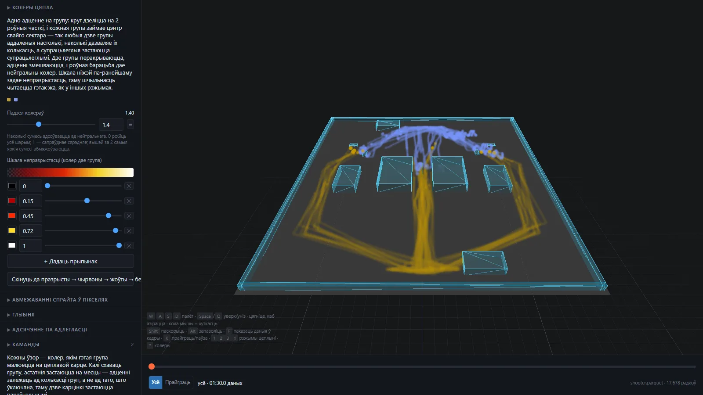

# Каманды

Рэжым Каманды паказвае, дзе была кожная каманда, кожная ў сваім колеры. Там, дзе каманды перакрываюцца, колеры змешваюцца.

**Каманды** (клавіша 3) — гэта поле шчыльнасці [Цеплыні](heat.md), у якім кожная [група](glossary.md) мае свой адценне. Там, дзе групы перакрываюцца, іх адценні змешваюцца; роўная спрэчка выходзіць нейтральнай. Непразрыстасць па-ранейшаму нясе шчыльнасць дакладна так, як у іншых рэжымах, таму карціна адказвае адразу на *колькі* і *чый*. Патрабуе слупка груп.

Гэта не [накладанне фігур](box-replay.md): яно малюе адну фігуру на кожнага чалавека, а гэта — поле цеплыні, афарбаванае тым жа слупком.

## Як выкарыстоўваць {#how-to-use-it}

1. Націсніце `3` (або абярыце **Каманды** на панэлі рэжымаў).
2. Адкрыйце **Колеры цяпла**. Квадрацікі паказваюць колер кожнай групы; навядзіце курсор на квадрацік, каб убачыць назву каманды.
3. Калі ўсё выглядае шэрым, павялічце **Падзел колераў**.
4. Зніміце галачку з групы ў [Спісе каманд](teams-list.md), каб выключыць яе; астатнія колеры застаюцца на сваіх месцах.

## Элементы кіравання {#controls}

У раздзеле **Колеры цяпла**:

| Кіраванне | Па змаўчанні | Значэнне |
|---|---|---|
| Квадрацікі | | Колер кожнай групы для першых 12 груп, потым *+N больш*. Навядзіце курсор, каб убачыць назву групы і колер. |
| **Падзел колераў** | 1,4 | Наколькі сумесь адсоўваецца ад нейтральнага, 0–4. 0 робіць усё шэрым; 1 — сапраўдная сярэдняя; пасля каля 2 самыя яркія сумесі выходзяць за дыяпазон, які можна паказаць, і абразаюцца па кожным канале, што зрушвае іх адценне. |
| **Шкала непразрыстасці (колер дае група)** | стандартная шкала цяпла | Тут выкарыстоўваецца толькі **альфа** шкалы: празрыста там, дзе нічога няма, непразрыста ўверсе. Яе колеры ігнаруюцца. |

Група, чый подпіс азначае «няма групы» (`0`, пусты, `none`, `unknown`, `null` або `-1`), малюецца шэрым.

Усе іншыя элементы цеплыні — форма, насычэнне, адказ, мінімальнае цяпло, глыбіня, адсячэнне — працуюць так, як у [Цеплыні](heat.md).

[Спіс каманд](teams-list.md) паказвае колер цеплыні каманд кожнай групы як квадрацік у гэтым рэжыме. Схаванне групы пакідае колер кожнай іншай групы на месцы: адценні прыходзяць з агульнай колькасці груп, а не з таго, што ўключана, таму дзве карціны застаюцца параўнальнымі.

## Для распрацоўшчыкаў {#for-developers}

### Палітра {#the-palette}

З [`colors.ts`](https://github.com/Holdi601/3DHeat/blob/main/src/render/colors.ts):

- Колеры жывуць на плоскасці колераў **Oklab** пры фіксаванай светласці (0,7) і насычанасці (0,115), таму кожная група роўна яркая, і чырвоная група не выглядае гарачэй за сіную.
- Пры *n* групах круг адценняў дзеліцца на *n* роўных частак, і група *i* бярэ **цэнтр** сваёй часткі, `(i + 0.5) / n` круга. Любыя дзве групы стаяць так далёка, як дазваляе колькасць, і супрацьлеглыя застаюцца супрацьлеглымі пры любой колькасці.
- Выкарыстоўваецца не больш за **16** розных адценняў. Пры большай колькасці груп id размяшчаюцца паўторным дзяленнем напалам (id з перастаўленымі бітамі: 0, ½, ¼, ¾, ⅛, …), каб суседнія id не мелі аднаго адцення; групы звыш 16 абавязкова дзеляць адценні.
- Група, чый подпіс азначае «няма групы» — `0`, пусты, `none`, `unknown`, `null` або `-1`, без уліку рэгістра, — малюецца **нейтральна шэрым** замест таго, каб браць кавалак круга. Так падаецца толькі першы такі подпіс у спісе груп.

Стандартны падзел 1,4, а не 1, таму што пры 1 сумесь пяці роўна размеркаваных адценняў *і ёсць* шэрая: правільна і нячытэльна. Крыху вышэй за 1 захоўвае сумленнасць нічыіх, але робіць бачным падзел 60/40.

### Як гэта працуе {#how-it-works}

Цеплавая мэта ў гэтым рэжыме мае чатыры каналы. Кожны спрайт дадае сваю шчыльнасць *v* у першы канал, а *v* × каардынаты Oklab *a* і *b* групы — у другі і трэці. Пры кампазіце сумесь пікселя — гэта сярэдняе, узважанае шчыльнасцю: *a* = G / R, *b* = B / R, маштабаванае падзелам колераў і пераўтворанае ў sRGB пры светласці палітры. Дзяленне на накопленую шчыльнасць робіць адценне незалежным ад таго, колькі даных ёсць, і таму кожны элемент шчыльнасці працягвае дзейнічаць толькі на непразрыстасць.

Чатыры-канальная мэта каштуе ў чатыры разы больш памяці GPU, чым аднаканальная цеплавая мэта пры тым жа разрозненні.
