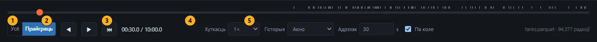

# Стужка часу і прайграванне

Панэль пад малюнкам падобная да відэапляэра: даныя можна прайграць як фільм, паставіць на паўзу, перайсці да любога моманту і змяніць хуткасць.

Панэль пад выглядам - гэта стужка часу ([`Timeline.tsx`](https://github.com/Holdi601/3DHeat/blob/main/src/ui/Timeline.tsx)). Яна вырашае, якія радкі бачныя ў любы момант. Патрэбны слупок часу; без яго ўся панэль адключана, від застаецца ў **Усе**, а бакавая панэль кажа *No time column in this data - the timeline is disabled and every datapoint is shown at once.*

## Усе і Прайграць {#all-and-play}

Два вышэйшыя рэжымы, бо яны адказваюць на розныя пытанні.

- **Усе** (па змаўчанні пры кожнай загрузцы) цалкам ігнаруе галоўку прайгравання і паказвае кожны радок, які прайшоў фільтры. Гэта від «дзе гэта адбываецца», і ён не тое ж, што перамотка да канца. Паўзунок адключаны, а гадзіннік паказвае `all ·  of data`.
- **Прайграць** прайгрывае даныя як паскораны запіс. З'яўляюцца паўзунок, кіраванне і налады гісторыі.

Выбар **Усе** таксама спыняе прайграванне.

## Кіраванне {#the-controls}

| Кіраванне | Па змаўчанні | Значэнне |
|---|---|---|
| Паўзунок | пачатак | Галоўка прайгравання. Цягніце, каб перайсці; 20,000 крокаў па дыяпазоне. |
| **Усе** / **Прайграць** | Усе | Гл. вышэй. |
| ▶ / ❚❚ | на паўзе | Прайграць або паставіць на паўзу; таксама `K`. |
| ◀ **Прайграць назад (J)** | | Прайгрывае даныя ў адваротным кірунку. Паказваецца толькі ў рэжыме **Накладанне фігур**; той жа клавішай `J` можна карыстацца і там (гл. [Клавіятура](#keyboard)). |
| ⏮ | | Вяртае да пачатку дыяпазону. |
| Гадзіннік | | `elapsed / total` як `mm:ss.s` (або `h:mm:ss`), і, калі слупок часу - абсалютная пазнака, сапраўдны час сутак галоўкі як `HH:MM:SSZ` (UTC). |
| **Хуткасць** | 1× | Секунды даных на адну сапраўдную секунду. Меню мае 17 крокаў ад 0.01× да 1800× (0.01, 0.02, 0.05, 0.1, 0.25, 0.5, 1, 2, 4, 8, 16, 32, 64, 128, 256, 600, 1800), а таксама **Свая…**: уводзьце любую хуткасць ад 0.001× да 3600× (напрыклад 0.3 або 12) і націсніце Enter; Esc пакідае бягучую хуткасць. Апошняя хуткасць запамінаецца для наступнага наведвання (гл. [Захаваныя налады](ref-settings-storage.md)). |
| **Гісторыя** | Назапашана | Што лічыцца бачным на галоўцы: *Назапашана*, *Акно* або *Час жыцця* (ніжэй). |
| **Адрэзак** (Акно; у рэжыме Лініі таксама Час жыцця) | 30 s | Даўжыня акна, якое заканчваецца на галоўцы; не менш за 0.01 с. У [Лінейнай цеплыні](line-heat.md#playback) гэта даўжыня хваста. |
| **Запасны час жыцця** (толькі Час жыцця, не ў рэжыме Лініі) | 10 s | Колькі часу радок без наступнага ўзору сваёй асобы застаецца бачным. |
| **Згасанне** (толькі Час жыцця, не ў рэжыме Лініі) | 0.4 | Доля жыцця кожнага радка, якая сыходзіць на згасанне, 0-1. |
| **Па коле** | уключана | У канцы пачынаецца нанова; выключана - спыняецца ў канцы. |
| Правы бок | | Назва набору даных. |

**Дыяпазон** - гэта прамежак часу набору даных - або, у [накладанні фігур](box-replay.md) пры выбраным сеансе, прамежак гэтага сеансу.

## Гісторыя {#history}

У рэжыме Прайграць:

- **Назапашана** - усё ад пачатку дыяпазону да галоўкі. Цяпло нарастае, пакуль ідзе прайграванне.
- **Акно** - фіксаваны адрэзак гісторыі, які заканчваецца на галоўцы (*Адрэзак*).
- **Час жыцця** - кожны радок жыве да **наступнага ўзору той самай асобы** (у тым самым сеансе), таму ў любы момант ёсць роўна адна пазіцыя на асобу. Радок, чыя асоба больш ніколі не з'яўляецца - смерць, адключэнне, канец журнала, - не мае наступнага ўзору і жыве на *Запасны час жыцця*, а не знікае адразу або не застаецца назаўсёды. Радкі **згасаюць** на апошняй долі *Згасанне* свайго жыцця, а не знікаюць раптам: калі на асобу жыве адзін узор, радок, які знікае паміж двума кадрамі, прымушае ўсе поле мігцець з частотай узораў. *Згасанне* 0 вяртае жорсткае адсячэнне.

Час жыцця патрабуе як слупка асобы, так і слупка часу; без слупка асобы гісторыя пры загрузцы вяртаецца да Назапашана. У [Лінейнай цеплыні](line-heat.md#playback) гісторыя задае, колькі часу відаць хваст маршруту; у [накладанні фігур](box-replay.md) *Запасны час жыцця* - колькі часу трымаецца асоба без далейшых узораў.

## Паводзіны пры прайграванні {#playback-behaviour}

З цыкла кадраў ([`engine.ts`](https://github.com/Holdi601/3DHeat/blob/main/src/render/engine.ts)):

- Галоўка рухаецца на *час кадра × хуткасць*. Час кадра абмежаваны 0.1 с, таму пераключэнне ўкладак не перамяшчае галоўку скачком.
- Націск «прайграць» у самым канцы дыяпазону пачынае з пачатку, як у медыяплэеры. Пры кожнай загрузцы галоўка ставіцца на пачатак, таму першы націск «прайграць» запускае прайграванне.
- У канцы дыяпазону галоўка скача да пачатку (Loop уключана) або спыняецца там і прайграванне заканчваецца (Loop выключана).
- Паўзунак чытае галоўку рухавіка напрамую на кожным кадры; стан дадатку абнаўляецца пры перамотках, пачатках, спыненнях і цыклах.
- Выбар сеансу ў выбарніку сеансаў перамотвае на пачатак гэтага сеансу.

## Чаму прайграванне плаўнае і танное {#why-playback-is-smooth-and-cheap}

Радкі захоўваюцца адсартаванымі па часе, таму акно часу - гэта два бінарныя пошукі па слупку часу: прасоўванне галоўкі рухае два цэлыя і не чапае ніводнага радка, а кошт прайгравання залежыць ад колькасці радкоў у акне, а не ад памеру набору даных.

Як цяпло трымаецца роўным, пакуль акно рухаецца, залежыць ад гісторыі ([Накапленне](accumulation.md)):

- **Назапашана** толькі расце, таму кожны кадр дадае толькі тыя радкі, якія з'явіліся з мінулага кадра, з поўнай вагой. Поле расце монатонна, і паўза нічога не мяняе, бо больш нічога не прыходзіць. (Перавылічэнне зрабіла б так, што кожны кадр асвятляе іншую выпадковую падвыбарку і потым згасае, што выглядае як выбухі, якія спалахваюць і знікаюць.)
- **Акно** і **Час жыцця** сапраўды мяняюцца кожны кадр і перавылічваюцца, змешваючыся як экспаненцыйнае коўзнае сярэдняе (вага 0.34 для новага кадра), якое ў стацыянарным стане несцяжнае і значна спакайнейшае, чым пачынаць нанова.
- У рэжыме Час жыцця кандыдаты - гэта радкі ад *галоўка - max(самы доўгі прамежак у данах, Запасны час жыцця)* да галоўкі; потым шэйдэр адкідае кожны радок, чыё жыццё скончылася, і ўжывае згасанне.

Пераключэнне паміж Усе і Прайграць або змена гісторыі перазапускае накапленне.

## Клавіятура {#keyboard}

| Клавіша | Дзеянне |
|---|---|
| `K` | Прайграць / паставіць на паўзу |
| `J` | Прайграць назад; яшчэ раз націснуць - пауза (толькі накладанне фігур) |
| `L` | Прайграць наперад; яшчэ раз націснуць - пауза (толькі накладанне фігур) |

`J` і `L` таксама пераключаюць стужку часу на **Прайграць**. Клавішы ігнаруюцца, калі фокус у тэкставым полі або меню. У укладцы Аналіз заездаў `K` кіруе ўласным прайграваннем гэтай укладкі.
