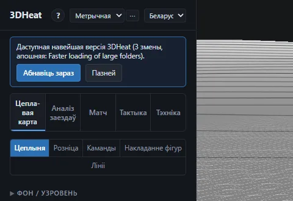

# Абнаўленні

Глядзельнік паведамляе вам, калі існуе новая версія, і абнаўляецца сам, толькі калі вы згодны. Нічога на вашым кампутары не мяняецца без вашага адказу.

## Абнавіць глядзельнік {#update-the-viewer}

1. **На старонцы.** Калі існуе новая версія, пад назвай уверсе бакавой панэлі з'яўляецца акно: «Даступна новая версія 3DHeat». Націсніце **Абнавіць зараз**. Калі ўсё скончыцца, старонка перазагрузіцца сама. **Пазней** хавае акно да перазагрузкі старонкі.
2. **Калі напісана запусціць restart.bat**, закрыйце акно сервера (чорнае акно, якое адкрыў `start.bat`) і двойчы націсніце `restart.bat`.
3. **Пры запуску глядзельніка.** `start.bat` таксама правярае. Калі існуе новая версія, ён пытаецца **Update now? [Y/N]**. Націсніце `Y`, каб абнавіць. Націсніце `N` або пачакайце 60 секунд без адказу, каб запусціць тую версію, што ў вас ёсць.



Копія са зменамі вашымі рукамі ніколі не абнаўляецца за вас: акно толькі кажа, што абнаўленне чакае, і прапануе зафіксаваць або адкласці вашы змены і запусціць `git pull`. Копія, якая не ўсталявана праз git (напрыклад, zip-файл), не паказвае нічога.

Як працуе праверка, крок за крокам:

```
старонка ---(праз 4 с, потым кожныя 6 г)---> сервер распрацоўкі ---> git fetch
   адстае?  не  -> нічога не паказваецца
            так -> вашы ўласныя зменыі або фіксацыі?  так -> толькі паведамляецца
                                                       не  -> [Абнавіць зараз] -> git pull
                                                             -> перазагрузка або «запусціце restart.bat»
```

## Правілы бяспекі {#the-safety-rules}

- **Толькі перамотка наперад** (`git pull --ff-only`): абнаўленне ніколі не злівае, не перабазуе і нічога не перапісвае.
- **Без лакальных змен**: копія з незафіксаванымі зменамі ў адсочваных файлах (`git status --porcelain --untracked-files=no` не пустое) ніколі не абнаўляецца аўтаматычна - чужая праца не павінна быць перазапісана абнаўленнем. Ёй толькі кажуць, што абнаўленне чакае. Неадсочваныя файлы (даныя, экспарты) зменамі не лічацца.
- **Без лакальных фіксацый**: копія з фіксацыямі, якіх няма ў upstream («разыйшлася»), не абнаўляецца - перамотка наперад не можа іх дагнаць, а зліццё - справа `git pull` уручную. Старонка і `start.bat` кажуць гэта адными словамі, і `start.bat` запускае тую версію, што там ёсць.
- **Толькі са самой старонкі**: запыт абнаўлення на сервер распрацоўкі павінен несці ўласны загаловак і, калі браўзер пасылае `Origin`, прыходзіць з уласнага хоста сервера (ніжэй).
- Абнаўляецца толькі копія git з upstream-галіны; усё іншае (копія без `.git`, git не ўсталяваны, статычная зборка) не чапаецца і нічога не кажа.

## Што робіць start.bat {#what-startbat-does}

`start.bat` (націсніце двойчы; акно - гэта сервер) робіць па парадку:

1. Знаходзіць Node.js - у `PATH`, інакш у `%ProgramFiles%\nodejs`, `%ProgramFiles(x86)%\nodejs` або `%LOCALAPPDATA%\Programs\nodejs` - і, калі яго няма, прапануе ўсталяваць праз `winget install -e --id OpenJS.NodeJS.LTS` (пытае, Y/N; потым акно трэба адкрыць зноў, каб Windows падхапіла новы `PATH`).
2. **Абнаўленні**, калі ўсталяваны git і ў тэчцы ёсць `.git`:
   - `git fetch --quiet` (без сеткі або без upstream: прапускаецца моўчкі);
   - падлічвае `git rev-list --count HEAD..@{u}`; нічога не адстае - нічога не кажа;
   - лакальныя зменыі: «A newer version of 3DHeat is available (N changes), but this copy has local changes, so it is not updated. Commit or stash them, then run git pull.» - і запускае тую версію, што ёсць;
   - уласныя фіксацыі (`git rev-list --count @{u}..HEAD` не 0): «A newer version of 3DHeat is available (N changes), but this copy has commits of its own that the newest version does not, so it is not updated. Update it with git pull.» - і запускае тую версію, што ёсць;
   - інакш «A newer version of 3DHeat is available (N changes).» і пытанне **Update now? [Y/N]**. `N`, або адсутнасць адказу 60 секунд, друкуе «Not updated; starting the version you have.» і запускае тую версію, што ёсць. На `Y`: «Updating...», паведамляе, ці мяняюцца `package.json` або `package-lock.json`, запускае `git pull --ff-only` (калі і гэта не ўдаецца - сетка, напрыклад: «The update did not go through; starting the version you have.»), потым `git submodule update --init` (замацаваныя інструменты, гл. [Падтрыманне дакументацыі](maintaining.md#the-tools-under-exporters)), потым `npm install`, калі файлы пакета змяніліся і `node_modules` існуе, і «Updated.».
3. Адмаўляецца запускаць другі сервер: калі на порце **5273** ужо нешта слухае, кажа пра гэта і накіроўвае да `restart.bat` / `stop.bat`.
4. Пры першым запуску (няма `node_modules`) пытаецца, перш чым спампоўваць залежнасці (каля 300 МБ у `node_modules\`, нічога на ўсю сістэму).
5. Запускае сервер распрацоўкі на `127.0.0.1:5273` (`--strictPort`) і адкрывае браўзер, калі ён гатовы.

`restart.bat` спыняе сервер (па порце) і запускае `start.bat` зноў, таму задае тое самае пытанне. `stop.bat` толькі спыняе.


## Для распрацоўшчыкаў {#for-developers}

### Пакуль працуе: маршрут абнаўлення {#while-it-runs-the-update-route}

Сервер распрацоўкі (плагін Vite `heat3d-self-update` у `vite.config.ts`) абслугоўвае `/__heat3d/update`. Ён існуе толькі на серверы распрацоўкі - не ў статычнай зборцы і не ў `vite preview`.

**`GET /__heat3d/update`** адказвае, ці адстае копія:

```json
{ "checkout": true, "upstream": "origin/main", "behind": 3, "ahead": 0, "dirty": false, "latest": "the newest commit's subject" }
```

- `checkout: false`, калі тэчка не копія git;
- запускае `git fetch --quiet` **не часцей за кожныя 30 хвілін** (запыты паміж гэтым адказваюць па тым, што было апошнім разам выбрана);
- `behind` / `ahead` - з `git rev-list --count HEAD..@{u}` / `@{u}..HEAD`, `dirty` - з `git status --porcelain --untracked-files=no`, `latest` - тэма апошняй фіксацыі upstream;
- без upstream-галіны `upstream: null` і `behind: 0`.

**`POST /__heat3d/update/apply`** прыводзіць копію ў парадак:

1. Адхіляецца з `403 { ok: false, reason: "forbidden" }`, калі запыт не мае загалоўка `X-Heat3d-Update: 1` і, калі ён мае `Origin`, хост гэтага origin не супадае з `Host` запыту. Міжсайтавая форма не можа адправіць уласны загаловак без папярэдняга запыту CORS, які гэты сервер ніколі не дае.
2. Нічога рабіць не трэба (не копія, няма upstream, не адстае): `{ ok: true, updated: false }`.
3. Лакальныя зменыі: `{ ok: false, reason: "dirty" }`; лакальныя фіксацыі: `{ ok: false, reason: "diverged" }`.
4. Інакш: запісвае, якія файлы мяняюцца (`git diff --name-only HEAD @{u}`), запускае `git pull --ff-only` (тайм-аўт 2 хв), `git submodule update --init` (збой ігнаруецца), `npm install`, калі змяніліся `package.json` або `package-lock.json` (тайм-аўт 15 хв), і адказвае `{ ok: true, updated: true, restart }` - `restart` кажа, чаму запушчаны сервер не можа ўзяць абнаўленне: `"dependencies"`, калі залежнасці ўсталяваны нанова, `"config"`, калі змяніўся толькі файл `vite.config`, `false`, калі перазапуск не патрэбны.
5. Няўдалая каманда git або npm адказвае `{ ok: false, reason: "<памылка, да 300 знакаў>" }`.

Адказы - JSON з `Cache-Control: no-store`. Сервер слухае толькі `127.0.0.1`, таму маршрут недаступны з сеткі.

### Паведамленне на старонцы {#the-notice-in-the-page}

`UpdateBanner`, пад назвай уверсе бакавой панэлі:

- Ён пытаецца ў маршрута праз **4 секунды** пасля загрузкі старонкі (не ў першыя секунды: у старонкі ёсць набор даных для загрузкі і GPU для запуску) і зноў **кожныя 6 гадзін**, пакуль старонка адкрыта.
- Ён **нічога** не паказвае, калі маршрута няма (статычная зборка), тэчка не копія або нічога не навейшае - паведамленне пры кожным запуску - гэта тое, да чаго людзі прывыкаюць і перастаюць звяртаць увагу.
- Адстае, без лакальных змен: «A newer version of 3DHeat is available (N changes, the newest: <тэма>).» з кнопкамі **Абнавіць зараз** і **Пазней** (*Пазней* хавае яго да перазагрузкі старонкі).
- Адстае, з лакальнымі зменамі: тое самае сказ і «This copy has local changes, so it is not updated automatically; commit or stash them, then run git pull.» - без кнопкі.
- **Абнавіць зараз** адпраўляе запыт на `/apply` («Абнаўленне...»). Потым:
  - «Абноўлена. Старонка перазагрузіцца.» - і перазагрузка праз 1,5 с (сервер ужо аддае новыя файлы);
  - калі залежнасці ўсталяваны нанова: «Абноўлена. Яе залежнасці змяніліся: закрыйце акно сервера і запусціце **restart.bat**, каб завяршыць.»;
  - калі змяніліся толькі налады сервера: «Абноўлена. Налады сервера змяніліся: закрыйце акно сервера і запусціце **restart.bat**, каб завяршыць.»;
  - у выніку нічога не трэба ўзяць (`updated: false` - копія ўжо ўзятая, напрыклад, праз `start.bat`): «Нічога не абнаўлялася: гэтая копія ўжо самая новая версія.» - і без перазагрузкі;
  - адхілена: сказ пра *dirty*, або «This copy has commits of its own that the newest version does not; update it with git pull.», або «Абнаўленне не адбылося: <прычына>».
