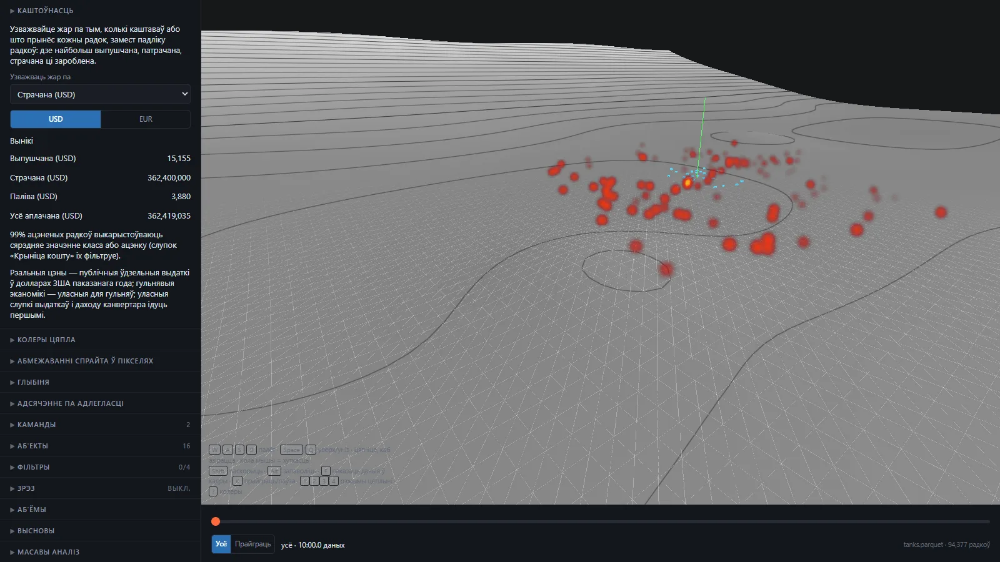

# Вагаванне значэнняў

Кожны стрэл, боепрыпас, страчаны транспартны сродак і літр паліва мае цану. Праглядальнік вылічвае, колькі каштаваў або прынёс кожны радок, і можа ўзважваць цеплыню па ёй, каб карта паказвала **куды пайшлі грошы**, а не дзе радкі.

## Як выкарыстоўваць {#how-to-use-it}

1. Загрузіце даныя з падзеямі (стрэлы, забойствы, смерці) і назвамі транспартных сродкаў або зброі.
2. Адкрыйце **Значэнне** на бакавой панэлі Heat.
3. Абярыце **Узважваць жар па**, напрыклад, *Страчана (USD)*. Цяпер цеплыня дадае цану кожнага радка замест 1.
4. Чытайце **Вынікі**: сума кожнага слупка значэнняў па тым, што паказана (працуюць фільтры і часавае акно).
5. Калі цэны — рэальныя грошы, з'яўляецца перамыкач **USD / EUR**.

Абярыце пусты першы пункт меню, каб зноў палічыць радкі.

## Што можна ўзважваць {#what-can-be-weighed}

Слупкі значэнняў дадаюцца пры загрузцы, па аднаму на від і валюту:

| Від | Радкі, на якія ён трапляе | Як вызначаецца цана |
|---|---|---|
| **Выпушчана** | стрэлы і запускі | зброя, інакш сярэдняе для гэтага віду боепрыпасу |
| **Патрачана** | купля, з'яўленне | грашовыя слупкі гульні (напрыклад, меню купі шутара) |
| **Страчана** | смерці, знішчэнні | уласны транспартны сродак, інакш сярэдняе яго класа |
| **Знішчана** | забойствы | транспартны сродак цэлі |
| **Нанесеная шкода** | трапленні | доля вартасці цэлі |
| **Паліва** | пазіцыі | выкарыстанае паліва, са слупка паліва або вылічанае па класе і часе |
| **Усё аплачана** | | выпушчана + патрачана + страчана + паліва |
| **Зароблена** | узнагароды | уласныя слупкі ўзнагарод гульні (`earn_…`) |
| **Вынік** | | зароблена мінус аплачана; малюецца як цеплыня са знакам (станоўчы ўзмацняльнік там, дзе больш зарабілі, адмоўны там, дзе больш заплацілі) |

Назвы слупкоў — `cost_<kind>_<currency>`, `earn_<currency>` і `net_<currency>`. Канвертар, які ведае ўласную валюту гульні (напрыклад, канвертар запісаў, які піша ў ігравых крэдытах), перамагае ўбудаваныя табліцы цэн.

## Табліцы цэн {#the-price-tables}

| Табліца | Валюта |
|---|---|
| Рэальнае ваеннае: ракеты, бомбы, снарады, контрмеры, самалёты, верталёты, наземныя транспартныя сродкі, караблі, паліва | USD (EUR = USD × 0,92, фіксаваны `EUR_PER_USD` у [`cost.ts`](https://github.com/Holdi601/3DHeat/blob/main/src/data/cost.ts); гэта не жывы курс) |
| Меню купівлі шутараў і ўзнагароды за забойствы | крэдыты гульні |
| Танкавыя і караблявыя гульні | крэдыты гульні |
| Стратэгічныя гульні (некалькі рэсурсаў) | адзін слупок на рэсурс і адзін агульны |
| Ваенныя гульні | ачкі |

Гульня распазнаецца па назвах у данных. Рэальныя цэны бяруцца з публічных крыніц (бюджэтныя дакументы, энцыклапедыі) або пазначаюцца як ацэнкі; яны не карэктуюцца на інфляцыю. Згенераваны спіс табліц — на [Табліцы значэнняў](ref-value-tables.md).

## Ацэнкі {#estimates}

Дадатковы слупок катэгорыі **Cost source** кажа, як была вызначана цана кожнага радка: `table`, `class average`, `estimate` або `none`. Раздзел **Значэнне** паказвае, якая доля ацэненых радкоў — сярэднія або ацэнкі. Каб пакінуць толькі дакладна ацэненыя радкі, зніміце адзнаку з *estimate* і *class average* у **Cost source** на [Фільтрах](filters.md).

## Дзе яшчэ паказваецца вартасць {#where-else-value-shows}

- [Высновы](insights.md): знаходкі *Costly ground* і *Earning ground*.
- [Разбіўка](breakdown.md): Зароблена, Страчана і Вынік грошы па камандзе, гульцу або зброі.
- [Аб'ёмы і параўнанне](volumes.md): слупкі значэнняў у статыстыцы і параўнанні.
