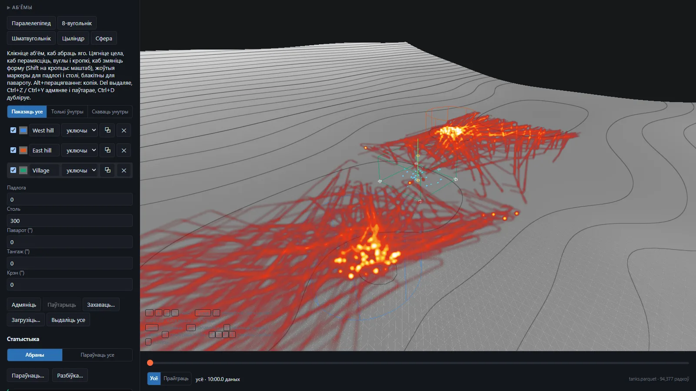
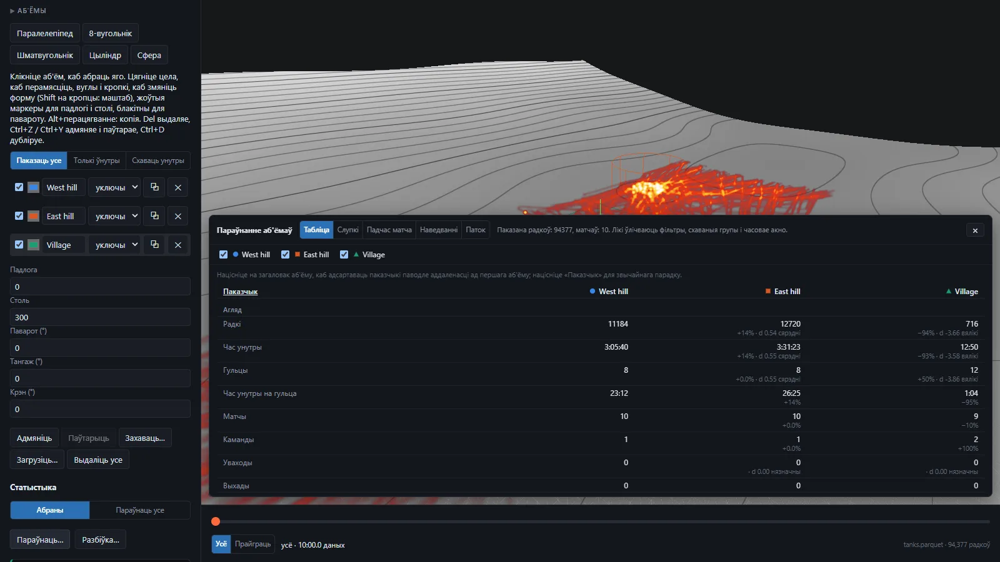
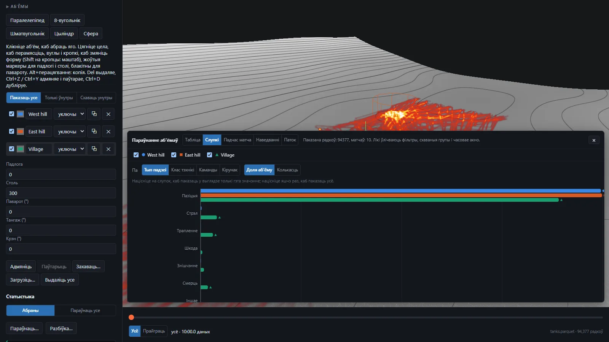

# Аб'ёмы і параўнанне

**Аб'ём** - гэта нябачная скрынка (або цыліндр, або сфера), якую вы малюеце вакол месца, каб спытаць: што тут адбывалася? Выкарыстоўвайце, каб палічыць забойствы на мосце, параўнаць два пагоркі або паказаць толькі актыўнасць у адной вобласці.

```
 від зверху              Вы малюеце фігуру ->  праграма лічыць
 +------------+          тое, што ўнутры:
 |   ( A )    |           радкі, гульцы, забойствы, час ...
 |        [B] |          Параўнайце A з B, побач.
 +------------+
```



Аб'ёмы вымяраюць, што адбываецца ўнутры, фільтруюць выгляд да іх, экспартуюць іх радкі і могуць параўноўвацца побач. Гл. таксама [слоўнік](glossary.md) для радка, асобы і матчу.

## Намалюйце аб'ём {#draw-a-volume}

1. Адкрыйце **Аб'ёмы** на бакавой панэлі.
2. Выберыце інструмент і малюйце ў 3D-выглядзе або на 2D-карце. Падлога і столь пачынаюцца ад даных унізе. Esc адмяняе.
3. Націсніце на аб'ём, каб абраць яго; з'яўляецца яго **Статыстыка**.

| Інструмент | Як малюваць |
|---|---|
| **Паралелепіпед** | Перацягніце прамавугольнік (Shift: квадрат). Адзін клік ставіць аб'ём па змаўчанні. |
| **n-gon** | Перацягніце ад цэнтра (Shift захоўвае правільнасць). *Corners* задае n ад 3 да 64 (па змаўчанні 8, таму кнопка чытаецца **8-gon**). |
| **Шматвугольнік** | Клікайце па вуглах; замыкайце падвойным кліком, Enter або кліком на першы вугал. Backspace выдаляе апошні вугал. |
| **Цыліндр** | Перацягніце радыус. |
| **Сфера** | Перацягніце радыус; яна стаіць на зямлі. |

## Рэдагаванне {#edit}

- Націсніце на аб'ём, каб абраць яго. Перацягніце яго корпус, каб перамясціць, вуглы - каб змяніць форму (Shift на вугле маштабуе).
- **Жоўтыя** маркеры задаюць падлогу і столь, **блакітны** маркер паварочвае яго.
- Alt+перацягванне капіруе, Del выдаляе, Ctrl+Z / Ctrl+Y адмяняюць і вяртаюць, Ctrl+D дубліруе. **Выдаліць усе** выдаляе ўсе аб'ёмы.
- Дакладныя значэнні: Floor, Ceiling, Turn / Pitch / Roll (скрынкі), Radius (сферы, цыліндры).

Кожны радок аб'ёму мае сцяжок паказу, колер, назву, **уключыць** або **выключыць**, дубляванне і выдаленне. Аб'ёмы захоўваюцца ў браўзеры для кожнага набору даных, а **Захаваць...** / **Загрузіць...** запісваюць і чытаюць файл `volumes.json`.

## Фільтраваць выгляд {#filter-the-view}

| Фільтр | Эфект |
|---|---|
| **Паказаць усе** (па змаўчанні) | Аб'ёмы толькі вымяраюць. |
| **Толькі ўнутры** | Цяпло, прайграванне і [аналіз трапленняў](hit-analysis.md) малююць толькі тое, што ўнутры ўключаных аб'ёмаў і па-за выключанымі. |
| **Схаваць унутры** | Наадварот. |

Відэафільтр бярэ да 8 аб'ёмаў з 64 кропкамі контуру ўсяго; знак «!» пазначае аб'ём, які перавышае гэта. Статыстыка і экспарт ужо лічаць яго.

## Статыстыка {#statistics}

Вобласць **Статыстыка** ідзе за фільтрамі, акном часу і схаванымі групамі. *Абраныя* паказвае абраны аб'ём, *Compare all* ставіць кожны аб'ём побач. Яна паказвае:

- **Радкоў унутры (паказаных)** і **Радкоў унутры (усе даныя)**, **Гульцы**, **Каманды**, **Матчы**, **Час унутры**, **Уваходы / выхады**, **Пік цяпла**, **Сярэдняе цяпло**, **Аб'ём / плошча** і гістаграму **Калі**;
- для кожнага слупка: катэгорыі з **доля ўнутры, падзеленая на долю ва ўсіх паказаных даных**, і лікі з дыяпазонам, медыянай і 5-м-95-м працэнтылямі.

**Statistics as CSV / JSON** захоўвае іх. **Экспарт даных унутры** запісвае радкі ўнутры як CSV або Parquet (*Only the rows shown* уключана па змаўчанні), адзін аб'ём або ўсе, са слупком, які кажа, у якім аб'ёме знаходзіцца кожны радок.

## Параўнанне аб'ёмаў {#compare-volumes}

Пры двух і больш бачных аб'ёмах націсніце **Compare...**.

1. Намалюйце тры аб'ёмы, напрыклад Заходні пагорак, Усходні пагорак і Вёска.
2. Націсніце **Compare...** пад Статыстыкай.
3. У **Табліца** чытайце рознасць кожнага значэння ад першага аб'ёму.
4. Перайдзіце на **Слупкі**, каб убачыць долі слупкамі.



| Выгляд | Паказвае |
|---|---|
| **Табліца** | Радкі, час унутры, гульцы, матчы, каманды, уваходы, выхады, наведванні, даўжыня наведванняў, забойствы, смерці, забойствы на смерць, забойствы за хвіліну, час на гульца, слупкі значэнняў; згрупавана па падзеях, класе тэхнікі, гульцы або ШІ, камандзе і накірунку. Кожнае значэнне паказвае сваю рознасць ад першага аб'ёму і памер эфекту (нязначны, малы, сярэдні, вялікі). Націсніце загаловак аб'ёму, каб сартаваць па адлегласці ад першага. |
| **Слупкі** | Колькасці або долі па падзеі, класе, акцёры, камандзе або накірунку. Націсніце слупок, каб адфільтраваць выгляд да яго. |
| **Падчас матча** | Адзін графік на аб'ём па хвілінах матчу: прысутнасць, радкі або забойствы. Націсніце, каб перайсці туды. |
| **Наведванні** | Скрыпічныя і скрынкавыя дыяграмы таго, як доўга трываюць наведванні (лагарыфмічная шкала). |
| **Паток** | Куды ідуць трэкі пасля выхаду з кожнага аб'ёму: матрыца пераходаў або стужкі патоку. |



## Парады {#tips}

- Пачніце з высновы: у [Высновах](insights.md) **Аб'ём тут** дадае цыліндр вакол месца высновы.
- **Разбіўка...** адкрывае [Разбіўку](breakdown.md) для абранага аб'ёму: хто і што лепш выступае ўнутры.
- [Направленая цеплыня](directional-heat.md) можа пабудаваць графік кірункаў унутры абранага аб'ёму.
- [Укладка Тэхніка](hit-analysis.md#restrict-to-an-area) выкарыстоўвае тыя ж аб'ёмы як свой фільтр вобласці.
