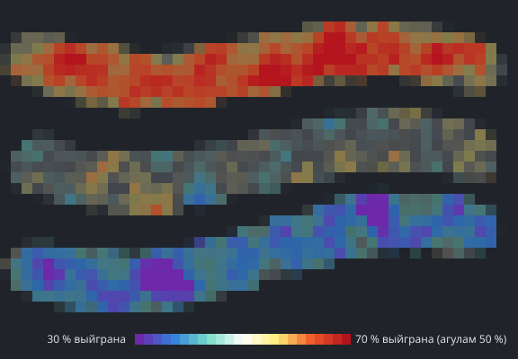

# Доля перамог: як часта перамагае месца, маршрут ці дзеянне

Дзе гулец стаіць, куды ідзе, адкуль кідае гранаты - і як часта яго бок потым выйграе раўнд. **Карта долі перамог** афарбоўвае кожнае месца паводле долі радкоў там, што належаць да раўндаў, якія выйграў бок радка, у параўнанні з доляй па ўсім паказаным: цёпла там, дзе яна вышэй, холадна там, дзе ніжэй, нічога там, дзе яна такая ж.

*На малюнку выдуманыя даныя: тры маршруты на пустым узроўні, 68 %, 50 % і 33 % іх радкоў у выйграных раўндах.*

Патрэбныя даныя, якія кажуць, хто перамог: [слупкі выніку](data-formats.md#outcome-columns) (`won`, `matchWon`, `roundEndReason`). Іх запісваюць канвертары CS2 і War Thunder; любы файл таксама можа.

## Паспрабуйце {#try-it}

1. Загрузіце матчы са слупком выніку і націсніце `2` (**Розніца**).
2. У **Падзел для рознасці** націсніце **Доля перамог у раўндах** (або **Доля перамог у матчах**). Гэта ставіць выйграныя раўнды на **+**, прайграныя на **−** і пераключае панэль на **Доля +**.
3. Чытайце колеры. Панэль паказвае агульную долю: *Усяго 52,0 % з 1 200 000 радкоў на +.*
4. Звужайце з дапамогай [фільтраў](filters.md): адзін бок (T або CT), адзін тып падзеі (*Пазіцыя* - дзе людзі стаялі, *Стрэл* або *Пуск (ракета, снарад, бомба)* - адкуль яны стралялі ці кідалі), адна закупка, адна карта.

Месца, цёплае з радкамі *Пазіцыя*, - гэта месца, чые ўладальнікі часцей выйгравалі раўнд. З радкамі *Знішчэнне* гэта месца, дзе зробленыя забойствы вялі да выйграных раўндаў.

## Налады {#the-settings}

| Налада | Што робіць | Па змаўчанні |
|---|---|---|
| **Розніца** / **Доля +** | сама розніца, або доля боку + сярод радкоў абодвух бакоў | Розніца |
| **Поўны колер пры** | наколькі вышэй ці ніжэй агульнай долі месца паказваецца поўным колерам, у пунктах | ± 20 пунктаў |
| **Найменш радкоў, каб афарбаваць месца** | месца з меншай колькасцю радкоў не афарбоўваецца; колер з'яўляецца паступова ад паловы гэтага ліку | 12 |
| **Цяжэнне да агульнай долі (радкі)** | кожнае месца пачынае з такой колькасці радкоў на агульнай долі, таму месца з 3 радкамі, усе выйграныя, не паказваецца як 100 % | 12 |

Усе тры дзейнічаюць на гатовы малюнак: іх перацягванне ніколі не запускае назапашванне нанова.

Доля можа быць ад любога падзелу, не толькі перамог: *Доля +* з падзелам па баках паказвае, дзе T былі большай часткай прысутнасці, а з падзелам па файлах дзвюх карт - дзе радкі аднаго файла пераважаюць радкі другога.

## Радкі, а не раўнды {#rows-not-rounds}

Карта лічыць радкі. Гулец, які стаіць на адным месцы дваццаць секунд, дадае радок у кожным узоры, і ўсе яны з аднаго раўнда. Таму доказ у месцы - гэта радкі побач з ім, а не раўнды. Таму мінімум і цяжэнне зададзены ў радках, і таму яны большыя, чым адзін раўнд.

Для саміх раўндаў:

- **[Разбіўка](breakdown.md)** для пункта, віду або аб'ёму: *Перамогі %* лічыць раўнд кожнага гульца адзін раз, з цяжэннем да агульнай долі месца гэтак жа (4 раўнды).
- Статыстыка **[Аб'ёмаў](volumes.md)**: *Доля перамог* - раўнды з гульцом унутры аб'ёму, кожны адзін раз, з цяжэннем да долі па ўсім паказаным, разам з колькасцямі.

## Фільтры выніку {#outcome-filters}

Панэль [Фільтры](filters.md) паказвае слупкі выніку адразу пасля ўласных слупкоў праглядальніка: **Вынік раўнда** і **Вынік матча** (*Любы*, *Перамога*, *Паражэнне*) і **Як скончыўся раўнд** (знішчэнне ўсіх, бомба выбухнула, бомба абясшкоджана, час скончыўся, капітуляцыя, нічыя, мэта, утрыманне зон, страта ачкоў, страчана ўся тэхніка), на мове праглядальніка.

## Для распрацоўшчыкаў {#for-developers}

Праход цяпла запісвае тры сумы ў чатырохканальную мэту, якую выкарыстоўвае цяпло каманд: цяпло `R = Σ|v|`, цяпло боку + `P` і `S = Σ v²/w`, дзе `w` - вага праходу (вага выбаркі, памножаная на ўзмацненне кадра). Кампазіцыя чытае долю `P/R` (сярэдняе, узважанае ядром) і колькасць радкоў, на якіх яна трымаецца, `n = R²/S` (эфектыўны памер выбаркі Кіша), цягне долю да агульнай, `p = (n·P/R + m·r0)/(n + m)`, і афарбоўвае `p - r0` у межах дыяпазону на шкалах рознасці.

`n` скарачае кожны множнік, агульны для радкоў у пікселі - узмацненне кадра, вагу выбаркі, вагу плошчы абрэзанага спрайта - таму малюнак аднолькавы пры любым маштабе і шчыльнасці выбаркі, а кадры з кожным k-м радком зліваюцца ў цэлае без скачкоў колеру. Агульная доля бярэцца з падлікаў бакоў на CPU, з дакладнасцю да дзясятых працэнта; нічога не счытваецца назад з GPU. Арыфметыка і яе праверкі: [`render/rateMap.ts`](https://github.com/Holdi601/3DHeat/blob/main/src/render/rateMap.ts) і яго тэст.

Гэта каштуе столькі ж, колькі цяпло каманд: чатырохканальная мэта ўчацвёра павялічвае прапускную здольнасць змешвання праходу цяпла, толькі пакуль уключана *Доля +*.
