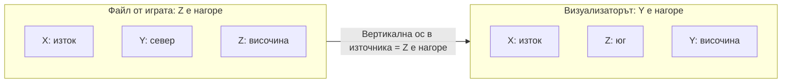

# Оси, единици и време

Играта и картите не се съгласуват кое е нагоре, колко е дълга една единица и как се записва времето. Тази страница показва трите настройки, които правят данните ви да стоят, да са в правилен мащаб и да се въртят правилно.

Ако картата ви стои като стена, вместо да лежи като под, превключете **Вертикална ос в източника**.

При грешна **Вертикална ос в източника** картата стои като стена; при правилна лежи като под.

## Светът, в който визуализаторът рисува {#the-world-the-viewer-draws-in}

Светът на визуализатора е **Y нагоре**: X и Z са равнината на земята, Y е височината. Повечето игрови двигатели са **Z нагоре**: за тях X и Y са земята, а Z е височината. Някои двигатели са и огледални (левосторонни). Съпоставянето казва как да се превърнат осите на файла в осите на визуализатора. (Технически визуализаторът е десностранен, конвенцията на three.js.)

### Вертикална ос {#up-axis}

**Вертикална ос в източника** в [Съпоставяне на колони](column-mapping.md):

| Настройка | Файл (x, y, z) става свят (X, Y, Z) |
|---|---|
| *Z е нагоре (повечето игрови двигатели)* - по подразбиране | (x, **z**, **y**): Z от файла става височина, а Y от файла става Z на света |
| *Y е нагоре (графична конвенция)* | (x, y, z) без промяна |

При данни с Z нагоре трите масива се преименуват, вместо да се копират ([`remapAxesInPlace`](https://github.com/Holdi601/3DHeat/blob/main/src/data/ingest.ts)), което спестява стотици мегабайти при големи зареждания. Предположението се прави от извадката: кой от колоните Y и Z има по-малък разброс, той е нагоре.

### Обръщания {#flips}

**Обръщане на X**, **Обръщане на Y**, **Обръщане на Z** отричат оста на *файла* с това име, преди преименуването - така че при Z нагоре *Обръщане на Y* отрича това, което в крайна сметка става Z на света. Обръщането променя заредените данни: координатите, които показват [линийката](measure.md), срезът и позата на камерата, са обърнатите.

За да нарисувате огледален свят в правилната посока **без** да променяте данните, използвайте вместо това **Камера и сцена → Обръщане на оста на света** ([Камера](camera.md#invert-world-axis)). Това е по-добрият избор за игри, чийто свят е левосторонен, защото всяка координата, която инструментите показват, остава на самата игра.

### Мащаб на единиците {#unit-scale}

**Мащаб на единиците** умножава всяка позиция. *1 (m)* задава 1, *0,01 (cm→m)* задава 0,01 (единиците на Unreal Engine са сантиметри, затова използвайте 0,01; единиците на Source са инчове, затова използвайте 0,0254; нито едното не е метри), а полето приема всяка стойност. Въведена 0 или стойност, която не е число, се заменя с 1.

Визуализаторът означава разстоянията в метри (радиус на спрайта, граници на отсичане, линийката, скорост на полета), което е вярно само когато мащабираната единица на света е метър. Нищо не се счупва, когато не е; етикетите просто казват „m“ за каквато и да е единица.

## Време {#time}

### Единици за време {#time-units}

Правило за палеца: стойности като 17000000000 (десет или повече цифри) са Unix времева марка; стойности като 0, 0,25, 0,5 са секунди от началото.

| Единица за време (етикет в менюто) | Чете се като | Показва се стенен часовник |
|---|---|---|
| *Секунди (относително)* | стойност × 1 s | не |
| *Милисекунди (относително)* | стойност × 0,001 s | не |
| *Микросекунди (относително)* | стойност × 10^-6 s | не |
| *Наносекунди (относително)* | стойност × 10^-9 s | не |
| *Unix времева марка (s)* | секунди от 1970-01-01 UTC | да |
| *Unix времева марка (ms)* | милисекунди от 1970-01-01 UTC | да |
| *ISO-8601 низ с дата* | текст като `2026-03-14T18:02:11.250Z`, разчетен с `Date.parse` на браузъра | да |

При абсолютна единица (последните три) наборът данни запазва момента по стенен часовник на най-ранния си ред, а времевата линия показва текущото UTC време на деня (`HH:MM:SSZ`) до плейхеда.

**Колоните `TIMESTAMP` и `DATE` в Parquet** се декодират в истински моменти, затова настройката им за единица се пренебрегва и панелът го казва. Колона `DATE` е цял ден: всеки ред от даден ден споделя един и същ момент и възпроизвеждането прескача по един ден, за което панелът предупреждава.

**Низовете ISO-8601 работят еднакво в CSV и Parquet.** Текстова колона за време с ISO единица се разчита веднъж за всеки различен низ; ако нито един не се разчита, зареждането се проваля със *No parseable ISO-8601 timestamps in the mapped time column.* - а съпоставянето вече отказва да започне, когато нито една от извадените стойности не се разчита. Колона `TIMESTAMP` в Parquet се чете като времева марка, каквато и да е зададена единица, а числова колона в Parquet с ISO единица се чете като Unix милисекунди. Текстова колона за време с числова единица се отхвърля преди зареждане: всяка стойност би се прочела като NaN.

### Как се пази времето {#how-time-is-stored}

Докато файловете се сливат, времената са 64-битови секунди, така че абсолютна епоха пази подсекундните си детайли. Когато всички файлове са вътре, най-ранното време на цялата селекция става 0 и всеки ред пази 32-битови секунди от него. 32-битовото число с плаваща запетая има 24 бита мантиса: интервали до около ден и половина се разрешават по-добре от 1/100 s, интервали до половин година - до около секунда. Ред, чието време липсва или не е число, се поставя на 0, т.е. в началото.

След това редовете се сортират по време, което прави времевата линия евтина: времеви прозорец се намира с две двоични търсения (виж [Вземане на проби и бюджети](sampling-and-budgets.md)).

### Изминало време срещу стенен часовник {#elapsed-time-versus-wall-clock}

Колона за време като `match_time` или `round_time` брои от собственото начало на всеки мач. Когато я изберете, всеки мач попада на обща ос - добро за сравняване на това, което се случва в минута 3 на всеки мач - и панелът обръща внимание на това. Колона по стенен часовник показва мачовете в реалния ред, в който са станали, като се припокриват, където са се припокривали.

## Посока на гледане {#look-direction}

Посоката на гледане се използва само от [наслагването на фигури](box-replay.md) (лъчите от всяка фигура). Пази се като два ъгъла, yaw и pitch, в радиани.

- **Колони yaw / pitch** се четат както са, преобразувани от градуси, когато е избрано *Градуси*. Не се коригират за вертикалната ос или за обръщанията.
- **Колони с вектор на посоката** минават през същото преименуване и обръщания като позициите, след което стават yaw = atan2(x, -z) и pitch = atan2(y, √(x² + z²)) в осите на света, така че лъчът сочи там, където е обърната фигурата, и в огледален свят от източника.

Ако колоните yaw/pitch излязат с грешна посока след обръщане, вектор на посоката или коригирани ъгли, решението е в това.
