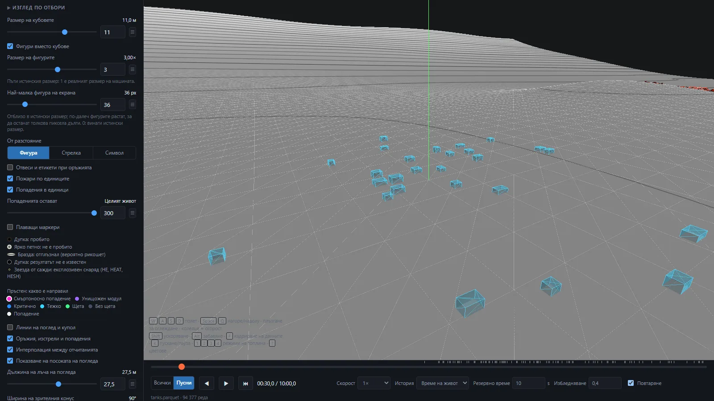

# Наслагване на фигури (разбор с кубове)

Малък филм: по една фигура за всеки човек, която се движи, докато времето тече, със следа зад нея.

Режимът се нарича **Наслагване на фигури** в лентата с режими. Тази страница преди се наричаше „разбор с кубове“, защото преди фигурите всеки човек беше куб; „разбор с фигури“ и „разбор с кубове“ значат едно и също. **Наслагване на фигури** няма числов клавиш: изберете го в лентата с режими. Той рисува по една фигура (или куб) за всяко [лице](glossary.md), което се движи по [времевата линия](timeline.md), с по желание посоки на погледа и следи. Това е възпроизвеждане, а не плътност: *кой къде е бил, кога*. Нужна е колона с лице; без колона за време всяко отчитане се рисува наведнъж.

## Как се използва {#how-to-use-it}

1. Заредете данни с колона за лице и колона за време.
2. Изберете **Наслагване на фигури** в лентата с режими.
3. Превключете времевата линия на **Пусни** и натиснете пускане (`K`).
4. Отворете **Изглед по отбори**, за да промените **Дължина на следата**, размера на фигурите или лъчите на погледа.

В този режим не се рисува топлина, а адаптивният бюджет на спрайтовете е неактивен.

По подразбиране всеки човек се рисува като фигурата на това, което е, а не като куб - виж [Фигури](figures.md) за това коя фигура получава всяка единица, и [Разбор на мач](match-replay.md) за етикетите, камерата, която следва, измерването между две единици и списъка със събития.

## Панелът Изглед по отбори {#the-team-viewer-panel}

Показва се вместо панелите за топлина в този режим.

| Контрол | По подразбиране | Обхват (плъзгане) | Значение |
|---|---|---|---|
| **Фигури вместо кубове** | включено | | Всеки човек като фигурата на това, което е: войник пеш, танкът или самолетът, които данните назовават. Това, което данните не казват нищо за, остава куб. |
| **Размер на фигурите** | 1× | | 1× е истински размер. |
| **Най-малка фигура на екрана** | 36 px | 0 = винаги истински размер | Истински размер отблизо; по-далеч фигурите растат, за да останат толкова пиксела дълги. |
| **Оръжия, изстрели и попадения** | включено | | Оръжия в полет с дим, трасиращи изстрели, удари, попадения и убийства. Трасиращите изстрели, изведени от попадение, са пунктирани. |
| **Размер на кубовете** | размер на обекта, или обхват / 500, при зареждане | 0,05-200 m, логаритмично (5000) | Дължина на ръба на всеки куб. Виж [размер на обекта](sessions-persons-groups.md#entity-size). |
| **Интерполация между отчитанията** | включено | | Между две отчитания на един и същи човек в една и съща сесия поставя кубът пропорционално между тях. Никога през граница на сесия. |
| **Показване на посоката на погледа** | включено | | Лъч от всеки куб по посоката на погледа на човека (изисква [колони за погледа](axes-units-and-time.md#look-direction)). |
| **Дължина на лъча на погледа** | размер на обекта × 4, или обхват / 200, при зареждане | 0,5-500 m, логаритмично (20 000) | Показва се, докато посоката на погледа е включена. |
| **Дължина на следата** | 8 s | 0-300 s (86 400); 0 = изключено | Секунди история, нарисувани зад всеки човек. |
| **Рисуване на всяко сурово отчитане** | изключено | | Куб за всяко записано отчитане в прозореца, вместо един интерполиран куб на човек. Семплира се, за да остане интерактивно. |

Подсказките в панела обясняват, че интерполацията и следите свързват отчитанията само в рамките на една сесия, и, когато заредените данни имат [споделени имена](sessions-persons-groups.md#names-worn-by-several-things-at-once), колко имена са нарисувани като единични отчитания.

## Сесията, която се пуска {#the-session-being-played}

Когато има колона за сесия, изборникът **Сесия** в горната част на страничната лента ([Сесии](sessions-persons-groups.md#the-session-picker)) решава кой мач се възпроизвежда. При зареждане се избира най-натоварената. Само редовете на тази сесия стават кубове и следи, а времевата линия върви по обхвата на тази сесия, а не по целия набор данни. *Всички сесии* пуска всички сесии едновременно, като и тогава никога не свързва отчитания между сесии.

## Какво се рисува кога {#what-is-drawn-when}

От [`TrackCursor`](https://github.com/Holdi601/3DHeat/blob/main/src/data/tracks.ts):

**Живи кубове** (режим Пусни, сурови отчитания изключени). За всяко видимо лице - последното му отчитане в или преди плейхеда:

- Ако лицето има следващо отчитане, то е в същата сесия и името не е споделено, кубът се поставя между двете отчитания пропорционално на времето, като yaw се интерполира по по-късия път, а pitch - линейно (когато *Интерполация* е включена).
- В противен случай кубът стои на последното отчитане за **Резервно време** на времевата линия (по подразбиране 10 s) и след това се маха, така че елиминираните играчи да не остават.

**Режимът Всички** игнорира плейхеда и рисува всяко отчитане в обхвата като куб.

**Сурови отчитания** рисува по куб за всяко записано отчитане в прозореца: *Обхвата* при история *Прозорец*, иначе всичко до плейхеда. Най-много 65 536 куба; при повече отчитания се рисува всяко *k-то*.

**Следи** (когато дължината на следата е над 0 и суровите отчитания не се рисуват): линия между всяко двойка последователни отчитания на лице в последните *дължина на следата* секунди до плейхеда, като с възрастта избледнява от 80% непрозрачност до прозрачна. Следата спира при смяна на сесия и не се рисува за споделени имена. Най-много 131 072 върха; при повече редовете се прескачат равномерно.

**Кой е видим:** лицето е скрито, когато групата му е размаркирана в [Списъка с отбори](teams-list.md) (групата му е тази на първия му ред), когато филтър на група го изключва, или когато панелът [Обекти](entities.md) има селекция, която не го включва. [Филтрите](filters.md) по колони не се прилагат за кубовете.

## Цветове {#colours}

Едно семейство нюанси на група и по един тон на член, така че един поглед показва на коя страна е някой ([`teamMemberColor`](https://github.com/Holdi601/3DHeat/blob/main/src/render/colors.ts)). Нюансите на групите се сменят в фиксиран списък от десет - синьо, червено, зелено, кехлибарено, виолетово, циан, магента, лаймово, оранжево, индиго - а членовете на една група се разпределят по светлина 42-76% и наситеност 90-65%.

## Бележки {#notes}

- Наслагването на фигури престроява фигурите си само когато нещо се промени; неподвижен кадър прерисува последните.
- Редът *Кубове* в [наслагването със статистика](performance-and-stats.md) брои кубовете на екрана.
- Наслагването на фигури се рисува в същата сцена като нивото, така че [дълбочината на полето](camera.md#depth-of-field) размазва кубовете, но никога топлината.
