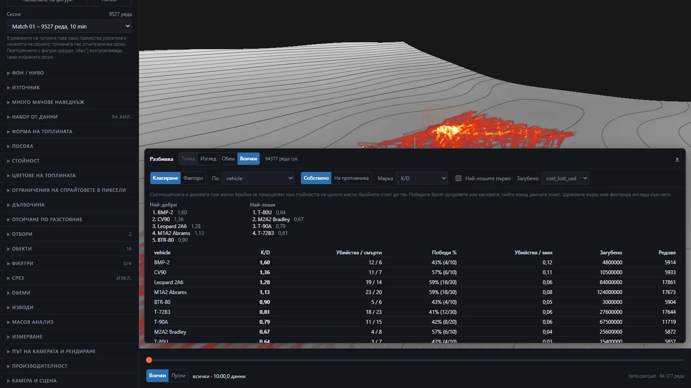
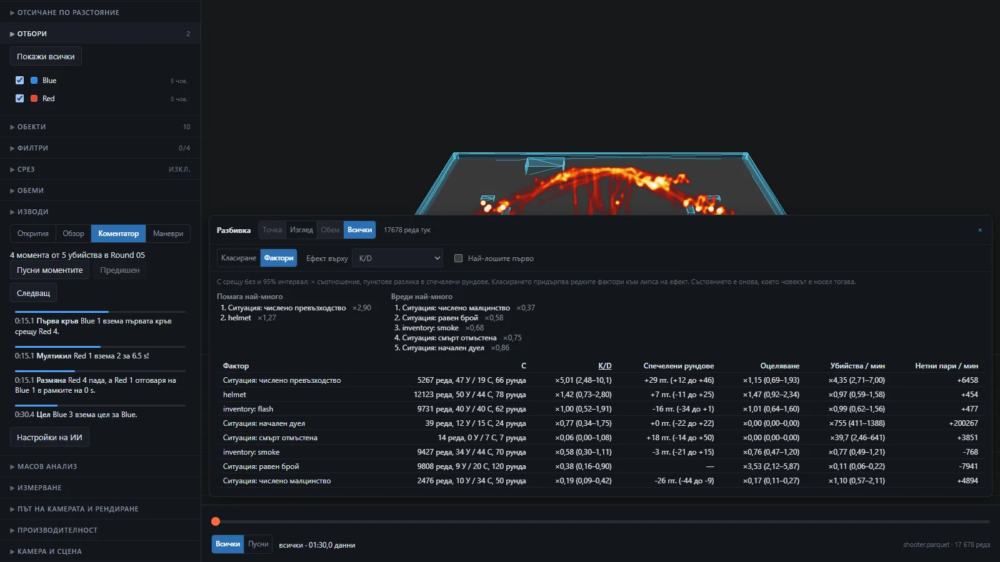

# Разбивка: кой и какво е най-добро къде

**Разбивката** отговаря на един въпрос: на това място коя машина, играч или оръжие се справя най-добре? Използвайте я, за да намерите танка, който печели на моста, или да видите дали наистина помага шлемът.

Тя класира това, което се случва на едно място (избрана точка, изгледът, обем или всичко видимо) по всяка категория, и измерва всеки фактор на състояние със и без него.

## Опитайте {#try-it}

1. Заредете мач с убийства и смърти и отворете **Обеми**.
2. Начертайте обем около мястото, което ви интересува, и го изберете.
3. Натиснете **Разбивка…** под Статистика.
4. Под **По** изберете *Техника* и мярката *K/D* (убийства на смърт).
5. Прочетете списъка, най-добрите първи. Натиснете **Най-лошите първо**, за да го обърнете. Щракнете върху име, за да филтрирате изгледа до него; щракнете отново, за да го пуснете.

## Отворете я {#open-it}

| Откъде | Област, с която започва |
| --- | --- |
| **Разбивка…** в [Обеми](volumes.md) (Статистика) | избраният обем |
| **Разбивка тук** на картата на избора, след щракване върху точка | сфера около тази точка (**Радиус**, по подразбиране 3% от размера на данните) |
| панелът за разделяне **Разлика** | изгледът |

Заглавката сменя областта: **Точка**, **Изглед** (какво е видяла камерата при последното броене; **Преброй отново** след движение), **Обем** (изберете един) или **Всички**. Броенето става във фонов режим; редът със състоянието казва колко реда има в областта.

## Класиране {#ranking}

Изберете по какво да класирате и мярка:

| Мярка | Какво е |
| --- | --- |
| A, B | редове от всяка страна на картата на разликата, разделени както ги разделя топлината |
| A / B, A - B, A / (A + B) | двата слоя един срещу друг |
| K/D | убийства срещу смъртни случаи |
| Печалба % | спечелени рундове (или мачове), когато данните казват кой е спечелил |
| Убийства / мин. | убийства на минута, налични (празнините между отчитанията на движението) |
| Спечелени, Загубени, Нетни пари | суми от колоните `earn_*` и `cost_*`; изборникът избира валутата |

Убийствата, смъртите, присъствието, победите и парите броят всеки ред, който изгледът показва на това място, от която и да е страна на разделянето или от никоя.

Съотношенията и честотите се издърпват към стойността на цялото място, когато броят е малък, така че 2 убийства при 1 живот не оглавяват списъка. Броят се показва до тях.

Можете да класирате по групите, играчите и мачовете, по всяка колона с категория (машина, оръжие, страна, вид покупка или агент и екип), по всяка числова колона в диапазони (броня, стойност на екипировката), по **клас** на колона с оръжие (пушка, снайперска, SMG, пистолет...) и по това колко части **помощно** съдържа колона със списък като `inventory`.

**Собствено** класира по собствената стойност на реда. **На противника** класира по стойността на другата страна: оръжието на жертвата при убийство, на убиеца при смърт (изисква колона `other` / `victim`, която ги назовава).

## Състояние в момента {#state-at-the-time}

Стойността на ред е собствената му, освен ако редът не записва нищо (ред на събитие без екипировка) или е смърт (чиято колона с оръжие може да назове оръжието на убиеца); тогава е това, което същият човек е носил последно по-рано в мача.

## Фактори: със срещу без {#factors-with-against-without}

Превключете от **Класиране** на **Фактори**, изберете **Ефект върху** и прочетете *Помага най-много* и *Пречи най-много*:

Ефектът на всеки фактор върху K/D, спечелени рундове, оцеляване (минути на смърт), убийства на минута и нетни пари на минута, с 95% интервал: съотношенията като x, спечелените рундове като разлика в точки. Класирането издърпва всяка оценка към липса на ефект според собствената ѝ несигурност, така че рядък фактор трябва да има ясен ефект, за да се класира високо; показаният интервал е неиздърпаният.

Данните с рундове добавят **ситуациите** от близки схватки ([Близки схватки и рундове](close-quarters.md)), изчислени веднъж за набор данни: *ослепен* (`state_flashed` на реда или вражеска светкавица в рамките на 15 m през последните 3 s), *смъртта е разменена*, *начален дуел*, и *човек повече*, *равен брой* или *човек по-малко* (живите играчи от страната на реда спрямо врага). Смъртта се брои в ситуацията, в която е била жертвата ѝ непосредствено преди нея.

В една обработка се измерват най-много 256 фактора.

## За разработчици {#for-developers}

### Издърпване на малки проби {#pulling-small-samples}

Стойността за класиране е `(n + m*r0) / (d + m)`: `n` и `d` са броевете, `r0` е съотношението на цялото място, а `m` е тежестта на това предварително знание.

### За автори на конвертори: именуване на колони с фактори {#for-converter-authors-naming-factor-columns}

Конвертор добавя фактор, като именува колоната му:

| Колона | Фактор |
| --- | --- |
| `state_<name>`, число | включен, докато е ненулев (`state_scoped`, `state_suppressor`) |
| `state_<name>`, категория | по един фактор за стойност (`state_ammo` = AP, HE...) |
| `active_<name>` | същото, за нещо, което е включено или използвано наскоро: способност, ултимейт, джаджа, бонус (`active_ult`, `active_stim`) |
| колона със списък (`inventory`, `loadout`, `perks`, `abilities`, `attachments`, `modules`, `buffs`, `debuffs`, `upgrades`, или име `state_`/`active_`, което завършва на `s`) | по един фактор за всеки елемент от стойност `a\|b\|c` |
| флагове за екипировка, които вече са познати (`helmet`, `defuser`, `armor`, `scoped`, `airborne`, `duck`, `flashed`...) | включен, докато е ненулев |
| `ammoType`, `shellType`, `ammoName` | последният изстрелян патрон |

Резултати: колона `won` с 0/1 (страната на реда е спечелила рунда или мача) и колона `round` - [колоните за изход](data-formats.md#outcome-columns); където файлът има и `won`, и `matchWon`, *Победи %* брои рундове. Пари: `earn_<currency>` и `cost_<kind>_<currency>`; приход по самия вид (`earn_round_cs2`, точните награди за рунд на конвертора) заменя само приходите на модела на разходите за този вид (`round` покрива и поставянето и обезвреждането на бомбата), а моделът все още оценява останалото.

Съпоставянето зарежда тези колони само: всяка колона `state_*`, `active_*`, `won`, `round` и колона със списък, освен тези, за които статистиката на Parquet файл показва, че държат една стойност през цялото време (всяка заредена колона е 4 байта на ред).
