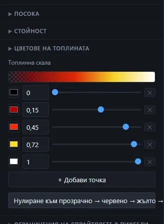

# Цвят и експозиция

Тези настройки определят каква част от топлината в какъв цвят се показва. **Точка на насищане** е колко топлина се брои като бяло-горещо.

## Бързи корекции {#quick-fixes}

- Всичко е бяло: увеличете **Точка на насищане** или натиснете **Автоматична експозиция от полето**.
- Нищо не се вижда: намалете **Точка на насищане** или натиснете **Автоматична експозиция от полето**.
- Виждат се само няколко единични точки: увеличете **Минимална топлина**.

Всеки контрол на тази страница действа, когато топлината се превръща в цвят, така че при плъзгане на който и да е от тях изгледът се прерисува веднага и **никога не рестартира натрупването**.

## Точка на насищане {#saturation-point}

**Точка на насищане** (секция Форма на топлината): натрупаната топлина, която се съпоставя с горния край на цветовата скала (при реакция *Линейна*; за другите виж по-долу). Логаритмичен плъзгач 0,1-4000, дръжката може да се плъзне до 10 000 000, защото натрупаната топлина расте с броя на редовете. По подразбиране 24; при всяко зареждане първо се прави **аналитична оценка**, после се **измерва** по картината.

Грешната стойност е разликата между топлинна карта и празен (или бял) екран, и тя не може да се изведе надеждно: телеметрията се струпва толкова силно - появяване, врата, тясно място - че отношението между пиковата и средната плътност се различава с порядък между наборите данни и между ъглите на камерата.

## Автоматична експозиция {#auto-exposure}

**Автоматична експозиция от полето** измерва полето, което шейдърът действително е създал. Пренебрегва празните пиксели, взема 98-ия процентил от осветените и го поставя на 85% от пътя до точката на насищане, така че горният край на скалата се пази за истинските пикове.

След това панелът показва *измерено X% от кадъра; 98-ият процентил R е поставен близо до горния край на скалата*. При реакция *Насищаща* стойност от 85% от точката на насищане попада на около 57% от скалата, а не на 85%.

Тя работи и **автоматично**:

- 8 изобразени кадъра след зареждане на набор данни;
- 8 кадъра след промяна на [филтрите](filters.md) (филтрирането на всяка позиция до сто събития променя плътността с порядъци);
- 8 кадъра след превключване между точкова и [линейна топлина](line-heat.md), или при промяна на маршрутите, които линейната топлина рисува, защото линията отлага много по-малко топлина на отчитане от спрайт.

Когато нищо не е осветено, автоматичното измерване оставя насищането както е; бутонът се връща към аналитичната оценка и показва *нищо за измерване - използвана е аналитичната оценка*.

### Следване на изгледа {#follow-the-view}

**Следване на изгледа** (секция Форма на топлината, по подразбиране включено) измерва отново всеки път, когато камерата спре, така че район, в който влизате, използва цялата цветова скала, а не мащаба, измерен за цялата карта. Малките промени се пренебрегват и мащабът се изменя плавно, а не скача. Работи в четирите режима на топлината, не в наслагването на фигури.

Изключете го, за да заключите мащаба и да сравнявате места на една скала. Ръчното плъзгане на **Точка на насищане** също го заключва.

## Реакция на плътността {#density-response}

**Реакция на плътността** - как *k* (топлина / насищане) се съпоставя със скалата:

| Реакция | Формула | Употреба |
|---|---|---|
| **Насищаща** (по подразбиране) | t = 1 - e^(-k) | Асимптотично се приближава към горния край на скалата, както правят натрупаните полупрозрачни спрайтове. Нищо не се отрязва до плътно бяло, затова е безопасният избор при непознати данни. |
| **Линейна** | t = k | Единственото съпоставяне, при което еднакъв цвят означава еднакъв брой. Използвайте го, за да сравните два набора данни или два времеви прозореца. |
| **Логаритмична** | t = log₂(1 + 7k) / 3 | Свива дългата опашка, така че един силен горещ пункт вече не сплеснява всичко останало до дъното на скалата. Повдига слабо заселените места. |

## Минимална топлина {#minimum-heat}

**Минимална топлина** (по подразбиране изключена, 0-100%): всеки пиксел, който носи каквато и да е топлина, се повдига поне до този процент от скалата. Увеличете я и намалете радиуса на спрайта, за да видите *къде нещо изобщо се е случило* - единичните данни стават ясно видими, вместо да стоят едва над прозрачното. Оставете я изключена, когато преценявате плътността, защото по замисъл изглажда дъното на скалата. Прагът (k > 0,0001) оставя наистина празните пиксели празни.

## Редакторът на скалата {#the-ramp-editor}

В секцията **Цветове на топлината**. Етикетът казва за какво служи скалата: *Топлинна скала* при Топлина и Линии, *Положителна (сумиращи се отбори)* при Разлика, *Скала на непрозрачност (цветът идва от групата)* в [Топлина по отбори](team-heat.md), където се използва само нейната алфа стойност.



Лентата отгоре показва скалата. Под нея има по един ред за всяка точка:

| Част | Значение |
|---|---|
| Цветно поле | Цветът на точката (избирачът на цветове на браузъра). |
| Число | Мястото на точката по скалата, от 0 до 1 (0 = няма топлина). |
| Плъзгач | Непрозрачността на точката, 0-100%. |
| ✕ | Премахва точката; не е активен, когато са останали само две. |

**+ Добави точка** добавя точка по средата между последните две, с цвета и непрозрачността на последната. **Нулиране към прозрачно → червено → жълто → бяло** възстановява стандартната скала.

Точките могат да са в произволен ред; подреждат се, когато се изгражда скалата. **Алфата** е това, което смесва топлината със сцената, затова нулевият край на стандартната скала е напълно прозрачен.

### Стандартните скали {#the-default-ramps}

| Позиция | Положителна (Топлина, Линии, Разлика +) | Отрицателна (Разлика −) |
|---|---|---|
| 0,00 | черно, алфа 0 | черно, алфа 0 |
| 0,15 | rgb(180, 0, 0), алфа 0,55 | rgb(0, 170, 60), алфа 0,55 |
| 0,45 | rgb(255, 40, 0), алфа 0,85 | rgb(0, 190, 200), алфа 0,85 |
| 0,72 | rgb(255, 220, 40), алфа 0,95 | rgb(40, 80, 255), алфа 0,95 |
| 1,00 | бяло, алфа 1 | rgb(170, 60, 255), алфа 1 |

## Докато камерата се движи {#while-the-camera-moves}

Когато камерата се движи, натрупването се рестартира всеки кадър. Когато **Рисуване на всеки ред във всеки кадър** е включено (по подразбиране), всеки движещ се кадър е точен; когато е изключено, движещият се кадър показва една семплирана оценка - по-ярки, мащабирани по тежест петна - която се сближава към по-гладката истинска картина, щом спрете. Това е очаквано; виж [Натрупване](accumulation.md).

## За разработчици {#for-developers}

### Композитният проход {#the-composite-pass}

След като топлината е натрупана, стойността на всеки пиксел се превръща в цвят в един композитен проход ([`COMPOSITE_FS`](https://github.com/Holdi601/3DHeat/blob/main/src/render/webgl2/shaders.ts)). Стъпките са:

```
k = |heat| / saturation point
t = response(k)                         clamped to 0..1
if minimum heat > 0 and k > 0.0001:  t = minimum + (1 - minimum) × t
colour, alpha = ramp(t)                  (the negative ramp when heat < 0, Difference only)
pixel = mix(scene, colour, alpha)
```

### Аналитичната оценка {#the-analytic-estimate}

**Аналитичната оценка** ([`estimateSaturation`](https://github.com/Holdi601/3DHeat/blob/main/src/data/calibrate.ts)) приема, че редовете са разпределени върху XZ-отпечатъка на данните: средна топлина = редове × (π r² / площ на отпечатъка) × 1/3 × интензитет в центъра (1/3 е средното за диска при линеен профил), умножено по предполагаемо отношение пик-към-средно 25, ограничено до 0,1-1 000 000. Трябва да е само в рамките на един порядък.

### Измерване {#metering}

[`exposure.ts`](https://github.com/Holdi601/3DHeat/blob/main/src/render/exposure.ts):

1. целевата топлина се чете обратно от GPU, семплирана до най-много 40 000 стойности;
2. празните пиксели (топлина ≤ 0,0001) се отхвърлят - по-голямата част от топлинното поле е празна и усредняването им би занизило всичко, както измервател на камера, насочен към черен фон;
3. 98-ият процентил на осветените пиксели е референцията;
4. точката на насищане става референция / 0,85, така че референцията е на 85% от пътя до точката на насищане, а горният край на скалата се пази за истинските пикове.

### Цветовата таблица {#the-colour-table}

Скалата се запечатва в таблица 256 × 2 RGBA (положителната скала е на първия ред, отрицателната - на втория) ([`buildColorLut`](https://github.com/Holdi601/3DHeat/blob/main/src/render/colors.ts)). Цветовете се интерполират в линейна светлина и се съхраняват като sRGB; непрозрачността се интерполира линейно.
