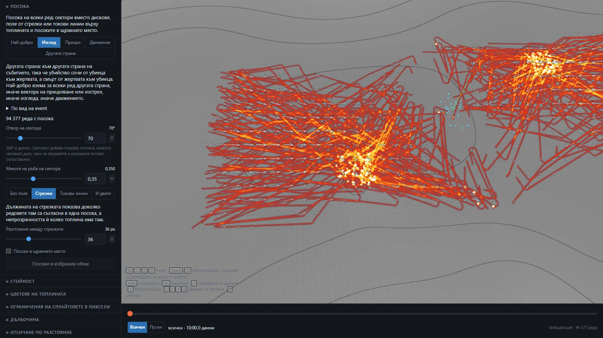

# Посочена топлина

Обикновената топлина казва **къде** се случват нещата. Посочената топлина казва и **в каква посока**: в каква посока са гледали хората, на кого са се прицелвали, къде са се движили, или къде е била другата страна в схватката.

Нормалният спрайт е пълен диск (360 градуса). С **Отвор на сектора** 70 градуса същият спрайт става тесен клин, който сочи посоката, в която е била обърнат редът, и добавя същата обща топлина.

## Как се използва {#how-to-use-it}

1. Заредете данни, в които има посока (виж [Какво дава посока на ред](#what-gives-a-row-a-direction)).
2. Изберете **Топлина**, **Разлика** или **Топлина по отбори** в лентата с режими.
3. Отворете секцията **Посока** в страничната лента.
4. Изберете **източник** (коя посока да се ползва), после включете рисуването:
   - намалете **Отвор на сектора** под 360°, за да рисувате всеки ред като клин, който сочи посоката си, вместо като диск;
   - изберете **Поле**, за да рисувате стрелки или токови линии върху топлината;
   - отметнете **Посоки в щракнато място** и щракнете върху топлината, за да получите полярна диаграма на това място.

Редът със състоянието казва колко реда имат посока от избрания източник.

## Настройки {#settings}

| Настройка | По подразбиране | Какво прави |
|---|---|---|
| Източник: **Най-добри**, **Изглед**, **Прицел**, **Движение**, **Другата страна** | Най-добри | Каква посока получава всеки ред. *Най-добри* взема, за всеки ред, другата страна, после прицела, после изгледа, после движението. |
| **За всеки вид събитие** | както по-горе | Различен източник за всеки вид събитие, например *Другата страна* за убийства и *Изглед* за позиции. Показва се, когато данните имат колона със събития с най-много 40 стойности. |
| **Отвор на сектора** | 360° | 360° е нормалният диск (изключено). По-малко е по-тесен клин. Клинът добавя колкото топлина добавя дискът му, така че сумите и разликите остават сравними. |
| **Мекота на ръба на сектора** | 0,35 | 0 е клин с остър ръб, 1 е мек вентилатор. |
| **Поле**: Без поле, Стрелки, Токови линии, И двете | Без поле | Стрелки: дължината на стрелката е колко редовете там са съгласни в една посока, непрозрачността ѝ - колко топлина има там. Стрелките се показват само там, където има топлина. |
| **Разстояние между стрелките** | 28 px | Разстоянието между стрелките на екрана. |
| **Анимирай токовите линии** | включено | Токовите линии текат, докато са включени. |
| **Посоки в щракнато място** | изключено | Щракнете върху топлината, за да видите посоките там (по-долу). |
| **Посоки в избрания обем** | | Същата диаграма за всичко вътре в избрания [обем](volumes.md). |

## Полярната диаграма на място {#the-polar-chart-at-a-spot}

Когато **Посоки в щракнато място** е включено, щракнете върху топлината. Редовете близо до тази точка (в рамките на 1,5 радиуса на спрайта) се събират в роза от 24 сегмента по 15°:

- **оранжеви** венчелистчета: изходящи посоки (накъде сочат редовете);
- **сини** венчелистчета: входящи посоки (откъде са дошли);
- **площта** на венчелистчето расте с броя му; стрелка показва основната посока;
- линиите под диаграмата дават основния азимут, колко силно редовете са съгласни (R, от 0 до 1), разпределението в градуси и броя на редовете.

0° е горе в диаграмата, което е world −Z (север за записи на Tacview). Точката е маркирана и в 3D изгледа със стрелка и пръстен.

## Какво дава посока на ред {#what-gives-a-row-a-direction}

| Източник | Нужно в данните |
|---|---|
| Изглед | колона yaw (съпоставена като посока на гледане): `yaw`, `heading`, `azimuth`, `view_yaw`, `rot_z` |
| Прицел | двойки числа като `aim_x`/`aim_y`, `shot_x`/`shot_y`, `fire_x`/`fire_y`, `hit_dir_x`/`hit_dir_y` (незадължителен `…_z`) |
| Движение | нищо допълнително: стъпката от предишното отчитане на същото лице (най-много 10 s по-рано, в същата сесия) |
| Другата страна | колона, която назовава другата страна на събитие (`other`, `victim`, `target`, `killer`, `attacker`, `shooter`, `other_player` ...), чиито стойности са имена на лица; убийството сочи от убиеца към жертвата, смъртта - от жертвата към убиеца |

## Съвети {#tips}

- Клиновете се нуждаят от някакъв размер на екрана; под няколко пиксела отново се рисуват като дискове.
- Ползвайте *Другата страна* при редове за убийства, за да видите **от къде** са печелени схватките, и *Изглед* при редове за позиции, за да видите **къде гледат хората**.
- При **Разлика** клиновете на двете страни сочат в собствените си посоки, така че спорните линии на огън изпъкват.
