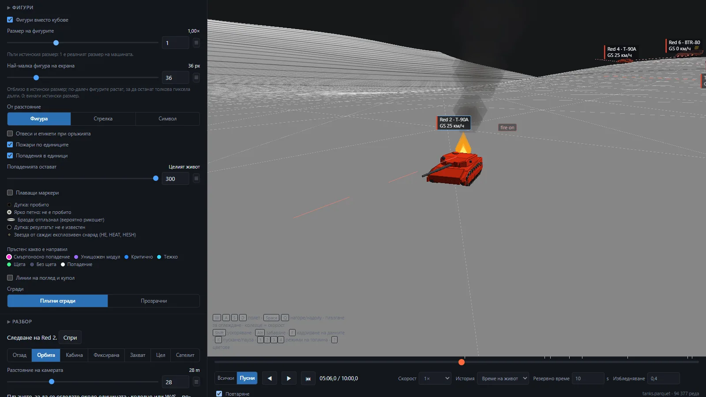

# Фигури

**Фигура** е малък 3D модел на това, което е една единица в действителност: танк, реактивен самолет, кораб, войник. [Разборът](match-replay.md) рисува всяка единица като нейната фигура в истински размер, вместо като обикновена кутия.

Има около 2000 именовани превозни средства, самолета, кораба, оръжия и войници, всички построени от самия визуализатор.

## Какво има в каталога {#what-is-in-the-catalogue}

| Област | Примери |
|---|---|
| Хора | войник прав, клекнал, легнал; снайперист, противотанков, санитар, екипаж |
| Земя | танкове, бойни машини на пехотата, противовъздушна отбрана, артилерия, камиони и коли, влакове и трамваи |
| Въздух | изтребители, щурмовачи, бомбардировачи, транспортни, хеликоптери, от биплани до съвременни реактивни |
| Море | военни кораби по клас, самолетоносачи, подводници, лодки, търговски кораби |
| Оръжия | ракети, ракетни снаряди, бомби, торпеда, сигнални и отклоняващи ракети |
| Маркери | димни, светкавични и запалителни гранати, поставени бомби, знамена, точки на появяване, пътни точки |

## Как се правят фигурите {#how-the-figures-are-made}

- **Построени по публикувани размери.** Повечето фигури са направени от собствения построител на фигури на визуализатора по публични числа: дължина, ширина, височина, опорни колела, кула и оръдие, крила и опашка. Формата им после се настройва спрямо публични снимки, чертежи и публикувани размери. Не се използват модели на игри.
- **Свободни модели.** Няколко фигури използват свободни 3D модели (CC0 или CC BY), където са по-верни, понякога комбинирани с построения корпус. Авторите на творбите под CC BY са посочени в [Източници на фигурите](figure-credits.md); творбите под CC0 не изискват посочване и не са изброени там.
- Всяка фигура има пълна, груба и далечна версия (нива на детайлност, LOD), така че хиляди да могат да се нарисуват едновременно.

## Коя фигура получава една единица {#which-figure-a-unit-gets}

Визуализаторът гледа собствените колони на данните:

1. **Имена** - колони, наречени *Name*, *Vehicle*, *Unit*, *Unit type*, *Model*, *Aircraft*, *Plane*, *Tank*, *Ship*, *Craft*, *Loadout*, *Kit* или *Figure* - се сравняват с каталога: точно, през около 4000 псевдонима (идентификатори на единици от няколко игри), по най-дългото познато начало (`F-16C_50` е F-16C), или по най-късото име на фигура, което започва с него.
2. Име, чиято фигура не отговаря на **типа** на единицата, не се използва (камион, наречен *Typhoon*, не е изтребителят).
3. **Типове** - колони, наречени *Type*, *Class*, *Kind*, *Category*, *Icon*, *Role* или *Domain* - дават фигура за клас: етикети на Tacview (`Air+FixedWing`, `Ground+Heavy+Armor+Vehicle+Tank`, `Sea+Watercraft+Warship`, `Weapon+Missile`), икони на картата или прости думи (tank, helicopter, infantry).
4. Данни без нито едно от двете са данни за хора: всеки е войник.

Затова най-лесният начин да получиш правилните фигури е колона `vehicle` с истинските имена или колона `type` с етикети на Tacview.

**Моята единица се показва като кутия или като войник.** Добави колона `vehicle` с истинското име или колона `type` с етикет на Tacview. Задръж курсора върху единицата, за да видиш кое име е съпоставено. Данни, които имат такива колони, но нищо не казват за една единица, я оставят като кутия; данни без нито едно от двете се рисуват като войници.

## Настройки {#settings}

Секцията **Фигури** в страничната лента на разбора задава размера, най-малкия размер на екрана, в какво се превръщат далечните единици (фигура, стрелка, символ) и ефектите, нарисувани върху тях. Виж [Разбор на мач](match-replay.md#figures). Дим, огън и други ефекти с време: [Фигури в наслагването на фигури](figure-replay.md).

## Незадължителен локален пакет с фигури {#an-optional-local-figure-pack}

Можеш да пазиш незадължителен пакет със собствени фигури на собствената си машина. Фигурите му заемат мястото на фигури от каталога със същите имена. Той никога не е част от хранилището или публикувана версия; без него нищо не се променя.
