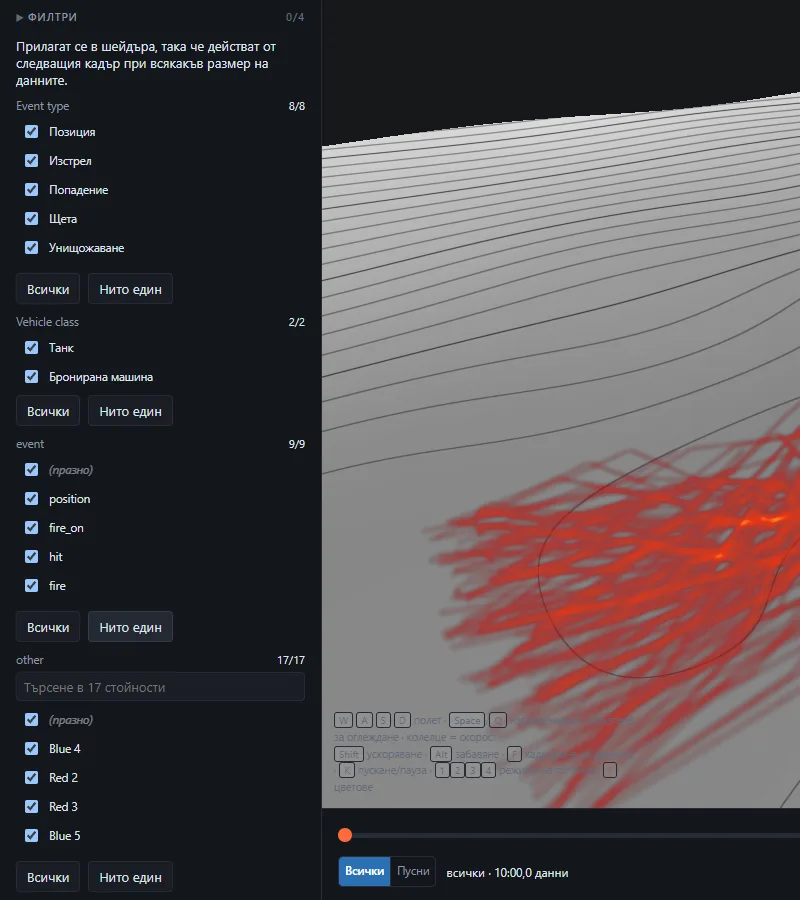
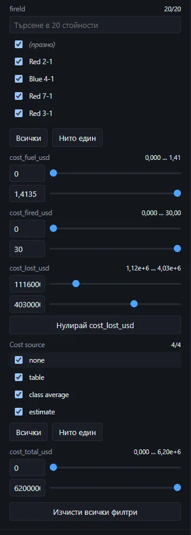

# Филтри

**Филтрите** скриват редовете, които не ви интересуват, като например един клас машини или един вид събитие, и картината се обновява веднага. Панелът изброява колоните, запазени при зареждане под *Запази за филтриране* ([Съпоставяне на колони](column-mapping.md)), плюс *Източников файл*, когато са заредени няколко файла.

## Опитайте {#try-it}

1. Заредете набор от данни и отворете **Филтри** в страничната лента.
2. Под **Клас превозно средство** махнете отметката на *Танк*. Картината се променя веднага.
3. Натиснете **Изчисти всички филтри**, за да отмените.

Първите редове са собствените колони на визуализатора (по-долу). Редовете след тях идват от вашия файл.

## Колоните, които визуализаторът добавя {#columns-the-viewer-adds}

При зареждане визуализаторът изчислява четири собствени колони и ги изброява **първи**, с имена и стойности на вашия език, така че един и същ филтър работи за всяка игра и всеки източник на данни:

| Колона | Стойности | Изчислява се от |
|---|---|---|
| **Тип събитие** | 23 вида: Позиция, Изстрел, Изстрелване (ракета, реактивен снаряд, бомба), Попадение, Промах (оръжието е приключило близо до никаква цел), Експлозия, Щета, Убийство, Смърт, Унищожен, Катастрофа, Катапултиране / изскачане, Появяване, Изчезване, Излитане, Кацане, Контакт със земята, Спиране на земята, Презареждане / зареждане с гориво, Заснемане / цел, Примамка, Съобщение, Друго | колона с име `event`, `events`, `event_type` или `event_name`; собствените думи на всяка игра (`shot`, `burst`, `fired`, `struck`, `flare`, `plant` ...) се съпоставят с тези видове. Пълната таблица: [Видове и класове събития](ref-event-types.md). |
| **Играч или ИИ** | Играч, ИИ | колона `ai`, `is_ai`, `bot` или `actor`; иначе `is_player` / `human`; иначе идентификатор на акаунт (`user_id`, `steam_id`; празно или 0 е ИИ); за записи на Tacview - дали обектът има пилот |
| **Клас превозно средство** | 17 класа: Изтребител, Ударен самолет, Бомбардировач, Друг самолет, Хеликоптер, Танк, Броньиран автомобил, Противовъздушна отбрана, Артилерия, Камион / кола, Кораб, Подводница, Пехота, Оръжие, Примамка, Конструкция, Друго | името на превозното средство или единицата (съпоставено с [каталога на фигурите](figures.md)) и колоните за тип |
| **Клас цел** | същите класове | превозното средство на другата страна (`other_vehicle`, `target_vehicle`, `victim_type` ...) |

Веднага след тях идват [колоните за изход](data-formats.md#outcome-columns), когато данните ги имат: **Резултат от рунда** и **Резултат от мача** (*Всеки*, *Спечелен*, *Загубен*) и **Как завърши рундът**, със стойностите на вашия език. Филтрирайте по тях или разделете топлината по тях като [карта на дела на победите](win-rate.md).

Изброяват се само видовете, които се срещат. Колоните със стойности (`cost_*`, `earn_*`, `net_*` и *Източник на цената*, вж. [Претегляне на стойностите](value-weighting.md)) се филтрират като всяка числова колона: например махнете отметката на *estimate* под *Източник на цената*, за да останат само редовете с цена.

Списък с категории с повече от 12 стойности получава поле за търсене (*Търсене в n стойности*) и бутон **Само тези**, който позволява точно стойностите, които съвпадат.

Кои колони могат да се филтрират, се решава при зареждане, защото трябва да бъдат прочетени тогава. Без нито една запазена колона панелът го казва и сочи *Запази за филтриране*.

## Числови колони (диапазон) {#numeric-columns-range}

| Част | Значение |
|---|---|
| Име и `min ... max` | Колоната и текущият диапазон (пълният диапазон на колоната, докато не е зададен филтър). |
| Първи ред: поле за число и плъзгач | Долната граница. Влачейки плъзгача над горната граница, вие я изтласкате с него. |
| Втори ред: поле за число и плъзгач | Горната граница. Влачейки под долната граница, вие я изтласквате и нея. |
| **Нулиране на *колоната*** | Премахва този филтър. |

Плъзгачите покриват минимума и максимума на колоната в 1,000 стъпки; полетата за число приемат всяка стойност. Ред минава, когато стойността му е в диапазона, включително и в двата края. Големите стойности се показват в експоненциален вид (`1.23e6`).

## Колони с категории {#category-columns}

| Част | Значение |
|---|---|
| Име и `разрешени/общо` | Колоната и колко от стойностите ѝ са разрешени. |
| Списък със стойности | Отметка за всяка стойност; празната стойност се показва като *(празно)*. |
| **Всички** / **Нито един** | Разрешава всяка стойност / никоя стойност. |

Разрешаването на всички стойности премахва филтъра.

## Правила {#rules}

- **Четири филтъра наведнъж.** Заглавката показва `active/4`. Пети филтър не се прилага, и панелът го казва. Избор в [Обекти](entities.md) (или фокусът върху играч в раздела Мач) също заема един от четирите. Филтър, който обхваща цялата колона, не заема нито един.
- **Колона с категории има най-много 4,096 стойности**; по-широка не се запазва при зареждане.
- **Филтрите се комбинират с И** и с видимостта на отборите, разделянето за разлика, прозореца на времето, отрязването по разстояние и [среза](slice.md).
- **Смяната на филтър рестартира натрупването и преизмерва експозицията** няколко кадъра по-късно, защото филтрирането може да промени плътността много ([Цвят и експозиция](colour-and-exposure.md#auto-exposure)).
- **Изчисти всички филтри** премахва всеки филтър по колона. Видимостта на отборите и избраните играчи, зададени другаде, се запазват.
- Филтрите по колони променят режимите на топлината. Те не променят фигурите на [разбора с фигури](box-replay.md), които следват видимостта на отборите и избора в Обекти. Изборът в Обекти променя и двете.
- При [линейна топлина](line-heat.md) филтърът се проверява за реда, в който завършва всеки сегмент.
- При всеки нов набор от данни всички филтри се изчистват.

## За разработчици {#for-developers}

**Слотове.** Всеки активен филтър заема един от четирите слота на GPU ([`MAX_FILTER_SLOTS`](https://github.com/Holdi601/3DHeat/blob/main/src/render/types.ts)), текстура от 4 байта на ред. Слотовете се дават на филтрите в реда, в който са били променени за последно ([`filterSlots`](https://github.com/Holdi601/3DHeat/blob/main/src/render/filterTables.ts), споделен от шейдъра и двата панела). Над четири грешка казва *Прилагат се само първите 4 филтъра. Махнете един - останалите се игнорират, а не се комбинират тихо*, а имената на допълнителните филтри гласят *колона (не се прилага)*. Филтрите се изпълняват по ред във vertex шейдъра, така че промяната на праг не изисква нов разбор и ново качване.

**Филтри, които панелът не показва.** Съществуват още два вида в състоянието на приложението ([`FilterSpec`](https://github.com/Holdi601/3DHeat/blob/main/src/state/types.ts)):

- филтър **groups**, зададен от раздела Мач, когато фокусира една страна. Той скрива другите групи във всеки режим, включително [разлика](difference.md), разделена по колона.
- филтър **persons**, зададен от панела [Обекти](entities.md) и от раздела Мач, когато фокусира един играч. Той ограничава разбора с фигури и режимите на топлината. В топлината е филтър по категория върху идентификаторите на хора и заема един от четирите слота. Маската му съдържа 65,536 идентификатора ([`FILTER_MASK_CAPACITY`](https://github.com/Holdi601/3DHeat/blob/main/src/render/types.ts)); човек над това не се рисува в топлината, докато филтърът е активен, дори когато е избран. Разборът с фигури все още ги показва.
