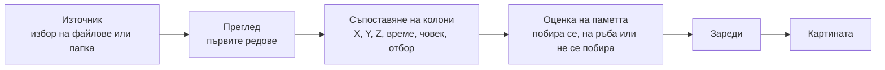

# Зареждане на данни

Преди 3DHeat да може да нарисува нещо, му трябва таблица: всеки ред казва къде е било нещо и, ако го имате, кога и кой. Този раздел показва как един файл става картина. Още нямате данни? Опитайте [демо данните](demo-data.md).

**Направете това сега:**

1. В страничната лента на Топлинна карта отворете **Източник** и натиснете **Файлове…** (или пуснете файл или папка в зоната за пускане).
2. Погледнете **Съпоставяне на колони**: полетата обикновено вече са попълнени.
3. Проверете дали **Оценката на паметта** казва *се побира*.
4. Натиснете **Зареди**.

Всичко, което показва разделът Топлинна карта, идва от един **набор от данни**: таблица от редове, всеки с позиция и, по избор, време, човек, група, сесия, посока на погледа и произволен брой допълнителни колони, запазени за филтриране. Този раздел обяснява как се прави наборът от данни.

## Пътят от файлове до картина {#the-path-from-files-to-picture}

1. **Изберете файлове** в панела **Източник** - един файл, няколко, дърво от папки или чрез пускане. Приемат се Parquet, CSV, Tacview, GPS записи и още; пълният списък е в [Формати на данни](data-formats.md#files). Вж. [Зареждане на файлове](loading-files.md).
2. **Преглед.** Отваря се първият файл от избора: имената на колоните, първите му 50 реда, кои колони изглеждат числови и (за Parquet) логическият тип на всяка колона и собствените инструкции за четене на файла, записът `heat3d` във footer-а.
3. **Автоматично съпоставяне.** Колоните се назначават на роли - X, Y, Z, време, човек, сесия, група, посока на погледа - и шепа се запазват за филтриране. Всяко предположение се показва в панела **Съпоставяне на колони** и може да се промени. Вж. [Съпоставяне на колони](column-mapping.md) и [Оси, единици и време](axes-units-and-time.md).
4. **Броене.** Броят редове на всеки файл се чете (точно от footer-ите на Parquet, оценено за CSV), така че панелът може да каже, преди каквото и да е зареждане, колко памет е нужна и дали се побира. Ако не се побира, предлага да се зареди всеки *N-ти* ред. Вж. [Памет и бюджети](memory-and-budgets.md).
5. **Зареждане.** Фонов работник разбира само съпоставените колони на всеки файл - няколко файла наведнъж, до бюджета за [нишки за разбор](memory-and-budgets.md#parser-threads) - и ги слива, в реда на избора, в един набор от данни: един общ речник на хора, групи и сесии за всички файлове, общо начало на времето, всички редове, подредени по време. Вж. [Сесии, лица и групи](sessions-persons-groups.md).
6. **Качване.** Главната нишка съобщава „Качване на N реда в GPU“ за един кадър, после пакетира редовете в паметта на GPU в рамките на бюджета за GPU. Вж. [Задържане на паметта на GPU](gpu-memory.md).
7. **Първа картина.** Камерата кадрира данните, радиусът на спрайта и насищането се задават според обхвата и броя редове на данните, а след 8 нарисувани кадъра насищането се измерва от самата картина ([Цвят и експозиция](colour-and-exposure.md)).

## Изисквания, проверени преди зареждане {#requirements-checked-before-a-load}

| Нужно | Какво се случва без него |
|---|---|
| **Поне две от X / Y / Z** | Зареждането се отказва. С точно две третата ос е 0 и данните се рисуват като плоска равнина в 3D сцената - което иска топлинна карта отгоре. |
| Колона с време | По избор. Без нея времевата линия е изключена, изгледът остава в режим **Всички**, а страничната лента го казва. |
| Колона с човек | По избор. Нужна е за [наслагването на фигури](box-replay.md) (фигура за всеки човек), [линейната топлина](line-heat.md) (пътя, който всеки човек е извървял), интерполация, следи и историята **Време на живот**. |
| Колона с група | По избор. Нужна е за [топлина по отбори](team-heat.md) и за режима [разлика](difference.md) (поне две групи). |

Режим, който заредените данни не могат да поддържат, е заграден в сиво в лентата с режими; при посочване подсказката казва защо.

## Без ваши собствени данни {#without-your-own-data}

Панелът **Набор от данни** (под **Източник**) има [синтетичен генератор](synthetic-generator.md), който създава набор от данни с форма на battle royale с всякакъв размер - полезен за пробване на визуализатора и за проверка какво може да поеме една машина.

## Страниците в този раздел {#pages-in-this-section}

- [Зареждане на файлове](loading-files.md) - избиране, папки, пускане и сливане на много файлове, правилото за файлове с движение, напредък и отказ
- [Съпоставяне на колони](column-mapping.md) - всяко поле от панела за съпоставяне, как автоматичното съпоставяне отгатва, подсказките `heat3d`
- [Оси, единици и време](axes-units-and-time.md) - вертикална ос, обръщания, мащаб на единиците, единици за време, посока на погледа
- [Сесии, лица и групи](sessions-persons-groups.md) - какво прави всяка, ограниченията, общите имена, размерът на обектите, панелът Набор от данни
- [Синтетичен генератор](synthetic-generator.md)
- [Памет и бюджети](memory-and-budgets.md) - модел на заеманото място, проверка дали се побира, разреждане, таван на сортирането, бюджети на ресурсите
