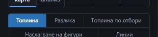

# Режими на топлината

Всяка точка добавя малко блясък, блясъците се натрупват и натрупването се рисува с цветове. Режимите са пет начина да се нарисува, и всеки отговаря на един въпрос.

Лентата с режими в горната част на страничната лента на раздела Топлинна карта избира как се рисува [наборът от данни](glossary.md). Клавишите 1-4 избират Топлина, Разлика, Топлина по отбори и Линии. Наслагването на фигури няма клавиш.

| Режим | Въпрос, на който отговаря |
|---|---|
| **Топлина** | Къде се е случило и колко? |
| **Разлика** | Коя страна е била повече? |
| **Топлина по отбори** | Чие беше? |
| **Линии** | По кой път отиваха хората? |
| **Наслагване на фигури** | Кой къде беше и кога? |

| Режим (етикет в лентата) | Клавиш | Какво рисува | Нужно |
|---|---|---|---|
| **Топлина** | 1 | Адитивна плътност: всеки видим ред добавя радиален спрайт, обърнат към камерата. [Топлина](heat.md) | набор от данни |
| **Разлика** | 2 | Плътност със знак: една популация добавя, друга изважда. [Разлика](difference.md) | две страни: поне две групи или разделяне по запазена колона |
| **Топлина по отбори** | 3 | Плътност, оцветена по група: нюанс за всяка група, смесен там, където групите се припокриват. [Топлина по отбори](team-heat.md) | колона с групи |
| **Наслагване на фигури** | - | Фигура (или кутия) за всеки човек, която се движи по времевата линия: разборът. [Наслагване на фигури](box-replay.md), [Разбор на мач](match-replay.md) | колона с хора |
| **Линии** | 4 | Линейна топлина: линия от всяка проба на човек до следващата му, с отпадане на топлината настрани. [Линейна топлина](line-heat.md) | колона с хора и колона с време |

Режим, който данните не могат да поддържат, е заграден в сиво и подсказката му казва причината, например *Недостъпно - режимът Разлика изисква две групи или запазена колона за разделяне; тези данни имат една група.* Когато нов набор от данни не може да поддържа текущия режим, изгледът се връща към **Топлина**.

Клавишите 1-4 се проверяват спрямо данните по същия начин: клавиш за заграден в сиво режим не прави нищо.

## Кои панели показва всеки режим {#which-panels-each-mode-shows}

| Панел | Топлина | Разлика | Топлина по отбори | Наслагване на фигури | Линии |
|---|---|---|---|---|---|
| Маршрути ([линейна топлина](line-heat.md)) | | | | | да |
| Форма на топлината (с **Следване на изгледа** и **Еднаква плътност при всяко мащабиране**), Цветове на топлината, Пиксельни граници на спрайта, Дълбочина, Отрязване по разстояние | да | да | да | | да |
| Посока ([посочена топлина](directional-heat.md)), Стойност ([претегляне на стойностите](value-weighting.md)) | да | да | да | | да |
| Изглед по отбори ([наслагване на фигури](box-replay.md)) | | | | да | |
| Разделяне за разлика ([разлика](difference.md)) | | да | | | |
| [Отбори](teams-list.md), [Обекти](entities.md), [Филтри](filters.md), Фон / ниво, [Срез](slice.md), [Измерване](measure.md), Път на камерата и рендиране, Производителност, Камера и сцена | да | да | да | да | да |

## Какво споделят всички режими на топлината {#what-every-heat-mode-shares}

Всичките четири режима на топлината (всичко освен наслагването на фигури) са една и съща машина с различни входове ([`engine.ts`](https://github.com/Holdi601/3DHeat/blob/main/src/render/engine.ts)):

1. **Кои редове.** [Времевата линия](timeline.md) избира непрекъснат диапазон от редове, подредени по време; [филтрите](filters.md), видимостта на групите, разделянето за разлика, [отрязването по разстояние](depth-and-culling.md#distance-culling) и [срезът](slice.md) решават за всеки ред, във vertex шейдъра, дали и колко силно допринася.
2. **Разпръскване.** Всеки допринасящ ред се рисува като спрайт (или, в режим Линии, като сегмент) в **целта на топлината** с плаваща запетая, като добавя стойността си от скалата. Когато редовете са повече, отколкото кадърът може да поеме, се рисува стратифицирана проба от редовете, претеглена за компенсация. Вж. [Вземане на проби и бюджети](sampling-and-budgets.md).
3. **Натрупване.** Докато нищо не се променя, кадрите се сливат, докато всеки ред е допринесъл точно веднъж. Вж. [Натрупване](accumulation.md).
4. **Смесване на кадъра.** Натрупаната стойност във всеки пиксел се дели на **точката на насищане**, оформя се от **реакцията на плътността**, повдига се от **минималната топлина** и се търси в **цветовата скала**, чиято алфа я смесва върху сцената. Вж. [Цвят и експозиция](colour-and-exposure.md).

Всичко в стъпка 4 се прилага при смесването на кадъра, така че влачене на тези контроли никога не рестартира натрупването; всичко в стъпки 1-2 го рестартира.

## Страниците в този раздел {#pages-in-this-section}

- [Топлина](heat.md) - обикновеният режим на топлина и преглед на неговите панели
  - [Форма на спрайта](sprite-shape.md) - радиус, интензитети, затихване, редакторът на крива, пиксельни граници, сплескване
  - [Цвят и експозиция](colour-and-exposure.md) - редакторът на скалата, точката на насищане, автоматичната експозиция, минималната топлина, реакцията на плътността
  - [Дълбочина и отрязване](depth-and-culling.md) - закриване от нивото, скриване зад терена, отрязване по разстояние
- [Разлика](difference.md) - разделянето за разлика
- [Топлина по отбори](team-heat.md)
- [Линейна топлина](line-heat.md) - маршрутите
- [Наслагване на фигури](box-replay.md) - режимът на разбора (файлът още се казва box replay)
- [Посочена топлина](directional-heat.md)
- [Претегляне на стойностите](value-weighting.md)
