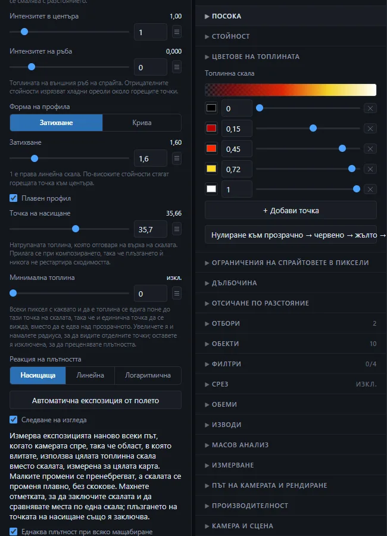

# Топлина

Топлината оцветява местата, където е станало много неща: червено, където се е случило малко, бяло-горещо, където се е случило много. Отговаря на въпроса „къде се случва това и колко“.

**Топлина** (клавиш 1) е стандартният режим. Всеки видим [ред](glossary.md) допринася с кръгъл [спрайт](glossary.md), обърнат към камерата; припокриващите се спрайтове се събират в буфер с плаваща запетая; сборът се съпоставя с цветова скала - по подразбиране прозрачно → червено → жълто → бяло - и се рисува върху сцената.

Картината показва топлината от един кръг на стрелба на ниво със сгради: горещите места са в стаите и по стълбите, а не само на терена.

## Как се използва {#how-to-use-it}

1. Заредете данни и натиснете `1` (или изберете **Топлина** в лентата с режими).
2. Ако всичко е бяло или празно, натиснете **Автоматична експозиция от полето** в секцията **Форма на топлината**.
3. Променяйте **Радиус на спрайта**, докато съседните точки се слеят в ивици: по-малкият показва единични места, по-големият - области.
4. Отворете **Цветове на топлината**, за да смените цветовете, или **Дълбочина**, за да оставите хълмовете и стените да скриват топлината зад себе си.

Същите панели оформят [Разлика](difference.md), [Топлина по отбори](team-heat.md) и [Линейна топлина](line-heat.md); те се различават по това, което се добавя (със знак, оцветено или по линии), а не по начина.

## Панелите и стандартните им стойности {#the-panels-and-their-defaults}

Всеки контрол е обяснен на собствената си страница; колоната Подробности води към нея. Плъзгачите имат поле за въвеждане до себе си и дръжка за плъзгане (малката хватка вдясно: плъзнете нагоре или надолу, по-далеч е по-бързо, Shift за фина настройка); когато плъзгачът свършва, преди да стигне до реалната граница, дръжката може да се избута отвъд нея до *тавана на плъзгане*, даден тук. Стойностите, отбелязани *при зареждане*, се пресмятат наново за всеки нов набор данни.

### Форма на топлината (отворена) {#heat-shape-open}

| Контрол | По подразбиране | Обхват (таван на плъзгане) | Подробности |
|---|---|---|---|
| **Радиус на спрайта** | 6 m; при зареждане обхват / 120 | 0,05-2000 m, логаритмично (50 000) | [Форма на спрайта](sprite-shape.md#sprite-radius) |
| **Интензитет в центъра** | 1 | 0-10 (1000) | [Форма на спрайта](sprite-shape.md#centre-and-edge-intensity) |
| **Интензитет на ръба** | 0 | -2-10 (1000) | [Форма на спрайта](sprite-shape.md#centre-and-edge-intensity) |
| **Форма на профила** | *Затихване* | *Затихване* / *Крива* | [Форма на спрайта](sprite-shape.md#ramp-shape-falloff-or-curve) |
| **Затихване** (само при Затихване) | 1,6 | 0,1-8 (64) | [Форма на спрайта](sprite-shape.md#falloff) |
| **Плавен профил** (само при Затихване) | включено | | [Форма на спрайта](sprite-shape.md#falloff) |
| Редактор на крива (само при Крива) | готов профил *Плавна* | | [Форма на спрайта](sprite-shape.md#the-curve-editor) |
| **Точка на насищане** | 24; при зареждане оценка, после измерена | 0,1-4000, логаритмично (10 000 000) | [Цвят и експозиция](colour-and-exposure.md#saturation-point) |
| **Минимална топлина** | изключено (0) | 0-100% | [Цвят и експозиция](colour-and-exposure.md#minimum-heat) |
| **Реакция на плътността** | *Насищаща* | *Насищаща* / *Линейна* / *Логаритмична* | [Цвят и експозиция](colour-and-exposure.md#density-response) |
| **Автоматична експозиция от полето** | | бутон | [Цвят и експозиция](colour-and-exposure.md#auto-exposure) |
| **Следване на изгледа** | включено | | Измерва експозицията наново всеки път, когато камерата спре, така че район, в който влизате, използва цялата цветова скала. Малките промени се пренебрегват и мащабът се изменя плавно. Изключете го или плъзнете **Точка на насищане**, за да заключите мащаба и да сравнявате места на една скала. [Цвят и експозиция](colour-and-exposure.md#follow-the-view) |
| **Еднаква плътност при всяко мащабиране** | включено | | Цветът означава един и същ брой редове на единица площ от земята, колкото и да сте близо. Спрайт, който ограниченията в пиксели увеличават (далеч) или намаляват (отблизо), запазва топлината, която би добавил при истинския си размер, така че картина, експонирана отдалеч, не избледнява, когато летите навътре. Когато е изключено, ограничен спрайт добавя цялата си тежест при ограничения си размер. [Форма на спрайта](sprite-shape.md#pixel-clamps) |
| **Сплескване върху равнината на земята** | изключено | | [Форма на спрайта](sprite-shape.md#flatten-onto-ground-plane) |

### Цветове на топлината (затворена) {#heat-colours-closed}

| Контрол | По подразбиране | Подробности |
|---|---|---|
| Цветни полета на групите и **Разделяне на цветовете** (само Топлина по отбори) | 1,4 | [Топлина по отбори](team-heat.md) |
| Редакторът **Топлинна скала** (*Положителна (сумиращи се отбори)* при Разлика, *Скала на непрозрачност* при Топлина по отбори) | прозрачно → червено → жълто → бяло | [Цвят и експозиция](colour-and-exposure.md#the-ramp-editor) |
| **Нулиране към прозрачно → червено → жълто → бяло** | | |
| Скалата **Отрицателна (изваждащи отбори)** (само Разлика) | прозрачно → зелено → синьо → лилаво | [Разлика](difference.md#colours) |

### Ограничения на спрайтовете в пиксели (затворена) {#sprite-pixel-clamps-closed}

| Контрол | По подразбиране | Обхват (таван на плъзгане) | Подробности |
|---|---|---|---|
| **Мин. радиус в пиксели** | 1 px | 0-16 (512) | [Форма на спрайта](sprite-shape.md#pixel-clamps) |
| **Макс. радиус в пиксели** | 96 px | 2-1024, логаритмично (8192) | [Форма на спрайта](sprite-shape.md#pixel-clamps) |

### Дълбочина (отворена) {#depth-open}

| Контрол | По подразбиране | Подробности |
|---|---|---|
| **Скриване зад терена** | включено | [Дълбочина и отрязване](depth-and-culling.md#hide-behind-terrain) |
| **Скрито зад геометрия** | 0,8 (*80% по-тъмно*) | [Дълбочина и отрязване](depth-and-culling.md#hidden-behind-geometry) |

### Отрязване по разстояние (затворена) {#distance-culling-closed}

| Контрол | По подразбиране | Обхват (таван на плъзгане) | Подробности |
|---|---|---|---|
| **Близо** | изключено (0) | 0,5-5000 m, логаритмично, долният край на пътя = изключено (200 000) | [Дълбочина и отрязване](depth-and-culling.md#distance-culling) |
| **Далеч** | изключено (0) | 1-200 000 m, логаритмично, долната граница = изключено (10 000 000) | [Дълбочина и отрязване](depth-and-culling.md#distance-culling) |
| **Срез по равнина** | включено | | [Дълбочина и отрязване](depth-and-culling.md#distance-culling) |
| **Срязване и на нивото** | включено | | [Дълбочина и отрязване](depth-and-culling.md#distance-culling) |

Клавиши: `[` и `]` придърпват и изтласкват далечната граница, `\` я превключва ([Дълбочина и отрязване](depth-and-culling.md#keyboard)).

### Посока и Стойност {#direction-and-value}

Две допълнителни секции са под Форма на топлината. **Посока** рисува всеки ред като клин и добавя стрелки: виж [Посочена топлина](directional-heat.md). **Стойност** претегля топлината според това, което е струвал или спечелил всеки ред: виж [Претегляне на стойностите](value-weighting.md).

## Какво се запазва {#what-is-saved}

Настройките на топлината по-горе не се пазят между сесиите: презареждането на страницата възстановява стандартните стойности. В браузъра се пазят две неща: последната скорост на възпроизвеждане (`heat3d.speed`, виж [Времева линия](timeline.md)) и настройките на фигурите от далеч в [наслагването на фигури](box-replay.md) (стил на символа, размер, маркери за попадения и т.н.). Пазят се и езикът, [обърнатите оси на света](camera.md#invert-world-axis), запомнените имена на колите в раздела на състезанието и [библиотеката на нивата](level-library.md). Пълният списък е в [Запазени настройки](ref-settings-storage.md).
