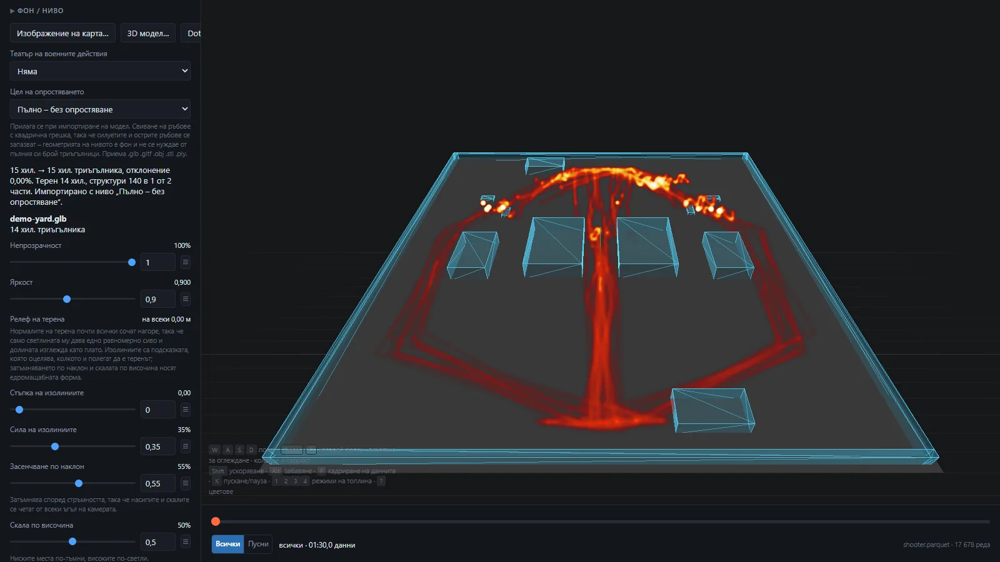

# Топлина

Топлината оцветява местата, където се е случвало много: червено там, където е ставало малко, бяло-нажежено там, където е ставало много. Отговаря на въпроса „къде се случва това и колко“.

**Топлина** (клавиш 1) е режимът по подразбиране. Всеки видим [ред](glossary.md) допринася с кръгъл [спрайт](glossary.md), обърнат към камерата; припокриващите се спрайти се събират в буфер с плаваща запетая; сумата се преобразува през цветова скала - по подразбиране прозрачно → червено → жълто → бяло - и се рисува върху сцената.

Снимката показва топлината на един рунд от стрелба на ниво със сгради: горещите точки са в стаите и по стълбите, а не само по земята.

## Как се използва {#how-to-use-it}

1. Заредете данни и натиснете `1` (или изберете **Топлина** в лентата с режими).
2. Ако всичко е бяло или празно, натиснете **Автоматична експозиция от полето** в секцията **Форма на топлината**.
3. Променяйте **Радиус на спрайта**, докато съседните точки се слеят в ивици: по-малкият показва единични петна, по-големият - области.
4. Отворете **Цветове на топлината**, за да смените цветовете, или **Дълбочина**, за да позволите хълмовете и стените да скриват топлината зад себе си.

Същите панели оформят [Разлика](difference.md), [Топлина по отбори](team-heat.md) и [Линейна топлина](line-heat.md); разликата е в това какво се добавя (със знак, оцветено или по линии), а не в начина.

## Панелите и техните стойности по подразбиране {#the-panels-and-their-defaults}

Всеки контрол по-долу се свързва с параметър на шейдъра, така че промяната не струва нищо освен ново рисуване. Плъзгачите имат поле за въвеждане отстрани и дръжка за влачене (малкия ръб вдясно: влачете нагоре или надолу, по-далеч е по-бързо, Shift за фино); когато пътят на плъзгача свършва преди истинската граница, дръжката може да премине отвъд нея до *тавана на жилото*, даден тук. Стойностите, отбелязани като *при зареждане*, се преизчисляват за всеки нов набор от данни.

### Форма на топлината (отворено) {#heat-shape-open}

| Контрол | Стойност по подразбиране | Обхват (таван на жилото) | Подробности |
|---|---|---|---|
| **Радиус на спрайта** | 6 m; при зареждане размер / 120 | 0.05-2000 m, логаритмично (50,000) | [Форма на спрайта](sprite-shape.md#sprite-radius) |
| **Интензитет в центъра** | 1 | 0-10 (1000) | [Форма на спрайта](sprite-shape.md#centre-and-edge-intensity) |
| **Интензитет на ръба** | 0 | -2-10 (1000) | [Форма на спрайта](sprite-shape.md#centre-and-edge-intensity) |
| **Форма на профила** | *Затихване* | *Затихване* / *Крива* | [Форма на спрайта](sprite-shape.md#ramp-shape-falloff-or-curve) |
| **Затихване** (само при Затихване) | 1.6 | 0.1-8 (64) | [Форма на спрайта](sprite-shape.md#falloff) |
| **Плавен профил** (само при Затихване) | включено | | [Форма на спрайта](sprite-shape.md#falloff) |
| Редактор на крива (само при Крива) | предварителна настройка *Плавно* | | [Форма на спрайта](sprite-shape.md#the-curve-editor) |
| **Точка на насищане** | 24; при зареждане оценка, после измерена | 0.1-4000, логаритмично (10,000,000) | [Цвят и експозиция](colour-and-exposure.md#saturation-point) |
| **Минимална топлина** | изключено (0) | 0-100% | [Цвят и експозиция](colour-and-exposure.md#minimum-heat) |
| **Реакция на плътността** | *Насищане* | *Насищане* / *Линейна* / *Логаритмична* | [Цвят и експозиция](colour-and-exposure.md#density-response) |
| **Автоматична експозиция от полето** | | бутон | [Цвят и експозиция](colour-and-exposure.md#auto-exposure) |
| **Следване на изгледа** | включено | | Измерва експозицията отново всеки път, когато камерата спре, така че област, в която летите, използва цялата цветова скала. Малките промени се пренебрегват и мащабът плавно се нагажда. Изключете го или влачете **Точка на насищане**, за да заключите мащаба и да сравнявате места на една скала. [Цвят и експозиция](colour-and-exposure.md#follow-the-view) |
| **Еднаква плътност при всяко мащабиране** | включено | | Един цвят означава един и същ брой редове на единица площ, колкото и близо да сте. Спрайт, който пиксельните граници уголемяват (далеч) или смаляват (отблизо), запазва топлината, която би добавил в истинския си размер, така че снимка, експонирана отдалеч, не избледнява, когато летите към нея. Изключено, ограниченият спрайт добавя пълната си тежест при ограничения си размер. [Форма на спрайта](sprite-shape.md#pixel-clamps) |
| **Сплескване върху равнината на земята** | изключено | | [Форма на спрайта](sprite-shape.md#flatten-onto-ground-plane) |

### Цветове на топлината (затворено) {#heat-colours-closed}

| Контрол | Стойност по подразбиране | Подробности |
|---|---|---|
| Образци на групите и **Разделяне на цветовете** (само при Топлина по отбори) | 1.4 | [Топлина по отбори](team-heat.md) |
| Редакторът **Топлинна скала** (*Положителна (добавящи отбори)* при Разлика, *Скала на прозрачността* при Топлина по отбори) | прозрачно → червено → жълто → бяло | [Цвят и експозиция](colour-and-exposure.md#the-ramp-editor) |
| **Нулиране към прозрачно → червено → жълто → бяло** | | |
| Скала **Отрицателна (изваждащи отбори)** (само при Разлика) | прозрачно → зелено → синьо → лилаво | [Разлика](difference.md#colours) |

### Пиксельни граници на спрайта (затворено) {#sprite-pixel-clamps-closed}

| Контрол | Стойност по подразбиране | Обхват (таван на жилото) | Подробности |
|---|---|---|---|
| **Мин. радиус в пиксели** | 1 px | 0-16 (512) | [Форма на спрайта](sprite-shape.md#pixel-clamps) |
| **Макс. радиус в пиксели** | 96 px | 2-1024, логаритмично (8192) | [Форма на спрайта](sprite-shape.md#pixel-clamps) |

### Дълбочина (отворено) {#depth-open}

| Контрол | Стойност по подразбиране | Подробности |
|---|---|---|
| **Скриване зад терена** | включено | [Дълбочина и отрязване](depth-and-culling.md#hide-behind-terrain) |
| **Скрито зад геометрия** | 0.8 (*с 80% по-тъмно*) | [Дълбочина и отрязване](depth-and-culling.md#hidden-behind-geometry) |

### Отрязване по разстояние (затворено) {#distance-culling-closed}

| Контрол | Стойност по подразбиране | Обхват (таван на жилото) | Подробности |
|---|---|---|---|
| **Близо** | изключено (0) | 0.5-5000 m, логаритмично, долният край на трака = изключено (200,000) | [Дълбочина и отрязване](depth-and-culling.md#distance-culling) |
| **Далеч** | изключено (0) | 1-200,000 m, логаритмично, долният край = изключено (10,000,000) | [Дълбочина и отрязване](depth-and-culling.md#distance-culling) |
| **Срез по равнина** | включено | | [Дълбочина и отрязване](depth-and-culling.md#distance-culling) |
| **Срязване и на нивото** | включено | | [Дълбочина и отрязване](depth-and-culling.md#distance-culling) |

Клавиши: `[` и `]` приближават и отдалечават далечната граница, `\` я превключва ([Дълбочина и отрязване](depth-and-culling.md#keyboard)).

### Посока и Стойност {#direction-and-value}

Още две секции са под Форма на топлината. **Посока** рисува всеки ред като клин и добавя стрелки: вж. [Посочена топлина](directional-heat.md). **Стойност** претегля топлината според това, колко е струвал или спечелил всеки ред: вж. [Претегляне на стойностите](value-weighting.md).

## Какво се запазва {#what-is-saved}

Настройките на топлината по-горе не се запазват между сесиите: презареждането на страницата възстановява стойностите по подразбиране. В браузъра се пазят две неща: последната скорост на възпроизвеждане (`heat3d.speed`, вж. [Времева линия](timeline.md)) и настройките на далечните фигури в [наслагването на фигури](box-replay.md) (стил на символите, размер, маркери за попадения и т.н.). Също така езикът, [обърнатите световни оси](camera.md#invert-world-axis), запомнените имена на колите в раздела за състезания и [библиотеката на нивата](level-library.md). Пълният списък е в [Запазени настройки](ref-settings-storage.md).
