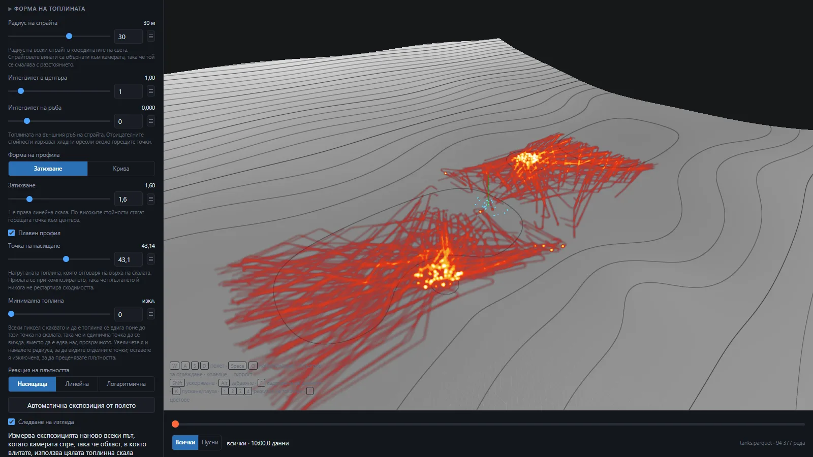
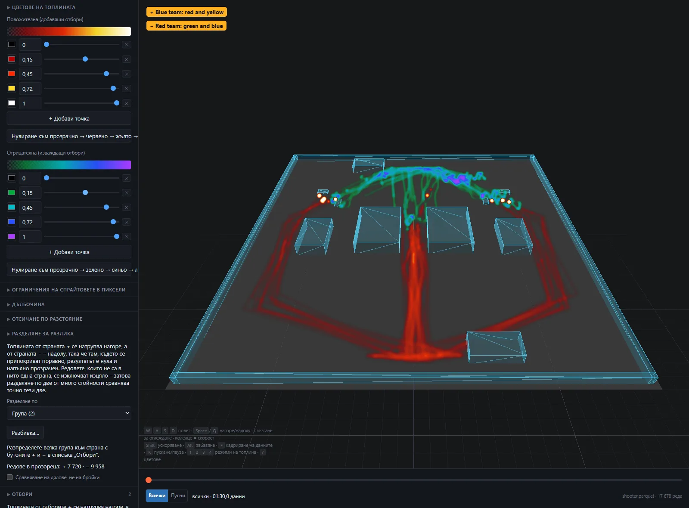
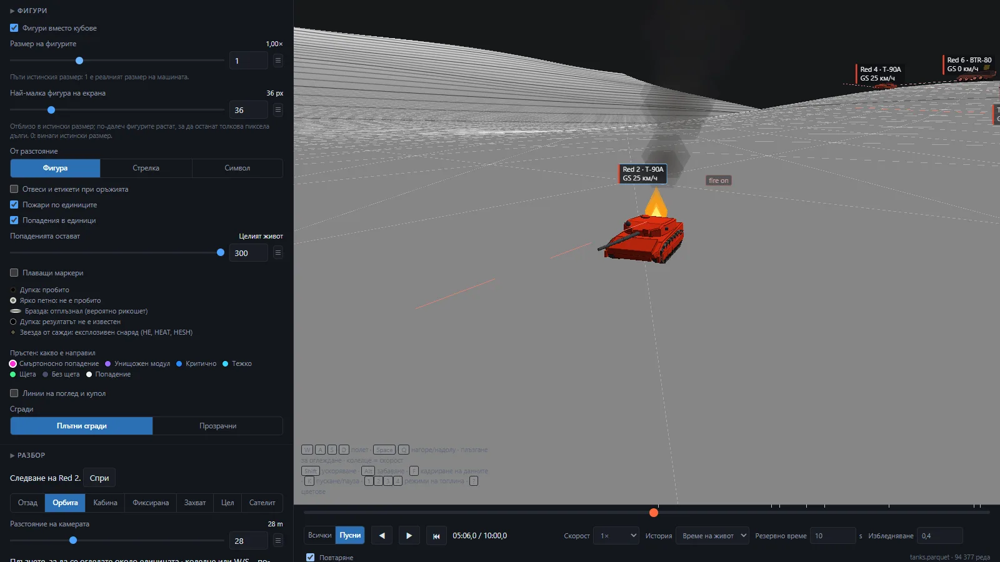
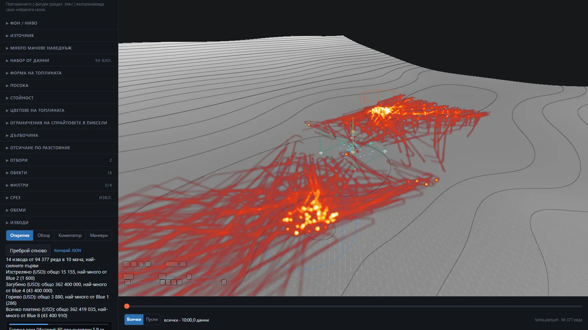
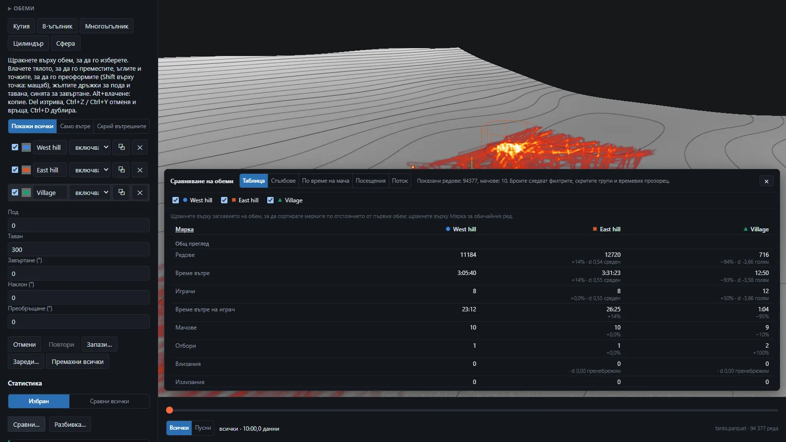
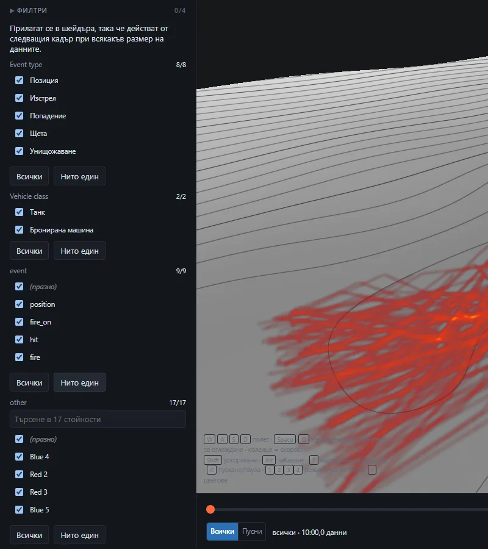
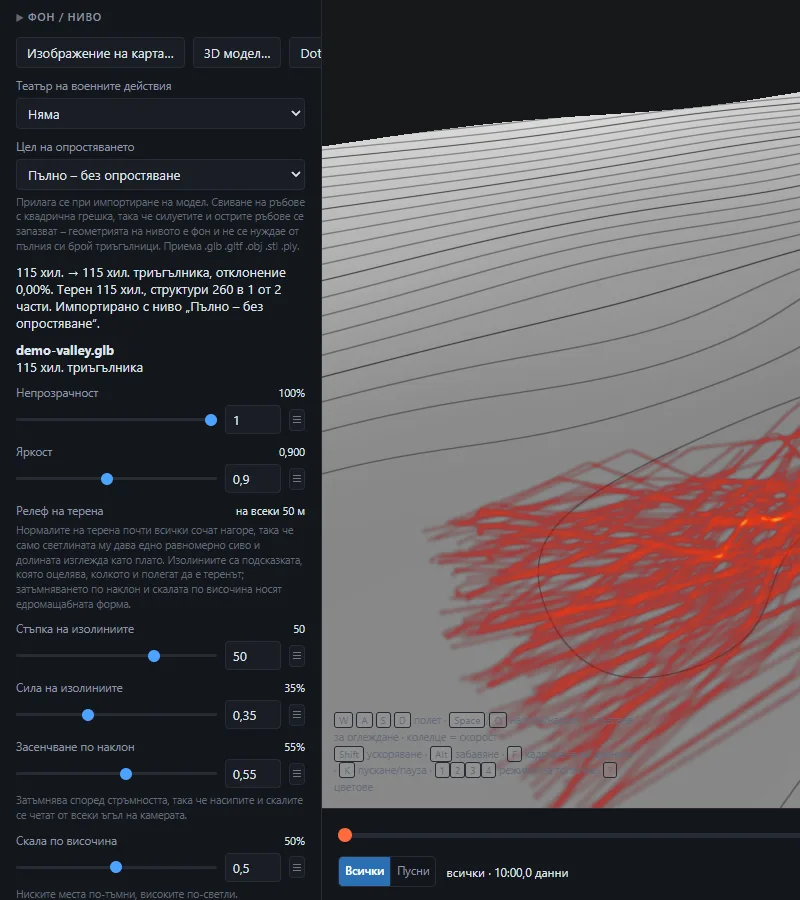

{: width="720" }

# 3DHeat

3DHeat показва къде са се случили нещата в една игра - къде са се движили, сражавали и загивали играчите - като светещи цветове, през които можете да летите, или като малки 3D фигури, които повтарят мача.

Заредете позиции - CSV, Parquet, записи на Tacview, превърнати разбори, един файл, папка или хиляди мачове - и ги вижте като **топлинна карта, през която можете да летите**, като **фигури, които повтарят мача**, като линии по маршрутите, които са извървели хората, или като една популация срещу друга. Програмата сама открива какво изпъква, и работи изцяло във вашия браузър: нищо не се качва никъде. 3DHeat и всички негови инструменти са безплатни и с отворен код под [MIT лиценза](https://github.com/Holdi601/3DHeat/blob/main/LICENSE).



**Тук сте за първи път?** Направете [демо данните](demo-data.md) и следвайте седемте им стъпки. Всяка снимка на този сайт е направена с тях.

## Какво прави {#what-it-does}

| | |
|---|---|
|  | **[Режими на топлината](heat-modes.md)** - топлина, [разлика](difference.md) (червено там, където едната страна е била повече, зелено-синьо там, където е била другата), [топлина по отбори](team-heat.md), [линейна топлина](line-heat.md); [посочена топлина](directional-heat.md) с клинове, полета от стрелки и полярни графики; топлина, [претеглена по стойност](value-weighting.md): колко струват оръжията, машините и горивото. |
|  | **[Разбор на мач](match-replay.md)** - всяка единица като [фигурата](figures.md) на това, което е, НАТО или руски символи на по-голямо разстояние, ракети и трасиращи куршуми, маркери за попадения, отломки, пожари, кули, цели и тактически изглед; [много мачове наведнъж](many-matches.md). |
|  | **[Изводи](insights.md)** - силни позиции, опасна местност, капани при появяване, теснини и изпъкващи играчи, открити и подредени с доказателствата; писано обобщение, по желание от ИИ по ваш избор; наблюдател за един мач; [лещата на знанието](knowledge.md). |
|  | **[Обеми](volumes.md)** - рисувайте кутии, призми, цилиндри и сфери, филтрирайте по тях, броете какво се случва вътре, изнасяйте го и сравнявайте места едно до друго; [разбивка](breakdown.md) на това кой и какво се представя най-добре на дадено място. |
|  | **[Филтри](filters.md)** - по вид събитие, играч или ИИ, клас машина, стойност, всяка колона, в графичната карта при всякакъв размер на данните. |
|  | **[Нива](levels.md)** - картинки на картите, 3D нива, направени с [инструментите за данни](#related-repositories), опростяване, [фонът на света](world-backdrop.md) с истински терен за данни от полет. |

Освен това: разделът [Състезателен анализ](race-analysis.md) за обиколки от състезателни игри, разделът [Мач](match-analysis.md) за обобщения на Counter-Strike 2, [дъската с тактики](tactics-board.md) за планове на ниво, [анализ на попаденията](hit-analysis.md) по машина, [масов анализ](mass-analysis.md) на хиляди мачове, [пътища на камерата и видео](camera-path-and-video.md), [40 езика](languages.md), [метрични или имперски единици](settings.md).

## Разделите {#the-tabs}

Разделите са в горната част на страничната лента, под името, единиците и менюто за езика.

| Раздел | За какво е |
|---|---|
| **Топлинна карта** | Всяка таблица с позиции: режимите на топлината, наслагването на фигури, филтрите, обемите, изводите, нивата, измерването и видеото. |
| **Състезателен анализ** | Две или повече обиколки на едно трасе: къде се губи време, защо и какво да се промени. |
| **Мач** | Разборът на мача с фигури и обобщенията на мачовете в Counter-Strike 2. |
| **Тактика** | Планове на ниво: фигури, маршрути, хвърляно снаряжение, зони и бележки на стъпки, които се възпроизвеждат. |
| **Машини** | Къде е бил уцелен всеки обект, от кого и с какво. |

## Инсталиране и стартиране {#install-and-run}

3DHeat е безплатен за ползване, промяна и споделяне (MIT лиценз), както и всеки инструмент, изброен в [Свързани хранилища](#related-repositories).

### Windows, лесният начин {#windows-the-easy-way}

Коренът на хранилището съдържа три командни файла.

| Файл | Какво прави |
|---|---|
| `start.bat` | Стартира визуализатора. Намира Node.js, дори когато не е в `PATH` (търси в `%ProgramFiles%\nodejs`, `%ProgramFiles(x86)%\nodejs` и `%LOCALAPPDATA%\Programs\nodejs`), а ако Node.js липсва, предлага да инсталира LTS версията с `winget install -e --id OpenJS.NodeJS.LTS`. При първо стартиране пита, преди да изтегли зависимостите (около 300 MB в папката `node_modules\` в самата папка, нищо системно). Отказва да стартира, когато нещо вече слуша порт 5273, и сочи `restart.bat`. Когато папката е git копие без локални промени и има по-нова версия, пита дали да се обнови (Y/N; ако няма отговор за 60 секунди, оставя тази версия; вж. [Обновления](updates.md)). След това стартира сървъра за разработка на `http://127.0.0.1:5273/` и отваря браузъра. **Прозорецът е сървърът**: оставете го отворен, затворете го или натиснете Ctrl+C, за да спрете. |
| `restart.bat` | Изпълнява `stop.bat quiet`, после `start.bat`. Нужен е само след промяна на `vite.config.ts`, добавяне на зависимост или когато сървърът е блокирал - промените в кода се презареждат автоматично. |
| `stop.bat` | Спира каквото слуша порт 5273, като намира номера на процеса през `netstat`, никога по име на образа, така че другите процеси на Node.js на машината остават непокътнати. Чака около две секунди, докато сокетът се освободи. С аргумента `quiet` не спира в края. |

### Ръчно (всяка ОС) {#by-hand-any-os}


```bash
git clone --recursive https://github.com/Holdi601/3DHeat.git
cd 3DHeat
npm install
npm run dev      # http://127.0.0.1:5273
```

Папката `exporters/` съдържа отделните инструменти за данни като git подмодули, всеки със собствено хранилище; след обикновено клониране изпълнете `git submodule update --init`. Самият визуализатор не се нуждае от тях, за да работи. `exporters/ext/` съдържа незадължителните конвертори (War Thunder, World of Tanks, World of Warships, разбори на Squad; карти за DCS и IL-2), всеки от тях отделен проект.

Към нищо от това не идват игрови данни: нивата, картите и записите се правят на вашата собствена машина с инструментите, от игри, които притежавате.

### npm скриптове {#npm-scripts}

| Скрипт | Какво изпълнява |
|---|---|
| `npm run dev` | Сървърът за разработка на Vite на порт 5273, свързан към `127.0.0.1`. |
| `npm run build` | Проверка на типовете (`tsc --noEmit`) и production пакет в `dist/`. |
| `npm run preview` | Сервира production пакета. |
| `npm run typecheck` | Само проверката на типовете. |
| `npm test` / `npm run test:watch` | Модулни и интеграционни тестове (vitest). |
| `npm run smoke` | Управлява истинското приложение в безглав Chromium и проверява дали платното има оцветени пиксели; снимките отиват в `tools/.smoke/`. Очаква сървърът за разработка да работи. |
| `npm run smoke:f16` | Същият пакет с `?heat=f16`, който принуждава пътя на натрупване с half-float (вж. [Натрупване с half-float](half-float-accumulation.md)). |
| `npm run bench` | Тест на скоростта на зареждане; записва `tools/.smoke/ingest-bench.json`. |
| `npm run test:heavy` | Тестове, които искат големи реални файлове с данни; сами се пропускат, когато файловете липсват. |
| `npm run inspect -- <file.parquet>` | Извежда схемата на Parquet файл и някои редове (`tools/inspect-parquet.mjs`). |

### Какво добавя сървърът за разработка {#what-the-dev-server-adds}

Визуализаторът е статична уеб страница, но сървърът за разработка (вж. `vite.config.ts`) добавя два локални маршрута, които статичното разгръщане на `dist/` няма:

- `/__host/memory` показва инсталираната и свободната RAM на машината и, където може да я прочете, паметта на графичната карта (от `nvidia-smi`, а на Windows от записа на дисплейния адаптер в регистъра). Благодарение на това [бюджетите на паметта](memory-and-budgets.md) използват реални стойности вместо ограничените предположения на браузъра.
- `/__heat3d/update` проверява дали копието изостава и може да го обнови напред ([Обновления](updates.md)).

Сървърът се свързва само към `127.0.0.1`, така че никой от двата маршрута не е достъпен от мрежата. Отваряйте го като `http://127.0.0.1:5273`: `localhost` може да се разреши до IPv6 loopback `::1`, където нищо не слуша. Той не изпраща заглавки за междусайтова изолация (COOP/COEP): нищо във визуализатора не използва `SharedArrayBuffer`, а работниците предават данните си чрез прехвърляне, което не ги изисква.

## Изисквания за браузър и GPU {#browser-and-gpu-requirements}

- **Браузър с WebGPU или WebGL2.** Първо се опитва WebGPU (Chrome и Edge го имат); без него се използва бекендът WebGL2. WebGL2 трябва да предлага `EXT_color_buffer_float` (рендиране към float текстури), иначе визуализаторът показва „Cannot initialise the renderer.“ Вж. [Двата бекенда](backends.md). Визуализаторът е разработен и тестван в Chromium; другите браузъри не са проверени.
- **Включено хардуерно ускорение.** Когато браузърът рисува на процесора (SwiftShader, llvmpipe, Microsoft Basic Render Driver и подобни), червен банер в горната част на страничната лента го казва и показва как да се поправи. Вж. [Откриване на софтуерно рендериране](software-rendering.md).
- **Отделна графична карта помага, но не е задължителна.** И двата бекенда искат високопроизводителния адаптер. Количеството данни, което може да се държи в GPU, е бюджет, който можете да видите и променяте ([Памет и бюджети](memory-and-budgets.md)).
- **Незадължителните функции** използват още браузърни API: рендирането на видео изисква WebCodecs `VideoEncoder` с VP9 или VP8 ([Път на камерата и видео](camera-path-and-video.md)); опростяването на мрежи на нивата изисква WebAssembly; пускането на папки използва File and Directory Entries API; библиотеката на нивата използва IndexedDB; геймпадовете използват Gamepad API.

## Карта на документацията {#documentation-map}

**Начало**: [Демо данни](demo-data.md) · [Зареждане на данни](getting-data-in.md) ([зареждане на файлове](loading-files.md), [съпоставяне на колони](column-mapping.md), [оси, единици и време](axes-units-and-time.md), [сесии, лица и групи](sessions-persons-groups.md), [Tacview](tacview-acmi.md), [конвертори](converters.md), [.3dheat](container.md), [памет и бюджети](memory-and-budgets.md))

**Преглед**: [Режими на топлината](heat-modes.md) ([топлина](heat.md), [форма на спрайта](sprite-shape.md), [цвят и експозиция](colour-and-exposure.md), [дълбочина и отрязване](depth-and-culling.md), [разлика](difference.md), [топлина по отбори](team-heat.md), [линейна топлина](line-heat.md), [разбор на кутия](box-replay.md), [посочена топлина](directional-heat.md), [претегляне на стойностите](value-weighting.md)) · [Времева линия](timeline.md) · [Нива](levels.md) ([картинки на картите](map-images.md), [3D нива](model-levels.md), [вид](level-appearance.md), [библиотека](level-library.md), [фон на света](world-backdrop.md), [неговите източници](world-backdrop-sources.md)) · [Камера](camera.md) ([геймпад](gamepad.md), [клавиши](keyboard-reference.md)) · [Път на камерата и видео](camera-path-and-video.md)

**Анализ**: [Филтри и инструменти](filters-and-tools.md) ([филтри](filters.md), [отбори](teams-list.md), [обекти](entities.md), [срез](slice.md), [измерване](measure.md), [обеми](volumes.md), [разбивка](breakdown.md)) · [Изводи](insights.md) ([лещата на знанието](knowledge.md)) · [Масов анализ](mass-analysis.md)

**Разбор**: [Разбор на мач](match-replay.md) · [Много мачове наведнъж](many-matches.md) · [Фигури](figures.md) ([в наслагването на фигури](figure-replay.md), [източници](figure-credits.md)) · [Съответствие с Tacview](tacview-parity.md) · [Анализ на попаденията](hit-analysis.md)

**Други раздели**: [Състезателен анализ](race-analysis.md) ([методът](race-analytics.md), [други игри](other-games.md)) · [Анализ на мач](match-analysis.md) · [Тактическа дъска](tactics-board.md) ([скорости](tactics-speeds.md))

**Визуализаторът**: [Речник](glossary.md) · [Настройки, единици и клавиши](settings.md) · [Езици](languages.md) · [Обновления](updates.md) · [Вътрешности на рендерирането](rendering-internals.md) ([бекендите](backends.md), [натрупване](accumulation.md), [вземане на проби и бюджети](sampling-and-budgets.md), [half-float](half-float-accumulation.md), [памет на GPU](gpu-memory.md), [софтуерно рендериране](software-rendering.md), [производителност и статистика](performance-and-stats.md)) · [Формати на данни](data-formats.md) · [Справка](reference.md) · [Поддържане на документацията](maintaining.md)

## Свързани хранилища {#related-repositories}

Визуализаторът чете данни; тези инструменти ги създават. Всеки е отделно публично хранилище (MIT) със собствена документация. Нито един от тях не носи игрови данни: нивата, картите и записите се правят на вашата машина, от игри, които притежавате. Всеки четец на игра е отделен малък проект със собствен лицензен файл, издания и система за проблеми, така че може да се инсталира, обновява, поддържа – или да бъде оттеглен по искане на притежател на права – самостоятелно, без да засяга визуализатора и другите инструменти.

| Хранилище | Какво прави | Полезно за | Документация |
|---|---|---|---|
| [3DHeat-GameFiles](https://github.com/Holdi601/3DHeat-GameFiles) | Чете трасета и нива от архивите, с които игрите се разпространяват (Forza Horizon, BeamNG, Assetto Corsa Rally; четци за Unreal, Unity, Frostbite и Source 2), като glTF | 3D ниво под вашата топлина или разбор | [сайт](https://holdi601.github.io/3DHeat-GameFiles/) |
| [3DHeat-GameCapture](https://github.com/Holdi601/3DHeat-GameCapture) | Записва телеметрия от обиколки от интерфейсите, които състезателните игри публикуват, и възстановява нива от видео на игра | обиколки за Състезателен анализ; ниво там, където файловете не могат да се прочетат | [сайт](https://holdi601.github.io/3DHeat-GameCapture/) |
| [3DHeat-UnrealExporter](https://github.com/Holdi601/3DHeat-UnrealExporter) | Приставка за Unreal Editor, която експортира ниво като един glTF файл | нива от вашите собствени Unreal проекти | [сайт](https://holdi601.github.io/3DHeat-UnrealExporter/) |
| [3DHeat-CS2](https://github.com/Holdi601/3DHeat-CS2) | Демота на Counter-Strike 2 в таблици за топлинни карти и обобщения на мачове, карти на CS2 в геометрия | топлина за CS2, разбори и раздела Мач | [сайт](https://holdi601.github.io/3DHeat-CS2/) |
| [3DHeat-Watcher](https://github.com/Holdi601/3DHeat-Watcher) | Записва вашата игра във фонов режим от това, което игрите публикуват: телеметрия, интеграции на състоянието на играта, логове, разбори | вашата собствена статистика, без да правите нищо ръчно | [сайт](https://holdi601.github.io/3DHeat-Watcher/) |
| [3DHeat-Ext-WarThunder](https://github.com/Holdi601/3DHeat-Ext-WarThunder) | Разбори на War Thunder (`.wrpl`) в таблици: въздушни и наземни следи, изстрели, попадения, убийства, кули, цели | разбори на War Thunder, маркери за попадения и изводи | [сайт](https://holdi601.github.io/3DHeat-Ext-WarThunder/) |
| [3DHeat-Ext-WoT](https://github.com/Holdi601/3DHeat-Ext-WoT) | Разбори на World of Tanks в таблици: позицията на всяка машина, загиванията и убийствата | топлина и разбори за World of Tanks | [сайт](https://holdi601.github.io/3DHeat-Ext-WoT/) |
| [3DHeat-Ext-WoWs](https://github.com/Holdi601/3DHeat-Ext-WoWs) | Разбори на World of Warships в таблици: позицията на всеки кораб и потъванията | топлина и разбори за World of Warships | [сайт](https://holdi601.github.io/3DHeat-Ext-WoWs/) |
| [3DHeat-Ext-Squad](https://github.com/Holdi601/3DHeat-Ext-Squad) | Демота от сървъри на Squad в таблици: позицията, отборът и отрядът на всеки играч | топлина и разбори за Squad | [сайт](https://holdi601.github.io/3DHeat-Ext-Squad/) |
| [3DHeat-Ext-DCS](https://github.com/Holdi601/3DHeat-Ext-DCS) | Терени на DCS World от вашата собствена инсталация в нива: земя, пътища, градове, летища, полета, вода | DCS и записи на Tacview върху истинския им терен | [сайт](https://holdi601.github.io/3DHeat-Ext-DCS/) |
| [3DHeat-Ext-IL2](https://github.com/Holdi601/3DHeat-Ext-IL2) | Карти на IL-2 Great Battles в нива | записи на IL-2 върху тяхната карта | [сайт](https://holdi601.github.io/3DHeat-Ext-IL2/) |

## Структура на кода, накратко {#source-layout-briefly}

| Папка | Съдържание |
|---|---|
| [`src/data/`](https://github.com/Holdi601/3DHeat/tree/main/src/data) | Избор на файлове, зареждане на CSV и Parquet, автоматично съпоставяне, проверка, модел на паметта, изграждане на набори от данни, четене на модели, класификация, опростяване, библиотека на нивата |
| [`src/render/`](https://github.com/Holdi601/3DHeat/tree/main/src/render) | Цикълът на кадрите (`engine.ts`), вземане на проби, двата бекенда, камера, геймпад, измерване, път на камерата, запис на видео |
| [`src/state/`](https://github.com/Holdi601/3DHeat/tree/main/src/state) | Състоянието на приложението (`store.ts`) с всяка стойност по подразбиране, типовете на домейна (`types.ts`), кривата на спрайта |
| [`src/ui/`](https://github.com/Holdi601/3DHeat/tree/main/src/ui) | Панелите на страничната лента, времевата линия, наслагванията |
| [`src/race/`](https://github.com/Holdi601/3DHeat/tree/main/src/race), [`src/match/`](https://github.com/Holdi601/3DHeat/tree/main/src/match) | Разделите Състезателен анализ и Мач |
| [`src/i18n/`](https://github.com/Holdi601/3DHeat/tree/main/src/i18n) | Преводи |
| [`src/insights/`](https://github.com/Holdi601/3DHeat/tree/main/src/insights) | Изводи: детектори, обобщение, наблюдател, ИИ доставчици, лещата на знанието |
| [`src/mass/`](https://github.com/Holdi601/3DHeat/tree/main/src/mass) | Масов анализ на много мачове |
| [`src/volumes/`](https://github.com/Holdi601/3DHeat/tree/main/src/volumes) | Обеми, тяхната статистика, експорт и сравнение |
| [`src/breakdown/`](https://github.com/Holdi601/3DHeat/tree/main/src/breakdown) | Разбивка и фактори |
| [`src/overlay/`](https://github.com/Holdi601/3DHeat/tree/main/src/overlay) | Наслагването за много мачове |
| [`src/figures/`](https://github.com/Holdi601/3DHeat/tree/main/src/figures) | Каталогът с фигури и неговият строител |
| [`src/vehicle/`](https://github.com/Holdi601/3DHeat/tree/main/src/vehicle) | Анализ на попаденията (раздел Машини) |
| [`src/tactics/`](https://github.com/Holdi601/3DHeat/tree/main/src/tactics) | Тактическата дъска |
| [`src/world/`](https://github.com/Holdi601/3DHeat/tree/main/src/world) | Фонът на света |
| [`src/units/`](https://github.com/Holdi601/3DHeat/tree/main/src/units) | Мерни единици |
