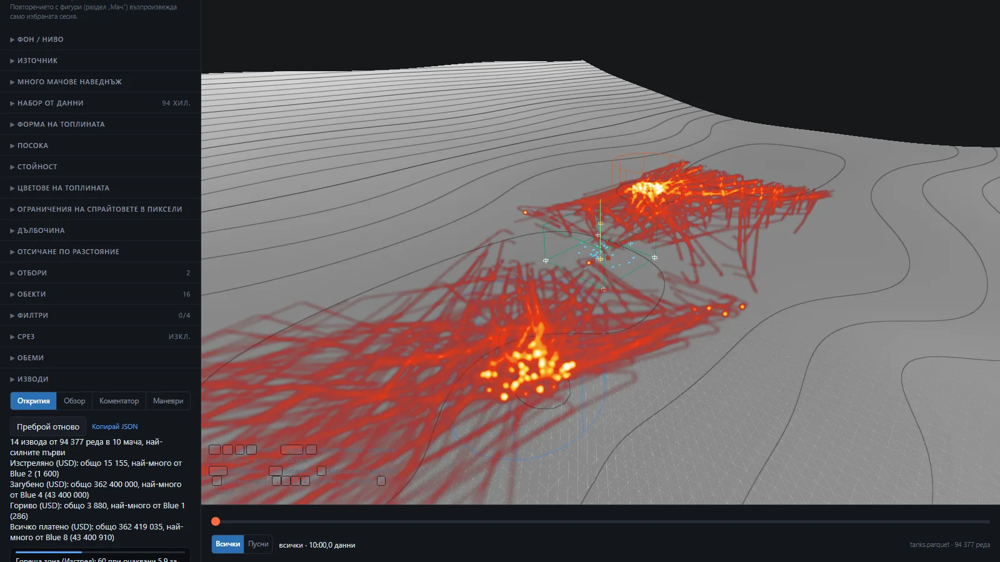
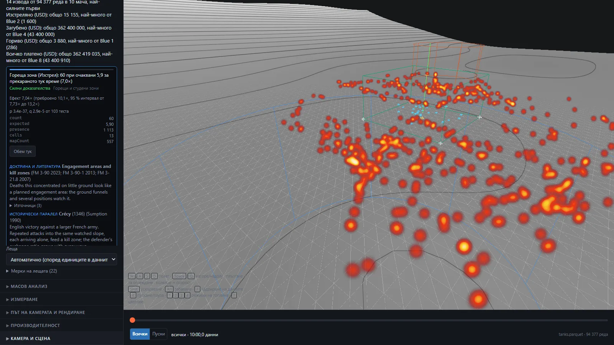
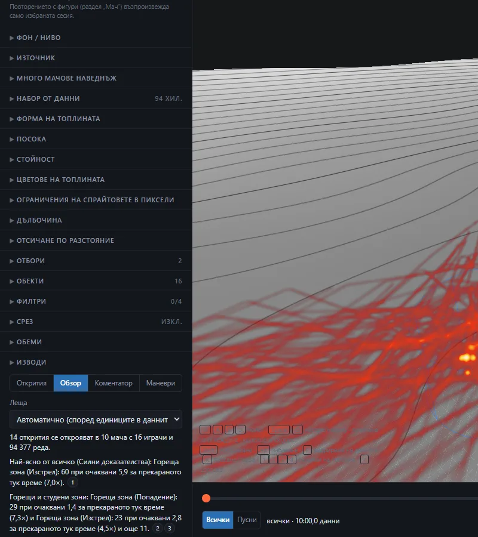
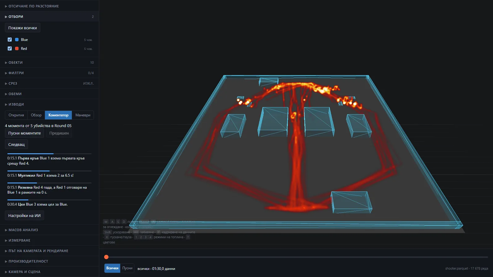

# Изводи

**Изводи** преглежда заредените данни за това, което изпъква - силни позиции, опасна местност, капани при появяване, тесни места, играчи далеч над връстниците си - и ви казва, най-силното първо, с доказателствата. Използвайте го, за да научите за минута къде е спечелен или загубен един мач. После може да напише обобщение, а при един разбор може да работи като коментатор, който скача към големите моменти.

Всичко се брои във вашия браузър. Нищо не напуска компютъра ви, освен ако не включите външен ИИ (вж. [Външен ИИ](#external-ai)).

Секцията **Изводи** е в страничната лента на разделите Топлинна карта и Мач. Има три раздела: **Открития**, **Обзор** и **Коментатор**.

## Открития {#findings}

1. Заредете данни и отворете **Изводи**. Натиснете **Намери изводи** („Преброяване… n%“ показва напредъка).
2. Прочетете списъка. Всяко откритие има лента за сила, изречение, колко силни са доказателствата (*Силни доказателства*, *Добри доказателства* или *Някои доказателства*), кой детектор го е открил и класът превозно средство, където това има значение.
3. **Щракнете върху откритие**: визуализаторът прилага филтрите му, прелита камерата до мястото и скача до времето, и отваря подробностите: ефекта с 95% интервал, стойностите p и q, преброените доказателства и **Обем тук**, който рисува [обем](volumes.md) около мястото.
4. **Върни филтрите** връща вашите филтри. **Копирай JSON** копира целия доклад.

Броенето използва текущите филтри, скритите групи и избрания мач през целия времеви диапазон. Когато по-късно смените филтрите, бележка го казва; натиснете **Преброй отново**.

Редовете в началото на списъка (например общите суми на парите) обобщават всички данни преди откритията.

### Детекторите {#the-detectors}

| Детектор | Какво открива | Нужно в данните |
|---|---|---|
| **Силни позиции** | Места с много по-добри шансове за убийство към смърт от останалата карта и *безопасен терен*, където малко умират за времето, прекарано там | събития за убийства и смърти |
| **Горещи и студени зони** | Места, където даден вид събитие (изстрели, попадения, превземания ...) се случва далеч по-често или по-рядко, отколкото времето, прекарано там, предсказва | колона със събития |
| **Открит терен и прикритие** | Смърти на открито спрямо близка почти равна геометрия, и бавно спрямо бързо движение | смърти; 3D ниво за частта с геометрията |
| **Появяване** | Силни точки за появяване, капани при появяване, безопасни точки, време до първия контакт | време и хора |
| **Клас по място** | Клас превозно средство или играчи срещу ИИ, които се представят много по-добре или по-зле в една област | убийства плюс колона за клас превозно средство или играч/ИИ |
| **Играчи** | Играчи, които убиват или умират далеч повече или по-малко от другите в същия клас | хора и убийства |
| **Тесни места и фланги** | Тесни места (далеч повече преминавания от околния терен) и фланкови маршрути (рядко използвани, но водещи до убийства) | хора |
| **Стойност** | *Скъп терен* и *Печелещ терен* | [колони със стойност](value-weighting.md) |

Детекторите, които не могат да работят с данните, са изброени отдолу с причината.

### Как се подреждат откритията {#how-findings-are-ranked}

Всяко място или група се сравнява с останалата карта (точни биномни тестове или тестове на честота). Процентът фалшиви открития е държан на 5% (Benjamini-Hochberg). Случайността може да изглежда като модел; това държи фалшивите тревоги ниски: сред показаните открития се очаква най-много около едно от двадесет да е случайно. Ефектите от малко събития се привличат към „без ефект“, преди да се подредят. Показват се най-много 60 открития, и всеки детектор получава няколко места близо до върха.

## Обзор {#debrief}

Разделът **Обзор** записва откритията като кратък текст: увод, най-ясното откритие, едно за тактиката, едно за баланса, останалите групирани по детектор, и колко почиват на по-слаби доказателства. Всеки абзац има номерирани бутони, които показват откритията му. **Копирай текста** го копира.

Вграденият разказвач работи офлайн, на вашия език. Селекторът **Леща** над него (вж. [Лещата на знанието](knowledge.md)) решава коя литература цитират абзаците.

### Външен ИИ {#external-ai}

**Настройки на ИИ** позволява модел на ИИ по ваш избор да напише обзора вместо това:

| Настройка | Значение |
|---|---|
| **Доставчик** | Anthropic (Claude), OpenAI (ChatGPT), OpenRouter, Ollama (локален), LM Studio (локален), сървър llama.cpp (локален) или всяка крайна точка, съвместима с OpenAI |
| **Базов URL**, **Модел** | Попълва се от доставчика; **Покажи моделите** пита сървъра |
| **API ключ** | Изпраща се само към базовия URL. Никога не се записва в журнал, никога не се запазва в изгледи, експорти или файлове `.3dheat`. Повечето локални сървъри не изискват такъв. |
| **Запомни ключа в този браузър** | Изключено по подразбиране: ключът се забравя, когато страницата се затвори |
| **Използвай външен ИИ** | Изключено по подразбиране |
| **Изпращай имената на играчите** | Изключено по подразбиране: играчите се изпращат като P1, P2 ... |

После напишете незадължителен въпрос и натиснете **Напиши с ИИ**. Изпращат се само откритията и техните числа - никога редовете от вашите данни. Отговорът се появява постепенно; цитираните откритията стават бутони.

## Коментатор {#caster}

За **един мач** (изберете един, ако са заредени няколко), **Коментаторът** намира моментите, които си струва да се гледат: първа кръв, мултиубийства, размени, клъчове, промени при целите, обрати, изпъкващи играчи, далечни изстрели.

- Щракнете върху момент: изгледът преминава към разбора, скача малко преди него, прелита там и следва играча.
- **Пусни моментите** пуска всеки до края му и продължава; **Предишен** / **Следващ** се движат през тях.
- Когато е включен външен ИИ, **Коментар от ИИ** пише коментар по списъка с моменти (видове, времена, имена или псевдоними, отбори, класове, разстояния).

Нужни са хора и събития за убийство/смърт (или за заснемане); колона `other`/`victim` прави възможни размените и далечните изстрели.

## Лещата на знанието {#knowledge-lens}

Откритието може да се чете през **леща** от установени знания: военна доктрина, въздушна и морска борба, градски операции, геймдизайн и киберспорт (или *Авто*, избрано от единиците в данните). Отворено откритие тогава показва най-близкия запис в **доктрина и литература** и **историческа паралел**, с препратки, а **Мерки на лещата** изчислява мерки от тази литература върху данните (подгонки по Lanchester, съотношения на размяна, съотношения на сили, полета на огъня, ключов терен, размени, инициатива). Обзорът и подканата към ИИ ги включват. Всичко за нея: [Лещата на знанието](knowledge.md).

Мерките на лещата измерват и как играчите се държат като тълпа и като група - подравняване и въртене в кръг, стадно движение по маршрути, коридори и следи, сгъстяване, водачи и следователи, изостанали, точката на пречупване при загуби, риск след загубен живот, серии, съгласие при покупки и реакцията на входящ огън - всяка спрямо собствения си нулев модел: [Колективно поведение](collective-behaviour.md).

## Данните, които правят изводите полезни {#data-that-makes-insights-work}

- позиции с **време**, колона за **човек** и колона за **отбор**;
- колона за **събития** с убийства и смърти (`kill`, `death`), и други (`hit`, `fire`, `capture` ...);
- колона за **другата страна** (`other`, `victim`) за размени и посоки;
- колона за **машина** или **тип** за класове; колона `ai` за играчи срещу ИИ;
- колона за **сесия** / **мач** / **рунд**, когато има няколко мача.

[Демо данните](demo-data.md) имат всичко това.
