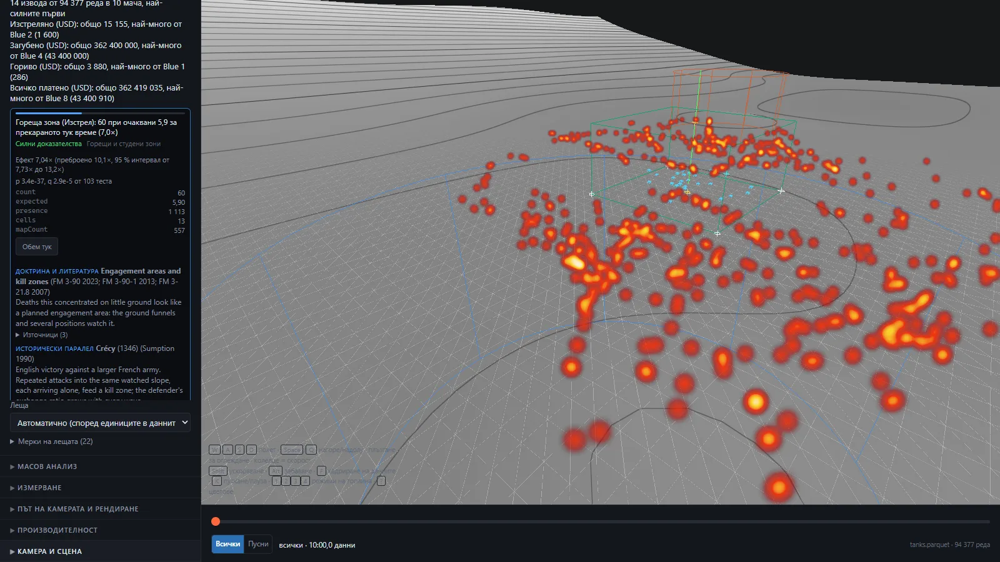

# Лещата на знанието

Когато [Изводи](insights.md) намери нещо, тази част го обяснява с идеи от военната история, дизайна на игри
и спортния анализ, и назовава книгата или статията, от която идва. Използвайте я, за да научите *защо* един модел
има значение, а не само че съществува.

## Опитайте {#try-it}

1. Заредете данни и отворете **Изводи**, после натиснете **Намери изводи**.
2. Щракнете върху една констатация, за да я отворите.
3. Прочетете **Доктрина и литература** и **Исторически паралел**; пълните препратки са свити отдолу.
4. Сменете **Леща** (например на *Военна доктрина*), за да прочетете същата констатация през друг корпус литература.

## Как работи {#how-it-works}

Панелът Изводи оценява констатациите си така, както би ги оценил професионален анализатор: през военната доктрина
и оперативния анализ, историческите сражения и литературата за дизайн на игри, дизайн на нива и анализ. Прави това
офлайн, от подбрана база знания във визуализатора, и предава същия материал на външен модел, когато той пише обзора.

## Какво показва панелът {#what-the-panel-shows}

- **Леща** избира корпуса литература, през който се четат констатациите: *Автоматично* (избрано според видовете единици
  в данните: самолети, кораби, наземни машини, пехота), *Военна доктрина*, *Въздушен бой*, *Морски*, *Градски*,
  *Дизайн на игри и баланс*, *Електронни спортове*. Записите извън избраната леща се пропускат.
- Всяка отворена констатация показва най-близкия си запис от **доктрина и литература** и най-близкия си **исторически
  паралел**, с пълните препратки свити отдолу.
- **Мерки на лещата** изброява мерките на оперативния анализ, изчислени върху същите редове (по-долу), всяка с
  това, което означава, и литературата ѝ.
- **Обзорът** добавя редове за водещите констатации и мерките на лещата: "Доктрина и литература: ..." и
  "Исторически паралел: ...", всеки с цитати автор-година и препратките отдолу.
- **Напиши с ИИ** изпраща най-подходящите записи (резюме, поука, констатациите, с които са свързани, пълните препратки)
  заедно с отчета и моли модела да ги цитира по идентификатор - `{concept.lanchester-square}` - и да не ползва други източници.

Етикетите са преведени; самото знание е на английски.

## Мерки на лещата {#lens-metrics}

Изчисляват се в работника на изводите, в същия проход през редовете като детекторите (`src/insights/lensMetrics.ts`).
Всяка се пропуска, когато данните не могат да я носят.

| Мярка | Какво измерва | Нужно |
|---|---|---|
| Пригодност на Ланчестър | Загубите на всяка страна за 20 s, регресирани върху живите сили на двете страни (Poisson, грешки от квазиправдоподобие); степените върху силата на врага и на собствената страна, проверени спрямо квадратния закон (прицелен огън) и линейния закон (площен огън) | време, отбори, убийства и смъртни случаи |
| Съотношение на размяната | Убийства на смърт по страна и по място; делът на смъртите на най-смъртоносния терен, който държи 5% от времето, спрямо дела, който дава само случайността при толкова смъртни случаи; Gini на смъртите спрямо времето; Moran's I на честотите на смъртите | убийства и смъртни случаи |
| Локално съотношение на силите | Приятелските и вражеските единици, живи в обхват на ангажиране на всяко убийство (обхватът се задава от данните: два пъти медианното разстояние до най-близкия враг); делът на убийствата от локално превъзхождащата страна и нейният излишък спрямо това, което предсказват самите числа | време, отбори, лица |
| Полета на огън | Видимостта от най-натоварените места на убийства върху 2.5D повърхност на препятствията (геометрията на нивото до височината на стена, или извървяната земя) спрямо средното място, и ранговата корелация между видимостта и дела на убийствата | позиции; зареденото ниво го прави по-точно; не важи за въздух |
| Енергийно състояние | Специфичната енергия (височина плюс височината, която скоростта може да купи) на въздушните убийци и въздушните жертви, сравнена по статистиката на Ман-Уитни | класове самолети, време, височина |
| Ключов терен | Колко често дадено място е сред трите най-натоварени места на убийства в мач | няколко мача |
| Взаимна подкрепа (размени) | Смъртите, на които отговаря убийство от съотборник в обхвата на ангажиране и 5 s | време, отбори |
| Първи удар | Ангажименти - убийства, групирани по мач, по 20 s затишие и по три обхвата на ангажиране на разстояние - спечелени от страната, която първа е отбелязала | време, отбори |
| Модел на залпа | Уравнението на залпа на Хюз, прилагано към 20-секундни периоди на кораби в досег: кораби, извадени от строя на нападащ кораб, и спасени на защитаващ се кораб; Ланчестър пригодност само за корабите | класове кораби, време, отбори |
| Бойна ефективност | Убийства на единица бойно време на всяка страна и съотношението на двете най-големи (стойност на бойната ефективност в смисъла на Дюпюи) с 95% интервал, и делът на всяка страна от убийствата при равни местни числа | време, отбори |
| Обхвати на ангажиране | Разстоянието до най-близкия враг при убийства, при изстрелвания и при първия изстрел на всеки живот (откриване до ангажиране), по вид единица | време, отбори; изстрелвания, където данните ги имат |
| Верига на убийството | Секунди от последното изстрелване на убиеца до убийството и от първия му изстрел в боя до убийството | време; изстрелвания или събития за огън |
| Концентрация или разпръскване | През всеки 20-секунден период разпръскването на двете най-големи страни и делът на убийствата, взет от по-плътната | време, отбори |
| Излети | За всяка страна: излети (излитания или появявания на самолети), кацания, загубени самолети и убийства от самолети; степен на загуба и убийства на излет | класове самолети; излитания или появявания |

Данните с рундове добавят мерките за близък бой и електронни спортове - вероятност за победа в рунда, стойност на
действията, първите двубои, размените, влизащият срещу задържащия, прицелването, кръстосания огън, помощните средства,
числовото предимство, клъчовете, подготовката, след поставянето, смъртоносните фуния и влиянието на играча: вижте
[Близък бой и рундове](close-quarters.md).

Траекториите и отборите добавят мерките за колективно поведение на науката за тълпите, колективното движение,
поведенческата икономика и военната психология - подреждане и кръжене, водене по маршрут, ленти и следи, струпване,
водачи и последователи, изостанали, точката на пречупване, риск след загуби, серии, съгласие при покупка и
потискане, всяка спрямо собствен нулев модел: вижте [Колективно поведение](collective-behaviour.md).

Оръжията, примамките и сградите не се броят за единици. Когато редовете на оръжията назовават изстрелващата
единица (колона `Shooter` или `Launcher`, както при данни, произлезли от Tacview), изстрелването се приписва на тази
единица, съпоставена по име или по идентификатор на обекта.

## Как констатациите се срещат с литературата {#how-findings-meet-the-literature}

Записите и констатациите се срещат през една **таксономия на модели** (`src/insights/knowledge/patterns.ts`):
концентрация, локално превъзходство, прицелен и площен огън, тесни места, зони на убийство, полета на огън, обратен
скат, обходи, взаимна подкрепа, енергийно предимство, натиск при появяване, баланс и т.н. Всеки вид детектор и всяка
мярка на лещата казва кои модели показват числата ѝ (`src/insights/lens.ts`); всеки запис на знанието казва на кои
модели се отнася, с тегло. Релевантността на запис за дадена констатация е претегленото припокриване, мащабирано според
това колко добре областта на записа (суша, въздух, море, градска среда) съответства на данните и според собствената сила
на констатацията. Показаното обяснение е числото на констатацията в едно изречение, последвано от поуката на записа.

## Каталог {#catalogue}

Всеки модел, понятие, метод, исторически случай, принцип на дизайна и изследване, с библиографията: вижте
[Каталога на знанието](knowledge-catalogue.md).

## За разработчици {#for-developers}

### Добавяне на записи {#adding-entries}

1. Изберете файла според вида: `concepts.ts` и `concepts-more.ts`, `methods.ts`, `cases.ts`, `cases-land.ts`, `cases-air-sea.ts`, `cases-esports.ts`, `design.ts` (принципи на дизайна) или `studies.ts` в `src/insights/knowledge/`.
2. Дайте му нов идентификатор `<type>.<slug>` (никога не използвайте повторно), леща, области и моделите, които засяга, с тегла 0..1. Добавяйте модел в `patterns.ts` само когато констатация може да го покаже, и го съпоставете с констатация или мярка в `lens.ts`.
3. Напишете резюмето и поуката **с ваши думи**. Цитати само от произведения в публично достояние (`pd: true` в препратката) и кратки.
4. Цитирайте: добавете всяко ново произведение в `refs.ts` с автори, година, заглавие и издател (списание с том и страници); URL или DOI, когато има публичен запис.
5. Пуснете `npx vitest run src/insights/lens.test.ts` (уникални идентификатори, познати модели, разрешими препратки, цитати в публично достояние, случаи с дата и резултат) и `node tools/knowledge-doc.mjs`, за да обновите [каталога](knowledge-catalogue.md).
