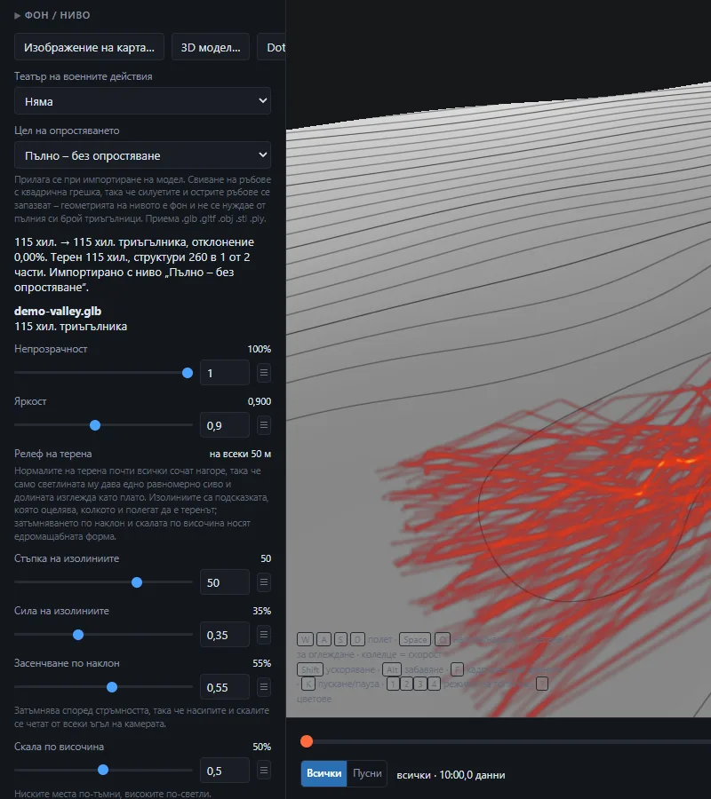

# Нива и фонова геометрия

Нивото е 3D мястото, където се е разиграла играта - карта, град, трасе. Поставете го зад данните си и виждате *къде* е топлината. Панелът **Фон / ниво** (виж [Речник](glossary.md) за „ниво“) дава три вида контекст:

- **картинка на карта**, georeferenced с две котви - виж [Картинки на картите](map-images.md);
- **3D ниво** - `.glb`, `.gltf`, `.obj`, `.stl` или `.ply` - разделено на терен, конструкции и вода и опростено при импорт - виж [3D нива](model-levels.md) и [Вид на нивото](level-appearance.md);
- **фон на света** - за запис, който казва къде на Земята се намира (файл Tacview ACMI): истинският терен, пътищата, водата, летищата и сградите, изтеглени от отворени данни - виж [Фон на света](world-backdrop.md).

Когато нищо не е заредено, сцената е тъмна с мрежа и оцветени оси (**Мрежа** и **Оси** в [Камера и сцена](camera.md)), а панелът казва *Нищо не е заредено - сцената показва мрежа и оси. Добавете картинка на карта или мрежа на ниво, за да дадете контекст на топлината.*

Нивото се споделя от трите раздела: трасе, заредено в раздела Състезателен анализ, е същото ниво, което показва топлинната карта.

## Сложете ниво зад данните си {#put-a-level-behind-your-data}

1. Първо заредете данните си ([Зареждане на данни](getting-data-in.md)), за да се напасне нивото към тях.
2. Отворете **Фон / ниво** в страничната лента.
3. Натиснете **Изображение на карта…** за картинка или **3D модел…** за 3D ниво и изберете файла. За запис от реалния свят използвайте вместо това **Фон на света** или **Театър**.
4. Изчакайте реда с напредъка да приключи. Голям модел първо се опростява (виж **Цел на опростяването** по-долу).
5. Натиснете **F** в изгледа, за да поберете всичко. Използвайте **Непрозрачност** и **Яркост**, докато топлината изпъкне над нивото.
6. Натиснете **Запази в библиотеката**, ако ще ползвате нивото отново ([Библиотека на нивата](level-library.md)).

## Какво прави нивото за топлината {#what-a-level-does-for-the-heat}

- **Закрива**: точките с данни зад него се затъмняват по всяка повърхност, а точките зад терена са скрити ([Дълбочина и отрязване](depth-and-culling.md)). Без ниво няма окклузия.
- То се **среже** от [Среза](slice.md) и, при *Срязване и на нивото*, от [отрязването по разстояние](depth-and-culling.md#distance-culling), заедно с топлината.
- То е единственото нещо, което [дълбочината на полето](camera.md#depth-of-field) размазва, освен мрежата и кубовете.
- 3D ниво **разширява далечната равнина на камерата**, когато е по-голямо от данните: близката и далечната равнина се калибрират от набора данни, а експортирана карта с няколко километра ширина иначе би стояла изцяло зад далечната равнина и би оставила празен изглед. Далечната равнина става 3 × хоризонталния обхват на нивото, когато той е по-голям, близката равнина се мести с нея (поне далечна / 100 000), за да се пази точността на дълбочината, от която зависи окклюзията, а скоростта на полета се вдига до поне обхват / 12. Тя се разширява, никога не се стеснява.

## Панелът, отгоре надолу {#the-panel-top-to-bottom}

| Част | Подробности |
|---|---|
| **Изображение на карта…**, **3D модел…** | Зареждане на едно; то замества текущото ниво. |
| **Фон на света**, **Забрави картните плочки** | Само за набор данни с географска отнесеност: построява истинското място под данните като ниво или изтрива изтеглените плочки. [Фон на света](world-backdrop.md) |
| **Цел на опростяването** | Бюджетът на триъгълници за следващия импорт на модел: *Пълно - без опростяване* (по подразбиране), *Високо - 8M*, *Средно - 3M*, *Ниско - 800k*, *Силуета - 100k*. [3D нива](model-levels.md#simplification) |
| Напредък и **Отказ** | Докато се декодира или импортира. |
| Бележка за импорта | Триъгълниците преди и след, разделянето на терен / конструкции / вода, използваното ниво на детайл. |
| Име и размер | `width×height px · x × z m/px` за картинка, `N triangles (from M)` за модел. |
| **Непрозрачност**, **Яркост** | И двата вида. |
| Контроли на картинката | **Обезцветяване**, **Обръщане север/юг**, **Разположение** (две котви), **Напасване към границите на данните**, **Височина**. [Картинки на картите](map-images.md) |
| Контроли на модела | Релеф на терена, вода, триъгълници на терена, каркас, текстура, заснет цвят, конструкции, класификация на частите. [Вид на нивото](level-appearance.md) |
| **Запази в библиотеката**, **Премахни** | [Библиотека на нивата](level-library.md); Премахни изважда нивото. |
| **Библиотека** | Нивата, запазени в този браузър. [Библиотека на нивата](level-library.md) |

## Страници в този раздел {#pages-in-this-section}

- [Картинки на картите](map-images.md)
- [3D нива](model-levels.md) - формати, части, класификация, опростяване, текстури
- [Вид на нивото](level-appearance.md) - всеки контрол за 3D ниво
- [Библиотека на нивата](level-library.md)
- [Фон на света](world-backdrop.md) - истинският свят под запис, от отворени данни

Как се вземат нива от игри и двигатели е работа на отделните инструменти за експорт (виж [README](https://github.com/Holdi601/3DHeat/blob/main/README.md) на хранилището); формата, в която те пишат, е обобщена в [3D нива](model-levels.md#the-exporter-contract).
