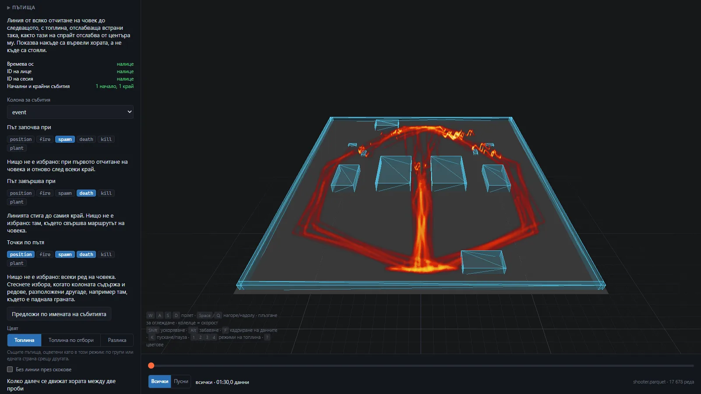

# Линейна топлина

Топлината показва къде са стояли хората. Линиите показват пътеките, по които са вървели.

**Линии** (клавиш 4) е линейната топлина: линия от всяка проба на [лице](glossary.md) до следващата му, размазана със същото затихване, каквото има [спрайтът](glossary.md) - напреки на линията, вместо около точка. Показва къде хората *са отишли*, а не къде са стояли: коридор, минат веднъж, се вижда толкова, колкото стая, в която са се засели, а рядките проби на бърз играч се свързват в непрекъснат маршрут, вместо в пунктирана следа. Изисква колона за лице и колона за време.

## Как се ползва {#how-to-use-it}

1. Натиснете `4` (или изберете **Линии** в лентата на режимите).
2. Отворете **Пътища** и проверете зеления списък: ос на времето и ID на лице трябва да са налични.
3. Натиснете **Предложи по имената на събитията**, за да се попълнят местата, където пътищата започват и завършват.
4. Прочетете реда със статистиката: "N пътища, M от тях достигат край".
5. Ако линиите прескачат през картата, нагласете **Най-дълга стъпка** (вижте [Ограничението за скок](#the-jump-limit)).

Линията има смисъл само между начало и край, затова панелът **Пътища** казва какво ограничава един път. Всичко от [Правилата на пътя](#the-rules-of-a-route) нататък е подробност, която можете да прескочите.

## Панелът Пътища {#the-routes-panel}

Показва се над панелите за топлина в режим Линии.

### Какво има в данните {#what-the-data-has}

Списък с отметки, зелен, когато е налично, кехлибарен, когато не е:

| Ред | Състояния |
|---|---|
| **Ос на времето** | *налична* / *липсва - нужна е* |
| **ID на лице** | *налично* / *липсва - нужно е* |
| **ID на сесия** | *налично* / *няма - всички редове са една сесия* |
| **Начални и крайни събития** | *N начала, M края* / *няма избрани - цели следи* (зелено само с колона за събития и поне едно начало и един край) |

### Контроли {#controls}

| Контрола | Значение |
|---|---|
| **Колона за събития** | Колона на категория, чиито стойности са събития (поява, смърт, позиция, ...). *Няма - цели следи*: всяка следа на всяко лице във всяка сесия е един път, прекъснат там, където следата има празнина. Предлагат се само колоните, запазени за филтриране при зареждане. |
| **Път започва при** | Стойности на събития, които започват път (поява, възраждане, десант). Няма избрани: пътят започва от първата проба на лицето и отново след всеки край. |
| **Път завършва при** | Стойности на събития, които завършват път (смърт, извличане, телепортиране). Линията стига до самия крайен ред. Няма избрани: пътят завършва там, където свършва следата на лицето. |
| **Точки по пътя** | Стойности на събития, чиито редове лежат по пътя. Няма избрани: всеки ред на лицето. Стеснете го, когато колоната съдържа и редове, поставени другаде, като например там, където е паднала граната. |
| **Предложи по имената на събитията** | Попълва трите списъка по имената на стойностите (по-долу). |
| **Цвят** | *Топлина*, *Топлина по отбори* или *Разлика*. Същите пътища в оцветяването на този режим: всяка група в собствен нюанс или една страна срещу другата, със списъка на групите, разделянето и скалите, работещи както в тези режими. По подразбиране *Топлина*. Топлината по отбори и разликата изискват колона за група. |
| **Без линии през скокове** / **Най-дълга стъпка** | Следващата проба на лице, по-далеч от това, е възраждане, телепортиране или падане, а не място, където е отишло, затова никоя линия не свързва двете. Попълва се при зареждане, когато данните показват ясна празнина (по-долу), и е изключено, когато не показват. Работи с или без колона за събития. |
| Ред със статистиката | `N пътища, M от тях достигат край, K сегмента`, обновява се няколко пъти в секунда. |

Всеки списък е ред от превключващи чипове, по един за стойност, най-честите първи; задържането върху чип показва броя на редовете му. Предлагат се най-много 120 стойности (*още N стойности не са показани*).

Избирането на друга колона за събития прилага предложението, когато то избира същата колона, а иначе започва с празни списъци.

### Предложението {#the-suggestion}

При всяко зареждане и при **Предложи по имената на събитията** ([`suggestLineSettings`](https://github.com/Holdi601/3DHeat/blob/main/src/data/lines.ts)):

- **Колона за събития:** първата запазена колона на категория, наречена `event`, `eventname` или `eventtype`; иначе `kind`, `type` или `action`; иначе която и да е, съдържаща *event*, *kind*, *action* или *type*.
- **Начала:** стойности, съдържащи *spawn, deploy, join, enter, start, begin, respawn, revive, land/landed/landing, drop* - освен ако не съвпаднат и с дума за край.
- **Краища:** стойности, съдържащи *death, died, dead, kill/killed, eliminat…, extract, evac, teleport, leave, left, disconnect, quit, exit, end, finish, downed* - с изключение на стойностите `kill` и `kills` (убийството е нещо, което убиецът прави, а не край на пътя му).
- **Точки:** стойности, които са точно *position, location, player location, move, movement, tick, sample* или *pos*; когато се намери някоя, началата и краищата се добавят и към точките. Когато не се намери нито една, точките остават празни (всеки ред).

### Ограничението за скок {#the-jump-limit}

Там, където хората скачат, дължините на стъпките се делят на две групи с почти нищо между тях: какво покрива лице между две проби и ширината на картата. При зареждане ([`suggestMaxJump`](https://github.com/Holdi601/3DHeat/blob/main/src/data/lines.ts)) стъпките се броят по удвоявания на квадрата на дължината им, до 16 милиона от тях, а ограничението попада в средата на първия диапазон над медианата, който е широк поне едно удвояване на дължината, държи под 0.02% от стъпките във всеки интервал и има стъпки отвъд себе си. Без такъв диапазон нищо не се отрязва, тъй като няма как да се отличи скок от бърза кола; включването на ограничението на ръка тогава започва от една десета от диагонала на данните.

Диаграмата над ограничението показва колко дълги са наистина стъпките, с линия на ограничението: стълбчетата вдясно от нея не се рисуват. И двете оси са логаритмични, защото скоковете могат да са една стотна от стъпките и хиляда пъти по-дълги. Задръжте върху стълбче за диапазона и дела му; щракнете върху диаграмата, за да поставите ограничението там. Под нея - делът на стъпките над ограничението.

## Правилата на пътя {#the-rules-of-a-route}

Редовете се обхождат във времеви ред, по лице ([`buildLines`](https://github.com/Holdi601/3DHeat/blob/main/src/data/lines.ts)):

1. Редовете на [споделено име](sessions-persons-groups.md#names-worn-by-several-things-at-once) се пропускат изцяло.
2. Когато са избрани точки, ред, който не е нито начало, нито край, нито точка, се пропуска.
3. Редовете се следват по лице и по сесия, така че лице, чиито сесии се преплитат във времевия ред, има по един път във всяка. Път се затваря, когато предишният ред няма наследник (неговият [живот](sessions-persons-groups.md#person) е "няма") - път никога не прескача граница на сесия или празнина, за която зареждането е решило, че няма следваща проба. На кой път е даден ред се определя веднъж и се пази, 4 байта на ред, така че промяната на най-дългата стъпка не повтаря тази част.
4. **Начало** затваря всеки отворен път и отваря нов там.
5. Когато са избрани начала, ред извън път се игнорира. Без начала всеки некрайен ред извън път отваря такъв.
6. Всеки друг ред вътре в път добавя **сегмент** от предишния ред на пътя до този.
7. **Край**, който удължава път, го затваря след сегмента си; този път се брои като *достигнал край*.
8. Стъпка по-дълга от **Най-дълга стъпка** затваря пътя там, където е, и нов път започва от далечния край, освен ако този ред не е край. През нея не се рисува линия, а редът със статистиката я брои.

Всеки сегмент се пази в *крайния* си ред, така че сегментите остават във времеви ред, а [времевата линия](timeline.md) (прозорецът), семплерът, [филтрите](filters.md), видимостта на групите и знакът на разликата работят с тях както с точките. Филтърът се прилага затова към реда, в който завършва сегментът.

## Възпроизвеждане {#playback}

В режим **Всички** всеки път се рисува цял. В режим **Пусни** всяко лице е точка, която се движи между пробите си и рисува маршрута си зад себе си:

- сегмент, който започва след главата за възпроизвеждане, не се рисува;
- сегментът, в който лицето е по средата, се рисува до интерполираната му позиция, с крайна капачка на главата;
- топлината избледнява по **опашката**: при историята *Натрупване* опашката е неограничена и целият досегашен път остава; при *Прозорец* избледнява до нула за *Обхвата* (по подразбиране 30 s). При *Продължителност на живот* опашката е също *Обхватът*, а в режим Линии времевата линия показва полето *Обхват* и за тази история (вместо *Резервен живот* и *Избледняване*, които линейната топлина не използва).

Докато се възпроизвежда, всеки кадър се рисува цял, а не натрупан, защото главите се движат на всеки кадър и плъзгащата се средна би размазала всяка в ивица.

## За разработчици {#for-developers}

### Памет {#memory}

Пътищата се строят в главната нишка, когато се влезе в режим Линии (или когато настройките на пътя се променят), и се освобождават при излизане от него: 5 байта на ред в паметта и 8 байта на ред в GPU (началната позиция на всеки сегмент, квантувана до 16 бита на ос в обхвата на данните, и флаговете му).

### Как се рисува линия {#how-a-line-is-drawn}

И двата бекенда рисуват всеки сегмент от крайния си ред като **18 върха** ([`lineHeatVs`](https://github.com/Holdi601/3DHeat/blob/main/src/render/webgl2/shaders.ts) и неговият WGSL двойник):

- Полуширината във всеки край е [радиусът на спрайта](sprite-shape.md#sprite-radius) на това разстояние до края, с приложените пикселни ограничения. Линия по-тънка от 2.5 px се рисува с ширина 2.5 px, а топлината ѝ се намалява съответно, така че тънките линии нито изчезват, нито светят по-силно.
- Топлината затихва **напреки** на линията със същата скала като спрайт - затихване или крива, интензивност в центъра и на ръба.
- Закръглени капачки се рисуват **само** там, където път започва или завършва, така че съединенията между съседни сегменти да не се превръщат в низ от perли.
- Геометрията се строи в екранно пространство и се интерполира линейно там, така че затихването остава центрирано върху линията, независимо как навлиза в дълбочината. Сегмент, който пресича близката равнина, се реже там, вместо да се отхвърля.

Топлината на точките и линейната топлина отлагат много различни количества топлина на ред, затова наситеността се измерва отново, когато превключвате между тях ([Цвят и експозиция](colour-and-exposure.md#auto-exposure)).
