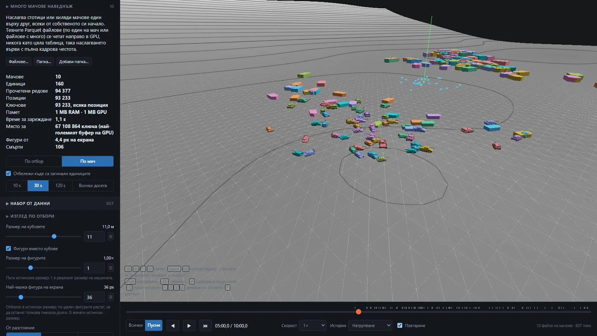

# Много мачове наведнъж

**Много мачове наведнъж** пуска много мачове едно върху друго, така че виждаш къде обикновено отиват играчите на всеки мач. Използвай го, за да сравниш стотици или хиляди мачове в една картина.

Всеки мач започва от собственото си начало и единиците му се движат като фигури. Файловете отиват право в графичната карта и не се строи цялата таблица, така че се пуска плавно там, където обикновено зареждане би изчерпало паметта.

## Как да го ползваш {#how-to-use-it}

1. Отвори **Много мачове наведнъж** в страничната лента на топлинната карта.
2. Натисни **Файлове…** (избери много файлове), **Папка…** (папка и подпапките ѝ) или **Добави папка…** (добави към заредените).
3. Визуализаторът превключва към наслагването на фигури и започва от началото. Натисни **Пусни**.

Всеки файл е един мач (или съдържа няколко). Работят файлове Parquet и [`.3dheat`](container.md) контейнери. Файлът трябва да има колона за позиция, за време и за единица; колоните за име, тип и страна се запазват. Другите файлове и помощните файлове на конверторите (полет, съобщения, събития, чат, цели) се пропускат. За обикновена таблица виж [Зареждане на данни](getting-data-in.md).

## Настройки {#settings}

| Настройка | Какво прави |
|---|---|
| **По отбор** / **По мач** | Оцветява по страна или по цвят за всеки мач. |
| **Отбележи къде са загинали единиците** | Отбелязване на мястото, където е загинала всяка единица, за 10 s, 30 s, 120 s или за всичко досега. |

Панелът показва колко мача, единици, реда и позиции са прочетени, използваната памет и времето за зареждане. *Място за* е колко още позиции може да поеме графичната карта. *Фигури от* е размерът на екрана, под който единицата се рисува като малка стрелка вместо фигурата си.

Видът на фигурите ползва същите контроли като [разбора на мач](match-replay.md#figures): **Размер на фигурите**, **Най-малка фигура на екрана** и **От разстояние**.

## Съвети {#tips}

- Когато всичко не би се събрало в паметта, позициите се разреждат (запазва се само позиция на всеки няколко метра) и панелът казва това.
- Режимите на топлината работят и върху данните на наслагването.
- За статистики над хиляди мачове без рисуването им виж [Масов анализ](mass-analysis.md).
