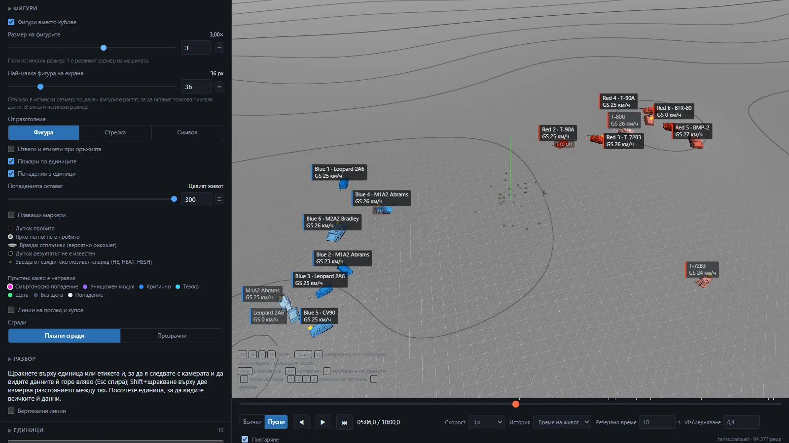
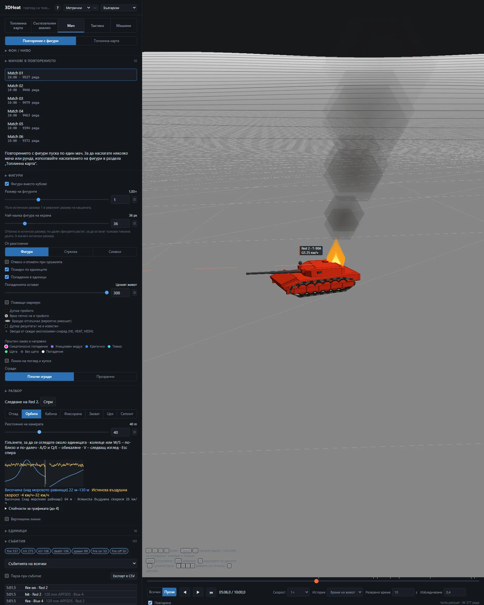
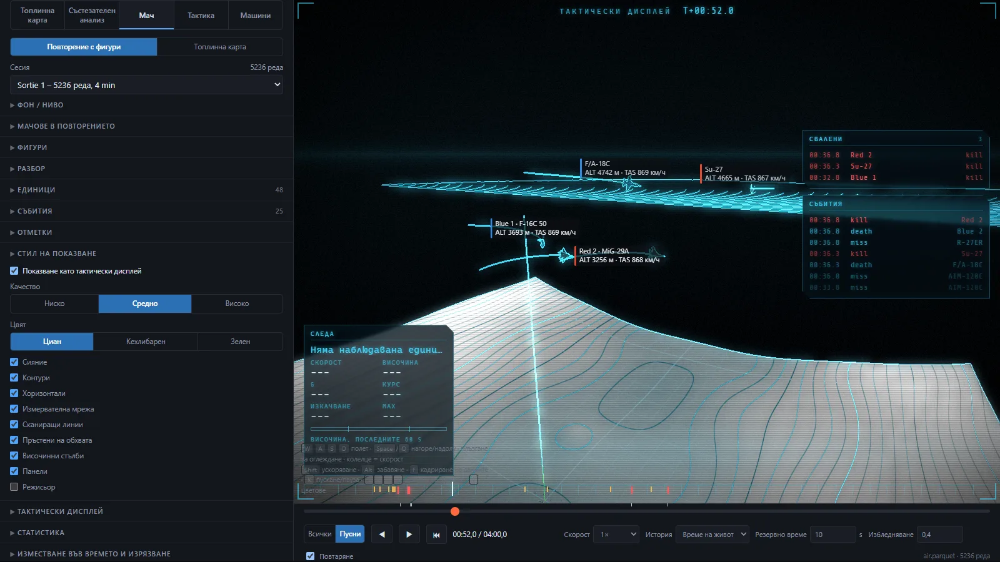

# Разбор на мач

Разборът е филм на мача, в който всеки играч е нарисуван като това, което е карал. Използвайте го, за да гледате отново една схватка, да следите една единица и да видите кой кого е уцелил.

Изстрелите, попаденията, пожарите и отломките се рисуват върху единиците и целите на нивото. Камерите, етикетите и тактическият дисплей ви помагат да прочетете схватката. Познавате ли Tacview? [Съответствие с Tacview](tacview-parity.md) показва къде е всеки от инструментите му.

## Започнете разбор {#start-a-replay}

1. Заредете запис с **Източник → Файлове…** или като го пуснете в панела Източник (всяка таблица с колона за **човек** и колона за **време**, файл на Tacview, превърнат разбор, мач от [`.3dheat`](container.md)). Вж. [Зареждане на данни](getting-data-in.md).
2. Отворете раздела **Мач** и изберете **Повторение с фигури**, или изберете **Наслагване на фигури** в лентата с режими на раздела Топлинна карта.
3. Под **Мачове в повторението** изберете един мач, всички наведнъж или няколко.
4. Натиснете **Пусни** на времевата линия (или `K`). Влачете времевата линия, за да прескочите.

Фигурите заменят кутиите за всяка единица, чието име или тип е известно (вж. [Фигури](figures.md)). Данни без колона за име или тип се рисуват като войници.

## Фигури {#figures}

| Настройка (секция **Фигури**) | Стойност по подразбиране | Какво прави |
|---|---|---|
| **Фигури вместо кубове** | включено | Изключено рисува прости кутии. |
| **Размер на фигурите** (пъти истинския размер) | 1 | 1 е истинският размер; от 0.25 до 20 пъти (логаритмична скала). По-голям помага отдалеч. |
| **Най-малка фигура на екрана** | 36 px | Далечните фигури порастват, за да останат толкова големи, от 0 до 200 px; 0 запазва истинския размер. |
| **От разстояние**: Фигура, Стрелка, Символ | Фигура | В какво се превръща далечна единица. |
| **Символи** | НАТО (APP-6) | НАТО (APP-6), руски тактически знаци, икони **Карта на игра** или **Само форми (за далтонисти)**. |
| **Размер на символа**, **Моята страна**, **Враждебна / неутрална**, **Чертички за курс** | 28 px (12 до 64), автоматично, враждебна, включено | Как изглеждат символите и коя страна е приятелска. |
| **Вертикални линии** | включено | Линия от всяка единица право надолу до земята, за да се четат височините в 3D. |
| **Отвеси и етикети при оръжията** | изключено | Линии до земята и етикети при ракети и бомби. |
| **Пожари по единиците** | включено | Пламъци от момента, в който единицата се запали, до гасенето ѝ. |
| **Попадения в единици** | включено | Маркери къде са уцелили изстрелите (по-долу). **Попаденията остават**: от 1 до 300 секунди, или **Целият живот**. **Плаващи маркери**: маркери, нарисувани над повърхността. |
| **Линии на поглед и купол** | изключено | Прекъснати: където гледа играчът; плътни: където сочи оръдието. |
| **Сгради** | плътни | Плътни или прозрачни сгради, когато нивото ги рисува. |

### Символи от разстояние {#symbols-at-a-distance}

Когато една единица би била по-малка от **Най-малка фигура на екрана**, тя може да стане символ, който остава четлив. Формата показва вида (например закръглена кутия с белег за верига за броня); цветът показва страната. Отворете менюто **Символи**, за да смените стила.

### Маркери за попадение, отломки и пожари {#hit-marks-wrecks-and-fires}

- **Маркерите за попадение** стоят върху повърхността, която изстрелът е срещнал, в мащаба на фигурата. Видът им казва какво е станало: дупка (е минал), ярко пръскане (не е минал), драскотина (отскочил е), звезда от сажди (експлозивен снаряд). Цветен пръстен казва какво е направил: фатален изстрел, модул унищожен, критично, тежко, щета, без щета, попадение. Задръжте курсора върху маркер за името на снаряда.
- Унищожена единица се рисува **овъглена** като отломка от смъртта си до възраждането или премахването ѝ; символът ѝ е задраскан.
- **Пожарите** горят по единица от момента, в който тя се запали, до гасенето.
- **Куполите** се завъртат към мястото, където данните казват, че сочи оръдието (или, без тях, където гледа играчът).

### Оръжия, примамки и трасиращи куршуми {#weapons-decoys-and-tracers}

С включено **Оръжия, изстрели и попадения** (секция Изглед по отбори): ракетите, ракетите, бомбите и торпедата летят като собствени фигури със следа от дим; куршумите и снарядите са трасиращи; попаденията и експлозиите святкат. Трасиращ куршум, нарисуван **прекъснато**, е изведен от попадение, защото данните нямат изстрел. Отвличащите сигнали и плявата се рисуват като примамки; те са скрити от списъка с единици, освен ако не е отметнато *Примамки и снаряди*.

## Камери {#cameras}

Щракнете върху единица или нейния етикет, за да я **следвате**; секцията **Разбор** предлага **Отзад**, **Орбита**, **Кабина** (с дисплей пред очите, `H`), **Фиксирана**, **Захват**, **Цел** и **Сателит**. `V` ги превърта, а **Разстояние на камерата** задава колко далеч. Esc спира.

- **Изглед на две единици**: изберете **Цел** (или щракнете с Ctrl/Alt върху единица), за да я гледате от следваната. **Размяна** ги разменя.
- **Мярка**: Shift-щракнете върху две единици за посоката, разстоянието и разликата във височината между тях.
- **2D карта** (`M`): ъглов или пълен изглед, със следи и имена.
- **Отметки** (`B`): запазва момента и камерата; собствените убийства, смърти и отметки на записа също се изброяват.
- **Събития**: всяко събитие във времеви ред; щракване отива там. `Page Up` / `Page Down` прескачат между събитията; **Пауза при събитие** спира при всяко.

## Тактически дисплей {#tactical-display}

Секцията **Тактически дисплей** рисува, без единица, избраните, всички или един вид (самолети, наземни, кораби, оръжия): векторите на скоростта и пътя напред, линиите на носа и на подемната сила, конусите на радара, заключванията, връзките за данни, зоните и линиите на ангажиране, линиите на видимост, къде гледат играчите (конуси на погледа), прицелването на куполите и записаната камера.

### Стил на дисплея {#display-style}

`T` (или превключвателят **Показване като тактически дисплей**) сменя вида към стил на радарен екран: сияние, контури, контурни линии, мерителна мрежа, линии на сканиране, пръстени на обхвата, скали на височината, панели с убийства и събития, и **Режисьор**, който сам премества камерата към събитията.

## Цели {#objectives}

Когато мач идва с целите си, секцията **Цели** ги рисува върху нивото: зони за заснемане (с притежател и напредък на заснемането), точки на появяване, летища, райони и цели за бомбардиране, като всеки слой може да се включва и изключва, с етикети. Те се виждат през земята. Когато са заредени няколко режима на игра, **Режим** филтрира мачовете по режим. Целите идват от файл на мача от конвертор до записа или вътре в контейнер [`.3dheat`](container.md).

## Етикети и статистика {#labels-and-statistics}

- **Етикети**: правила за всеки вид (**Избрани**, **Самолети**, **Наземни**, **Кораби**, **Оръжия**, **ИИ**): показване или не, кои стойности, и **Приоритет** за това кой получава мястото, когато етикетите се припокриват. **Раздалечаване на етикетите** премества етикет до своята единица, когато би покрил друга, и го пропуска там, където няма място. **Размер на етикетите** е от 60 до 250 %. **Обратно към име, техника, височина и скорост** възстановява правилата.
  - Наземните единици започват с име, машина и скорост.
  - Самолетите започват с име, машина, височина и скорост.
  - Корабите започват с име, машина, скорост и курс.
  - Задръжте курсора върху единица, за да видите всяка нейна стойност.
- **Статистика**: за отбор и единица: убийства, смърти, изстрели, попадения, съотношение на попаденията, излитания, кацания, време във въздуха, максимална скорост, височина и G, разстояние. Експорт в CSV.
- **Графики**: стойностите на една единица във времето, две единици сравнени или една стойност спрямо друга.

## Много мачове наведнъж {#many-matches-at-once}

За да наложите стотици или хиляди мачове един върху друг, вижте [Много мачове наведнъж](many-matches.md). Подробности за фигурите (дим, пожар, други времеви ефекти): [Фигури в наслагването на фигури](figure-replay.md). Списък с функции на Tacview: [Съответствие с Tacview](tacview-parity.md), подстраница на тази.
