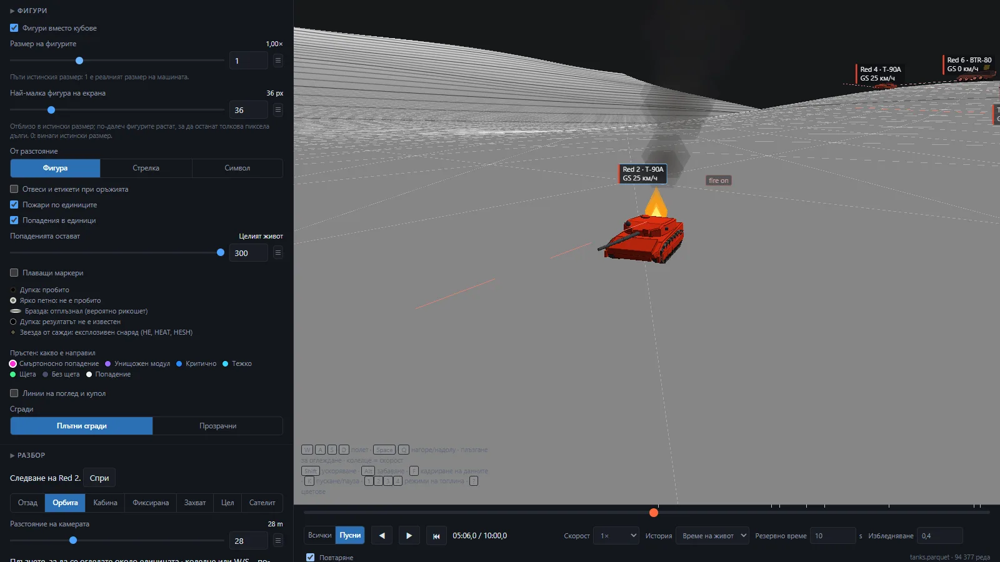
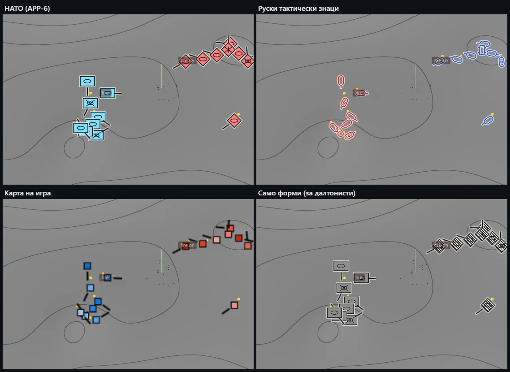
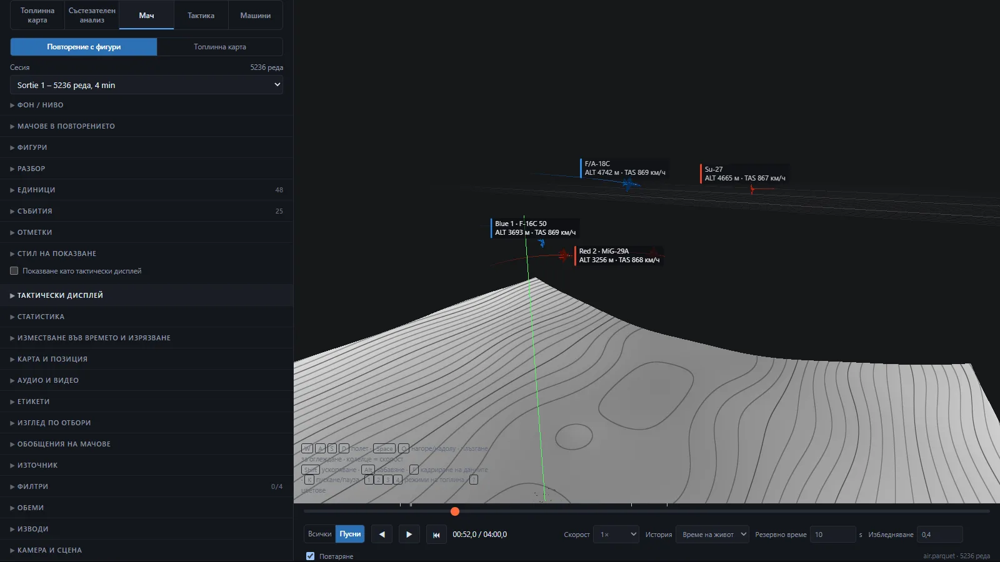

# Разбор на мач

Разборът е филм на мача, в който всеки играч е нарисуван като това, което е управлявал. Използвайте го, за да гледате отново една схватка, да следвате една единица и да видите кой кого е улучил.

Изстрелите, попаденията, пожарите и развалините се рисуват върху единиците и целите на нивото. Камерите, етикетите и тактическият дисплей ви помагат да прочетете схватката. Знаете ли Tacview? [Съответствие с Tacview](tacview-parity.md) показва къде е всеки от инструментите му.

## Започнете разбор {#start-a-replay}

1. Заредете запис с **Източник → Файлове…** или като го пуснете върху панела Източник (всяка таблица с колона **лице** и колона **време**, файл на Tacview, преобразуван разбор, [`.3dheat`](container.md) мач). Виж [Зареждане на данни](getting-data-in.md).
2. Отворете раздела **Мач** и изберете **Повторение с фигури**, или изберете **Наслагване на фигури** в лентата с режими на раздела Топлинна карта.
3. Под **Мачове в повторението** изберете един мач, всички наведнъж или няколко.
4. Натиснете **Пусни** на времевата линия (или `K`). Плъзнете времевата линия, за да скачате.

Фигурите заменят кубовете за всяка единица, чието име или вид е известно (виж [Фигури](figures.md)). Данните без колона за име или вид се рисуват като войници.

## Фигури {#figures}

| Настройка (секция **Фигури**) | По подразбиране | Какво прави |
|---|---|---|
| **Фигури вместо кубове** | включено | Изключено рисува обикновени кубове. |
| **Размер на фигурите** (пъти истинския размер) | 1 | 1 е истински размер; от 0,25 до 20 пъти (логаритмична скала). По-големият помага от далеч. |
| **Най-малка фигура на екрана** | 36 px | Фигурите от далеч растат, за да останат толкова дълги, от 0 до 200 px; 0 пази истинския размер. |
| **От разстояние**: Фигура, Стрелка, Символ | Фигура | В какво се превръща единица от далеч. |
| **Символи** | NATO (APP-6) | NATO (APP-6), руски тактически знаци, икони **Карта на игра** или **Само форми (за далтонисти)**. |
| **Размер на символа**, **Моята страна**, **Враждебна / неутрална**, **Чертички за курс** | 28 px (от 12 до 64), автоматично, враждебна, включено | Как изглеждат символите и коя страна е приятелска. |
| **Вертикални линии** | включено | Линия от всяка единица право надолу до земята, така че височините се четат в 3D. |
| **Отвеси и етикети при оръжията** | изключено | Линии до земята и етикети на ракети и бомби. |
| **Пожари по единиците** | включено | Пламъци от момента, в който единица се запали, докато се загаси. |
| **Попадения в единици** | включено | Маркери, където са уцелили изстрелите (по-долу). **Попаденията остават**: от 1 до 300 секунди, или **Целият живот**. **Плаващи маркери**: маркери, нарисувани над повърхността. |
| **Линии на поглед и купол** | изключено | Пунктир: където гледа играчът; плътна: където сочи оръдието. |
| **Сгради** | плътни | Плътни или прозрачни сгради, когато нивото ги рисува. |

### Символи от разстояние {#symbols-at-a-distance}

Когато една единица би била по-малка от **Най-малка фигура на екрана**, тя може да се превърне в символ, който остава четлив. Формата казва вида (например закръглена кутия с маркировка за верига за бронирана машина); цветът казва страната. Отворете менюто **Символи**, за да смените стила.

### Маркери на попаденията, развалини и пожари {#hit-marks-wrecks-and-fires}

- **Маркерите на попаденията** стоят върху повърхността, която изстрелът е срещнал, в мащаба на фигурата. Видът им казва какво е станало: дупка (минал е), ярко пръскане (не е минал), драскотина (отскочил), сажд звезда (експлозивен снаряд). Цветен пръстен казва какво е направил: фатален изстрел, унищожен модул, критично, тежко, щета, без щета, попадение. Задръжте курсора върху маркер, за да видите името на снаряда.
- Унищожена единица се рисува **овъглена** като развалина от смъртта си до възраждането или премахването ѝ; символът ѝ е зачеркнат.
- **Пожарите** горят върху единица от момента, в който се запали, докато се загаси.
- **Купалите** се завъртат към мястото, където данните казват, че сочи оръдието (или, без тях, където гледа играчът).

### Оръжия, примамки и трасиращи изстрели {#weapons-decoys-and-tracers}

С включено **Оръжия, изстрели и попадения** (секция Изглед по отбори): ракетите, снарядите, бомбите и торпедата летят като собствени фигури със следа от дим; куршумите и снарядите са трасиращи изстрели; попаденията и взривовете светкавично проблясват. Трасиращ изстрел, нарисуван **пунктирано**, е изведен от попадение, защото данните нямат самия изстрел. Светлинните и пасивните примамки се рисуват като примамки; те са скрити от списъка с единици, освен ако е отметнато *Примамки и снаряди*.

## Камери {#cameras}

Щракнете върху единица или етикета ѝ, за да я **следвате**; секцията **Разбор** предлага **Отзад**, **Орбита**, **Кабина** (с индикатори на екрана, `H`), **Фиксирана**, **Захват**, **Цел** и **Сателит**. `V` ги сменя циклично, **Разстояние на камерата** задава колко далеч. Esc спира.

- **Изглед на две единици**: изберете **Цел** (или Ctrl/Alt-щракване върху единица), за да я гледате от следваната. **Размяна** ги разменя.
- **Измерване**: Shift-щракване върху две единици за азимута, разстоянието и разликата във височината между тях.
- **2D карта** (`M`): ъгъл или цял изглед, със следи и имена.
- **Отметки** (`B`): запазва момента и камерата; собствените убийства, смъртни случаи и маркери на записа също са изброени.
- **Събития**: всяко събитие в ред по време; щракване отива там. `Page Up` / `Page Down` скачат между събитията; **Пауза при събитие** спира при всяко.

## Тактически дисплей {#tactical-display}

Секцията **Тактически дисплей** рисува, за никоя единица, избраните, всички или един вид (самолети, наземни, кораби, оръжия): вектори на скоростта и пътя напред, линии на носа и на лифта, радарни конуси, захващания, канали за данни, зони и линии на въздействие, линии на видимост, където гледат играчите (конуси на погледа), прицелването на купола и записаната камера.

### Стил на дисплея {#display-style}

`T` (или превключвателят **Показване като тактически дисплей**) превключва вида към стил на радарен екран: сияние, контури, изолинии, мрежа за измерване, сканиращи линии, пръстени за обхват, скали на височината, панели с убийства и събития и **Режисьор**, който сам премества камерата към събитията.

## Цели {#objectives}

Когато мач идва с целите си, секцията **Цели** ги рисува върху нивото: зони за превземане (с притежател и напредък на превземането), места на появяване, летища, области и цели за бомбардиране, като всеки слой се включва и изключва, с етикети. Виждат се през терена. Когато са заредени няколко игрови режима, **Режим** филтрира мачовете по режим. Целите идват от мачовия файл на конвертора до записа или в контейнер [`.3dheat`](container.md).

## Етикети и статистика {#labels-and-statistics}

- **Етикети**: правила за всеки вид (**Избрани**, **Самолети**, **Наземни**, **Кораби**, **Оръжия**, **ИИ**): показани или не, кои стойности, и **Приоритет** за това кой получава мястото, когато етикетите се застъпват. **Раздалечаване на етикетите** премества етикет до своята единица, когато би покрил друга, и го пропуска там, където няма място. **Размер на етикетите** е от 60 до 250 %. **Обратно към име, техника, височина и скорост** възстановява правилата.
  - Наземните единици започват с име, техника и скорост.
  - Самолетите започват с име, техника, височина и скорост.
  - Корабите започват с име, техника, скорост и курс.
  - Задръжте курсора върху единица, за да видите всяка стойност, която има.
- **Статистика**: за всеки отбор и единица: убийства, смъртни случаи, изстрели, попадения, процент на попаденията, излитания, кацания, време във въздуха, най-голяма скорост, височина и G, разстояние. Износ в CSV.
- **Графики**: стойностите на единица във времето, две единици сравнени, или една стойност спрямо друга.

## Много мачове наведнъж {#many-matches-at-once}

За да наслоите стотици или хиляди мачове един върху друг, виж [Много мачове наведнъж](many-matches.md). Подробности за фигурите (дим, пожар, други времеви ефекти): [Фигури в наслагването на фигури](figure-replay.md). Списък на функциите на Tacview: [Съответствие с Tacview](tacview-parity.md), подстраница на тази.
