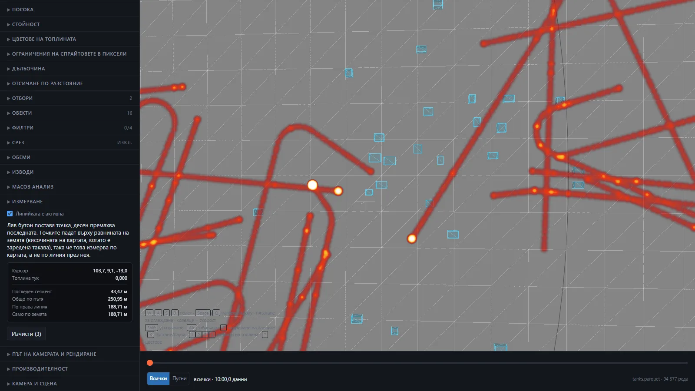

# Измерване

**Измерване** превръща мишката в линийка и ти казва колко е натоварено мястото под курсора. Използвай го, за да разбереш на колко разстояние са две места или колко трафик има на едно място.

## Опитай {#try-it}

1. Отвори **Измерване** в страничната лента и отметни **Линийката е активна**.
2. Кликни с левия бутон на три места на картата. Всеки клик поставя точка.
3. Прочети **Общо по пътя** (дължината на целия път) и **Последен сегмент** (последният участък).
4. Кликни с десния бутон, за да махнеш последната точка, или натисни **Изчисти (3)**, за да махнеш всички.

| Действие | Ефект |
|---|---|
| Ляв клик | Поставя точка там, където курсорът среща равнината на земята. Клик, при който мишката е изминала повече от 4 пиксела между натискането и отпускането, е провлачване на камерата, а не точка. |
| Десен клик | Премахва последната точка. |
| Движение | Позицията на курсора и топлината под него се обновяват на живо. |

Камерата продължава да работи, докато линийката е включена: провлачването все още гледа наоколо, клавишите все още летят. Докато е включена, тя поема всеки клик, затова [избор с клик](camera.md#click-to-pick) чака да се изключи.

**Равнината на земята** е височината на [картинката на картата](map-images.md), когато е заредена картинка на картата; иначе е най-ниската Y на набора данни (0 без такава). Точките се поставят върху нея, така че линийката мери през картата, а не по права през нея. При 3D ниво равнината все още е най-ниската Y на набора данни, а не повърхността на нивото - за точка на истинската повърхност изключи линийката и кликни върху нея ([избор с клик](camera.md#click-to-pick)), който чете координатите от собствените триъгълници на нивото.

## Показания {#readouts}

| Ред | Значение |
|---|---|
| **Курсор** | Световните X, Y, Z на точката под курсора, върху равнината. |
| **Топлина тук** | Колко е топлината на пиксела под курсора. По-голямо число означава повече трафик на това място. Това е стойността, която се подава на цветовата скала, преди точката на насищане да я раздели, така че можеш да я сравниш с [Точката на насищане](colour-and-exposure.md#saturation-point). |
| **Последен сегмент** | Разстоянието от последната точка до курсора (или между последните две точки). |
| **Общо по пътя** | Дължината на начупената линия през всяка точка и курсора. |
| **По права линия** | 3D разстоянието от първата точка до курсора (или последната точка). |
| **Само по земята** | Същото, само по X и Z. |
| **Изчисти (N)** | Премахва всички точки. |

Разстоянията се показват в сантиметри под 1 единица, в метри под 1000, в километри над това - като се приема, че една световна единица е метър ([Оси, единици и време](axes-units-and-time.md#unit-scale)). Координатите са световни, включително когато една ос е [обърната за показване](camera.md#invert-world-axis).

Точките и линията между тях се рисуват като наслагване в изгледа, с размер според разстоянието между мрежовите линии. Точките на линийката не се запазват в изгледите; остават, когато зареждаш други данни.

## За разработчици {#for-developers}

**Топлина тук** се чете от GPU най-много на всеки 120 ms, защото четене на един пиксел спира конвейера. Използва същия път като `engine.readHeatProbe()`: делено на усилването, с което е записан кадърът, така че на пътя на натрупване с half-float (`?heat=f16`) е в същите единици като на цел от 32 бита ([Натрупване с half-float](half-float-accumulation.md)).
