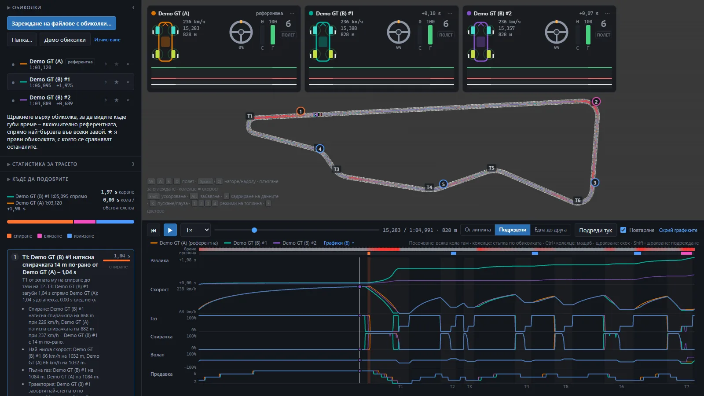

# Състезателен анализ

Карали сте същото трасе два пъти. Разделът **Състезателен анализ** пуска и двете карания заедно в 3D, показва
къде една обиколка е била по-бавна и ви казва защо. Още няма обиколки? Натиснете **Демо обиколки**.

Разделът сравнява две или повече обиколки на едно трасе. Той споделя платното, камерата и заредения модел на
трасето (**Фон / ниво**) с топлинната карта; всичко останало е собствено: собствен страничен панел и собствена лента
под изгледа. Думи като *обиколка*, *референтна* и *връх на завой* са в [речника](glossary.md).

Тази страница е картата на раздела. Всяка част има своя страница:

| Страница | Какво обхваща |
|---|---|
| [Зареждане на обиколки](race-loading-laps.md) | всеки формат на файл, папките и трасетата, имената на колите, демо обиколките, списъкът с обиколки, референтната и фокусът |
| [Повторение и 3D сцената](race-replay-and-scene.md) | лентата за управление, трите режима на повторение, подреждането на колите, камерата след колата, линиите, картите, колите, етикетите, огледалните светове |
| [Графики и HUD](race-charts-and-hud.md) | графиките по разстояние, избирането на графики, посочване и мащаб, картите на колите, таблицата на каналите |
| [Събития за контрол над колата](race-control-events.md) | блокиране, буксуване, поднасяне, завъртане, изнасяне, удари, катастрофи, ABS/TC, ръчна спирачка, във въздуха - как се открива всяко, с всеки праг |
| [Анализ завой по завой](race-corner-analysis.md) | подравняване по разстояние, завои и сегменти, времевата сметка на завой, всяка причина и редът, в който се пробват, формата на линията и съветът |
| [Профили на колите и сравнение](race-car-profiles.md) | какво може всяка кола, измерено от обиколките ѝ; *Сравнение на колите*; какво решава колата във всеки завой |
| [Статистика за трасето](race-course-statistics.md) | много обиколки на едно трасе: грешки по завой и по вид, картата на грешките, експортът към топлинната карта, ограниченията на представянето |
| [Анализ на състезания: методът](race-analytics.md) | изследванията зад правилата, с източници |
| [Други състезателни игри](other-games.md) | какво прави визуализаторът с обиколки от всяка игра: приплъзване и дрифт, изчислени там, където играта не ги изпраща, огледални светове, допълнителните канали |

## Екранът {#the-screen}

**Страничният панел**, отгоре надолу (разделите могат да се свиват):

1. **Обиколки** - зареждане, списък, показване/скриване, референтна, фокус, преследване.
   Вижте [Зареждане на обиколки](race-loading-laps.md).
2. **Статистика за трасето** - само от три заредени обиколки нагоре.
   Вижте [Статистика за трасето](race-course-statistics.md).
3. **Къде да подобрите** - констатациите на фокусираната обиколка, завой по завой.
   Вижте [Анализ завой по завой](race-corner-analysis.md).
4. **Завой по завой** (или *Завой по завой - клас X* при няколко класа) - най-бързата обиколка през всеки завой и
   нейната линия. Показва се при две или повече обиколки.
5. **Контрол над колата** - блокировките, плъзгането, изнасянията и ударите на фокусираната обиколка.
   Вижте [Събития за контрол над колата](race-control-events.md).
6. **Сравнение на колите** (или **Колата**, когато е една кола) - вижте
   [Профили на колите и сравнение](race-car-profiles.md).
7. **Изглед** - коя карта е нанесена върху трасето и какво се рисува.
   Вижте [Повторение и 3D сцената](race-replay-and-scene.md).
8. Общите панели **Ниво** и **Камера и сцена** (модел на трасето, обръщане на осите, камера) - описани при
   топлинната карта и в [Камера](camera.md).

**Изгледът** показва трасето, нарисуваните линии, картата, колите, етикетите, закачени за трасето, и до шест карти
на колите горе вляво (вижте [Графики и HUD](race-charts-and-hud.md)). Без заредени обиколки пише
"Няма заредени обиколки - пуснете тук два или повече файла с обиколки или заредете демо обиколките от страничния панел."

**Лентата под изгледа** държи управлението на повторението и, ако не е скрита, графиките по разстояние.

## Бърз старт {#quick-start}

1. Отворете раздела **Състезателен анализ** (до **Топлинна карта** горе в страничния панел).
2. Заредете обиколки. Натиснете **Демо обиколки**, за да видите какво прави разделът с три измислени обиколки. За
   собствени обиколки първо ги запишете ([форматите на файлове и записвачите](race-loading-laps.md#file-formats)), после натиснете
   **Зареждане на файлове с обиколки…** или **Папка…**, или пуснете файлове или папки върху изгледа.
3. Най-бързата завършена обиколка става референтна; най-бавната от останалите е фокусирана. Щракнете върху
   всяка обиколка в списъка, за да я фокусирате; ★ прави обиколката референтна.
4. Прочетете **Къде да подобрите**. Щракнете върху констатация: колите се подреждат 40 m преди нея, камерата я кадрира,
   повторението преминава през нея и се отварят измерванията.
5. Посочете графиките, за да преместите всяка кола на този метър; Shift+щрак, за да ги подредите там.

## Клавиатура {#keyboard}

Докато е отворен разделът Състезания:

| Клавиш | Действие |
|---|---|
| **K** | пуска / паузира повторението |
| **Home** | връща към началото на повторението |
| цифрови клавиши | нищо (в топлинната карта превключват режимите) |

Клавишите, въведени в текстово поле или падащо меню, се игнорират. Клавишите на камерата работят както в топлинната
карта (**W A S D**, **Интервал** нагоре, **Q** надолу, **Shift** по-бързо, **Alt** по-бавно, мишката за оглеждане;
всичко е в [Камера](camera.md)); **F** кадрира заредените обиколки (както го прави зареждането на обиколки).

## Много обиколки {#many-laps}

- Всички заредени обиколки се анализират и се броят; десетки отнемат секунда или две.
- Над **8** обиколки (`SHOW_ALL_UP_TO`) добавените обиколки се рисуват само когато са референтната, фокусираната или
  най-добрата обиколка в класа на фокусираната. Превключват се *Покажи всички* / *Само разглежданите*.
- Над **10** видими коли (`PLAIN_PAST`) обиколките, които не се разглеждат (не фокусираната, не преследваната кола и не
  референтната), се рисуват с линии, изтънени до точка на всеки 6 m вместо на 1.5 m, и с прости коли.
- Графиките рисуват най-много **8** обиколки; HUD показва най-много **6** карти.
- Статистиката на трасето се появява от **3** обиколки.

Подробности: [Статистика за трасето](race-course-statistics.md#performance-with-many-laps).

## Настройки по подразбиране на изгледа {#default-view-settings}

| Настройка | По подразбиране |
|---|---|
| Карта | Времева карта |
| Линии по карането, Коли, Гуми и окачване, Етикети, Трасе от обиколките | включено |
| Всички стойности на картите | изключено |
| Размер на колата | 1× |
| Графики | показани |
| Режим на повторение | От линията |
| Скорост на повторението | 1× |
| Цикъл | включено |

Нищо от това не се пази; презареждането започва от стойностите по подразбиране. Какво се помни в браузъра: езикът
и имената на колите, научени от файловете с обиколки (вижте [Зареждане на обиколки](race-loading-laps.md#car-names)).

## За разработчици {#for-developers}

### Какво се случва, когато се заредят обиколки {#what-happens-when-laps-are-loaded}

При всяка смяна на набора обиколки, на референтната или на езика целият анализ се прави отново (`analyse` в
[`src/race/analysis.ts`](https://github.com/Holdi601/3DHeat/blob/main/src/race/analysis.ts)):

1. Към всяка обиколка се добавят изведени канали там, където играта не ги изпраща: ъгъл на дрифт, приплъзване на колелата
   от скоростите им, във въздуха, разхлабена настилка, скорост на завъртане ([`derive.ts`](https://github.com/Holdi601/3DHeat/blob/main/src/race/derive.ts)).
2. Референтната се избира и всяка обиколка се проектира върху пътя ѝ и се преизчислява на всеки 2 m ([`align.ts`](https://github.com/Holdi601/3DHeat/blob/main/src/race/align.ts)).
3. От обиколките се определя дали светът на играта е огледален ([`handedness.ts`](https://github.com/Holdi601/3DHeat/blob/main/src/race/handedness.ts)).
4. Завоите се намират на референтната и се групират в сегменти от една спирачна зона до следващата ([`segments.ts`](https://github.com/Holdi601/3DHeat/blob/main/src/race/segments.ts)).
5. За всяка кола: нейната обвивка (сцепление, спиране, тяга според скоростта), профилът ѝ, кривите на гумите ѝ
   ([`envelope.ts`](https://github.com/Holdi601/3DHeat/blob/main/src/race/envelope.ts),
   [`profile.ts`](https://github.com/Holdi601/3DHeat/blob/main/src/race/profile.ts),
   [`control.ts`](https://github.com/Holdi601/3DHeat/blob/main/src/race/control.ts)).
6. За всяка обиколка и сегмент: какво е направила (точка на спиране, най-бавна точка, пълна газ, ...) и линията, която е карала
   ([`line.ts`](https://github.com/Holdi601/3DHeat/blob/main/src/race/line.ts)).
7. За всяка обиколка: нейните събития за контрол над колата, всяко поставено спрямо обиколката, с която се сравнява там.
8. За всяка обиколка и сегмент: времевата сметка спрямо нейната сравнителна обиколка и констатацията с думи.
9. Времевата карта и картата на причините за всяка обиколка.

Текстовете се създават на текущия език; смяната на езика пуска анализа отново (и преименува демо обиколките).
Грешка в анализа се показва под бутоните **Обиколки** като грешка, а обиколките остават заредени.

### Изходни файлове {#source-files}

| Файл | Роля |
|---|---|
| `src/race/adapters.ts`, `ibt.ts` | четене на файлове с обиколки |
| `src/race/lap.ts`, `carNames.ts`, `synthetic.ts` | типът обиколка, наименуването, демо обиколките |
| `src/race/derive.ts`, `handedness.ts` | изведени канали, огледални светове |
| `src/race/align.ts`, `segments.ts`, `line.ts` | ос на разстоянието, завои, линии |
| `src/race/analysis.ts` | сравнени завои, причини, констатации |
| `src/race/envelope.ts`, `profile.ts` | какво може една кола |
| `src/race/control.ts`, `impacts.ts` | контрол над колата, удари и катастрофи |
| `src/race/stats.ts` | много обиколки |
| `src/race/replay.ts`, `scene.ts`, `glyph.ts`, `geometry.ts` | повторение и рисуване |
| `src/race/schema.ts`, `graphs.ts` | таблицата на каналите, редовете на графиките |
| `src/ui/race/*` | страничният панел, графиките, HUD, етикетите |
| `src/state/raceStore.ts` | състоянието на раздела и часовникът на повторението |
